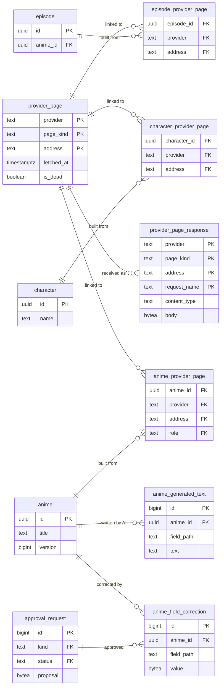
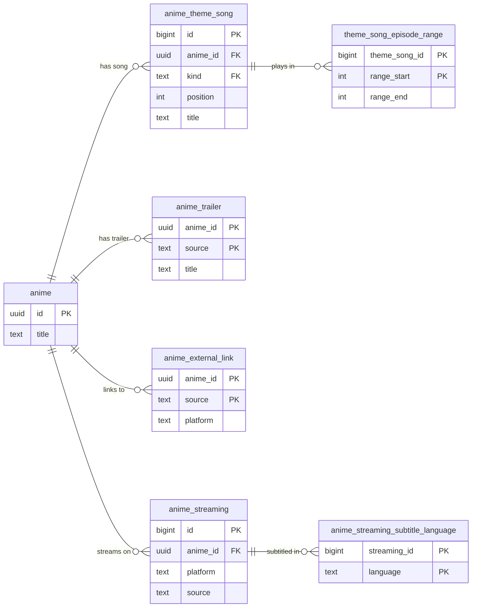
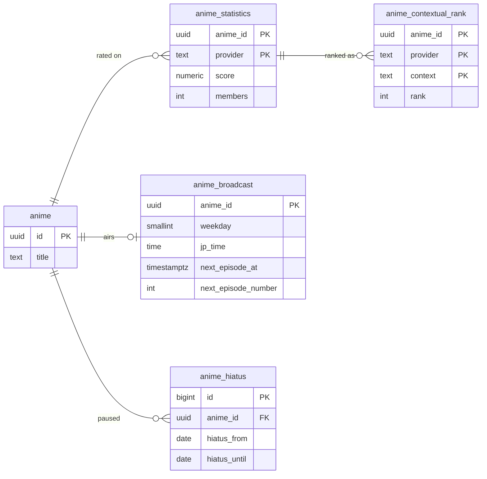
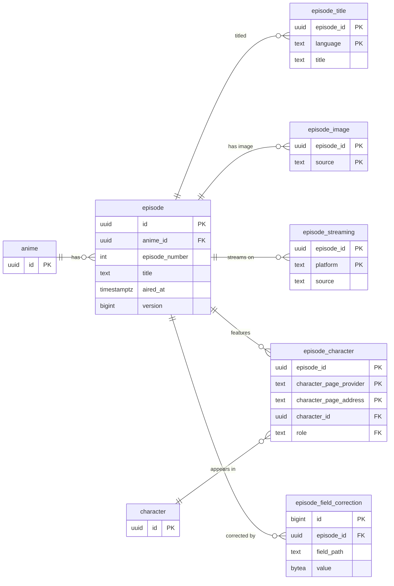
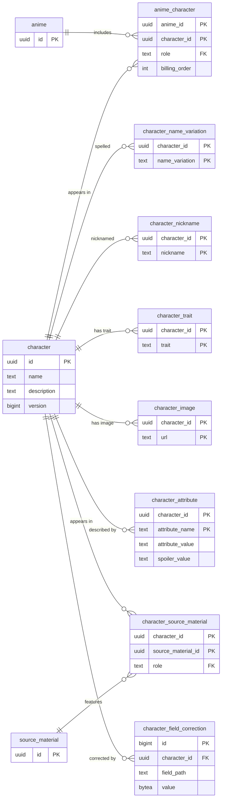
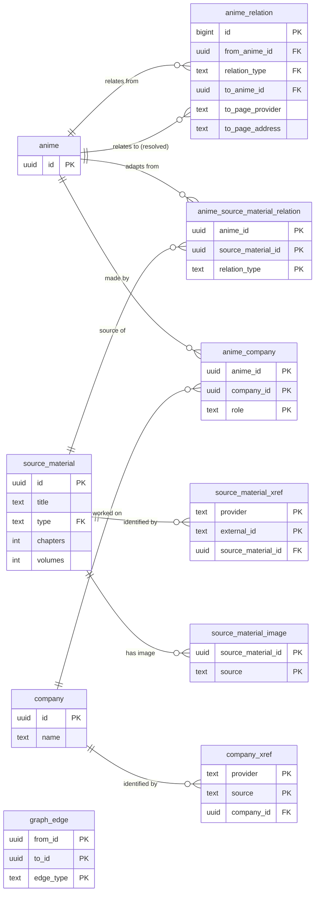

# Database Schema

PostgreSQL schema of the catalogue, owned by the [[postgres_integration_architecture_decision|PostgreSQL Service]].

> [!info] Design Approach
> - **Provider pages are stored as fetched.** Each page keeps the raw responses its provider sent, so any entity can be merged again at any time without fetching anything.
> - **Entities are built from pages.** A work, an episode and a character each link to their own provider pages, and each holds its merged record.
> - **Every field is a column or a table.** No JSONB. Each list, map and nested object of the canonical models in `libs/common/src/common/models/anime.py` has its own table, and every table is normalized to fifth normal form.

Every stage of enrichment is stored, so nothing has to be fetched again to rebuild an entity:

| Stage | Where it is stored | Written by |
|---|---|---|
| ~~Each provider page, as received~~ | ~~`provider_page`, `provider_page_response`~~ | ~~`StorePage` (ECHO-97)~~ |
| Which pages make up an entity | `anime_provider_page`, `episode_provider_page`, `character_provider_page` | Merges, which link the pages they read (ECHO-97) (ECHO-104, ECHO-107) |
| Which pages make up an entity | `anime_provider_page` | Seed load and review answers, which create works and move pages (ECHO-107) |
| Approved corrections | `anime_field_correction` and the episode and character ones | Approval queue (P-ECHO-15) |
| AI-written text | `anime_generated_text` | `WriteSynopsisWorkflow` (ECHO-115) |
| ~~The merged work, as users see it~~ | ~~`anime` and its detail tables~~ | ~~`SaveAnime` (ECHO-98)~~ |
| ~~The merged episode~~ | ~~`episode` and its detail tables~~ | ~~`SaveEpisode` (ECHO-103)~~ |
| The merged character | `character` and its detail tables | `SaveCharacter` (ECHO-104) |

Mapping a page to the canonical model happens in memory during each merge and is never stored. A mapper fix therefore reaches every entity on its next merge without fetching again.

## Entity Relationship Diagrams

The schema is split into seven diagrams. Lookup tables (`anime_type`, `provider` and the others in [[#Lookup Tables]]) and the shared name tables (`genre`, `tag` and the others) are left out, since each is a single `value` or `name` column.

### Provider pages and the entities built from them

How every entity links to the pages it is merged from, and the tables that change a merge.



### Anime names and classification

Titles, synonyms, genres, tags, demographics, content warnings, themes and images of `Anime`.


### Anime songs, streaming and links

Theme songs with the episodes they play in, streaming entries with their subtitle languages, trailers and external links of `Anime`.



### Anime statistics and schedule

Provider statistics with their contextual ranks, the broadcast slot and the hiatus history of `Anime`.



### Episodes



### Characters

Characters are shared between works, so a work links to them through `anime_character`.



### Relations, source material and companies

How works link to each other, to source material and to companies, and the graph projection built from them.



## Design Principles

### 1. Entities Built From Provider Pages

Each entity is stored **once** under a UUIDv7 ID:
- `anime`: one row per work
- `episode`: one row per episode of a work
- `character`: one row per character
- `source_material`: one row per source work (manga, light novel, visual novel, game, and so on)
- `company`: one row per studio, producer or licensor

**IDs are assigned once,** when the entity is first created, and never change, so nothing is derived from provider URLs.

- IDs are UUIDv7, from `uuid.uuid7()` through `generate_entity_id` in `libs/common`. (ECHO-88)
- A work from the seed gets its ID when the seed load creates it. (ECHO-107)
- An episode or character gets its ID from the merge of the work that first lists it, and every later merge receives that ID and keeps it. (ECHO-105)
- ~~Rows the PostgreSQL Service creates by itself, `source_material` and `company`, get `DEFAULT uuidv7()`. (ECHO-102)~~

**Pages identify what arrives from outside.** Inside the system, only the UUID is used.

- ~~A provider page is stored once under its page key: provider, page kind and address, such as `mal`, `anime`, `21`. (ECHO-97)~~
- When a seed release or discovery brings page keys, a key already linked as a source belongs to that entity. A key never seen before is a new entity, unless the matching rules or a review answer place it elsewhere. (ECHO-107)

A work page is linked to a work in one of two roles:
- ~~**`source`**: the page lists this work. The page is merged into the work. A work has at most one source page per provider. (ECHO-97)~~
- ~~**`partial_source`**: the page lists a larger work this work is part of. The page is linked for reference and is not merged. (ECHO-97)~~

A page can be a source of one work and a partial source of several. The works that share a page are partial sources of each other both ways. Episode and character pages have no roles: each belongs to exactly one episode or character. (ECHO-97) (ECHO-107)

**Example**: "One Piece" is one `anime` row with one source page each from MAL, AniList, Kitsu, AniDB and the other providers, and each of its episodes and characters links to its own pages the same way.

---

### 2. Unresolved Edge Pattern

**Problem**: When work A is saved, related work B may not exist yet.

~~**Solution**: Store the relationship at once with a nullable foreign key (ECHO-102)~~
- Insert the edge with `to_anime_id = NULL`
- Store the target page (`to_page_provider`, `to_page_address`)
- Resolve the foreign key when that page becomes a source of a work

```sql
-- Unresolved edge (ECHO-102)
INSERT INTO anime_relation (from_anime_id, relation_type, to_page_provider, to_page_address)
VALUES ('uuid-a', 'SEQUEL', 'anilist', '141902');

-- Later: resolved by the transaction that links the page to work B (ECHO-107)
UPDATE anime_relation
SET to_anime_id = 'uuid-b'
WHERE to_anime_id IS NULL AND to_page_provider = 'anilist' AND to_page_address = '141902';
```

**Benefits**:
- Save works in any order
- Show the link before the target exists
- Graph queries use only resolved edges (`WHERE to_anime_id IS NOT NULL`)

~~The same pattern links an episode to a character that is not stored yet (`episode_character`). (ECHO-103)~~

~~Source material needs no unresolved state: a related source work always carries a title and type, so `SaveAnime` creates or finds its row through `source_material_xref` in the same transaction. (ECHO-102)~~

**Who asserts an edge:**
- ~~`anime_relation` holds only what each work's own provider pages say, in one direction, from that work. When work A lists B as a sequel and B lists A as a prequel, there are two rows, one asserted by each work. (ECHO-102)~~
- ~~`SaveAnime` replaces the work's own `anime_relation` rows with what the merge produced. It never touches rows another work asserted. (ECHO-102)~~
- ~~`SaveAnime` replaces the work's own `anime_relation_claim` rows with the providers' claims the merge passed on, so the provenance always matches the stored relations. (ECHO-102)~~
- ~~Both directions exist only in `graph_edge`. The `graph_edge` rows between two works are recomputed from both works' `anime_relation` rows and the inverse map whenever either work's relations change, so removing one work's assertion never removes an edge the other work still asserts. (ECHO-102)~~
- ~~Before recomputing a pair, the save takes a transaction-level advisory lock on that pair. `pg_advisory_xact_lock` takes a `bigint`, so the key is a 64-bit hash of the pair's two IDs in sorted order. A save that touches several pairs takes their locks in ascending order of those hashed keys, never of the raw IDs, since the hash does not keep the IDs' order. Two related works saving at once therefore recompute their pair one after the other, each reading the other's committed rows, and cannot deadlock. A hash collision only makes two unrelated pairs wait for each other. (ECHO-102)~~
- Any transaction that links a page as a source of a work resolves every unresolved relation pointing at that page, and recomputes the `graph_edge` rows of each pair it resolves.
  - ~~A save resolves them when it links a page. (ECHO-102)~~
  - `CreateAnime` and `RelinkPages` resolve them when they link a page. (ECHO-107)

---

### 4. Writes and Deletes

~~**Write order.** A save upserts rows in shared tables (`genre`, `tag`, `company`, `source_material`, `character`, `graph_edge`) inside one transaction. Each save sorts its keys and writes every table in a fixed order, so two refreshes saving at the same time take their locks in the same order and cannot deadlock. (ECHO-98)~~

**Version.** An entity's `version` increases with every change to the entity or to what its merge reads. A merge that loaded before such a change then fails its version check and starts again from a fresh load. Versions only need to grow, so a version without an event of its own is fine.

- A save that changes the entity increases it, and so does a new correction. (ECHO-98) (ECHO-132)
- A page relinked to or from a work, by `CreateAnime` or `RelinkPages`, increases the work's version. (ECHO-107)
- A new AI-written text, saved by `SaveGeneratedText`, increases the work's version. (ECHO-115)

**Characters a save creates.** Before creating a character the merge gave a new ID, `SaveAnime` looks up its page keys in `character_provider_page`. When any of them already belongs to a character, such as one another work's save created a moment earlier, it links that character instead and the new ID is dropped. A save therefore never fails on a character another work created, and never loops. (ECHO-104)

**Not yet merged.** A work exists before its first merge. Episodes and characters a work's save creates follow the same rule: they exist from the work's lists, and their own first merge sets `merged_at`.

- The seed load creates the work with its ID and page links, and nothing has been fetched. A linked page that was never fetched has a NULL `fetched_at` and `responses_hash`, which also makes it due. (ECHO-107)
- ~~The work's `merged_at` is NULL, so `title`, `type` and `status` may be empty, and a check constraint requires all three once `merged_at` is set. The save that first sets `merged_at` writes the `created` event; every later changing save writes `updated`. (ECHO-98)~~
- Every read for consumers and the backend (`Get*`, `ListEpisodes`, `ListScoreAnime`, `ListUpcomingEpisodes`, the graph primitives) reads the `*_visible` views, which skip rows whose `merged_at` is NULL. The due queries do not: an unmerged work has never been refreshed, so it is due. (ECHO-108)

**Recording a refresh.** `RecordRefresh`, the last activity of every refresh, sets `next_refresh_at`, the one column every due check reads:

- **Every page fetched or not due:** `refreshed_at = now()`, `refresh_failures = 0`, and `next_refresh_at = now() + REFRESH_AFTER_DAYS`, whether the merge changed something, changed nothing or did not run. (ECHO-108)
- **Some pages failed:** the same, except `next_refresh_at` is the earliest time a failed page may be tried again, `2^fetch_failures` hours after its failure, at most a week. A page that failed is not hidden until the next weekly sweep. (ECHO-108)
- **The refresh failed:** `refresh_failed_at = now()`, one more `refresh_failures`, and `next_refresh_at = now() + 2^refresh_failures` hours, at most a week, so a work that keeps failing is not picked by every sweep and every open. (ECHO-108)

The workflow passes `REFRESH_AFTER_DAYS` with the call, since the setting belongs to the Update Service. (ECHO-108)

~~A page that fails every fetch attempt records `fetch_failed_at` and `fetch_failures` through `StorePage`, and the refresh goes on without it. (ECHO-97)~~

**Visible rows.** Reads for consumers and the backend go through the `anime_visible`, `episode_visible` and `character_visible` views, which hold only merged, undeleted rows.

- ~~The views are created with their tables. (ECHO-98)~~
- Loads for merging, `ListEntityPages` and the due queries read the tables, since unmerged entities must be loaded and are due. (ECHO-108)

**Purging deleted rows.** A deleted entity keeps its own row for good, with its ID, version, `deleted_at` and `merged_into_anime_id`, so old links and users' lists can be redirected. Its detail rows (titles, genres, images and the others) are purged 30 days after the delete by the cleanup job. Unique constraints that a deleted row could block, such as an episode's number, count only undeleted rows. (ECHO-116)

**Missing and dead pages.** A seed release never removes a work or a page; it only adds them and moves pages between works. A page is found to be gone only by a refresh. When `FetchPage` reports the provider's own "not found" (not a block or an error), `StorePage` records `missing_since` and counts `missing_answers`, and keeps the page's last stored responses, which still take part in merges. After two such answers at least a day apart, with no successful fetch between them, the page becomes a `dead_page` approval item. A reviewer's approval sets `is_dead`, which takes the page out of merges and refreshes; a rejection clears the count. Once reviews of a provider's dead pages keep being confirmed, its `DEAD_PAGE_REVIEW` setting is turned off and two answers a day apart set `is_dead` directly. A successful fetch clears both `missing_since` and `missing_answers`, so two isolated answers months apart never add up to a review item. (ECHO-97) (ECHO-131)

**Merges the database requests.** A change made in the database that the next merge must see sets `merge_requested_at` on the entity in the same transaction: `CreateAnime`, `RelinkPages`, a new AI-written text, and an approved correction, dead page or character merge. The caller also sends the entity's refresh `merge_requested` at once, so the merge usually runs within seconds. The column guarantees it runs even when that signal is lost or nothing is refreshing the entity, such as a finished work's episode the sweep skips.

- ~~The save that follows clears the column, changed or not. (ECHO-98)~~
- `ListRequestedMerges` returns such entities whatever their age, status or `next_refresh_at`. (ECHO-108)
- A pass every 15 minutes reads `ListRequestedMerges` and sends each entity's refresh `merge_requested`. (ECHO-117)

**Approvals apply themselves.** `DecideApproval` records a reviewer's decision and, when approved, applies it in the same transaction: inserts the correction, moves the pages, sets `is_dead`, or merges two characters, and sets `merge_requested_at` on every entity it touched. It refuses a correction whose `field_path` the model does not have. Renaming a field includes a migration that renames the stored paths, and the daily cleanup job reports any stored correction whose path no longer names a field. (P-ECHO-15)

**Merging two characters.**

- Characters are matched across providers with Jev, and an uncertain match becomes a `character_match` review item, as work matching does. (ECHO-110)
- Two stored characters can still turn out to be one, when a character was first created from one provider in one work and from another provider in another. Finding such pairs is the character deduplication project. (P-ECHO-23)
- The older ID survives (UUIDv7 IDs sort by creation time). In one transaction, the newer character's page links, cast rows, episode appearances and graph edges move to the survivor, and the newer character keeps its row with `deleted_at` and `merged_into_character_id`, sends `character.deleted`, and the survivor gets `merge_requested_at`. Until reviews keep confirming them, such merges go through review like dead pages. (ECHO-104)

**The merge version.** A mapping fix reaches every entity this way, including finished works and those over 30 years old, with no separate workflow.

- ~~Each entity stores the `merge_version` of the code that last merged it. (ECHO-98)~~
- The due queries also return entities whose `merge_version` is older than the current one, whatever their age, status or `next_refresh_at`. Raising the version makes every entity due at once. (ECHO-108)
- Their refresh merges them from stored pages without fetching, so they cannot use up any provider's rate. They run at priority 4 with the fairness key `remerge`, below the sweep's priority 3, so the weekly refreshes go first. (ECHO-111)

~~**The change hash.** `merged_record_hash` is computed over a canonical form of everything the save writes: the merged entity and its episode and character lists. Maps are encoded in key order (`prost` is configured to generate `BTreeMap` for map fields, since its default `HashMap` encodes in a different order on every run), and the merge returns every list sorted. `hash_format` records the form used, so changing it is a planned re-save of every entity, not an accident. (ECHO-98)~~

~~**`updated_at`.** The save that changes a row sets `updated_at = now()` in the same statement. There is no trigger. (ECHO-98)~~

A page view writes nothing: the backend decides whether an entity is due from the `next_refresh_at` that `Get*` returns. (ECHO-108)

**Deleting an entity.** An entity is removed by setting `deleted_at`, never by deleting its row, so consumers can still read its version. Foreign keys with `ON DELETE CASCADE` do not fire on a soft delete, so the deleting transaction removes what hangs off the entity itself:

- **A work** (`DeleteAnime`, such as when merged into another): its page links are removed, so the surviving work can claim those pages as sources; its own `anime_relation` rows are deleted; relations other works assert towards it go back to unresolved, keeping their page key, so they resolve to whichever work next holds that page; and every `graph_edge` row from or to it is deleted. (ECHO-107)
- ~~**An episode**: its page links and every `graph_edge` row from or to it are deleted. (ECHO-103)~~
- **A character**: its page links and every `graph_edge` row from or to it are deleted. (ECHO-104)
- In every case the version increases once more, and the `deleted` event is written to the outbox, by the method that deletes the entity.

Every query that joins an entity filters out deleted rows. (ECHO-108)

---

### 3. Normalization

Every table is in fifth normal form:

- **1NF.** No column holds a list or group. Titles, genres, streaming links and every other list become rows.
- **2NF and 3NF.** Every column describes the whole key of its own table and nothing else. A related work's title is not copied onto the relation, a theme song's episodes are not copied onto the song, and nothing that belongs to another entity is stored twice.
- **4NF.** Facts that vary independently get separate tables. A streaming entry's subtitle languages are their own table, apart from its regions and flags.
- **5NF.** A table with three or more key columns exists only when the fact really involves all of them together. `anime_company (anime_id, company_id, role)` stays three-way, because a company can animate one work and finance another, so the role cannot be rebuilt from two-way tables.

| Decision | Rationale |
|----------|-----------|
| **No JSONB** | Every field of the canonical models has a column or a table, so every value is typed, constrained and queryable. |
| **No denormalized copies of other entities** | A related work's title, type and year are read from its own row through the link. An unresolved link shows only the link until the target is stored. |
| ~~**Lookup tables instead of CHECK constraints**~~ | ~~Enum-like columns use single-column lookup tables seeded from the enums in `anime.py`, so valid values are visible in SQL and new ones need no DDL change. (ECHO-93)~~ |
| ~~**Shared name tables**~~ | ~~Genres, tags, demographics, content warnings and character traits are rows in `genre`, `tag`, `demographic`, `content_warning` and `trait`, linked per entity, so each name is stored once. (ECHO-93)~~ |
| **`episode_count` is the provider's total** | It is the number of episodes providers report for the work, which can be ahead of the episodes stored. It is not a count of `episode` rows. |
| **`score_weighted`, `score_mean`, `score_median` are columns** | `ScoreCalculations` has exactly three values, each depending only on the work. |
| ~~**Hiatus history**~~ | ~~Each change of the hiatus snapshot adds a row to `anime_hiatus`, so the frontend can show a work's pauses. The current hiatus is the latest row. (ECHO-101)~~ |
| ~~**Source material and companies deduplicate through cross-references**~~ | ~~A source URL already in `source_material_xref` or `company_xref` reuses its row. Names are never used to merge two rows, since similar names belong to different companies and works. (ECHO-102)~~ |
| ~~**Corrections are stored per entity table**~~ | ~~`anime_field_correction` has a real foreign key to its work, instead of one table with an untyped entity reference (ECHO-98)~~ |
| ~~**Corrections are stored per entity table**~~ | ~~`episode_field_correction` has a real foreign key to its episode (ECHO-103)~~ |
| **Corrections are stored per entity table** | `character_field_correction` has a real foreign key to its character (ECHO-104) |
| ~~**Typed values as protobuf bytes**~~ | ~~A correction or approval value can be any field, nested ones included. It is stored as the protobuf message of that field, with the message name beside it, and only the merge and the approval queue read it. (ECHO-98)~~ |

---

## Complete DDL

> [!info] PostgreSQL Version Requirement
> This schema requires **PostgreSQL 18+** for `uuidv7()`, used as the default ID of `source_material` and `company`. Work, episode and character IDs are assigned by the merge.

### Lookup Tables

> **Linear:** ECHO-93

~~Each lookup is seeded from its enum in `libs/common/src/common/models/anime.py`, and CI checks that the two match (see [[echora_contracts]]).~~

```sql
-- Enums of the canonical models
CREATE TABLE anime_type (value text PRIMARY KEY);
INSERT INTO anime_type VALUES
  ('CM'), ('MOVIE'), ('MUSIC'), ('ONA'), ('OTHER'), ('OVA'), ('PV'),
  ('SPECIAL'), ('TV'), ('TV SHORT'), ('TV SPECIAL'), ('UNKNOWN');

CREATE TABLE anime_status (value text PRIMARY KEY);
INSERT INTO anime_status VALUES
  ('CANCELLED'), ('FINISHED'), ('ONGOING'), ('UNKNOWN'), ('UPCOMING');

CREATE TABLE anime_rating (value text PRIMARY KEY);
INSERT INTO anime_rating VALUES
  ('G - All Ages'), ('PG - Children'), ('PG-13 - Teens 13 or older'),
  ('R - 17+ (violence & profanity)'), ('R+ - Mild Nudity'), ('Rx - Hentai'), ('UNKNOWN');

CREATE TABLE anime_season (value text PRIMARY KEY);
INSERT INTO anime_season VALUES ('SPRING'), ('SUMMER'), ('FALL'), ('WINTER');

-- Shared by anime.source_material and source_material.type
CREATE TABLE source_material_type (value text PRIMARY KEY);
INSERT INTO source_material_type VALUES
  ('BOOK'), ('CARD GAME'), ('DOUJINSHI'), ('4-KOMA'), ('GAME'), ('LIGHT NOVEL'),
  ('MANGA'), ('MANHUA'), ('MANHWA'), ('MIXED MEDIA'), ('MUSIC'), ('NOVEL'),
  ('ONE SHOT'), ('ORIGINAL'), ('OTHER'), ('PICTURE BOOK'), ('RADIO'), ('UNKNOWN'),
  ('VISUAL NOVEL'), ('WEB MANGA'), ('WEB NOVEL'), ('WEBTOON'), ('FAIRY TALE'),
  ('SHORT STORY'), ('COMIC'), ('LIVE ACTION'), ('ILLUSTRATION'), ('WESTERN MEDIA');

CREATE TABLE character_role (value text PRIMARY KEY);
INSERT INTO character_role VALUES ('BACKGROUND'), ('MAIN'), ('SUPPORTING'), ('UNKNOWN');

CREATE TABLE company_role (value text PRIMARY KEY);
INSERT INTO company_role VALUES ('STUDIO'), ('PRODUCER'), ('LICENSOR'), ('UNKNOWN');

-- Values use underscores, exactly as AnimeRelationType defines them
CREATE TABLE anime_relation_type (value text PRIMARY KEY);
INSERT INTO anime_relation_type VALUES
  ('ADAPTATION'), ('ALTERNATIVE_VERSION'), ('ALTERNATIVE_SETTING'), ('CHARACTER'),
  ('CROSSOVER'), ('FULL_STORY'), ('OTHER'), ('PARENT_STORY'), ('PREQUEL'),
  ('SAME_FRANCHISE'), ('SAME_SETTING'), ('SEQUEL'), ('SIDE_STORY'), ('SPIN_OFF'), ('SUMMARY');

CREATE TABLE source_material_relation_type (value text PRIMARY KEY);
INSERT INTO source_material_relation_type VALUES
  ('ADAPTATION'), ('SOURCE'), ('ALTERNATIVE'), ('SPIN_OFF'), ('CHARACTER'),
  ('SEQUEL'), ('PREQUEL'), ('PARENT_STORY'), ('SIDE_STORY'), ('OTHER');

-- Values of the storage design
CREATE TABLE provider (value text PRIMARY KEY);
INSERT INTO provider VALUES
  ('mal'), ('anilist'), ('kitsu'), ('anidb'), ('anime_planet'), ('anisearch'),
  ('animeschedule'), ('syoboi'),
  ('ann'), ('livechart'), ('simkl'),   -- from the seed's links; fetched once their fetchers exist
  ('animecountdown');                   -- link only, never fetched

CREATE TABLE page_kind (value text PRIMARY KEY);
INSERT INTO page_kind VALUES ('anime'), ('episode'), ('character');

CREATE TABLE anime_page_role (value text PRIMARY KEY);
INSERT INTO anime_page_role VALUES ('source'), ('partial_source');

CREATE TABLE anime_image_type (value text PRIMARY KEY);
INSERT INTO anime_image_type VALUES ('cover'), ('poster'), ('banner');

CREATE TABLE theme_song_kind (value text PRIMARY KEY);
INSERT INTO theme_song_kind VALUES ('opening'), ('ending');

CREATE TABLE approval_kind (value text PRIMARY KEY);
INSERT INTO approval_kind VALUES ('review_case'), ('risky_change'), ('suggested_edit'), ('dead_page'),
  ('character_match'),  -- an uncertain cross-provider character match, or two stored characters that are one
  ('link_check');  -- franchise links the link check found worth a look

CREATE TABLE approval_status (value text PRIMARY KEY);
INSERT INTO approval_status VALUES ('open'), ('approved'), ('rejected');

CREATE TABLE graph_node_type (value text PRIMARY KEY);
INSERT INTO graph_node_type VALUES
  ('anime'), ('character'), ('source_material'), ('company'), ('person');

-- Edge types of graph_edge: the anime relation types, the company roles, and the
-- edges between works, characters and source material. Types for people are added
-- with the people tables.
CREATE TABLE graph_edge_type (value text PRIMARY KEY);
INSERT INTO graph_edge_type VALUES
  ('ADAPTATION'), ('ALTERNATIVE_VERSION'), ('ALTERNATIVE_SETTING'), ('CHARACTER'),
  ('CROSSOVER'), ('FULL_STORY'), ('OTHER'), ('PARENT_STORY'), ('PREQUEL'),
  ('SAME_FRANCHISE'), ('SAME_SETTING'), ('SEQUEL'), ('SIDE_STORY'), ('SPIN_OFF'), ('SUMMARY'),
  ('STUDIO'), ('PRODUCER'), ('LICENSOR'), ('UNKNOWN'),
  ('FEATURES'), ('APPEARS_IN'), ('ADAPTED_FROM'), ('WAS_ADAPTED_TO');

-- Shared names, one row per distinct name
CREATE TABLE genre (name text PRIMARY KEY);
CREATE TABLE tag (name text PRIMARY KEY);
CREATE TABLE demographic (name text PRIMARY KEY);
CREATE TABLE content_warning (name text PRIMARY KEY);
CREATE TABLE trait (name text PRIMARY KEY);
```

---

### Works

```sql
CREATE TABLE anime (  -- (ECHO-98)
  id                  uuid PRIMARY KEY,                 -- UUIDv7, assigned when the work is first created
  title               text,                             -- set by the first merge; see merged_at
  title_english       text,
  title_japanese      text,
  type                text REFERENCES anime_type(value),    -- set by the first merge
  status              text REFERENCES anime_status(value),  -- set by the first merge
  rating              text NOT NULL DEFAULT 'UNKNOWN' REFERENCES anime_rating(value),
  season              text REFERENCES anime_season(value),
  source_material     text REFERENCES source_material_type(value),
  year                smallint CHECK (year >= 1900),
  month               smallint CHECK (month BETWEEN 1 AND 12),  -- premiere month from AnimeSchedule
  episode_count       int NOT NULL DEFAULT 0 CHECK (episode_count >= 0),  -- the providers' total
  duration_seconds    int CHECK (duration_seconds >= 0),
  is_nsfw             boolean,
  country_of_origin   text CHECK (char_length(country_of_origin) = 2),  -- ISO 3166-1 alpha-2
  synopsis            text,                             -- from a correction or the AI-written text only
  background          text,
  aired_from          timestamptz,
  aired_to            timestamptz,
  score_weighted      numeric(4,2) CHECK (score_weighted BETWEEN 0 AND 10),
  score_mean          numeric(4,2) CHECK (score_mean BETWEEN 0 AND 10),
  score_median        numeric(4,2) CHECK (score_median BETWEEN 0 AND 10),
  version             bigint NOT NULL DEFAULT 1,        -- increased by every change to the work or its merge inputs; sent in events
  merged_record_hash  text,                             -- canonical hash of the last saved merge; an unchanged merge is not saved
  hash_format         smallint,                         -- format of merged_record_hash; a new format re-saves once, by design
  merge_version       int,                              -- version of the mapping and merge code of the last merge
  merge_requested_at  timestamptz,                      -- a change in the database needs a merge; cleared by the next save
  merged_at           timestamptz,                      -- first merge; NULL while the work exists only as page links
  refreshed_at        timestamptz,                      -- last refresh that succeeded, changed or not (RecordRefresh)
  refresh_failed_at   timestamptz,                      -- last refresh that failed or left a page failed
  next_refresh_at     timestamptz,                      -- when the work is due again; NULL means due now
  refresh_failures    int NOT NULL DEFAULT 0 CHECK (refresh_failures >= 0),  -- failures since the last success
  deleted_at          timestamptz,                      -- set when the work is removed, e.g. merged into another
  merged_into_anime_id uuid REFERENCES anime(id),       -- the work it was merged into, so its pages and links can redirect
  created_at          timestamptz NOT NULL DEFAULT now(),
  updated_at          timestamptz NOT NULL DEFAULT now(),  -- set by the save that changes the row
  CHECK (merged_at IS NULL OR (title IS NOT NULL AND type IS NOT NULL AND status IS NOT NULL))
);

-- The weekly sweep pages through active works in this order. A work due now (NULL) sorts
-- first as '-infinity', so the sort key has no NULL and keyset paging works on every page.
-- Works whose merge the database requested; few at a time, so a partial index finds them
CREATE INDEX anime_merge_requested_idx ON anime(merge_requested_at) WHERE merge_requested_at IS NOT NULL;  -- (ECHO-98)
-- Foreign keys are not indexed by PostgreSQL; this one serves redirects and the FK check
CREATE INDEX anime_merged_into_idx ON anime(merged_into_anime_id) WHERE merged_into_anime_id IS NOT NULL;  -- (ECHO-98)

CREATE INDEX anime_refresh_order_idx  -- (ECHO-98)
  ON anime((coalesce(next_refresh_at, '-infinity'::timestamptz)), id)
  WHERE deleted_at IS NULL;

-- Every read for consumers and the backend goes through this view, never the table, so a
-- forgotten filter cannot show a deleted work or one that exists only as page links.
-- Loads for merging and the due queries read the table, since they need unmerged works.
CREATE VIEW anime_visible AS  -- (ECHO-98)
  SELECT * FROM anime WHERE merged_at IS NOT NULL AND deleted_at IS NULL;

-- The daily score refresh reads ongoing and recently finished works
CREATE INDEX anime_score_sync_idx ON anime(status, aired_to)  -- (ECHO-108)
  WHERE deleted_at IS NULL AND status IN ('ONGOING', 'FINISHED');

CREATE TABLE anime_title (  -- (ECHO-100)
  anime_id  uuid NOT NULL REFERENCES anime(id) ON DELETE CASCADE,
  language  text NOT NULL,                     -- BCP 47 code, e.g. 'de', 'zh-Hant'
  title     text NOT NULL,
  PRIMARY KEY (anime_id, language)
);

CREATE TABLE anime_synonym (  -- (ECHO-100)
  anime_id  uuid NOT NULL REFERENCES anime(id) ON DELETE CASCADE,
  synonym   text NOT NULL,
  PRIMARY KEY (anime_id, synonym)
);

CREATE TABLE anime_genre (  -- (ECHO-100)
  anime_id  uuid NOT NULL REFERENCES anime(id) ON DELETE CASCADE,
  genre     text NOT NULL REFERENCES genre(name),
  PRIMARY KEY (anime_id, genre)
);

-- Works by genre
CREATE INDEX anime_genre_genre_idx ON anime_genre(genre, anime_id);  -- (ECHO-100)

CREATE TABLE anime_tag (  -- (ECHO-100)
  anime_id  uuid NOT NULL REFERENCES anime(id) ON DELETE CASCADE,
  tag       text NOT NULL REFERENCES tag(name),
  PRIMARY KEY (anime_id, tag)
);

-- Works by tag
CREATE INDEX anime_tag_tag_idx ON anime_tag(tag, anime_id);  -- (ECHO-100)

CREATE TABLE anime_demographic (  -- (ECHO-100)
  anime_id     uuid NOT NULL REFERENCES anime(id) ON DELETE CASCADE,
  demographic  text NOT NULL REFERENCES demographic(name),
  PRIMARY KEY (anime_id, demographic)
);

-- Works by demographic
CREATE INDEX anime_demographic_demographic_idx ON anime_demographic(demographic, anime_id);  -- (ECHO-100)

CREATE TABLE anime_content_warning (  -- (ECHO-100)
  anime_id         uuid NOT NULL REFERENCES anime(id) ON DELETE CASCADE,
  content_warning  text NOT NULL REFERENCES content_warning(name),
  PRIMARY KEY (anime_id, content_warning)
);

-- Works by content warning
CREATE INDEX anime_content_warning_content_warning_idx ON anime_content_warning(content_warning, anime_id);  -- (ECHO-100)

CREATE TABLE anime_theme (  -- (ECHO-100)
  anime_id     uuid NOT NULL REFERENCES anime(id) ON DELETE CASCADE,
  name         text NOT NULL,
  description  text,
  PRIMARY KEY (anime_id, name)
);

CREATE TABLE anime_theme_song (  -- (ECHO-101)
  id        bigint GENERATED ALWAYS AS IDENTITY PRIMARY KEY,
  anime_id  uuid NOT NULL REFERENCES anime(id) ON DELETE CASCADE,
  kind      text NOT NULL REFERENCES theme_song_kind(value),
  position  int NOT NULL,                      -- order within the work's openings or endings
  title     text NOT NULL,
  artist    text,
  UNIQUE (anime_id, kind, position)
);

CREATE TABLE theme_song_episode_range (  -- (ECHO-101)
  theme_song_id  bigint NOT NULL REFERENCES anime_theme_song(id) ON DELETE CASCADE,
  range_start    int NOT NULL CHECK (range_start >= 0),
  range_end      int CHECK (range_end >= range_start),  -- NULL while the song is still in use
  PRIMARY KEY (theme_song_id, range_start)
);

CREATE TABLE anime_trailer (  -- (ECHO-101)
  anime_id       uuid NOT NULL REFERENCES anime(id) ON DELETE CASCADE,
  source         text NOT NULL,
  title          text,
  thumbnail_url  text,
  PRIMARY KEY (anime_id, source)
);

CREATE TABLE anime_external_link (  -- (ECHO-101)
  anime_id  uuid NOT NULL REFERENCES anime(id) ON DELETE CASCADE,
  source    text NOT NULL,
  platform  text NOT NULL,
  label     text,
  language  text,
  PRIMARY KEY (anime_id, source)
);

CREATE TABLE anime_streaming (  -- (ECHO-101)
  id                   bigint GENERATED ALWAYS AS IDENTITY PRIMARY KEY,
  anime_id             uuid NOT NULL REFERENCES anime(id) ON DELETE CASCADE,
  platform             text NOT NULL,
  source               text NOT NULL,
  region               text,
  is_free              boolean,
  is_premium_required  boolean,
  has_dub              boolean,
  UNIQUE NULLS NOT DISTINCT (anime_id, source, region)
);

CREATE TABLE anime_streaming_subtitle_language (  -- (ECHO-101)
  streaming_id  bigint NOT NULL REFERENCES anime_streaming(id) ON DELETE CASCADE,
  language      text NOT NULL,
  PRIMARY KEY (streaming_id, language)
);

CREATE TABLE anime_image (  -- (ECHO-100)
  anime_id    uuid NOT NULL REFERENCES anime(id) ON DELETE CASCADE,
  image_type  text NOT NULL REFERENCES anime_image_type(value),
  source      text NOT NULL,
  PRIMARY KEY (anime_id, image_type, source)
);

-- Statistics as each provider reports them
CREATE TABLE anime_statistics (  -- (ECHO-101)
  anime_id    uuid NOT NULL REFERENCES anime(id) ON DELETE CASCADE,
  provider    text NOT NULL REFERENCES provider(value),
  score       numeric(4,2) CHECK (score BETWEEN 0 AND 10),
  scored_by   int CHECK (scored_by >= 0),
  members     int CHECK (members >= 0),
  favorites   int CHECK (favorites >= 0),
  rank        int CHECK (rank > 0),
  popularity  int CHECK (popularity > 0),
  PRIMARY KEY (anime_id, provider)
);

CREATE TABLE anime_contextual_rank (  -- (ECHO-101)
  anime_id     uuid NOT NULL,
  provider     text NOT NULL,
  context      text NOT NULL,                  -- e.g. 'highest rated all time'
  rank         int NOT NULL CHECK (rank > 0),
  is_all_time  boolean,
  format       text,
  season       text REFERENCES anime_season(value),
  year         smallint CHECK (year >= 1900),
  PRIMARY KEY (anime_id, provider, context),
  FOREIGN KEY (anime_id, provider)
    REFERENCES anime_statistics(anime_id, provider) ON DELETE CASCADE
);

-- Weekly slot and premiere dates
CREATE TABLE anime_broadcast (  -- (ECHO-101)
  anime_id         uuid PRIMARY KEY REFERENCES anime(id) ON DELETE CASCADE,
  weekday          smallint CHECK (weekday BETWEEN 1 AND 7),  -- ISO weekday of the JP slot
  timezone         text,                                      -- IANA zone, e.g. 'Asia/Tokyo'
  jp_time          time,
  sub_time         time,
  dub_time         time,
  sub_delay_days   int,
  dub_delay_days   int,
  premiere_jp      timestamptz,
  premiere_sub     timestamptz,
  premiere_dub     timestamptz,
  next_episode_at      timestamptz,                            -- NULL when not airing
  next_episode_number  int CHECK (next_episode_number >= 0)    -- the episode airing at next_episode_at
);

-- Episode tracking finds works whose next episode airs soon
CREATE INDEX anime_broadcast_next_episode_idx  -- (ECHO-108)
  ON anime_broadcast(next_episode_at)
  WHERE next_episode_at IS NOT NULL;

-- Every hiatus snapshot a work has had; a row is added when the snapshot changes
CREATE TABLE anime_hiatus (  -- (ECHO-101)
  id            bigint GENERATED ALWAYS AS IDENTITY PRIMARY KEY,
  anime_id      uuid NOT NULL REFERENCES anime(id) ON DELETE CASCADE,
  reason        text,
  hiatus_from   date,
  hiatus_until  date,                          -- NULL while the hiatus lasts
  recorded_at   timestamptz NOT NULL DEFAULT now()
);

CREATE INDEX anime_hiatus_latest_idx ON anime_hiatus(anime_id, recorded_at DESC);  -- (ECHO-101)
```

---

### Relations, Source Material and Companies

```sql
CREATE TABLE anime_relation (  -- (ECHO-102)
  id                bigint GENERATED ALWAYS AS IDENTITY PRIMARY KEY,
  from_anime_id     uuid NOT NULL REFERENCES anime(id) ON DELETE CASCADE,
  relation_type     text NOT NULL REFERENCES anime_relation_type(value),
  to_anime_id       uuid REFERENCES anime(id) ON DELETE CASCADE,  -- NULL until resolved
  to_page_provider  text NOT NULL,
  to_page_address   text NOT NULL,
  CHECK (from_anime_id <> to_anime_id),
  UNIQUE (from_anime_id, relation_type, to_page_provider, to_page_address)
);

CREATE INDEX anime_relation_from_idx ON anime_relation(from_anime_id);  -- (ECHO-102)
CREATE INDEX anime_relation_to_idx ON anime_relation(to_anime_id);  -- (ECHO-102)

-- Finds the edges to resolve when a page becomes a source of a work
CREATE INDEX anime_relation_unresolved_idx  -- (ECHO-102)
  ON anime_relation(to_page_provider, to_page_address)
  WHERE to_anime_id IS NULL;

-- Each provider's own claim about a relation, before the merge picks one type per target.
-- Read to count how many providers stand behind a relation and whether they agree on its type.
CREATE TABLE anime_relation_claim (  -- (ECHO-102)
  from_anime_id     uuid NOT NULL REFERENCES anime(id) ON DELETE CASCADE,
  provider          text NOT NULL REFERENCES provider(value),   -- whose page states the relation
  relation_type     text NOT NULL REFERENCES anime_relation_type(value),  -- the type that provider gave
  to_page_provider  text NOT NULL,
  to_page_address   text NOT NULL,
  PRIMARY KEY (from_anime_id, provider, relation_type, to_page_provider, to_page_address)
);

CREATE INDEX anime_relation_claim_target_idx  -- (ECHO-102)
  ON anime_relation_claim(to_page_provider, to_page_address);

CREATE TABLE source_material (  -- (ECHO-102)
  id              uuid PRIMARY KEY DEFAULT uuidv7(),
  title           text NOT NULL,
  title_english   text,
  title_japanese  text,
  type            text NOT NULL REFERENCES source_material_type(value),
  status          text REFERENCES anime_status(value),   -- publication status
  score           numeric(4,2) CHECK (score BETWEEN 0 AND 10),
  chapters        int CHECK (chapters >= 0),
  volumes         int CHECK (volumes >= 0),
  created_at      timestamptz NOT NULL DEFAULT now(),
  updated_at      timestamptz NOT NULL DEFAULT now()
);

CREATE TABLE source_material_xref (  -- (ECHO-102)
  provider            text NOT NULL REFERENCES provider(value),
  external_id         text NOT NULL,
  source_material_id  uuid NOT NULL REFERENCES source_material(id) ON DELETE CASCADE,
  source              text NOT NULL,
  PRIMARY KEY (provider, external_id),
  UNIQUE (source_material_id, provider)
);

CREATE TABLE source_material_image (  -- (ECHO-102)
  source_material_id  uuid NOT NULL REFERENCES source_material(id) ON DELETE CASCADE,
  source              text NOT NULL,
  PRIMARY KEY (source_material_id, source)
);

CREATE TABLE anime_source_material_relation (  -- (ECHO-102)
  anime_id            uuid NOT NULL REFERENCES anime(id) ON DELETE CASCADE,
  source_material_id  uuid NOT NULL REFERENCES source_material(id) ON DELETE CASCADE,
  relation_type       text NOT NULL REFERENCES source_material_relation_type(value),
  PRIMARY KEY (anime_id, source_material_id, relation_type)
);

CREATE INDEX anime_source_material_relation_work_idx  -- (ECHO-102)
  ON anime_source_material_relation(source_material_id);

CREATE TABLE company (  -- (ECHO-102)
  id           uuid PRIMARY KEY DEFAULT uuidv7(),
  name         text NOT NULL,
  description  text
);

CREATE TABLE company_xref (  -- (ECHO-102)
  provider    text NOT NULL REFERENCES provider(value),
  source      text NOT NULL,                   -- canonical company page URL
  company_id  uuid NOT NULL REFERENCES company(id) ON DELETE CASCADE,
  PRIMARY KEY (provider, source),
  UNIQUE (company_id, provider)
);

-- One row per role: a company can hold two roles on one work
CREATE TABLE anime_company (  -- (ECHO-102)
  anime_id    uuid NOT NULL REFERENCES anime(id) ON DELETE CASCADE,
  company_id  uuid NOT NULL REFERENCES company(id) ON DELETE RESTRICT,
  role        text NOT NULL REFERENCES company_role(value),
  PRIMARY KEY (anime_id, company_id, role)
);

CREATE INDEX anime_company_company_idx ON anime_company(company_id);  -- (ECHO-102)

-- Read-optimized projection of the junction tables for graph traversal, holding both
-- directions of every edge. The PostgreSQL Service writes it in the same transaction as
-- the junction rows; for anime relations it recomputes each pair from both works' rows.
-- A reverse edge from a company has the company's role as its type, the same as the
-- forward edge, so two roles of one company on one work stay two rows.
CREATE TABLE graph_edge (  -- (ECHO-102)
  from_id    uuid NOT NULL,
  from_type  text NOT NULL REFERENCES graph_node_type(value),
  to_id      uuid NOT NULL,
  to_type    text NOT NULL REFERENCES graph_node_type(value),
  edge_type  text NOT NULL REFERENCES graph_edge_type(value),
  PRIMARY KEY (from_id, to_id, edge_type)
);

CREATE INDEX graph_edge_from_idx ON graph_edge(from_id, from_type, edge_type);  -- (ECHO-102)
CREATE INDEX graph_edge_to_idx   ON graph_edge(to_id,   to_type,   edge_type);  -- (ECHO-102)
```

- **Orphans.** `character` and `company` rows are shared, so deleting a work never deletes them (`ON DELETE RESTRICT` on their links). A weekly job deletes characters and companies no work links to any more, and source material no work or character links to. (ECHO-116)
- **`character_relation`** (direct character-to-character relations) is not part of the first migrations. Its design is still open, see [[#Open questions]]. (P-ECHO-22)

---

### Characters

> **Linear:** ECHO-104

```sql
CREATE TABLE character (
  id                   uuid PRIMARY KEY,                -- UUIDv7, assigned when the character is first created
  name                 text NOT NULL,                   -- from the work's cast list until the first merge
  name_native          text,
  description          text,
  description_spoiler  text,                            -- Character.spoilers['description']
  favorites            int CHECK (favorites >= 0),
  version              bigint NOT NULL DEFAULT 1,
  merged_record_hash   text,
  hash_format          smallint,
  merge_version        int,
  merge_requested_at   timestamptz,
  merged_at            timestamptz,                     -- first merge of its own pages
  refreshed_at         timestamptz,
  refresh_failed_at    timestamptz,
  next_refresh_at      timestamptz,                     -- when the character is due again; NULL means due now
  refresh_failures     int NOT NULL DEFAULT 0 CHECK (refresh_failures >= 0),
  deleted_at           timestamptz,
  merged_into_character_id uuid REFERENCES character(id),  -- the character it was merged into, so links and favourites redirect
  created_at           timestamptz NOT NULL DEFAULT now(),
  updated_at           timestamptz NOT NULL DEFAULT now()  -- set by the save that changes the row
);

CREATE INDEX character_merge_requested_idx ON character(merge_requested_at) WHERE merge_requested_at IS NOT NULL;
CREATE INDEX character_merged_into_idx ON character(merged_into_character_id) WHERE merged_into_character_id IS NOT NULL;

CREATE INDEX character_refresh_order_idx
  ON character((coalesce(next_refresh_at, '-infinity'::timestamptz)), id)
  WHERE deleted_at IS NULL;

CREATE VIEW character_visible AS
  SELECT * FROM character WHERE merged_at IS NOT NULL AND deleted_at IS NULL;

-- Written from each work's character list; Character.roles and anime_ids are read from here
CREATE TABLE anime_character (
  anime_id       uuid NOT NULL REFERENCES anime(id) ON DELETE CASCADE,
  character_id   uuid NOT NULL REFERENCES character(id) ON DELETE RESTRICT,
  role           text NOT NULL REFERENCES character_role(value),
  billing_order  int,
  PRIMARY KEY (anime_id, character_id)
);

CREATE INDEX anime_character_character_idx ON anime_character(character_id);

CREATE TABLE character_name_variation (
  character_id    uuid NOT NULL REFERENCES character(id) ON DELETE CASCADE,
  name_variation  text NOT NULL,
  PRIMARY KEY (character_id, name_variation)
);

CREATE TABLE character_nickname (
  character_id  uuid NOT NULL REFERENCES character(id) ON DELETE CASCADE,
  nickname      text NOT NULL,
  PRIMARY KEY (character_id, nickname)
);

CREATE TABLE character_trait (
  character_id  uuid NOT NULL REFERENCES character(id) ON DELETE CASCADE,
  trait         text NOT NULL REFERENCES trait(name),
  PRIMARY KEY (character_id, trait)
);

-- Characters by trait
CREATE INDEX character_trait_trait_idx ON character_trait(trait, character_id);

CREATE TABLE character_image (
  character_id  uuid NOT NULL REFERENCES character(id) ON DELETE CASCADE,
  url           text NOT NULL,
  PRIMARY KEY (character_id, url)
);

-- Character.attributes and Character.spoilers share their keys
CREATE TABLE character_attribute (
  character_id     uuid NOT NULL REFERENCES character(id) ON DELETE CASCADE,
  attribute_name   text NOT NULL,              -- e.g. 'Age', 'Height'
  attribute_value  text,
  spoiler_value    text,
  PRIMARY KEY (character_id, attribute_name),
  CHECK (attribute_value IS NOT NULL OR spoiler_value IS NOT NULL)
);

-- Character.mangaography
CREATE TABLE character_source_material (
  character_id        uuid NOT NULL REFERENCES character(id) ON DELETE CASCADE,
  source_material_id  uuid NOT NULL REFERENCES source_material(id) ON DELETE CASCADE,
  role                text NOT NULL REFERENCES character_role(value),
  PRIMARY KEY (character_id, source_material_id)
);

CREATE INDEX character_source_material_work_idx ON character_source_material(source_material_id);
```

A character page's animeography only confirms links the works already make. `anime_character` is written from each work's own character list, so a character is linked to a work once that work is stored.

---

### Episodes

> **Linear:** ECHO-103

```sql
CREATE TABLE episode (
  id                  uuid PRIMARY KEY,                 -- UUIDv7, assigned when the episode is first created
  anime_id            uuid NOT NULL REFERENCES anime(id) ON DELETE CASCADE,
  episode_number      int NOT NULL CHECK (episode_number >= 0),
  season_number       int CHECK (season_number > 0),
  title               text,                             -- from the work's episode list until the first merge
  title_japanese      text,
  title_romaji        text,
  synopsis            text,
  description         text,
  aired_at            timestamptz,
  aired_notified_at   timestamptz,                      -- when notification.episode.aired was written; written once
  duration_seconds    int CHECK (duration_seconds >= 0),
  is_filler           boolean NOT NULL DEFAULT false,
  is_recap            boolean NOT NULL DEFAULT false,
  score               numeric(5,2) CHECK (score >= 0),
  version             bigint NOT NULL DEFAULT 1,
  merged_record_hash  text,
  hash_format         smallint,
  merge_version       int,
  merge_requested_at  timestamptz,
  merged_at           timestamptz,                      -- first merge of its own pages
  refreshed_at        timestamptz,
  refresh_failed_at   timestamptz,
  next_refresh_at     timestamptz,                      -- when the episode is due again; NULL means due now
  refresh_failures    int NOT NULL DEFAULT 0 CHECK (refresh_failures >= 0),
  deleted_at          timestamptz,
  created_at          timestamptz NOT NULL DEFAULT now(),
  updated_at          timestamptz NOT NULL DEFAULT now()   -- set by the save that changes the row
);

-- One undeleted episode per number: a removed episode does not block its number being listed again
CREATE UNIQUE INDEX episode_number_uniq ON episode(anime_id, episode_number) WHERE deleted_at IS NULL;

CREATE INDEX episode_merge_requested_idx ON episode(merge_requested_at) WHERE merge_requested_at IS NOT NULL;

CREATE INDEX episode_refresh_order_idx
  ON episode((coalesce(next_refresh_at, '-infinity'::timestamptz)), id)
  WHERE deleted_at IS NULL;

CREATE VIEW episode_visible AS
  SELECT * FROM episode WHERE merged_at IS NOT NULL AND deleted_at IS NULL;

-- Episode tracking reads the episodes airing in the next week
CREATE INDEX episode_aired_at_idx ON episode(aired_at) WHERE aired_at IS NOT NULL;

CREATE TABLE episode_title (
  episode_id  uuid NOT NULL REFERENCES episode(id) ON DELETE CASCADE,
  language    text NOT NULL,
  title       text NOT NULL,
  PRIMARY KEY (episode_id, language)
);

CREATE TABLE episode_image (
  episode_id  uuid NOT NULL REFERENCES episode(id) ON DELETE CASCADE,
  source      text NOT NULL,
  PRIMARY KEY (episode_id, source)
);

CREATE TABLE episode_streaming (
  episode_id  uuid NOT NULL REFERENCES episode(id) ON DELETE CASCADE,
  platform    text NOT NULL,
  source      text NOT NULL,
  PRIMARY KEY (episode_id, platform)
);

-- Characters in an episode, by their character page until that character is stored
CREATE TABLE episode_character (
  episode_id               uuid NOT NULL REFERENCES episode(id) ON DELETE CASCADE,
  character_page_provider  text NOT NULL,
  character_page_address   text NOT NULL,
  character_id             uuid REFERENCES character(id) ON DELETE SET NULL,  -- NULL until resolved
  role                     text NOT NULL REFERENCES character_role(value),
  PRIMARY KEY (episode_id, character_page_provider, character_page_address)
);

CREATE INDEX episode_character_unresolved_idx
  ON episode_character(character_page_provider, character_page_address)
  WHERE character_id IS NULL;

-- Character deletes set character_id to NULL without a full scan
CREATE INDEX episode_character_character_idx
  ON episode_character(character_id)
  WHERE character_id IS NOT NULL;
```

---

### Provider Pages

```sql
-- One row per provider page, keyed by its page key
CREATE TABLE provider_page (  -- (ECHO-97)
  provider    text NOT NULL REFERENCES provider(value),
  page_kind   text NOT NULL REFERENCES page_kind(value),
  address     text NOT NULL,                 -- the page's address on that provider, e.g. '21'
  fetched_at  timestamptz,                   -- NULL until first fetched; an older fetch never replaces a newer one
  is_dead     boolean NOT NULL DEFAULT false,-- confirmed gone: by a reviewer, or automatically once the provider is trusted
  missing_since timestamptz,                 -- first 'not found' answer; cleared when the page is found again
  missing_answers int NOT NULL DEFAULT 0 CHECK (missing_answers >= 0),  -- 'not found' answers since then
  responses_hash text,                       -- hash of the uncompressed responses; StorePage compares it
  fetch_failed_at timestamptz,               -- last fetch that failed every attempt
  fetch_failures  int NOT NULL DEFAULT 0 CHECK (fetch_failures >= 0),  -- failures since the last success
  PRIMARY KEY (provider, page_kind, address),
  CHECK ((fetched_at IS NULL) = (responses_hash IS NULL))
);

-- Every response that makes up a page, as received
-- (an AniList page is several GraphQL responses; a MAL page is several HTML pages)
CREATE TABLE provider_page_response (  -- (ECHO-97)
  provider      text NOT NULL,
  page_kind     text NOT NULL,
  address       text NOT NULL,
  request_name  text NOT NULL,               -- e.g. 'main', 'characters', 'episodes_page_2'
  content_type  text NOT NULL,               -- 'application/json', 'text/html', 'application/xml'
  body          bytea NOT NULL,              -- stored compressed
  PRIMARY KEY (provider, page_kind, address, request_name),
  FOREIGN KEY (provider, page_kind, address)
    REFERENCES provider_page(provider, page_kind, address) ON DELETE CASCADE
);

-- The body is already compressed, so TOAST stores it out of line without compressing again
ALTER TABLE provider_page_response ALTER COLUMN body SET STORAGE EXTERNAL;  -- (ECHO-97)

-- Which work pages make up each work
CREATE TABLE anime_provider_page (  -- (ECHO-97)
  anime_id   uuid NOT NULL REFERENCES anime(id) ON DELETE CASCADE,
  provider   text NOT NULL,
  page_kind  text NOT NULL DEFAULT 'anime' CHECK (page_kind = 'anime'),
  address    text NOT NULL,
  role       text NOT NULL REFERENCES anime_page_role(value),
  PRIMARY KEY (anime_id, provider, page_kind, address),
  FOREIGN KEY (provider, page_kind, address)
    REFERENCES provider_page(provider, page_kind, address) ON DELETE RESTRICT
);

-- A page is a source of at most one work
CREATE UNIQUE INDEX anime_provider_page_one_source_uniq  -- (ECHO-97)
  ON anime_provider_page(provider, address) WHERE role = 'source';

-- A work has at most one source page per provider
CREATE UNIQUE INDEX anime_provider_page_source_per_provider_uniq  -- (ECHO-97)
  ON anime_provider_page(anime_id, provider) WHERE role = 'source';

CREATE INDEX anime_provider_page_page_idx ON anime_provider_page(provider, page_kind, address);  -- (ECHO-97)

-- Each episode page belongs to exactly one episode
CREATE TABLE episode_provider_page (  -- (ECHO-103)
  episode_id  uuid NOT NULL REFERENCES episode(id) ON DELETE CASCADE,
  provider    text NOT NULL,
  page_kind   text NOT NULL DEFAULT 'episode' CHECK (page_kind = 'episode'),
  address     text NOT NULL,
  PRIMARY KEY (provider, page_kind, address),
  UNIQUE (episode_id, provider),
  FOREIGN KEY (provider, page_kind, address)
    REFERENCES provider_page(provider, page_kind, address) ON DELETE RESTRICT
);

-- What one provider's work page says about an episode, sliced out by the work's merge.
-- Input for the episode's merge, like a page: most providers list episodes only inside
-- the work's responses. SaveAnime replaces a work's rows; a changed row makes the episode due.
CREATE TABLE episode_list_entry (  -- (ECHO-103)
  episode_id        uuid NOT NULL REFERENCES episode(id) ON DELETE CASCADE,
  provider          text NOT NULL REFERENCES provider(value),
  title             text,
  aired_at          timestamptz,
  duration_seconds  int CHECK (duration_seconds >= 0),
  is_filler         boolean,
  is_recap          boolean,
  PRIMARY KEY (episode_id, provider)
);

-- Each character page belongs to exactly one character
CREATE TABLE character_provider_page (  -- (ECHO-104)
  character_id  uuid NOT NULL REFERENCES character(id) ON DELETE CASCADE,
  provider      text NOT NULL,
  page_kind     text NOT NULL DEFAULT 'character' CHECK (page_kind = 'character'),
  address       text NOT NULL,
  PRIMARY KEY (provider, page_kind, address),
  UNIQUE (character_id, provider),
  FOREIGN KEY (provider, page_kind, address)
    REFERENCES provider_page(provider, page_kind, address) ON DELETE RESTRICT
);
```

- ~~`StorePage` writes the page and its responses in one transaction, and only when its `fetched_at` is newer than the stored one, so a retried or late fetch never replaces newer data. It reports the page as changed when `responses_hash` differs, without reading the stored bodies. (ECHO-97)~~
- Each load reads an entity's pages and responses, and the merge maps them in memory.
  - ~~`LoadAnime` for a work. (ECHO-98)~~
  - ~~`LoadEpisode` for an episode. (ECHO-103)~~
  - `LoadCharacter` for a character. (ECHO-104)
- An entity's `sources` and `partial_sources` in the merged model come from these links. (ECHO-105)

---

### Approval, Corrections, AI Text and Outbox

```sql
-- One approval queue for review cases, risky changes and suggested edits
CREATE TABLE approval_request (  -- (P-ECHO-15)
  id                bigint GENERATED ALWAYS AS IDENTITY PRIMARY KEY,
  kind              text NOT NULL REFERENCES approval_kind(value),
  proposal_message  text NOT NULL,             -- protobuf message name of the proposal
  proposal          bytea NOT NULL,
  status            text NOT NULL DEFAULT 'open' REFERENCES approval_status(value),
  created_by        text NOT NULL,             -- a workflow name or a user ID
  created_at        timestamptz NOT NULL DEFAULT now(),
  decided_by        text,
  decided_at        timestamptz,
  decision_message  text,
  decision          bytea                      -- the answer given, kept as history
);

CREATE INDEX approval_request_open_idx ON approval_request(created_at) WHERE status = 'open';  -- (P-ECHO-15)

-- Approved corrections, applied after every merge. One table per entity, each with a real foreign key.
CREATE TABLE anime_field_correction (  -- (ECHO-98)
  id                bigint GENERATED ALWAYS AS IDENTITY PRIMARY KEY,
  anime_id          uuid NOT NULL REFERENCES anime(id) ON DELETE CASCADE,
  field_path        text NOT NULL,             -- e.g. 'episode_count', 'broadcast.jp_time'
  value_message     text NOT NULL,             -- protobuf message name of the value
  value             bytea NOT NULL,            -- the value as that protobuf message
  approval_request_id  bigint REFERENCES approval_request(id) ON DELETE SET NULL,
  approved_by       text NOT NULL,
  approved_at       timestamptz NOT NULL DEFAULT now(),
  UNIQUE (anime_id, field_path)
);

CREATE INDEX anime_field_correction_approval_idx  -- (ECHO-98)
  ON anime_field_correction(approval_request_id)
  WHERE approval_request_id IS NOT NULL;

-- episode_field_correction (ECHO-103) and character_field_correction (ECHO-104) have the same columns and
-- approval index, with episode_id and character_id in place of anime_id.

-- A correction to one link between works. Keyed on page keys, never on work IDs or titles, so it
-- survives refreshes, and merges or splits of works.
CREATE TABLE anime_relation_correction (  -- (P-ECHO-22)
  id                  bigint GENERATED ALWAYS AS IDENTITY PRIMARY KEY,
  from_page_provider  text NOT NULL,   -- for ignore_claim, the page whose claim is ignored;
  from_page_address   text NOT NULL,   -- for set_type, any source page of the work the link starts from
  to_page_provider    text NOT NULL,
  to_page_address     text NOT NULL,
  action              text NOT NULL CHECK (action IN ('ignore_claim', 'set_type')),
  relation_type       text REFERENCES anime_relation_type(value),           -- the type set_type gives
  seen_relation_type  text NOT NULL REFERENCES anime_relation_type(value),  -- the type the reviewer saw
  approval_request_id    bigint REFERENCES approval_request(id) ON DELETE SET NULL,
  approved_by         text NOT NULL,
  approved_at         timestamptz NOT NULL DEFAULT now(),
  CHECK ((action = 'set_type') = (relation_type IS NOT NULL)),
  UNIQUE (from_page_provider, from_page_address, to_page_provider, to_page_address, action)
);

-- A work a reviewer marked as a crossover, for crossovers the Crossover tag misses
CREATE TABLE anime_crossover_mark (  -- (P-ECHO-22)
  page_provider     text NOT NULL,   -- a source page of the crossover work
  page_address      text NOT NULL,
  approval_request_id  bigint REFERENCES approval_request(id) ON DELETE SET NULL,
  approved_by       text NOT NULL,
  approved_at       timestamptz NOT NULL DEFAULT now(),
  PRIMARY KEY (page_provider, page_address)
);

-- A franchise link a reviewer confirmed, so the link check never raises it again
CREATE TABLE confirmed_franchise_link (  -- (P-ECHO-22)
  first_page_provider   text NOT NULL,   -- a source page of each work; the pair is stored
  first_page_address    text NOT NULL,   -- with the smaller page key first
  second_page_provider  text NOT NULL,
  second_page_address   text NOT NULL,
  approval_request_id      bigint REFERENCES approval_request(id) ON DELETE SET NULL,
  approved_by           text NOT NULL,
  approved_at           timestamptz NOT NULL DEFAULT now(),
  PRIMARY KEY (first_page_provider, first_page_address, second_page_provider, second_page_address)
);

-- Text written by the Agent Service, every version kept
CREATE TABLE anime_generated_text (  -- (ECHO-115)
  id              bigint GENERATED ALWAYS AS IDENTITY PRIMARY KEY,
  anime_id        uuid NOT NULL REFERENCES anime(id) ON DELETE CASCADE,
  field_path      text NOT NULL,               -- 'synopsis'
  text            text NOT NULL,
  input_hash      text NOT NULL,               -- hash of the provider texts it was written from
  model_name      text NOT NULL,
  prompt_version  text NOT NULL,
  written_at      timestamptz NOT NULL DEFAULT now()
);

CREATE INDEX anime_generated_text_latest_idx  -- (ECHO-115)
  ON anime_generated_text(anime_id, field_path, written_at DESC);

-- The last attempt to write a work's text, kept even when nothing was written (too little
-- provider text, or every try refused), so the same inputs do not start the workflow again.
CREATE TABLE anime_generated_text_attempt (  -- (ECHO-115)
  anime_id      uuid NOT NULL REFERENCES anime(id) ON DELETE CASCADE,
  field_path    text NOT NULL,
  input_hash    text NOT NULL,
  outcome       text NOT NULL CHECK (outcome IN ('written', 'too_little_text', 'refused')),
  attempted_at  timestamptz NOT NULL DEFAULT now(),
  PRIMARY KEY (anime_id, field_path)
);

-- Web pages a generated text was written from
CREATE TABLE anime_generated_text_source (  -- (ECHO-115)
  generated_text_id  bigint NOT NULL REFERENCES anime_generated_text(id) ON DELETE CASCADE,
  url                text NOT NULL,
  PRIMARY KEY (generated_text_id, url)
);

-- Every NATS event, written in the transaction of the change it reports
CREATE TABLE outbox (  -- (ECHO-98)
  id             uuid PRIMARY KEY DEFAULT uuidv7(),  -- also the Nats-Msg-Id; never reused, even after a restore
  subject        text NOT NULL,              -- 'anime.updated', 'episode.created', ...
  entity_id      uuid NOT NULL,
  version        bigint NOT NULL,
  payload        bytea NOT NULL,             -- serialized protobuf event
  created_at     timestamptz NOT NULL DEFAULT now(),
  claimed_until  timestamptz,                -- a relay is publishing the row until then (ECHO-106)
  published_at   timestamptz,                -- (ECHO-106)
  publish_failures int NOT NULL DEFAULT 0,   -- failed sends; the row is parked after RELAY_MAX_FAILURES (ECHO-106)
  parked_at      timestamptz,                -- taken out of the queue; alerted on, and sent again by hand once fixed (ECHO-106)
  traceparent    text                        -- the save's trace context, sent as a NATS header (ECHO-106)
);

CREATE INDEX outbox_unpublished_idx ON outbox(id) WHERE published_at IS NULL AND parked_at IS NULL;  -- (ECHO-106)
```

- ~~A correction holds one field's approved value. The load methods return an entity's corrections with its pages. (ECHO-98)~~
- The merge applies them after merging, so a refresh never overwrites them. (ECHO-105)
- `anime.synopsis` is set only from an approved correction or the latest `anime_generated_text` row, never from a provider. (ECHO-105)
- Provider synopses stay in the stored page responses as input for writing. See [[update_service#AI-Written Synopsis|Update Service]]. (ECHO-115)
- The protobuf messages of proposals and decisions per approval kind are defined with the multi-user review page. (P-ECHO-15)
- A correction can be made without review: `approval_request_id` stays empty and `approved_by` names who made it. (P-ECHO-15)
- `LoadAnime` returns the work's relation corrections with its other corrections. `MergeAnime` drops the ignored claims before it picks each link's type, then applies `set_type`, so a refresh never brings a corrected link back. (P-ECHO-22)
- The daily cleanup job reports a relation correction whose pages no longer give that link, and sends one back to review when the provider's claim changed type since `seen_relation_type`. (P-ECHO-22)
- `ExportCorrections` writes every correction, crossover mark and confirmed link to a file in the repository, and `ImportCorrections` loads that file into a rebuilt database. The decisions are then kept in git history as well as in backups. (P-ECHO-15)
- The outbox relay is described in [[event_driven_architecture#2. The outbox relay publishes|Event-Driven Architecture]]. (ECHO-106)

---

### People (planned last)

> **Linear:** P-ECHO-20

Voice actors, production staff and episode staff are people shared across works. They are the last part of the schema to be built, after everything else works:

- `person`, with `person_xref` from `StaffMember.staff_ids` and the voice actor's profile URLs
- `anime_staff (anime_id, person_id, role)` from `Anime.production_staff`
- `character_voice (character_id, person_id, language)` from `Character.voice_actors`
- `episode_staff (episode_id, person_id, role)` and `episode_character_voice` from `Episode.staff` and `EpisodeCharacter.voice_actors`

Until then, those model fields are not stored.

---

## Deduplication Strategy

### Exact Deduplication

- ~~`provider_page` is keyed by its page key, so a page is stored once. (ECHO-97)~~
- ~~A work page is a source of at most one work, and an episode or character page belongs to exactly one episode or character, so the same provider page always maps to the same entity. (ECHO-97)~~
- ~~`source_material_xref` and `company_xref` are keyed by provider and external ID or URL, so the same external work or company always maps to the same row. (ECHO-102)~~

### Fuzzy Deduplication (Characters)

> **Linear:** P-ECHO-23

**Problem**: The same character can have pages on providers that do not link to each other.

**Solution**:
1. Use Qdrant similarity search to find candidate duplicates
2. Confirm with name variants, shared works and roles
3. Send uncertain pairs to the approval queue
4. Move the confirmed pages onto one character, keeping its ID

---

## Query Patterns

### Refresh Queries

> **Linear:** ECHO-108

```sql
-- ListDueAnime: works the weekly sweep refreshes, with keyset paging and a fixed cutoff per sweep.
-- next_refresh_at already holds every rule: the refresh interval after a success, the earliest
-- retry of a failed page, and the backoff after a failed refresh. NULL means due now, and sorts
-- as '-infinity', so no part of the sort key is NULL. Unmerged works are due, and are included.
-- Works first aired more than ON_DEMAND_REFRESH_AGE_YEARS ago refresh only when opened.
-- The first page passes ('-infinity', the nil UUID) as the cursor.
-- A work merged by older code is due whatever its age, so a mapping fix reaches every work.
SELECT id, next_refresh_at FROM anime
WHERE deleted_at IS NULL
  AND (   (coalesce(next_refresh_at, '-infinity') < $1             -- the sweep's cutoff
           AND (year IS NULL OR year > extract(year FROM now()) - $2))  -- ON_DEMAND_REFRESH_AGE_YEARS
       OR coalesce(merge_version, 0) < $6)                         -- the current merge version
  AND (coalesce(next_refresh_at, '-infinity'), id) > ($3, $4)     -- the last row of the previous page
ORDER BY coalesce(next_refresh_at, '-infinity'), id
LIMIT $5;

-- ListRequestedMerges: works whose merge a change in the database requested, read through
-- anime_merge_requested_idx before the sweep pages ListDueAnime. Kept out of ListDueAnime, since
-- such a work can sit anywhere in the refresh order, and an OR there would walk the whole order index.
SELECT id FROM anime
WHERE merge_requested_at IS NOT NULL AND deleted_at IS NULL
ORDER BY merge_requested_at
LIMIT $1;

-- ListUpcomingEpisodes: episodes of ongoing works airing in the next EPISODE_TRACKING_WINDOW_DAYS,
-- both those the work lists and the next episode its broadcast names but no row holds yet
SELECT e.id, e.anime_id, e.episode_number, e.aired_at AS expected_air_at
FROM episode e
JOIN anime a ON a.id = e.anime_id
WHERE a.status IN ('ONGOING', 'UPCOMING') AND a.deleted_at IS NULL AND e.deleted_at IS NULL
  AND e.aired_at BETWEEN now() - interval '24 hours' AND now() + make_interval(days => $1)
  AND e.aired_notified_at IS NULL                                -- a delayed episode stays tracked
UNION ALL
SELECT NULL, b.anime_id, b.next_episode_number, b.next_episode_at
FROM anime_broadcast b
JOIN anime a ON a.id = b.anime_id
WHERE a.status IN ('ONGOING', 'UPCOMING') AND a.deleted_at IS NULL
  AND b.next_episode_number IS NOT NULL
  AND b.next_episode_at BETWEEN now() - interval '24 hours' AND now() + make_interval(days => $1)
  AND NOT EXISTS (
    SELECT 1 FROM episode e
    WHERE e.anime_id = b.anime_id AND e.episode_number = b.next_episode_number
      AND e.deleted_at IS NULL
  )
ORDER BY expected_air_at;

-- ListScoreAnime: works whose scores refresh daily, ongoing or finished within the lookback.
-- A finished work with no end date is left out; its scores refresh in the weekly sweep.
SELECT id FROM anime
WHERE deleted_at IS NULL
  AND (status = 'ONGOING'
       OR (status = 'FINISHED' AND aired_to >= now() - make_interval(days => $1)))
  AND id > $2                                                    -- keyset: the last id of the previous page
ORDER BY id
LIMIT $3;
```

The same due queries exist for `episode` and `character`. An episode is older when its work is, and a character when every work it appears in is.

```sql
-- ListDuePages: the pages of one budgeted provider (AniDB) in due order, for the budgeted
-- fetcher, with the work each page belongs to. Never-fetched pages come first.
SELECT p.provider, p.page_kind, p.address, ap.anime_id
FROM provider_page p
JOIN anime_provider_page ap USING (provider, page_kind, address)
WHERE p.provider = $1 AND NOT p.is_dead
  AND (p.fetch_failed_at IS NULL
       OR p.fetch_failed_at < now() - make_interval(hours => least(power(2, p.fetch_failures)::int, 168)))
ORDER BY p.fetched_at NULLS FIRST, p.address
LIMIT $2;
```

`ListDueEpisodes` and `ListDueCharacters` return only the episodes and characters of ongoing and upcoming works. A character shared by several works counts as ongoing when any of its undeleted works is ongoing or upcoming. Those of finished works refresh when a user opens them, or when the work's weekly merge changes what it says about them: a changed `episode_list_entry` row, or a character added to or changed in the work's cast, sets that entity's `next_refresh_at` to NULL in the same save, and `SaveAnime` returns its ID so the work's refresh starts its refresh at once. The sweep does not pick up these entities, so the returned ID is what refreshes them. MAL alone lists about 420,000 episodes, and refreshing them all weekly at MAL's pace of one request every 1.5 seconds would need more than a day's capacity every day.

### Airing Schedule Queries

> **Linear:** P-ECHO-16

```sql
-- Premiering this week
SELECT title, aired_from FROM anime
WHERE status = 'UPCOMING' AND deleted_at IS NULL
  AND aired_from BETWEEN now() AND now() + interval '7 days'
ORDER BY aired_from;

-- What airs on Sundays (ongoing works)
SELECT a.title, b.jp_time, b.sub_time, b.timezone
FROM anime a
JOIN anime_broadcast b ON b.anime_id = a.id
WHERE a.status = 'ONGOING' AND a.deleted_at IS NULL AND b.weekday = 7;

-- The current hiatus of a work
SELECT reason, hiatus_from, hiatus_until FROM anime_hiatus
WHERE anime_id = $1
ORDER BY recorded_at DESC
LIMIT 1;
```

### Common Relationship Queries

> **Linear:** P-ECHO-16

```sql
-- All characters in a work
SELECT c.* FROM character c
JOIN anime_character ac ON ac.character_id = c.id
WHERE ac.anime_id = $1 AND c.deleted_at IS NULL
ORDER BY ac.billing_order;

-- All works sharing a character
SELECT a.* FROM anime a
JOIN anime_character ac ON ac.anime_id = a.id
WHERE ac.character_id = $1 AND a.deleted_at IS NULL;

-- Relations the work's own pages list, with unresolved ones shown by their page.
-- The inverses other works assert are in graph_edge.
SELECT r.relation_type, r.to_page_provider, r.to_page_address, t.id, t.title, t.type, t.year
FROM anime_relation r
LEFT JOIN anime t ON t.id = r.to_anime_id AND t.deleted_at IS NULL
WHERE r.from_anime_id = $1;

-- Works by genre
SELECT a.* FROM anime a
JOIN anime_genre g ON g.anime_id = a.id
WHERE g.genre = $1 AND a.deleted_at IS NULL;
```

---

## Knowledge Graph

> **Linear:** P-ECHO-22

The catalogue is a knowledge graph. Works, characters, companies and source material are its nodes, and the typed links between them are its edges. The graph stands on its own: the backend reads it for pages such as a franchise's watch order or a studio's other works, and the Agent Service, when it exists, reads it through the same methods.

The graph lives inside PostgreSQL, in `graph_edge`, and is walked with recursive SQL.

- **SQL/PGQ is not available.** The SQL standard's property-graph queries (`GRAPH_TABLE`) were committed to PostgreSQL and then reverted before PostgreSQL 19, so the earliest release with them is PostgreSQL 20. The tables are shaped so they could be declared as a property graph then, without moving data: every node is an entity table with a key, and every edge has a source key, a destination key and a type.
- **Apache AGE is not used.** It keeps its own graph storage beside the tables, so the data would be held twice, and its Cypher queries are strings `sqlx` cannot check at build time.

### Nodes

| Node | Table | Notes |
|---|---|---|
| Work | `anime` | Merged from all its provider pages; provider pages are never nodes. |
| Character | `character` | |
| Company | `company` | Found or created through `company_xref`, never by name. |
| Source material | `source_material` | Found or created through `source_material_xref`. |
| Person | planned | Staff and voice actors, with the people tables (P-ECHO-20). |
| Episode | planned | Through `episode_character`, once episodes are graph nodes. |
| Franchise | planned | Computed from the links; see [[#Franchises]]. |

Genres, tags, themes and demographics are **not** nodes. They are filters on works. A popular genre such as comedy is on about a third of all works, so a walk of two hops through genres reaches more than a third of the catalogue and every answer becomes "everything". Works that share tags with a work are found by `compare`, which is a join, not a walk.

### Edges

`graph_edge` holds every edge in both directions, and `graph_edge_type` is the one list of edge types. Nothing is derived at query time: a work's studio is a `STUDIO` edge to the company, so "works by the same studio" is two hops (work → company → work), and "works sharing a character" is `FEATURES` then `APPEARS_IN`.

| From → to | Edge types | Reverse |
|---|---|---|
| Work → work | `SEQUEL`, `PREQUEL`, `SIDE_STORY`, `PARENT_STORY`, `SUMMARY`, `FULL_STORY`, `SAME_FRANCHISE`, `SAME_SETTING`, `ALTERNATIVE_VERSION`, `ALTERNATIVE_SETTING`, `SPIN_OFF`, `CROSSOVER`, `CHARACTER`, `ADAPTATION`, `OTHER` | From the inversion map below |
| Work → character | `FEATURES` | `APPEARS_IN` |
| Work → company | `STUDIO`, `PRODUCER`, `LICENSOR`, `UNKNOWN` (the company's role) | The same role |
| Work → source material | `ADAPTED_FROM` | `WAS_ADAPTED_TO` |
| Person edges | planned with the people tables | |
| Character → character | planned, see [[#Open questions]] | |

**Walk defaults.** A walk follows the work relations and `STUDIO` unless the caller names other types. `PRODUCER` and `LICENSOR` are followed only when asked: a large broadcaster or licensor is linked to more than a thousand works, so one hop through it reaches far beyond the work's neighbourhood.

**Inversion map**, applied in the PostgreSQL Service (Rust), not in a trigger:

| Category | Relation types | Behaviour |
|---|---|---|
| Strict inverses | `SEQUEL ↔ PREQUEL`, `SIDE_STORY ↔ PARENT_STORY`, `SUMMARY ↔ FULL_STORY` | Both edges; each gets the other's type |
| Symmetric | `CROSSOVER`, `ALTERNATIVE_VERSION`, `ALTERNATIVE_SETTING`, `SAME_FRANCHISE`, `SAME_SETTING` | Both edges; the same type in both directions |
| One-way inverse | `SPIN_OFF → PARENT_STORY` | The spin-off's work gets `PARENT_STORY` back; `PARENT_STORY` keeps `SIDE_STORY` as its own inverse, since a stored relation keeps the type its provider gave |
| No inverse | `ADAPTATION`, `CHARACTER`, `OTHER` | One directed edge |

Providers that state both directions confirm the `SPIN_OFF` inverse: AniList and AnimeSchedule pair `SPIN_OFF` with `PARENT_STORY` from the other work's side.

**Who writes edges.** `anime_relation` holds only what each work's own merged record says, in one direction. Both directions exist only in `graph_edge`. The `graph_edge` rows between two works are recomputed from both works' `anime_relation` rows and the inversion map whenever either work's relations change, under the pair's advisory lock (see [[#2. Unresolved Edge Pattern]]). Every junction-table write and its `graph_edge` rows commit in one transaction; a periodic reconciliation job repairs any drift (ECHO-116).

### Edge properties and provenance

`graph_edge` holds the link and its type only. Everything else about an edge stays in the table it came from and is joined when asked:

- a character's role and billing order in `anime_character`;
- a company's role, which is the edge type itself;
- each provider's own claim about a relation in `anime_relation_claim`.

`anime_relation_claim` keeps, per work, which provider's page stated a relation and with which type, before the merge picks one type (see [[#Relations, Source Material and Companies]]). The number of providers behind an edge, and whether they agree on its type, are read from it. A relation one provider states can then be told apart from one six providers agree on, which matters for walks and for franchises.

### Franchises

A **story link** continues or retells the same story: `SEQUEL`, `PREQUEL`, `SIDE_STORY`, `PARENT_STORY`, `SUMMARY` and `FULL_STORY`.

A franchise is built from the story links, `SAME_FRANCHISE` and `SAME_SETTING`, leaving out commercials and promotional videos (`CM`, `PV`), which providers mark as side stories of several franchises at once. `SAME_SETTING` belongs there because some franchises change their cast each season: Precure's seasons are linked to each other only as the same setting. The other relation types do not join franchises.

**A work can belong to several franchises.** A crossover such as *Lupin III vs. Detective Conan* belongs to both, the way Wikidata's [media franchise (P8345)](https://www.wikidata.org/wiki/Property:P8345) property takes several values. Membership is therefore a table, not a column. (P-ECHO-22)

- A franchise is a connected group of works joined by franchise links under the rule above, computed by a job when relations change. (P-ECHO-22)
- A **crossover work** joins nothing. It is a member of every franchise its links reach, so a crossover never merges two franchises into one. (P-ECHO-22)
- A work is a crossover work when it carries the `Crossover` tag, which AniList gives, or when a reviewer marked it in `anime_crossover_mark`. A link also joins nothing when any provider's claim calls it `CROSSOVER`. (P-ECHO-22)
- The franchise tables are designed with the knowledge graph project; the rules above are their input. (P-ECHO-22)

#### Wrong franchise links

> **Linear:** P-ECHO-22

Most links that join two franchises are true, because a crossover really does link to both series. The crossover rule handles those. The links that wrongly join franchises fall into a few kinds, each fixed by a correction:

- **Films shown together in cinemas**, such as *Patlabor the Movie* with *SD Gundam no Gyakushuu*. The link is a real fact but not a story link, so a `set_type` correction makes it `OTHER`.
- **Parodies**, such as *Channel 5.5* parodying Kindaichi, Ghost in the Shell and Nodame Cantabile. A `set_type` correction makes the link `OTHER`. A `Parody` tag cannot decide it, since a parody series such as Gintama has its own franchise.
- **Errors in a provider's own list**, such as Anime-Planet listing *Devilman Crybaby* in Mazinger Z's "Same Franchise" tab. An `ignore_claim` correction drops that provider's claim, and the other providers' claims about the pair still count.
- **A page that bundles several works**, such as MAL's single entry for every *Doraemon (2005)* special, one of which is a joint Crayon Shin-chan broadcast. An `ignore_claim` correction drops the bundle's claim.
- **Promos typed as another format.** AniList has no PV format, so it files promos as ONA or Special. Most such works are a promo the seed lists twice, which seed cleaning resolves; a true bundle gets a type correction. A work typed PV or CM joins no franchise.

No automatic signal tells these apart from true links. Provider disagreement, links only Anime-Planet states, links Anime-Planet lists only one way, and Wikidata's franchise property were each tested against verified links and rejected. Wikidata is right where it has an answer, but it has one for few works. So a check lists candidates and a reviewer decides.

#### Link check

> **Linear:** P-ECHO-22

The `CheckFranchiseLinksWorkflow` runs the check and sends each candidate to the approval queue as a `link_check` item (see [[update_service#Franchise Link Check|Update Service]]). It finds two kinds of candidate:

- **Single join.** A franchise link that alone holds two parts of a group together, each part with at least `LINK_CHECK_MIN_SIDE` (3) works. Candidates are listed with the largest smaller part first, which puts the links joining two whole franchises at the top and plain sequel chains lower.
- **Sub-group pair.** Inside a group of more than `LINK_CHECK_LARGE_COMPONENT` (30) works, two sub-groups found by Louvain community detection and every link between them, as one item. This finds errors made of several links, such as a provider listing one franchise's works in another's tab, which no single link holds together. It is weaker than the single join. Louvain can put two wrongly joined franchises into one sub-group, as it did with Devilman and Cyborg 009, and the links between them are then not raised. Lowering the threshold below 30 raised many more pairs without finding more of the known errors.

A link a reviewer confirmed is in `confirmed_franchise_link` and is never raised again, and a corrected link no longer joins anything. The reviewer answers each link of an item in one of four ways:

- confirmed;
- not a franchise link (`set_type` to `OTHER`);
- ignore one provider's claim (`ignore_claim`);
- one of its works is a crossover (`anime_crossover_mark`).

`DecideApproval` writes the matching row and sets `merge_requested_at` on both works, so the next requested-merge pass merges them again.

The check does not find a wrong link inside one franchise, such as a side story attached to the wrong series of the same franchise, because such a link joins nothing that should stay apart.

`ListFranchiseLinks` streams one row per pair of works joined by a franchise link, after the crossover rule:

```sql
-- ListFranchiseLinks: franchise links between works, one row per pair, crossovers left out.
-- A link counts when either direction carries a franchise type: a SPIN_OFF gets PARENT_STORY back,
-- and only PARENT_STORY joins, so the pair is read from both directions and merged.
WITH crossover_work AS (
  SELECT anime_id FROM anime_tag WHERE tag = 'Crossover'
  UNION
  SELECT page.anime_id
  FROM anime_crossover_mark mark
  JOIN anime_provider_page page
    ON page.provider = mark.page_provider AND page.address = mark.page_address AND page.role = 'source'
), franchise_pair AS (
  SELECT DISTINCT least(ge.from_id, ge.to_id) AS first_anime_id, greatest(ge.from_id, ge.to_id) AS second_anime_id
  FROM graph_edge ge
  WHERE ge.from_type = 'anime' AND ge.to_type = 'anime'
    AND ge.edge_type IN ('SEQUEL', 'PREQUEL', 'SIDE_STORY', 'PARENT_STORY', 'SUMMARY', 'FULL_STORY',
                         'SAME_FRANCHISE', 'SAME_SETTING')
)
SELECT pair.first_anime_id,
       pair.second_anime_id,
       EXISTS (
         SELECT 1
         FROM confirmed_franchise_link confirmed
         JOIN anime_provider_page first_page
           ON first_page.provider = confirmed.first_page_provider AND first_page.address = confirmed.first_page_address
         JOIN anime_provider_page second_page
           ON second_page.provider = confirmed.second_page_provider AND second_page.address = confirmed.second_page_address
         WHERE first_page.role = 'source' AND second_page.role = 'source'
           AND ((first_page.anime_id = pair.first_anime_id AND second_page.anime_id = pair.second_anime_id)
             OR (first_page.anime_id = pair.second_anime_id AND second_page.anime_id = pair.first_anime_id))
       ) AS is_confirmed
FROM franchise_pair pair
JOIN anime_visible first_work ON first_work.id = pair.first_anime_id
JOIN anime_visible second_work ON second_work.id = pair.second_anime_id
WHERE first_work.type NOT IN ('CM', 'PV') AND second_work.type NOT IN ('CM', 'PV')
  AND pair.first_anime_id NOT IN (SELECT anime_id FROM crossover_work)
  AND pair.second_anime_id NOT IN (SELECT anime_id FROM crossover_work)
  AND NOT EXISTS (
    SELECT 1
    FROM anime_relation_claim claim
    JOIN anime_provider_page target
      ON target.provider = claim.to_page_provider AND target.address = claim.to_page_address AND target.role = 'source'
    WHERE claim.relation_type = 'CROSSOVER'
      AND ((claim.from_anime_id = pair.first_anime_id AND target.anime_id = pair.second_anime_id)
        OR (claim.from_anime_id = pair.second_anime_id AND target.anime_id = pair.first_anime_id))
  );
```

`EnrichmentService.FindFranchiseLinkCandidates` runs the check on those rows with networkx's built-in graph functions ([`bridges`](https://networkx.org/documentation/stable/reference/algorithms/generated/networkx.algorithms.bridges.bridges.html), [`bridge_components`](https://networkx.org/documentation/stable/reference/algorithms/generated/networkx.algorithms.connectivity.edge_kcomponents.bridge_components.html), [`louvain_communities`](https://networkx.org/documentation/stable/reference/algorithms/generated/networkx.algorithms.community.louvain.louvain_communities.html)). Over the whole enriched catalogue it took about a second. On that catalogue the single join found every wrong link verified so far that one link causes, and the sub-group pair found most of those several links cause. The logic, as tested:

```python
"""Find franchise links worth a reviewer's look, in one pass over the franchise links."""

from collections import defaultdict
from collections.abc import Iterable
from dataclasses import dataclass
from uuid import UUID

import networkx
from networkx.algorithms.connectivity import bridge_components


@dataclass(frozen=True)
class FranchiseLink:
    """One row of ListFranchiseLinks."""

    first_anime_id: UUID
    second_anime_id: UUID
    is_confirmed: bool


@dataclass(frozen=True)
class SingleJoinCandidate:
    """A link that alone holds two parts of a group together."""

    link: FranchiseLink
    smaller_side_size: int


@dataclass(frozen=True)
class SubCommunityPairCandidate:
    """Two sub-communities of a large component and the links between them."""

    first_sub_community: frozenset[UUID]
    second_sub_community: frozenset[UUID]
    links: tuple[FranchiseLink, ...]


def build_franchise_graph(links: Iterable[FranchiseLink]) -> tuple[networkx.Graph, dict[frozenset[UUID], FranchiseLink]]:
    """Build the undirected graph of franchise links, and look up each link by its pair of works.

    Links are added in sorted order, since Louvain's sub-groups depend on the order of the graph's
    edges as well as on its seed.
    """
    graph = networkx.Graph()
    links_by_pair = {}
    for link in sorted(links, key=lambda link: (link.first_anime_id, link.second_anime_id)):
        graph.add_edge(link.first_anime_id, link.second_anime_id)
        links_by_pair[frozenset((link.first_anime_id, link.second_anime_id))] = link
    return graph, links_by_pair


def find_single_joins(
    graph: networkx.Graph, links_by_pair: dict[frozenset[UUID], FranchiseLink], min_side_size: int
) -> list[SingleJoinCandidate]:
    """Find every bridge whose smaller side has at least min_side_size works.

    The graph's 2-edge-connected blocks, joined by its bridges, form a forest (the bridge tree).
    Weighting each block by its number of works, one post-order walk per tree gives the size of
    the part below every bridge, so no bridge needs the graph copied or searched again.
    """
    blocks = [frozenset(block) for block in bridge_components(graph)]
    block_of_work = {work_id: number for number, block in enumerate(blocks) for work_id in block}
    bridge_tree = networkx.Graph()
    bridge_tree.add_nodes_from(range(len(blocks)))
    bridge_of_blocks = {}
    for first_anime_id, second_anime_id in networkx.bridges(graph):
        block_pair = frozenset((block_of_work[first_anime_id], block_of_work[second_anime_id]))
        bridge_tree.add_edge(*block_pair)
        bridge_of_blocks[block_pair] = links_by_pair[frozenset((first_anime_id, second_anime_id))]
    candidates = []
    for tree_blocks in networkx.connected_components(bridge_tree):
        root = next(iter(tree_blocks))
        tree_size = sum(len(blocks[number]) for number in tree_blocks)
        parent_of_block = networkx.dfs_predecessors(bridge_tree, root)
        size_below = defaultdict(int)
        for number in networkx.dfs_postorder_nodes(bridge_tree, root):
            size_below[number] += len(blocks[number])
            if number not in parent_of_block:
                continue
            size_below[parent_of_block[number]] += size_below[number]
            smaller_side_size = min(size_below[number], tree_size - size_below[number])
            link = bridge_of_blocks[frozenset((number, parent_of_block[number]))]
            if smaller_side_size >= min_side_size and not link.is_confirmed:
                candidates.append(SingleJoinCandidate(link, smaller_side_size))
    return sorted(candidates, key=lambda candidate: candidate.smaller_side_size, reverse=True)


def find_sub_community_pairs(
    graph: networkx.Graph, links_by_pair: dict[frozenset[UUID], FranchiseLink], large_component_size: int
) -> list[SubCommunityPairCandidate]:
    """Find, inside every component over large_component_size works, the links between Louvain sub-communities.

    The seed is fixed and the graph is built in sorted order, so the same links give the same
    sub-communities on every run.
    """
    candidates = []
    for franchise_component in networkx.connected_components(graph):
        if len(franchise_component) <= large_component_size:
            continue
        component_graph = graph.subgraph(franchise_component)
        sub_communities = [frozenset(members) for members in networkx.community.louvain_communities(component_graph, seed=1)]
        sub_community_of_work = {work_id: number for number, members in enumerate(sub_communities) for work_id in members}
        links_between = defaultdict(list)
        for first_anime_id, second_anime_id in component_graph.edges():
            first_number, second_number = sub_community_of_work[first_anime_id], sub_community_of_work[second_anime_id]
            link = links_by_pair[frozenset((first_anime_id, second_anime_id))]
            if first_number != second_number and not link.is_confirmed:
                links_between[(min(first_number, second_number), max(first_number, second_number))].append(link)
        for (first_number, second_number), links in links_between.items():
            candidates.append(SubCommunityPairCandidate(sub_communities[first_number], sub_communities[second_number], tuple(links)))
    return candidates


def find_franchise_link_candidates(
    links: Iterable[FranchiseLink], min_side_size: int, large_component_size: int
) -> tuple[list[SingleJoinCandidate], list[SubCommunityPairCandidate]]:
    """Find both kinds of candidate, leaving out links a reviewer already confirmed."""
    graph, links_by_pair = build_franchise_graph(links)
    return (
        find_single_joins(graph, links_by_pair, min_side_size),
        find_sub_community_pairs(graph, links_by_pair, large_component_size),
    )
```

### Reads

Graph reads are `PostgresService` methods. Their messages are defined when the knowledge graph project starts.

| Read | Method | Purpose |
|---|---|---|
| `neighbors` | `FindNeighbors` | One hop from a node |
| `k_hop` | `FindReachable` | Every node within a number of hops, each with its shortest depth |
| `path` | `FindPath` | How two nodes connect, shortest first |
| `compare` | `CompareEntities` | What two nodes of the same type share and where they differ |

Each read takes a start node with its type, the edge types to follow (the walk defaults when none are given), and **node filters** applied to the works it returns: work type, year range, status, and genre, tag or theme names, matched through `anime_genre`, `anime_tag` and `anime_theme`. A filter narrows the results; it does not block the walk from passing through a work.

All reads share these rules:

- SQL is parameterized; no input is spliced into the query text.
- Hard caps on the server: at most 5 hops, 50 results and 50 neighbours per hop.
- A 2-second statement timeout, set with `SET LOCAL statement_timeout = '2s'` inside the read's own transaction, so it never stays on a pooled connection.
- Reads use `graph_edge`, which holds both directions of every edge, and skip deleted or unmerged entities through the `*_visible` views.
- Cycles are handled by PostgreSQL itself, never by a hand-written visited list. `k_hop` and `path` both use a recursive `UNION`, which discards rows that repeat an earlier result row, so each node is expanded once per depth ([PostgreSQL 18, Recursive Queries](https://www.postgresql.org/docs/18/queries-with.html#QUERIES-WITH-RECURSIVE)).
- `path` does not use the `CYCLE` clause. `CYCLE` stops a path from returning to a node, but the query still follows every path that repeats no node, and inside a large franchise that number grows too fast to finish.

Named reads serve pages directly and are built on the same edges: a work's franchise with its watch order (story links ordered by air date), a work's cast with roles, a company's works by role, and a work's related works with how many providers state each relation.

#### `neighbors`

```sql
-- FindNeighbors(start, start_type, edge_types, limit)
SELECT ge.to_id, ge.to_type, ge.edge_type
FROM graph_edge ge
WHERE ge.from_id = $1 AND ge.from_type = $2
  AND ge.edge_type = ANY($3)
LIMIT $4;
```

#### `k_hop`

```sql
-- FindReachable(start, start_type, edge_types, max_hops, limit)
-- UNION, not UNION ALL: PostgreSQL discards a row that repeats an earlier row, so each
-- (node, depth) pair is expanded once. The hop cap ends the recursion; cycles need no
-- tracking of their own.
WITH RECURSIVE reached_nodes(node_id, node_type, depth) AS (
  SELECT $1::uuid, $2::text, 0

  UNION

  SELECT ge.to_id, ge.to_type, r.depth + 1
  FROM reached_nodes r
  JOIN graph_edge ge ON ge.from_id = r.node_id AND ge.from_type = r.node_type
  WHERE r.depth < $4
    AND ge.edge_type = ANY($3)
)
SELECT node_id, node_type, min(depth) AS min_depth
FROM reached_nodes
WHERE node_id <> $1
GROUP BY node_id, node_type
ORDER BY min_depth, node_id
LIMIT $5;
```

Node filters are applied to the returned works with a join on `anime_visible` and the category tables.

#### `path`

`path` returns the shortest routes between two nodes in two steps. It first finds each node's shortest distance from the start, the same way `k_hop` does. It then walks back from the end, following only edges into a node one step closer to the start. The walk back can never loop, and it lists only shortest routes.

```sql
-- FindPath(start, start_type, end, end_type, edge_types, max_hops)
WITH RECURSIVE reached_nodes(node_id, node_type, depth) AS (
  SELECT $1::uuid, $2::text, 0

  UNION

  SELECT ge.to_id, ge.to_type, r.depth + 1
  FROM reached_nodes r
  JOIN graph_edge ge ON ge.from_id = r.node_id AND ge.from_type = r.node_type
  WHERE r.depth < $6
    AND NOT (r.node_id = $3 AND r.node_type = $4)   -- stop expanding at the end node
    AND ge.edge_type = ANY($5)
), shortest_depths AS (
  SELECT node_id, node_type, min(depth) AS depth
  FROM reached_nodes
  GROUP BY node_id, node_type
), reverse_paths(node_id, node_type, depth, node_path, edge_path) AS (
  SELECT s.node_id, s.node_type, s.depth, ARRAY[s.node_id], ARRAY[]::text[]
  FROM shortest_depths s
  WHERE s.node_id = $3 AND s.node_type = $4

  UNION ALL

  -- Each step goes to a node exactly one hop closer to the start, so the depth falls to 0
  SELECT ge.from_id, ge.from_type, b.depth - 1, ge.from_id || b.node_path, ge.edge_type || b.edge_path
  FROM reverse_paths b
  JOIN graph_edge ge ON ge.to_id = b.node_id AND ge.to_type = b.node_type AND ge.edge_type = ANY($5)
  JOIN shortest_depths s ON s.node_id = ge.from_id AND s.node_type = ge.from_type AND s.depth = b.depth - 1
  WHERE b.depth > 0
)
SELECT node_path, edge_path, cardinality(edge_path) AS hops
FROM reverse_paths
WHERE depth = 0
LIMIT 10;
```

The walk back reads `graph_edge_to_idx`. Both templates were run on PostgreSQL 18.7 over the whole enriched catalogue: `path` finds routes of up to five hops inside the largest franchises in tens of milliseconds, where a `CYCLE` version did not finish in ten minutes.

#### `compare`

`compare` takes two nodes of the same type and has two parts:

- **Field differences**, per node type: for works, `type`, `year`, `season`, `status`, `rating`, `episode_count` and `source_material` from `anime_visible`; for source material, `type`, `status`, `chapters` and `volumes`. The service marks each field as the same or different.
- **Shared links**, the same query for every node type:

```sql
-- CompareEntities, shared links: nodes both start nodes link to with the same edge type
SELECT g1.to_id, g1.to_type, g1.edge_type
FROM graph_edge g1
JOIN graph_edge g2
  ON g1.to_id = g2.to_id AND g1.to_type = g2.to_type AND g1.edge_type = g2.edge_type
WHERE g1.from_id = $1 AND g2.from_id = $2
  AND g1.from_type = $3 AND g2.from_type = $3;
```

For works, shared genres, tags and themes come from the category tables by the same kind of join.

### Open questions

- **Character-to-character relations.** Rivals, siblings, mentor and student. Providers barely supply them (AniList has a few types, MAL none), so they would be extracted by AI from character descriptions, and they change over a story. Whether to store one canonical relation per pair or relations per arc is undecided, so `character_relation` is not in the DDL yet.
- **People.** `person`, `anime_staff`, `character_voice` and `source_material_creator`, with staff and voice actors from MAL, AniList and AniDB (P-ECHO-20). A producer can be a person (`anime_staff`) or a company (`anime_company`); both are kept.
- **Episodes as nodes.** `episode_character` already links episodes to characters; episodes join the graph when an episode-level question needs them.
- **Series inside a franchise.** Community detection finds sub-series such as Gundam's Universal Century and SEED lines. Whether they become a stored level below the franchise is decided with the franchise tables.

---

## Where Each Model Field Is Stored

Every field of the canonical models in `libs/common/src/common/models/anime.py` has one place. Fields marked *read* are not stored; they are read back from other tables.

**`Anime`**
- Scalars → columns of `anime`. `nsfw` → `is_nsfw`, `duration` → `duration_seconds`, `month` → a month number.
- `id` → `anime.id`, assigned when the work is first created.
- `entity_type` → *read*, always `anime`.
- `sources`, `partial_sources` → `anime_provider_page` with role `source` or `partial_source`.
- `synopsis` → `anime.synopsis`, from a correction or `anime_generated_text` only.
- `score` → `score_weighted`, `score_mean`, `score_median`.
- `aired_dates` → `aired_from`, `aired_to`.
- `titles` → `anime_title`. `synonyms` → `anime_synonym`.
- `genres`, `tags`, `demographics`, `content_warnings` → `anime_genre`, `anime_tag`, `anime_demographic`, `anime_content_warning`, with the shared name tables.
- `themes` → `anime_theme`.
- `opening_themes`, `ending_themes` → `anime_theme_song` (kind `opening` or `ending`) and `theme_song_episode_range`.
- `trailers` → `anime_trailer`. `external_sources` → `anime_external_link`.
- `streaming_sources` → `anime_streaming` and `anime_streaming_subtitle_language`.
- `images` → `anime_image` (types `cover`, `poster`, `banner`).
- `statistics` → `anime_statistics` and `anime_contextual_rank`, one row per provider.
- `companies` → `company`, `company_xref`, `anime_company`, one row per role.
- `broadcast` → `anime_broadcast`. `hiatus` → `anime_hiatus`, a row per change.
- `related_anime` → `anime_relation`, by the target's page until resolved.
- `related_source_material` → `source_material`, `source_material_xref`, `source_material_image`, `anime_source_material_relation`.
- `production_staff` → people tables, planned last.

**`Episode`**
- Scalars → columns of `episode`. `aired` → `aired_at`, `filler` → `is_filler`, `recap` → `is_recap`, `duration` → `duration_seconds`.
- `id` → `episode.id`, assigned when the episode is first created. `anime_id` → `episode.anime_id`.
- `entity_type` → *read*, always `episode`.
- `sources` → `episode_provider_page`.
- `titles` → `episode_title`. `images` → `episode_image`. `streaming` → `episode_streaming`.
- `characters` → `episode_character`, by the character's page until resolved. Their voice actors → people tables, planned last.
- `staff` → people tables, planned last.

**`Character`**
- Scalars → columns of `character`.
- `id` → `character.id`, assigned when the character is first created.
- `entity_type` → *read*, always `character`.
- `sources` → `character_provider_page`.
- `roles`, `anime_ids` → *read* from `anime_character`.
- `animeography` → confirms `anime_character` links, which works write.
- `mangaography` → `character_source_material`.
- `traits` → `character_trait`. `name_variations` → `character_name_variation`. `nicknames` → `character_nickname`. `images` → `character_image`.
- `attributes`, `spoilers` → `character_attribute`. `spoilers['description']` → `character.description_spoiler`.
- `voice_actors` → people tables, planned last.

### Model changes this schema needs

- **`Broadcast`**: typed fields. `day` becomes an ISO weekday, `time` merges into `jp_time` as a time, `timezone` becomes an IANA zone, and `sub_time` and `dub_time` become times. (ECHO-88)
- **`AnimeHiatus`**: `hiatus_from` and `hiatus_until` become dates. (ECHO-88)
- **IDs**: `generate_entity_id` uses `uuid.uuid7()`, and a merge receives the existing ID and keeps it. (ECHO-88)
- **Derived IDs**: `merged_anime_id` and the deterministic episode and character IDs are removed. (ECHO-123)
- **`StaffMember.enhancement_status`**: removed, since it records matching progress, not data. (ECHO-88)
- **`Statistics`**: its docstring no longer says the values are mapped by AI. (ECHO-88)

---

## Migration Strategy

> **Linear:** ECHO-93

### Version Control

~~Migrations are `sqlx` migration files in `crates/postgres_db/migrations/`, the only place the schema is defined:~~
- ~~Timestamped migration files~~
- ~~Version tracking in the database by `sqlx migrate`~~
- ~~Queries checked against the migrated schema at build time~~

### Schema Evolution

**Adding a column**: safe when nullable or defaulted.
```sql
ALTER TABLE anime ADD COLUMN is_adult boolean;
```

**Adding a list field to a model**: a new detail table, keyed by the entity's ID.

**Adding an enum value**: one `INSERT` into its lookup table, in the same PR as the enum change.

**Adding an index**: built concurrently. `CREATE INDEX CONCURRENTLY` cannot run inside a transaction, so its migration file starts with `sqlx`'s `-- no-transaction` line and holds only that statement.
```sql
-- no-transaction
CREATE INDEX CONCURRENTLY anime_year_idx ON anime(year);
```

---

## Related Documentation

- [[postgres_integration_architecture_decision|PostgreSQL Architecture]] - Service design
- [[event_driven_architecture|Event-Driven Architecture]] - The outbox and NATS events
- [[event_schema_specification|Event Schema Specification]] - Events and gRPC messages
- [[update_service|Update Service]] - The workflows that write works

---

**Status**: Planned | **Last Updated**: 2026-11-14
