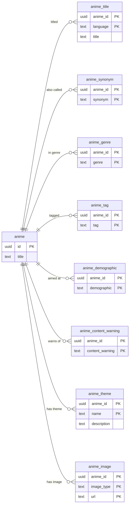
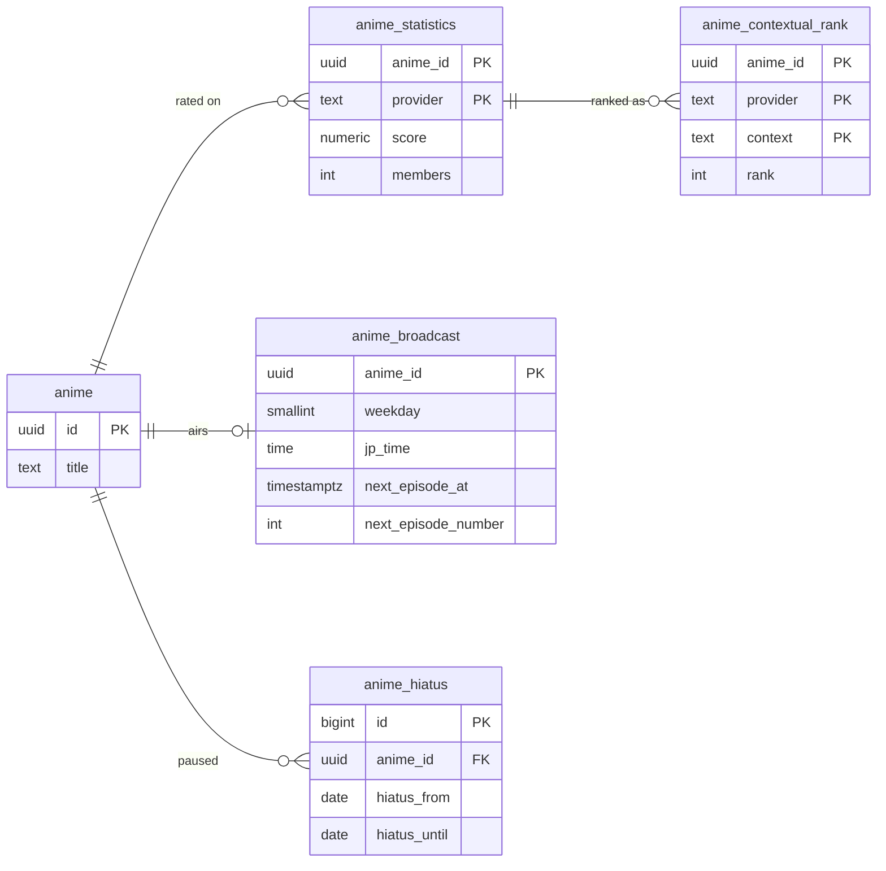
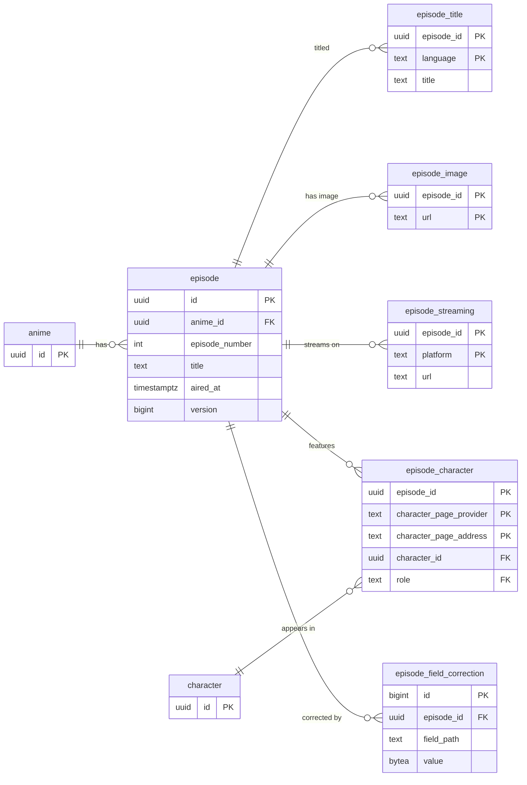
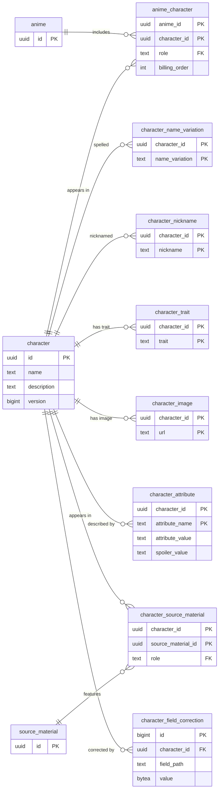
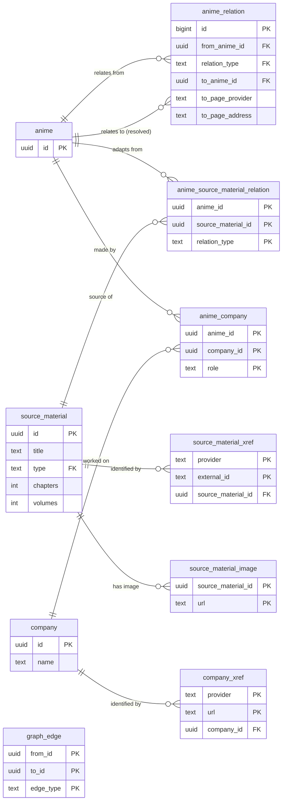

# Database Schema

PostgreSQL schema of the catalogue, owned by the [[postgres_integration_architecture_decision|PostgreSQL Service]].

> [!info] Design Approach
> - **Provider pages are stored as fetched.** Each page keeps the raw responses its provider sent, so any entity can be merged again at any time without fetching anything.
> - **Entities are built from pages.** A work, an episode and a character each link to their own provider pages, and each holds its merged record.
> - **Every field is a column or a table.** No JSONB. Each list, map and nested object of the canonical models in `libs/common/src/common/models/anime.py` has its own table, and every table is normalized to fifth normal form.

Every stage of enrichment is stored, so nothing has to be fetched again to rebuild an entity:

| Stage | Where it is stored | Written by |
|---|---|---|
| Each provider page, as received | `provider_page`, `provider_page_response` | `StorePage` |
| Which pages make up an entity | `anime_provider_page`, `episode_provider_page`, `character_provider_page` | Seed load, review answers, merges |
| Approved corrections and AI-written text | `anime_field_correction` and the episode and character ones, `anime_generated_text` | Approval queue, `SynopsisWorkflow` |
| The merged entity, as users see it | `anime`, `episode`, `character` and their detail tables | `SaveWork`, `SaveEpisode`, `SaveCharacter` |

Mapping a page to the canonical model happens in memory during each merge and is never stored. A mapper fix therefore reaches every entity on its next merge without fetching again.

## Entity Relationship Diagrams

The schema is split into seven diagrams. Lookup tables (`anime_type`, `provider` and the others in [[#Lookup Tables]]) and the shared name tables (`genre`, `tag` and the others) are left out, since each is a single `value` or `name` column.

### Provider pages and the entities built from them

How every entity links to the pages it is merged from, and the tables that change a merge.


### Anime names and classification

Titles, synonyms, genres, tags, demographics, content warnings, themes and images of `Anime`.



### Anime songs, streaming and links

Theme songs with the episodes they play in, streaming entries with their subtitle languages, trailers and external links of `Anime`.


### Anime statistics and schedule

Provider statistics with their contextual ranks, the broadcast slot and the hiatus history of `Anime`.



### Episodes



### Characters

Characters are shared between works, so a work links to them through `anime_character`.



### Relations, source material and companies

How works link to each other, to source material and to companies, and the graph projection built from them.



## Design Principles

### 1. Entities Built From Provider Pages

Each entity is stored **once** under a UUIDv7 ID:
- `anime`: one row per work
- `episode`: one row per episode of a work
- `character`: one row per character
- `source_material`: one row per source work (manga, light novel, visual novel, game, and so on)
- `company`: one row per studio, producer or licensor

**IDs are assigned once.** The first merge of a work, episode or character gives it a UUIDv7 (`uuid.uuid7()`, through `generate_entity_id` in `libs/common`), and every later merge receives that ID and keeps it. A work from the seed gets its ID when the seed load creates it. Rows the PostgreSQL Service creates by itself, `source_material` and `company`, get `DEFAULT uuidv7()`. An ID never changes, so nothing is derived from provider URLs.

**Pages identify what arrives from outside.** A provider page is stored once under its page key: provider, page kind and address, such as `mal`, `anime`, `21`. When a seed release or discovery brings page keys, a key already linked as a source belongs to that entity. A key never seen before is a new entity, unless the matching rules or a review answer place it elsewhere. Inside the system, only the UUID is used.

A work page is linked to a work in one of two roles:
- **`source`**: the page lists this work. The page is merged into the work. A work has at most one source page per provider.
- **`partial_source`**: the page lists a larger work this work is part of. The page is linked for reference and is not merged.

A page can be a source of one work and a partial source of several. The works that share a page are partial sources of each other both ways. Episode and character pages have no roles: each belongs to exactly one episode or character.

**Example**: "One Piece" is one `anime` row with one source page each from MAL, AniList, Kitsu, AniDB and the other providers, and each of its episodes and characters links to its own pages the same way.

---

### 2. Unresolved Edge Pattern

> **Linear:** ECHO-102, ECHO-107

**Problem**: When work A is saved, related work B may not exist yet.

**Solution**: Store the relationship at once with a nullable foreign key
- Insert the edge with `to_anime_id = NULL`
- Store the target page (`to_page_provider`, `to_page_address`)
- Resolve the foreign key when that page becomes a source of a work

```sql
-- Unresolved edge
INSERT INTO anime_relation (from_anime_id, relation_type, to_page_provider, to_page_address)
VALUES ('uuid-a', 'SEQUEL', 'anilist', '141902');

-- Later: resolved by the transaction that links the page to work B
UPDATE anime_relation
SET to_anime_id = 'uuid-b'
WHERE to_anime_id IS NULL AND to_page_provider = 'anilist' AND to_page_address = '141902';
```

**Benefits**:
- Save works in any order
- Show the link before the target exists
- Graph queries use only resolved edges (`WHERE to_anime_id IS NOT NULL`)

The same pattern links an episode to a character that is not stored yet (`episode_character`). Source material needs no unresolved state: a related source work always carries a title and type, so `SaveWork` creates or finds its row through `source_material_xref` in the same transaction.

**Who asserts an edge:**
- `anime_relation` holds only what each work's own provider pages say, in one direction, from that work. When work A lists B as a sequel and B lists A as a prequel, there are two rows, one asserted by each work.
- `SaveWork` replaces the work's own `anime_relation` rows with what the merge produced. It never touches rows another work asserted.
- Both directions exist only in `graph_edge`. The `graph_edge` rows between two works are recomputed from both works' `anime_relation` rows and the inverse map whenever either work's relations change, so removing one work's assertion never removes an edge the other work still asserts.
- Any transaction that links a page as a source of a work resolves every unresolved relation pointing at that page, and recomputes the `graph_edge` rows of each pair it resolves.

---

### 4. Writes and Deletes

> **Linear:** ECHO-98, ECHO-102, ECHO-103, ECHO-104, ECHO-107, ECHO-108

**Write order.** A save upserts rows in shared tables (`genre`, `tag`, `company`, `source_material`, `character`, `graph_edge`) inside one transaction. Each save sorts its keys and writes every table in a fixed order, so two refreshes saving at the same time take their locks in the same order and cannot deadlock.

**Version.** An entity's `version` increases with every change to the entity or to what its merge reads: a save that changes it, a page relinked to or from a work (`CreateWorks`, `RelinkPages`), a new AI-written text (`SaveGeneratedText`), and a new correction. A merge that loaded before such a change then fails its version check and starts again from a fresh load. Versions only need to grow, so a version without an event of its own is fine.

**Characters a save creates.** Before creating a character the merge gave a new ID, `SaveWork` looks up its page keys in `character_provider_page`. When any of them already belongs to a character, such as one another work's save created a moment earlier, it links that character instead and the new ID is dropped. A save therefore never fails on a character another work created, and never loops.

**`updated_at`.** The save that changes a row sets `updated_at = now()` in the same statement. There is no trigger. Page opens are kept in their own tables (`anime_open`, `episode_open`, `character_open`), so a page view never rewrites an entity row.

**Deleting an entity.** An entity is removed by setting `deleted_at`, never by deleting its row, so consumers can still read its version. Foreign keys with `ON DELETE CASCADE` do not fire on a soft delete, so the deleting transaction removes what hangs off the entity itself:

- **A work** (`DeleteWork`, such as when merged into another): its page links are removed, so the surviving work can claim those pages as sources; its own `anime_relation` rows are deleted; relations other works assert towards it go back to unresolved, keeping their page key, so they resolve to whichever work next holds that page; and every `graph_edge` row from or to it is deleted.
- **An episode or a character**: its page links and every `graph_edge` row from or to it are deleted.
- The version increases once more, and the `deleted` event is written to the outbox.

Every query that joins an entity filters out deleted rows.

---

### 3. Normalization

Every table is in fifth normal form:

- **1NF.** No column holds a list or group. Titles, genres, streaming links and every other list become rows.
- **2NF and 3NF.** Every column describes the whole key of its own table and nothing else. A related work's title is not copied onto the relation, a theme song's episodes are not copied onto the song, and nothing that belongs to another entity is stored twice.
- **4NF.** Facts that vary independently get separate tables. A streaming entry's subtitle languages are their own table, apart from its regions and flags.
- **5NF.** A table with three or more key columns exists only when the fact really involves all of them together. `anime_company (anime_id, company_id, role)` stays three-way, because a company can animate one work and finance another, so the role cannot be rebuilt from two-way tables.

| Decision | Rationale |
|----------|-----------|
| **No JSONB** | Every field of the canonical models has a column or a table, so every value is typed, constrained and queryable. |
| **No denormalized copies of other entities** | A related work's title, type and year are read from its own row through the link. An unresolved link shows only the link until the target is stored. |
| **Lookup tables instead of CHECK constraints** | Enum-like columns use single-column lookup tables seeded from the enums in `anime.py`, so valid values are visible in SQL and new ones need no DDL change. |
| **Shared name tables** | Genres, tags, demographics, content warnings and character traits are rows in `genre`, `tag`, `demographic`, `content_warning` and `trait`, linked per entity, so each name is stored once. |
| **`episode_count` is the provider's total** | It is the number of episodes providers report for the work, which can be ahead of the episodes stored. It is not a count of `episode` rows. |
| **`score_weighted`, `score_mean`, `score_median` are columns** | `ScoreCalculations` has exactly three values, each depending only on the work. |
| **Hiatus history** | Each change of the hiatus snapshot adds a row to `anime_hiatus`, so the frontend can show a work's pauses. The current hiatus is the latest row. |
| **Source material and companies deduplicate through cross-references** | A source URL already in `source_material_xref` or `company_xref` reuses its row. Names are never used to merge two rows, since similar names belong to different companies and works. |
| **Corrections are stored per entity table** | `anime_field_correction`, `episode_field_correction` and `character_field_correction` each have a real foreign key, instead of one table with an untyped entity reference. |
| **Typed values as protobuf bytes** | A correction or approval value can be any field, nested ones included. It is stored as the protobuf message of that field, with the message name beside it, and only the merge and the approval queue read it. |

---

## Complete DDL

> [!info] PostgreSQL Version Requirement
> This schema requires **PostgreSQL 18+** for `uuidv7()`, used as the default ID of `source_material` and `company`. Work, episode and character IDs are assigned by the merge.

### Lookup Tables

> **Linear:** ECHO-93

Each lookup is seeded from its enum in `libs/common/src/common/models/anime.py`, and CI checks that the two match (see [[echora_contracts]]).

```sql
-- Enums of the canonical models
CREATE TABLE anime_type (value text PRIMARY KEY);
INSERT INTO anime_type VALUES
  ('CM'), ('MOVIE'), ('MUSIC'), ('ONA'), ('OTHER'), ('OVA'), ('PV'),
  ('SPECIAL'), ('TV'), ('TV SHORT'), ('TV SPECIAL'), ('UNKNOWN');

CREATE TABLE anime_status (value text PRIMARY KEY);
INSERT INTO anime_status VALUES
  ('CANCELLED'), ('FINISHED'), ('ONGOING'), ('UNKNOWN'), ('UPCOMING');

CREATE TABLE anime_rating (value text PRIMARY KEY);
INSERT INTO anime_rating VALUES
  ('G - All Ages'), ('PG - Children'), ('PG-13 - Teens 13 or older'),
  ('R - 17+ (violence & profanity)'), ('R+ - Mild Nudity'), ('Rx - Hentai'), ('UNKNOWN');

CREATE TABLE anime_season (value text PRIMARY KEY);
INSERT INTO anime_season VALUES ('SPRING'), ('SUMMER'), ('FALL'), ('WINTER');

-- Shared by anime.source_material and source_material.type
CREATE TABLE source_material_type (value text PRIMARY KEY);
INSERT INTO source_material_type VALUES
  ('BOOK'), ('CARD GAME'), ('DOUJINSHI'), ('4-KOMA'), ('GAME'), ('LIGHT NOVEL'),
  ('MANGA'), ('MANHUA'), ('MANHWA'), ('MIXED MEDIA'), ('MUSIC'), ('NOVEL'),
  ('ONE SHOT'), ('ORIGINAL'), ('OTHER'), ('PICTURE BOOK'), ('RADIO'), ('UNKNOWN'),
  ('VISUAL NOVEL'), ('WEB MANGA'), ('WEB NOVEL'), ('WEBTOON'), ('FAIRY TALE'),
  ('SHORT STORY'), ('COMIC'), ('LIVE ACTION'), ('ILLUSTRATION'), ('WESTERN MEDIA');

CREATE TABLE character_role (value text PRIMARY KEY);
INSERT INTO character_role VALUES ('BACKGROUND'), ('MAIN'), ('SUPPORTING'), ('UNKNOWN');

CREATE TABLE company_role (value text PRIMARY KEY);
INSERT INTO company_role VALUES ('STUDIO'), ('PRODUCER'), ('LICENSOR'), ('UNKNOWN');

-- Values use underscores, exactly as AnimeRelationType defines them
CREATE TABLE anime_relation_type (value text PRIMARY KEY);
INSERT INTO anime_relation_type VALUES
  ('ADAPTATION'), ('ALTERNATIVE_VERSION'), ('ALTERNATIVE_SETTING'), ('CHARACTER'),
  ('CROSSOVER'), ('FULL_STORY'), ('OTHER'), ('PARENT_STORY'), ('PREQUEL'),
  ('SEQUEL'), ('SIDE_STORY'), ('SPIN_OFF'), ('SUMMARY');

CREATE TABLE source_material_relation_type (value text PRIMARY KEY);
INSERT INTO source_material_relation_type VALUES
  ('ADAPTATION'), ('SOURCE'), ('ALTERNATIVE'), ('SPIN_OFF'), ('CHARACTER'),
  ('SEQUEL'), ('PREQUEL'), ('PARENT_STORY'), ('SIDE_STORY'), ('OTHER');

-- Values of the storage design
CREATE TABLE provider (value text PRIMARY KEY);
INSERT INTO provider VALUES
  ('mal'), ('anilist'), ('kitsu'), ('anidb'), ('anime_planet'), ('anisearch'),
  ('animeschedule'), ('syoboi');

CREATE TABLE page_kind (value text PRIMARY KEY);
INSERT INTO page_kind VALUES ('anime'), ('episode'), ('character');

CREATE TABLE anime_page_role (value text PRIMARY KEY);
INSERT INTO anime_page_role VALUES ('source'), ('partial_source');

CREATE TABLE anime_image_type (value text PRIMARY KEY);
INSERT INTO anime_image_type VALUES ('cover'), ('poster'), ('banner');

CREATE TABLE theme_song_kind (value text PRIMARY KEY);
INSERT INTO theme_song_kind VALUES ('opening'), ('ending');

CREATE TABLE approval_kind (value text PRIMARY KEY);
INSERT INTO approval_kind VALUES ('review_case'), ('risky_change'), ('suggested_edit');

CREATE TABLE approval_status (value text PRIMARY KEY);
INSERT INTO approval_status VALUES ('open'), ('approved'), ('rejected');

CREATE TABLE graph_node_type (value text PRIMARY KEY);
INSERT INTO graph_node_type VALUES
  ('anime'), ('character'), ('source_material'), ('company'), ('person');

-- Edge types of graph_edge: the anime relation types, the company roles, and the
-- edges between works, characters and source material. Types for people are added
-- with the people tables.
CREATE TABLE graph_edge_type (value text PRIMARY KEY);
INSERT INTO graph_edge_type VALUES
  ('ADAPTATION'), ('ALTERNATIVE_VERSION'), ('ALTERNATIVE_SETTING'), ('CHARACTER'),
  ('CROSSOVER'), ('FULL_STORY'), ('OTHER'), ('PARENT_STORY'), ('PREQUEL'),
  ('SEQUEL'), ('SIDE_STORY'), ('SPIN_OFF'), ('SUMMARY'),
  ('STUDIO'), ('PRODUCER'), ('LICENSOR'), ('UNKNOWN'),
  ('FEATURES'), ('APPEARS_IN'), ('ADAPTED_FROM'), ('WAS_ADAPTED_TO');

-- Shared names, one row per distinct name
CREATE TABLE genre (name text PRIMARY KEY);
CREATE TABLE tag (name text PRIMARY KEY);
CREATE TABLE demographic (name text PRIMARY KEY);
CREATE TABLE content_warning (name text PRIMARY KEY);
CREATE TABLE trait (name text PRIMARY KEY);
```

---

### Works

> **Linear:** ECHO-98, ECHO-100, ECHO-101

```sql
CREATE TABLE anime (
  id                  uuid PRIMARY KEY,                 -- UUIDv7, assigned at the first merge
  title               text NOT NULL,
  title_english       text,
  title_japanese      text,
  type                text NOT NULL REFERENCES anime_type(value),
  status              text NOT NULL REFERENCES anime_status(value),
  rating              text NOT NULL DEFAULT 'UNKNOWN' REFERENCES anime_rating(value),
  season              text REFERENCES anime_season(value),
  source_material     text REFERENCES source_material_type(value),
  year                smallint CHECK (year >= 1900),
  month               smallint CHECK (month BETWEEN 1 AND 12),  -- premiere month from AnimeSchedule
  episode_count       int NOT NULL DEFAULT 0 CHECK (episode_count >= 0),  -- the providers' total
  duration_seconds    int CHECK (duration_seconds >= 0),
  is_nsfw             boolean,
  country_of_origin   text CHECK (char_length(country_of_origin) = 2),  -- ISO 3166-1 alpha-2
  synopsis            text,                             -- from a correction or the AI-written text only
  background          text,
  aired_from          timestamptz,
  aired_to            timestamptz,
  score_weighted      numeric(4,2) CHECK (score_weighted BETWEEN 0 AND 10),
  score_mean          numeric(4,2) CHECK (score_mean BETWEEN 0 AND 10),
  score_median        numeric(4,2) CHECK (score_median BETWEEN 0 AND 10),
  version             bigint NOT NULL DEFAULT 1,        -- increased by every change to the work or its merge inputs; sent in events
  merged_record_hash  text,                             -- hash of the last saved merge; an unchanged merge is not saved
  refreshed_at        timestamptz,                      -- last finished refresh
  deleted_at          timestamptz,                      -- set when the work is removed, e.g. merged into another
  merged_into_anime_id uuid REFERENCES anime(id),       -- the work it was merged into, so its pages and links can redirect
  created_at          timestamptz NOT NULL DEFAULT now(),
  updated_at          timestamptz NOT NULL DEFAULT now()  -- set by the save that changes the row
);

-- The weekly sweep pages through active works in this order. Never-refreshed works sort
-- first as '-infinity', so the sort key has no NULL and keyset paging works on every page.
CREATE INDEX anime_refresh_order_idx
  ON anime((coalesce(refreshed_at, '-infinity'::timestamptz)), id)
  WHERE deleted_at IS NULL;

-- The daily score refresh reads ongoing and recently finished works
CREATE INDEX anime_score_sync_idx ON anime(status, aired_to)
  WHERE deleted_at IS NULL AND status IN ('ONGOING', 'FINISHED');

-- Page opens, kept apart so a page view never rewrites the wide anime row
CREATE TABLE anime_open (
  anime_id        uuid PRIMARY KEY REFERENCES anime(id) ON DELETE CASCADE,
  last_opened_at  timestamptz NOT NULL,
  open_count      bigint NOT NULL DEFAULT 0
) WITH (fillfactor = 90);

CREATE TABLE anime_title (
  anime_id  uuid NOT NULL REFERENCES anime(id) ON DELETE CASCADE,
  language  text NOT NULL,                     -- BCP 47 code, e.g. 'de', 'zh-Hant'
  title     text NOT NULL,
  PRIMARY KEY (anime_id, language)
);

CREATE TABLE anime_synonym (
  anime_id  uuid NOT NULL REFERENCES anime(id) ON DELETE CASCADE,
  synonym   text NOT NULL,
  PRIMARY KEY (anime_id, synonym)
);

CREATE TABLE anime_genre (
  anime_id  uuid NOT NULL REFERENCES anime(id) ON DELETE CASCADE,
  genre     text NOT NULL REFERENCES genre(name),
  PRIMARY KEY (anime_id, genre)
);

-- Works by genre
CREATE INDEX anime_genre_genre_idx ON anime_genre(genre, anime_id);

CREATE TABLE anime_tag (
  anime_id  uuid NOT NULL REFERENCES anime(id) ON DELETE CASCADE,
  tag       text NOT NULL REFERENCES tag(name),
  PRIMARY KEY (anime_id, tag)
);

-- Works by tag
CREATE INDEX anime_tag_tag_idx ON anime_tag(tag, anime_id);

CREATE TABLE anime_demographic (
  anime_id     uuid NOT NULL REFERENCES anime(id) ON DELETE CASCADE,
  demographic  text NOT NULL REFERENCES demographic(name),
  PRIMARY KEY (anime_id, demographic)
);

-- Works by demographic
CREATE INDEX anime_demographic_demographic_idx ON anime_demographic(demographic, anime_id);

CREATE TABLE anime_content_warning (
  anime_id         uuid NOT NULL REFERENCES anime(id) ON DELETE CASCADE,
  content_warning  text NOT NULL REFERENCES content_warning(name),
  PRIMARY KEY (anime_id, content_warning)
);

-- Works by content warning
CREATE INDEX anime_content_warning_content_warning_idx ON anime_content_warning(content_warning, anime_id);

CREATE TABLE anime_theme (
  anime_id     uuid NOT NULL REFERENCES anime(id) ON DELETE CASCADE,
  name         text NOT NULL,
  description  text,
  PRIMARY KEY (anime_id, name)
);

CREATE TABLE anime_theme_song (
  id        bigint GENERATED ALWAYS AS IDENTITY PRIMARY KEY,
  anime_id  uuid NOT NULL REFERENCES anime(id) ON DELETE CASCADE,
  kind      text NOT NULL REFERENCES theme_song_kind(value),
  position  int NOT NULL,                      -- order within the work's openings or endings
  title     text NOT NULL,
  artist    text,
  UNIQUE (anime_id, kind, position)
);

CREATE TABLE theme_song_episode_range (
  theme_song_id  bigint NOT NULL REFERENCES anime_theme_song(id) ON DELETE CASCADE,
  range_start    int NOT NULL CHECK (range_start >= 0),
  range_end      int CHECK (range_end >= range_start),  -- NULL while the song is still in use
  PRIMARY KEY (theme_song_id, range_start)
);

CREATE TABLE anime_trailer (
  anime_id       uuid NOT NULL REFERENCES anime(id) ON DELETE CASCADE,
  url            text NOT NULL,
  title          text,
  thumbnail_url  text,
  PRIMARY KEY (anime_id, url)
);

CREATE TABLE anime_external_link (
  anime_id  uuid NOT NULL REFERENCES anime(id) ON DELETE CASCADE,
  url       text NOT NULL,
  platform  text NOT NULL,
  label     text,
  language  text,
  PRIMARY KEY (anime_id, url)
);

CREATE TABLE anime_streaming (
  id                   bigint GENERATED ALWAYS AS IDENTITY PRIMARY KEY,
  anime_id             uuid NOT NULL REFERENCES anime(id) ON DELETE CASCADE,
  platform             text NOT NULL,
  url                  text NOT NULL,
  region               text,
  is_free              boolean,
  is_premium_required  boolean,
  has_dub              boolean,
  UNIQUE NULLS NOT DISTINCT (anime_id, url, region)
);

CREATE TABLE anime_streaming_subtitle_language (
  streaming_id  bigint NOT NULL REFERENCES anime_streaming(id) ON DELETE CASCADE,
  language      text NOT NULL,
  PRIMARY KEY (streaming_id, language)
);

CREATE TABLE anime_image (
  anime_id    uuid NOT NULL REFERENCES anime(id) ON DELETE CASCADE,
  image_type  text NOT NULL REFERENCES anime_image_type(value),
  url         text NOT NULL,
  PRIMARY KEY (anime_id, image_type, url)
);

-- Statistics as each provider reports them
CREATE TABLE anime_statistics (
  anime_id    uuid NOT NULL REFERENCES anime(id) ON DELETE CASCADE,
  provider    text NOT NULL REFERENCES provider(value),
  score       numeric(4,2) CHECK (score BETWEEN 0 AND 10),
  scored_by   int CHECK (scored_by >= 0),
  members     int CHECK (members >= 0),
  favorites   int CHECK (favorites >= 0),
  rank        int CHECK (rank > 0),
  popularity  int CHECK (popularity > 0),
  PRIMARY KEY (anime_id, provider)
);

CREATE TABLE anime_contextual_rank (
  anime_id     uuid NOT NULL,
  provider     text NOT NULL,
  context      text NOT NULL,                  -- e.g. 'highest rated all time'
  rank         int NOT NULL CHECK (rank > 0),
  is_all_time  boolean,
  format       text,
  season       text REFERENCES anime_season(value),
  year         smallint CHECK (year >= 1900),
  PRIMARY KEY (anime_id, provider, context),
  FOREIGN KEY (anime_id, provider)
    REFERENCES anime_statistics(anime_id, provider) ON DELETE CASCADE
);

-- Weekly slot and premiere dates
CREATE TABLE anime_broadcast (
  anime_id         uuid PRIMARY KEY REFERENCES anime(id) ON DELETE CASCADE,
  weekday          smallint CHECK (weekday BETWEEN 1 AND 7),  -- ISO weekday of the JP slot
  timezone         text,                                      -- IANA zone, e.g. 'Asia/Tokyo'
  jp_time          time,
  sub_time         time,
  dub_time         time,
  sub_delay_days   int,
  dub_delay_days   int,
  premiere_jp      timestamptz,
  premiere_sub     timestamptz,
  premiere_dub     timestamptz,
  next_episode_at      timestamptz,                            -- NULL when not airing
  next_episode_number  int CHECK (next_episode_number >= 0)    -- the episode airing at next_episode_at
);

-- Episode tracking finds works whose next episode airs soon
CREATE INDEX anime_broadcast_next_episode_idx
  ON anime_broadcast(next_episode_at)
  WHERE next_episode_at IS NOT NULL;

-- Every hiatus snapshot a work has had; a row is added when the snapshot changes
CREATE TABLE anime_hiatus (
  id            bigint GENERATED ALWAYS AS IDENTITY PRIMARY KEY,
  anime_id      uuid NOT NULL REFERENCES anime(id) ON DELETE CASCADE,
  reason        text,
  hiatus_from   date,
  hiatus_until  date,                          -- NULL while the hiatus lasts
  recorded_at   timestamptz NOT NULL DEFAULT now()
);

CREATE INDEX anime_hiatus_latest_idx ON anime_hiatus(anime_id, recorded_at DESC);
```

---

### Relations, Source Material and Companies

> **Linear:** ECHO-102

```sql
CREATE TABLE anime_relation (
  id                bigint GENERATED ALWAYS AS IDENTITY PRIMARY KEY,
  from_anime_id     uuid NOT NULL REFERENCES anime(id) ON DELETE CASCADE,
  relation_type     text NOT NULL REFERENCES anime_relation_type(value),
  to_anime_id       uuid REFERENCES anime(id) ON DELETE CASCADE,  -- NULL until resolved
  to_page_provider  text NOT NULL,
  to_page_address   text NOT NULL,
  CHECK (from_anime_id <> to_anime_id),
  UNIQUE (from_anime_id, relation_type, to_page_provider, to_page_address)
);

CREATE INDEX anime_relation_from_idx ON anime_relation(from_anime_id);
CREATE INDEX anime_relation_to_idx ON anime_relation(to_anime_id);

-- Finds the edges to resolve when a page becomes a source of a work
CREATE INDEX anime_relation_unresolved_idx
  ON anime_relation(to_page_provider, to_page_address)
  WHERE to_anime_id IS NULL;

CREATE TABLE source_material (
  id              uuid PRIMARY KEY DEFAULT uuidv7(),
  title           text NOT NULL,
  title_english   text,
  title_japanese  text,
  type            text NOT NULL REFERENCES source_material_type(value),
  status          text REFERENCES anime_status(value),   -- publication status
  score           numeric(4,2) CHECK (score BETWEEN 0 AND 10),
  chapters        int CHECK (chapters >= 0),
  volumes         int CHECK (volumes >= 0),
  created_at      timestamptz NOT NULL DEFAULT now(),
  updated_at      timestamptz NOT NULL DEFAULT now()
);

CREATE TABLE source_material_xref (
  provider            text NOT NULL REFERENCES provider(value),
  external_id         text NOT NULL,
  source_material_id  uuid NOT NULL REFERENCES source_material(id) ON DELETE CASCADE,
  url                 text NOT NULL,
  PRIMARY KEY (provider, external_id),
  UNIQUE (source_material_id, provider)
);

CREATE TABLE source_material_image (
  source_material_id  uuid NOT NULL REFERENCES source_material(id) ON DELETE CASCADE,
  url                 text NOT NULL,
  PRIMARY KEY (source_material_id, url)
);

CREATE TABLE anime_source_material_relation (
  anime_id            uuid NOT NULL REFERENCES anime(id) ON DELETE CASCADE,
  source_material_id  uuid NOT NULL REFERENCES source_material(id) ON DELETE CASCADE,
  relation_type       text NOT NULL REFERENCES source_material_relation_type(value),
  PRIMARY KEY (anime_id, source_material_id, relation_type)
);

CREATE INDEX anime_source_material_relation_work_idx
  ON anime_source_material_relation(source_material_id);

CREATE TABLE company (
  id           uuid PRIMARY KEY DEFAULT uuidv7(),
  name         text NOT NULL,
  description  text
);

CREATE TABLE company_xref (
  provider    text NOT NULL REFERENCES provider(value),
  url         text NOT NULL,                   -- canonical company page URL
  company_id  uuid NOT NULL REFERENCES company(id) ON DELETE CASCADE,
  PRIMARY KEY (provider, url),
  UNIQUE (company_id, provider)
);

-- One row per role: a company can hold two roles on one work
CREATE TABLE anime_company (
  anime_id    uuid NOT NULL REFERENCES anime(id) ON DELETE CASCADE,
  company_id  uuid NOT NULL REFERENCES company(id) ON DELETE RESTRICT,
  role        text NOT NULL REFERENCES company_role(value),
  PRIMARY KEY (anime_id, company_id, role)
);

CREATE INDEX anime_company_company_idx ON anime_company(company_id);

-- Read-optimized projection of the junction tables for graph traversal, holding both
-- directions of every edge. The PostgreSQL Service writes it in the same transaction as
-- the junction rows; for anime relations it recomputes each pair from both works' rows.
-- A reverse edge from a company has the company's role as its type, the same as the
-- forward edge, so two roles of one company on one work stay two rows.
CREATE TABLE graph_edge (
  from_id    uuid NOT NULL,
  from_type  text NOT NULL REFERENCES graph_node_type(value),
  to_id      uuid NOT NULL,
  to_type    text NOT NULL REFERENCES graph_node_type(value),
  edge_type  text NOT NULL REFERENCES graph_edge_type(value),
  PRIMARY KEY (from_id, to_id, edge_type)
);

CREATE INDEX graph_edge_from_idx ON graph_edge(from_id, from_type, edge_type);
CREATE INDEX graph_edge_to_idx   ON graph_edge(to_id,   to_type,   edge_type);
```

- **Orphans.** `character` and `company` rows are shared, so deleting a work never deletes them (`ON DELETE RESTRICT` on their links). A weekly job deletes characters and companies no work links to any more, and source material no work or character links to.
- **`character_relation`** (direct character-to-character relations) is not part of the first migrations. Its design is still open, see [[#3. `character_relation` Table — IN DISCUSSION 🔄]].

---

### Characters

> **Linear:** ECHO-104

```sql
CREATE TABLE character (
  id                   uuid PRIMARY KEY,                -- UUIDv7, assigned at the first merge
  name                 text NOT NULL,
  name_native          text,
  description          text,
  description_spoiler  text,                            -- Character.spoilers['description']
  favorites            int CHECK (favorites >= 0),
  version              bigint NOT NULL DEFAULT 1,
  merged_record_hash   text,
  refreshed_at         timestamptz,
  deleted_at           timestamptz,
  created_at           timestamptz NOT NULL DEFAULT now(),
  updated_at           timestamptz NOT NULL DEFAULT now()  -- set by the save that changes the row
);

CREATE INDEX character_refresh_order_idx
  ON character((coalesce(refreshed_at, '-infinity'::timestamptz)), id)
  WHERE deleted_at IS NULL;

CREATE TABLE character_open (
  character_id    uuid PRIMARY KEY REFERENCES character(id) ON DELETE CASCADE,
  last_opened_at  timestamptz NOT NULL,
  open_count      bigint NOT NULL DEFAULT 0
) WITH (fillfactor = 90);

-- Written from each work's character list; Character.roles and anime_ids are read from here
CREATE TABLE anime_character (
  anime_id       uuid NOT NULL REFERENCES anime(id) ON DELETE CASCADE,
  character_id   uuid NOT NULL REFERENCES character(id) ON DELETE RESTRICT,
  role           text NOT NULL REFERENCES character_role(value),
  billing_order  int,
  PRIMARY KEY (anime_id, character_id)
);

CREATE INDEX anime_character_character_idx ON anime_character(character_id);

CREATE TABLE character_name_variation (
  character_id    uuid NOT NULL REFERENCES character(id) ON DELETE CASCADE,
  name_variation  text NOT NULL,
  PRIMARY KEY (character_id, name_variation)
);

CREATE TABLE character_nickname (
  character_id  uuid NOT NULL REFERENCES character(id) ON DELETE CASCADE,
  nickname      text NOT NULL,
  PRIMARY KEY (character_id, nickname)
);

CREATE TABLE character_trait (
  character_id  uuid NOT NULL REFERENCES character(id) ON DELETE CASCADE,
  trait         text NOT NULL REFERENCES trait(name),
  PRIMARY KEY (character_id, trait)
);

-- Characters by trait
CREATE INDEX character_trait_trait_idx ON character_trait(trait, character_id);

CREATE TABLE character_image (
  character_id  uuid NOT NULL REFERENCES character(id) ON DELETE CASCADE,
  url           text NOT NULL,
  PRIMARY KEY (character_id, url)
);

-- Character.attributes and Character.spoilers share their keys
CREATE TABLE character_attribute (
  character_id     uuid NOT NULL REFERENCES character(id) ON DELETE CASCADE,
  attribute_name   text NOT NULL,              -- e.g. 'Age', 'Height'
  attribute_value  text,
  spoiler_value    text,
  PRIMARY KEY (character_id, attribute_name),
  CHECK (attribute_value IS NOT NULL OR spoiler_value IS NOT NULL)
);

-- Character.mangaography
CREATE TABLE character_source_material (
  character_id        uuid NOT NULL REFERENCES character(id) ON DELETE CASCADE,
  source_material_id  uuid NOT NULL REFERENCES source_material(id) ON DELETE CASCADE,
  role                text NOT NULL REFERENCES character_role(value),
  PRIMARY KEY (character_id, source_material_id)
);

CREATE INDEX character_source_material_work_idx ON character_source_material(source_material_id);
```

A character page's animeography only confirms links the works already make. `anime_character` is written from each work's own character list, so a character is linked to a work once that work is stored.

---

### Episodes

> **Linear:** ECHO-103

```sql
CREATE TABLE episode (
  id                  uuid PRIMARY KEY,                 -- UUIDv7, assigned at the first merge
  anime_id            uuid NOT NULL REFERENCES anime(id) ON DELETE CASCADE,
  episode_number      int NOT NULL CHECK (episode_number >= 0),
  season_number       int CHECK (season_number > 0),
  title               text NOT NULL,
  title_japanese      text,
  title_romaji        text,
  synopsis            text,
  description         text,
  aired_at            timestamptz,
  duration_seconds    int CHECK (duration_seconds >= 0),
  is_filler           boolean NOT NULL DEFAULT false,
  is_recap            boolean NOT NULL DEFAULT false,
  score               numeric(5,2) CHECK (score >= 0),
  version             bigint NOT NULL DEFAULT 1,
  merged_record_hash  text,
  refreshed_at        timestamptz,
  deleted_at          timestamptz,
  created_at          timestamptz NOT NULL DEFAULT now(),
  updated_at          timestamptz NOT NULL DEFAULT now(),  -- set by the save that changes the row
  UNIQUE (anime_id, episode_number)
);

CREATE INDEX episode_refresh_order_idx
  ON episode((coalesce(refreshed_at, '-infinity'::timestamptz)), id)
  WHERE deleted_at IS NULL;

CREATE TABLE episode_open (
  episode_id      uuid PRIMARY KEY REFERENCES episode(id) ON DELETE CASCADE,
  last_opened_at  timestamptz NOT NULL,
  open_count      bigint NOT NULL DEFAULT 0
) WITH (fillfactor = 90);

-- Episode tracking reads the episodes airing in the next week
CREATE INDEX episode_aired_at_idx ON episode(aired_at) WHERE aired_at IS NOT NULL;

CREATE TABLE episode_title (
  episode_id  uuid NOT NULL REFERENCES episode(id) ON DELETE CASCADE,
  language    text NOT NULL,
  title       text NOT NULL,
  PRIMARY KEY (episode_id, language)
);

CREATE TABLE episode_image (
  episode_id  uuid NOT NULL REFERENCES episode(id) ON DELETE CASCADE,
  url         text NOT NULL,
  PRIMARY KEY (episode_id, url)
);

CREATE TABLE episode_streaming (
  episode_id  uuid NOT NULL REFERENCES episode(id) ON DELETE CASCADE,
  platform    text NOT NULL,
  url         text NOT NULL,
  PRIMARY KEY (episode_id, platform)
);

-- Characters in an episode, by their character page until that character is stored
CREATE TABLE episode_character (
  episode_id               uuid NOT NULL REFERENCES episode(id) ON DELETE CASCADE,
  character_page_provider  text NOT NULL,
  character_page_address   text NOT NULL,
  character_id             uuid REFERENCES character(id) ON DELETE SET NULL,  -- NULL until resolved
  role                     text NOT NULL REFERENCES character_role(value),
  PRIMARY KEY (episode_id, character_page_provider, character_page_address)
);

CREATE INDEX episode_character_unresolved_idx
  ON episode_character(character_page_provider, character_page_address)
  WHERE character_id IS NULL;

-- Character deletes set character_id to NULL without a full scan
CREATE INDEX episode_character_character_idx
  ON episode_character(character_id)
  WHERE character_id IS NOT NULL;
```

---

### Provider Pages

> **Linear:** ECHO-97, ECHO-103, ECHO-104

```sql
-- One row per provider page, keyed by its page key
CREATE TABLE provider_page (
  provider    text NOT NULL REFERENCES provider(value),
  page_kind   text NOT NULL REFERENCES page_kind(value),
  address     text NOT NULL,                 -- the page's address on that provider, e.g. '21'
  fetched_at  timestamptz NOT NULL,          -- an older fetch never replaces a newer one
  is_dead     boolean NOT NULL DEFAULT false,-- the provider no longer serves the page
  responses_hash text NOT NULL,              -- hash of the uncompressed responses; StorePage compares it
  PRIMARY KEY (provider, page_kind, address)
);

-- Every response that makes up a page, as received
-- (an AniList page is several GraphQL responses; a MAL page is several HTML pages)
CREATE TABLE provider_page_response (
  provider      text NOT NULL,
  page_kind     text NOT NULL,
  address       text NOT NULL,
  request_name  text NOT NULL,               -- e.g. 'main', 'characters', 'episodes_page_2'
  content_type  text NOT NULL,               -- 'application/json', 'text/html', 'application/xml'
  body          bytea NOT NULL,              -- stored compressed
  PRIMARY KEY (provider, page_kind, address, request_name),
  FOREIGN KEY (provider, page_kind, address)
    REFERENCES provider_page(provider, page_kind, address) ON DELETE CASCADE
);

-- The body is already compressed, so TOAST stores it out of line without compressing again
ALTER TABLE provider_page_response ALTER COLUMN body SET STORAGE EXTERNAL;

-- Which work pages make up each work
CREATE TABLE anime_provider_page (
  anime_id   uuid NOT NULL REFERENCES anime(id) ON DELETE CASCADE,
  provider   text NOT NULL,
  page_kind  text NOT NULL DEFAULT 'anime' CHECK (page_kind = 'anime'),
  address    text NOT NULL,
  role       text NOT NULL REFERENCES anime_page_role(value),
  PRIMARY KEY (anime_id, provider, page_kind, address),
  FOREIGN KEY (provider, page_kind, address)
    REFERENCES provider_page(provider, page_kind, address) ON DELETE RESTRICT
);

-- A page is a source of at most one work
CREATE UNIQUE INDEX anime_provider_page_one_source_uniq
  ON anime_provider_page(provider, address) WHERE role = 'source';

-- A work has at most one source page per provider
CREATE UNIQUE INDEX anime_provider_page_source_per_provider_uniq
  ON anime_provider_page(anime_id, provider) WHERE role = 'source';

CREATE INDEX anime_provider_page_page_idx ON anime_provider_page(provider, page_kind, address);

-- Each episode page belongs to exactly one episode
CREATE TABLE episode_provider_page (
  episode_id  uuid NOT NULL REFERENCES episode(id) ON DELETE CASCADE,
  provider    text NOT NULL,
  page_kind   text NOT NULL DEFAULT 'episode' CHECK (page_kind = 'episode'),
  address     text NOT NULL,
  PRIMARY KEY (provider, page_kind, address),
  UNIQUE (episode_id, provider),
  FOREIGN KEY (provider, page_kind, address)
    REFERENCES provider_page(provider, page_kind, address) ON DELETE RESTRICT
);

-- Each character page belongs to exactly one character
CREATE TABLE character_provider_page (
  character_id  uuid NOT NULL REFERENCES character(id) ON DELETE CASCADE,
  provider      text NOT NULL,
  page_kind     text NOT NULL DEFAULT 'character' CHECK (page_kind = 'character'),
  address       text NOT NULL,
  PRIMARY KEY (provider, page_kind, address),
  UNIQUE (character_id, provider),
  FOREIGN KEY (provider, page_kind, address)
    REFERENCES provider_page(provider, page_kind, address) ON DELETE RESTRICT
);
```

- `StorePage` writes the page and its responses in one transaction, and only when its `fetched_at` is newer than the stored one, so a retried or late fetch never replaces newer data. It reports the page as changed when `responses_hash` differs, without reading the stored bodies.
- `LoadWork`, `LoadEpisode` and `LoadCharacter` read an entity's pages and responses. The merge maps them in memory.
- An entity's `sources` and `partial_sources` in the merged model come from these links.

---

### Approval, Corrections, AI Text and Outbox

> **Linear:** ECHO-98, ECHO-103, ECHO-104, ECHO-115, ECHO-116, Approval queue project

```sql
-- One approval queue for review cases, risky changes and suggested edits
CREATE TABLE approval_item (
  id                bigint GENERATED ALWAYS AS IDENTITY PRIMARY KEY,
  kind              text NOT NULL REFERENCES approval_kind(value),
  proposal_message  text NOT NULL,             -- protobuf message name of the proposal
  proposal          bytea NOT NULL,
  status            text NOT NULL DEFAULT 'open' REFERENCES approval_status(value),
  created_by        text NOT NULL,             -- a workflow name or a user ID
  created_at        timestamptz NOT NULL DEFAULT now(),
  decided_by        text,
  decided_at        timestamptz,
  decision_message  text,
  decision          bytea                      -- the answer given, kept as history
);

CREATE INDEX approval_item_open_idx ON approval_item(created_at) WHERE status = 'open';

-- Approved corrections, applied after every merge. One table per entity, each with a real foreign key.
CREATE TABLE anime_field_correction (
  id                bigint GENERATED ALWAYS AS IDENTITY PRIMARY KEY,
  anime_id          uuid NOT NULL REFERENCES anime(id) ON DELETE CASCADE,
  field_path        text NOT NULL,             -- e.g. 'episode_count', 'broadcast.jp_time'
  value_message     text NOT NULL,             -- protobuf message name of the value
  value             bytea NOT NULL,            -- the value as that protobuf message
  approval_item_id  bigint REFERENCES approval_item(id) ON DELETE SET NULL,
  approved_by       text NOT NULL,
  approved_at       timestamptz NOT NULL DEFAULT now(),
  UNIQUE (anime_id, field_path)
);

CREATE INDEX anime_field_correction_approval_idx
  ON anime_field_correction(approval_item_id)
  WHERE approval_item_id IS NOT NULL;

-- episode_field_correction and character_field_correction have the same columns and
-- approval index, with episode_id and character_id in place of anime_id.

-- Text written by the Agent Service, every version kept
CREATE TABLE anime_generated_text (
  id              bigint GENERATED ALWAYS AS IDENTITY PRIMARY KEY,
  anime_id        uuid NOT NULL REFERENCES anime(id) ON DELETE CASCADE,
  field_path      text NOT NULL,               -- 'synopsis'
  text            text NOT NULL,
  input_hash      text NOT NULL,               -- hash of the provider texts it was written from
  model_name      text NOT NULL,
  prompt_version  text NOT NULL,
  written_at      timestamptz NOT NULL DEFAULT now()
);

CREATE INDEX anime_generated_text_latest_idx
  ON anime_generated_text(anime_id, field_path, written_at DESC);

-- Web pages a generated text was written from
CREATE TABLE anime_generated_text_source (
  generated_text_id  bigint NOT NULL REFERENCES anime_generated_text(id) ON DELETE CASCADE,
  url                text NOT NULL,
  PRIMARY KEY (generated_text_id, url)
);

-- Every NATS event, written in the transaction of the change it reports
CREATE TABLE outbox (
  id             bigint GENERATED ALWAYS AS IDENTITY PRIMARY KEY,  -- also the Nats-Msg-Id
  subject        text NOT NULL,              -- 'anime.updated', 'episode.created', ...
  entity_id      uuid NOT NULL,
  version        bigint NOT NULL,
  payload        bytea NOT NULL,             -- serialized protobuf event
  created_at     timestamptz NOT NULL DEFAULT now(),
  claimed_until  timestamptz,                -- a relay is publishing the row until then
  published_at   timestamptz
);

CREATE INDEX outbox_unpublished_idx ON outbox(id) WHERE published_at IS NULL;
```

- A correction holds one field's approved value. The load methods return an entity's corrections with its pages, and the merge applies them after merging, so a refresh never overwrites them.
- `anime.synopsis` is set only from an approved correction or the latest `anime_generated_text` row, never from a provider. Provider synopses stay in the stored page responses as input for writing. See [[update_service#AI-Written Synopsis|Update Service]].
- The protobuf messages of proposals and decisions per approval kind are defined with the multi-user review page.
- The outbox relay is described in [[event_driven_architecture#2. The outbox relay publishes|Event-Driven Architecture]].

---

### People (planned last)

> **Linear:** People project

Voice actors, production staff and episode staff are people shared across works. They are the last part of the schema to be built, after everything else works:

- `person`, with `person_xref` from `StaffMember.staff_ids` and the voice actor's profile URLs
- `anime_staff (anime_id, person_id, role)` from `staff_data.production_staff`
- `character_voice (character_id, person_id, language)` from `Character.voice_actors`
- `episode_staff (episode_id, person_id, role)` and `episode_character_voice` from `Episode.staff` and `EpisodeCharacter.voice_actors`

Until then, those model fields are not stored.

---

## Deduplication Strategy

### Exact Deduplication

- `provider_page` is keyed by its page key, so a page is stored once.
- A work page is a source of at most one work, and an episode or character page belongs to exactly one episode or character, so the same provider page always maps to the same entity.
- `source_material_xref` and `company_xref` are keyed by provider and external ID or URL, so the same external work or company always maps to the same row.

### Fuzzy Deduplication (Characters)

> **Linear:** Character deduplication project

**Problem**: The same character can have pages on providers that do not link to each other.

**Solution**:
1. Use Qdrant similarity search to find candidate duplicates
2. Confirm with name variants, shared works and roles
3. Send uncertain pairs to the approval queue
4. Move the confirmed pages onto one character, keeping its ID

---

## Query Patterns

### Refresh Queries

> **Linear:** ECHO-108

```sql
-- ListDueWorks: works the weekly sweep refreshes, with keyset paging and a fixed cutoff per sweep.
-- Works first aired more than OLDER_AFTER_YEARS ago refresh only when opened.
-- A never-refreshed work sorts as '-infinity', so no part of the sort key is NULL.
-- The first page passes ('-infinity', the nil UUID) as the cursor.
SELECT id, refreshed_at FROM anime
WHERE deleted_at IS NULL
  AND coalesce(refreshed_at, '-infinity') < $1                    -- the sweep's cutoff
  AND (year IS NULL OR year > extract(year FROM now()) - $2)      -- OLDER_AFTER_YEARS
  AND (coalesce(refreshed_at, '-infinity'), id) > ($3, $4)        -- the last row of the previous page
ORDER BY coalesce(refreshed_at, '-infinity'), id
LIMIT $5;

-- RecordOpen: count the open in the narrow open table, and report whether the work is due
INSERT INTO anime_open (anime_id, last_opened_at, open_count)
VALUES ($1, now(), 1)
ON CONFLICT (anime_id) DO UPDATE
SET last_opened_at = now(), open_count = anime_open.open_count + 1;

SELECT refreshed_at IS NULL OR refreshed_at < now() - make_interval(days => $2) AS is_due
FROM anime
WHERE id = $1 AND deleted_at IS NULL;

-- ListUpcomingEpisodes: episodes of ongoing works airing in the next EPISODE_WINDOW_DAYS,
-- both those the work lists and the next episode its broadcast names but no row holds yet
SELECT e.id, e.anime_id, e.episode_number, e.aired_at AS expected_air_at
FROM episode e
JOIN anime a ON a.id = e.anime_id
WHERE a.status IN ('ONGOING', 'UPCOMING') AND a.deleted_at IS NULL AND e.deleted_at IS NULL
  AND e.aired_at BETWEEN now() AND now() + make_interval(days => $1)
UNION ALL
SELECT NULL, b.anime_id, b.next_episode_number, b.next_episode_at
FROM anime_broadcast b
JOIN anime a ON a.id = b.anime_id
WHERE a.status IN ('ONGOING', 'UPCOMING') AND a.deleted_at IS NULL
  AND b.next_episode_number IS NOT NULL
  AND b.next_episode_at BETWEEN now() AND now() + make_interval(days => $1)
  AND NOT EXISTS (
    SELECT 1 FROM episode e
    WHERE e.anime_id = b.anime_id AND e.episode_number = b.next_episode_number
      AND e.deleted_at IS NULL
  )
ORDER BY expected_air_at;

-- ListScoreWorks: works whose scores refresh daily, ongoing or finished within the lookback.
-- A finished work with no end date is left out; its scores refresh in the weekly sweep.
SELECT id FROM anime
WHERE deleted_at IS NULL
  AND (status = 'ONGOING'
       OR (status = 'FINISHED' AND aired_to >= now() - make_interval(days => $1)))
  AND id > $2                                                    -- keyset: the last id of the previous page
ORDER BY id
LIMIT $3;
```

The same `RecordOpen` and due queries exist for `episode` and `character`. An episode is older when its work is, and a character when every work it appears in is.

### Airing Schedule Queries

```sql
-- Premiering this week
SELECT title, aired_from FROM anime
WHERE status = 'UPCOMING' AND deleted_at IS NULL
  AND aired_from BETWEEN now() AND now() + interval '7 days'
ORDER BY aired_from;

-- What airs on Sundays (ongoing works)
SELECT a.title, b.jp_time, b.sub_time, b.timezone
FROM anime a
JOIN anime_broadcast b ON b.anime_id = a.id
WHERE a.status = 'ONGOING' AND a.deleted_at IS NULL AND b.weekday = 7;

-- The current hiatus of a work
SELECT reason, hiatus_from, hiatus_until FROM anime_hiatus
WHERE anime_id = $1
ORDER BY recorded_at DESC
LIMIT 1;
```

### Common Relationship Queries

```sql
-- All characters in a work
SELECT c.* FROM character c
JOIN anime_character ac ON ac.character_id = c.id
WHERE ac.anime_id = $1 AND c.deleted_at IS NULL
ORDER BY ac.billing_order;

-- All works sharing a character
SELECT a.* FROM anime a
JOIN anime_character ac ON ac.anime_id = a.id
WHERE ac.character_id = $1 AND a.deleted_at IS NULL;

-- Relations the work's own pages list, with unresolved ones shown by their page.
-- The inverses other works assert are in graph_edge.
SELECT r.relation_type, r.to_page_provider, r.to_page_address, t.id, t.title, t.type, t.year
FROM anime_relation r
LEFT JOIN anime t ON t.id = r.to_anime_id AND t.deleted_at IS NULL
WHERE r.from_anime_id = $1;

-- Works by genre
SELECT a.* FROM anime a
JOIN anime_genre g ON g.anime_id = a.id
WHERE g.genre = $1 AND a.deleted_at IS NULL;
```

---

## Graph Query Primitives

> **Linear:** Relationship traversal project

> [!important] These are not regular queries
> Graph primitives use recursive CTEs and are called by the planned **Agent Service** through the PostgreSQL Service's relationship traversal methods, during natural-language search. They cover relationship traversal, path-finding and comparison. Regular reads and writes are the other gRPC methods in [[event_schema_specification#PostgresService (planned)|Event Schema Specification]].

All primitives share these safety invariants:
- SQL is parameterized — no string interpolation from agent output
- Hard caps enforced server-side: `max_hops ≤ 5`, `max_results ≤ 50`, `max_fanout_per_hop ≤ 50`
- A 2-second statement timeout as the hard backstop, set with `SET LOCAL statement_timeout = '2s'` inside the query's own transaction. A plain `SET` would stay on the pooled connection and limit every later query on it.
- The primitives read `graph_edge`, the only table holding both directions of every edge, and skip deleted entities.
- Cycle prevention via `visited` array in all recursive CTEs

### Edge Vocabulary (Allowlist)

The `edge_types` field in `GraphIntent` accepts only values from this allowlist. Direct edges are read from `graph_edge`; derived edges are joined from their junction tables.

| Edge type | Category | Source table |
|-----------|----------|-------------|
| `SEQUEL` | Direct | `graph_edge` |
| `PREQUEL` | Direct | `graph_edge` |
| `SIDE_STORY` | Direct | `graph_edge` |
| `PARENT_STORY` | Direct | `graph_edge` |
| `ALTERNATIVE_VERSION` | Direct | `graph_edge` |
| `ALTERNATIVE_SETTING` | Direct | `graph_edge` |
| `CROSSOVER` | Direct | `graph_edge` |
| `SUMMARY` | Direct | `graph_edge` |
| `FULL_STORY` | Direct | `graph_edge` |
| `CHARACTER` | Direct | `graph_edge` |
| `SPIN_OFF` | Direct | `graph_edge` |
| `ADAPTATION` | Direct | `graph_edge` |
| `OTHER` | Direct | `graph_edge` |
| `same_studio` | Derived | `anime_company` (role = 'STUDIO') |
| `co_appears` | Derived | `anime_character` |
| `adapted_from` | Derived | `anime_source_material_relation` |

---

### Primitive 1: `neighbors`

One-hop adjacency from a start node. No recursion.

```sql
-- neighbors(start, edge_types, max_results)
SELECT
  ge.to_id AS node_id,
  a.title,
  ge.edge_type
FROM graph_edge ge
JOIN anime a ON a.id = ge.to_id AND a.deleted_at IS NULL
WHERE ge.from_id = $1
  AND ge.from_type = 'anime' AND ge.to_type = 'anime'
  AND (cardinality($2::text[]) = 0 OR ge.edge_type = ANY($2))
LIMIT $3;
```

**Returns:** `GraphResult.node_ids` — immediate neighbors with relation type.

---

### Primitive 2: `k_hop`

Multi-hop expansion from a start node with depth and result caps.

```sql
-- k_hop(start, edge_types, max_hops, max_results)
WITH RECURSIVE frontier(node_id, visited, depth) AS (
  -- Base: direct neighbors
  SELECT
    to_id,
    ARRAY[from_id],
    1
  FROM graph_edge
  WHERE from_id = $1
    AND from_type = 'anime' AND to_type = 'anime'
    AND (cardinality($2::text[]) = 0 OR edge_type = ANY($2))

  UNION ALL

  -- Recursive: expand each frontier node
  SELECT
    ge.to_id,
    f.visited || ge.from_id,
    f.depth + 1
  FROM graph_edge ge
  JOIN frontier f ON ge.from_id = f.node_id
  WHERE ge.from_type = 'anime' AND ge.to_type = 'anime'
    AND NOT (ge.to_id = ANY(f.visited || f.node_id))  -- cycle prevention
    AND f.depth < $3                                  -- max_hops cap
    AND (cardinality($2::text[]) = 0 OR ge.edge_type = ANY($2))
)
SELECT DISTINCT
  node_id,
  min(depth) AS min_depth
FROM frontier
GROUP BY node_id
ORDER BY min_depth
LIMIT $4;  -- max_results cap
```

**Returns:** `GraphResult.node_ids` — all reachable nodes within `max_hops`, deduplicated, ordered by shallowest depth first.

> [!warning] Fanout safety
> `LIMIT $max_results` + `statement_timeout` (2s) are the hard fanout backstops. The recursive CTE itself cannot efficiently enforce per-hop fanout limits without significant added complexity; rely on the DB-level timeout.

---

### Primitive 3: `path`

Find the shortest explanation chain between two nodes.

```sql
-- path(start, end, edge_types, max_hops)
WITH RECURSIVE paths(node_id, visited, edge_path, depth) AS (
  -- Base: one-hop neighbors of start
  SELECT
    to_id,
    ARRAY[from_id]::uuid[],
    ARRAY[edge_type],
    1
  FROM graph_edge
  WHERE from_id = $1
    AND from_type = 'anime' AND to_type = 'anime'
    AND (cardinality($3::text[]) = 0 OR edge_type = ANY($3))

  UNION ALL

  -- Recursive: extend each path one hop
  SELECT
    ge.to_id,
    p.visited || ge.from_id,
    p.edge_path || ge.edge_type,
    p.depth + 1
  FROM graph_edge ge
  JOIN paths p ON ge.from_id = p.node_id
  WHERE ge.from_type = 'anime' AND ge.to_type = 'anime'
    AND NOT (ge.to_id = ANY(p.visited || p.node_id))  -- cycle prevention
    AND p.depth < $4                                  -- max_hops cap
    AND (cardinality($3::text[]) = 0 OR ge.edge_type = ANY($3))
)
SELECT
  visited || node_id AS full_path,
  edge_path,
  depth
FROM paths
WHERE node_id = $2   -- terminates at end node
ORDER BY depth
LIMIT 10;            -- return up to 10 shortest paths
```

**Returns:** `GraphResult.paths` — ordered node/edge chains from start to end, shortest first.

**Example:** "How is Attack on Titan related to Attack on Titan: Junior High?"
→ `path(start=AoT, end=Junior_High, edge_types=[], max_hops=3)`
→ `full_path=[AoT_uuid, Junior_High_uuid]`, `edge_path=["SIDE_STORY"]`

---

### Primitive 4: `compare`

Structured diff between two entities. Three sub-queries composed by the executor.

```sql
-- compare(start, end)

-- Query 1: scalar field diff
SELECT
  a1.id, a1.title, a1.type, a1.status, a1.year,
  a1.score_weighted, a1.episode_count, a1.source_material, a1.rating,
  a2.id, a2.title, a2.type, a2.status, a2.year,
  a2.score_weighted, a2.episode_count, a2.source_material, a2.rating
FROM anime a1, anime a2
WHERE a1.id = $1 AND a2.id = $2
  AND a1.deleted_at IS NULL AND a2.deleted_at IS NULL;

-- Query 2: shared characters
SELECT c.id, c.name, ac1.role AS role_in_a, ac2.role AS role_in_b
FROM anime_character ac1
JOIN anime_character ac2
  ON ac1.character_id = ac2.character_id
  AND ac2.anime_id = $2
JOIN character c ON c.id = ac1.character_id
WHERE ac1.anime_id = $1;

-- Query 3: shared studios
SELECT co.id, co.name
FROM anime_company acp1
JOIN anime_company acp2
  ON acp1.company_id = acp2.company_id
  AND acp2.anime_id = $2
JOIN company co ON co.id = acp1.company_id
WHERE acp1.anime_id = $1 AND acp1.role = 'STUDIO';
```

**Returns:** `GraphResult.meta` — structured diff map (scalar differences, shared characters, shared studios) + `GraphResult.summary` — human-readable comparison for the Answer Agent.

---

### `character_relation` in Graph Traversal

The `path` and `k_hop` primitives can traverse `character_relation` edges for direct character-to-character queries (e.g. "how is Luffy related to Nami?"). Edge types from `character_relation_type` (`rivals`, `siblings`, `friends`, etc.) are part of the graph executor's allowlist alongside `anime_relation` types.

---

## Where Each Model Field Is Stored

Every field of the canonical models in `libs/common/src/common/models/anime.py` has one place. Fields marked *read* are not stored; they are read back from other tables.

**`Anime`**
- Scalars → columns of `anime`. `nsfw` → `is_nsfw`, `duration` → `duration_seconds`, `month` → a month number.
- `id` → `anime.id`, assigned at the first merge.
- `entity_type` → *read*, always `anime`.
- `sources`, `partial_sources` → `anime_provider_page` with role `source` or `partial_source`.
- `synopsis` → `anime.synopsis`, from a correction or `anime_generated_text` only.
- `score` → `score_weighted`, `score_mean`, `score_median`.
- `aired_dates` → `aired_from`, `aired_to`.
- `titles` → `anime_title`. `synonyms` → `anime_synonym`.
- `genres`, `tags`, `demographics`, `content_warnings` → `anime_genre`, `anime_tag`, `anime_demographic`, `anime_content_warning`, with the shared name tables.
- `themes` → `anime_theme`.
- `opening_themes`, `ending_themes` → `anime_theme_song` (kind `opening` or `ending`) and `theme_song_episode_range`.
- `trailers` → `anime_trailer`. `external_sources` → `anime_external_link`.
- `streaming_sources` → `anime_streaming` and `anime_streaming_subtitle_language`.
- `images` → `anime_image` (types `cover`, `poster`, `banner`).
- `statistics` → `anime_statistics` and `anime_contextual_rank`, one row per provider.
- `companies` → `company`, `company_xref`, `anime_company`, one row per role.
- `broadcast` → `anime_broadcast`. `hiatus` → `anime_hiatus`, a row per change.
- `related_anime` → `anime_relation`, by the target's page until resolved.
- `related_source_material` → `source_material`, `source_material_xref`, `source_material_image`, `anime_source_material_relation`.
- `staff_data` → people tables, planned last.

**`Episode`**
- Scalars → columns of `episode`. `aired` → `aired_at`, `filler` → `is_filler`, `recap` → `is_recap`, `duration` → `duration_seconds`.
- `id` → `episode.id`, assigned at the first merge. `anime_id` → `episode.anime_id`.
- `entity_type` → *read*, always `episode`.
- `sources` → `episode_provider_page`.
- `titles` → `episode_title`. `images` → `episode_image`. `streaming` → `episode_streaming`.
- `characters` → `episode_character`, by the character's page until resolved. Their voice actors → people tables, planned last.
- `staff` → people tables, planned last.

**`Character`**
- Scalars → columns of `character`.
- `id` → `character.id`, assigned at the first merge.
- `entity_type` → *read*, always `character`.
- `sources` → `character_provider_page`.
- `roles`, `anime_ids` → *read* from `anime_character`.
- `animeography` → confirms `anime_character` links, which works write.
- `mangaography` → `character_source_material`.
- `traits` → `character_trait`. `name_variations` → `character_name_variation`. `nicknames` → `character_nickname`. `images` → `character_image`.
- `attributes`, `spoilers` → `character_attribute`. `spoilers['description']` → `character.description_spoiler`.
- `voice_actors` → people tables, planned last.

### Model changes this schema needs

> **Linear:** ECHO-88, ECHO-123

- **`Broadcast`**: typed fields. `day` becomes an ISO weekday, `time` merges into `jp_time` as a time, `timezone` becomes an IANA zone, and `sub_time` and `dub_time` become times.
- **`AnimeHiatus`**: `hiatus_from` and `hiatus_until` become dates.
- **IDs**: `generate_entity_id` uses `uuid.uuid7()`. A merge receives the existing ID and keeps it, so `merged_anime_id` and the deterministic episode and character IDs go.
- **`StaffMember.enhancement_status`**: removed, since it records matching progress, not data.
- **`Statistics`**: its docstring no longer says the values are mapped by AI.

---

## Migration Strategy

> **Linear:** ECHO-93

### Version Control

Migrations are `sqlx` migration files in `crates/postgres_db/migrations/`, the only place the schema is defined:
- Timestamped migration files
- Version tracking in the database by `sqlx migrate`
- Queries checked against the migrated schema at build time

### Schema Evolution

**Adding a column**: safe when nullable or defaulted.
```sql
ALTER TABLE anime ADD COLUMN is_adult boolean;
```

**Adding a list field to a model**: a new detail table, keyed by the entity's ID.

**Adding an enum value**: one `INSERT` into its lookup table, in the same PR as the enum change.

**Adding an index**: built concurrently. `CREATE INDEX CONCURRENTLY` cannot run inside a transaction, so its migration file starts with `sqlx`'s `-- no-transaction` line and holds only that statement.
```sql
-- no-transaction
CREATE INDEX CONCURRENTLY anime_year_idx ON anime(year);
```

---

## WIP: Open Graph Query Discussions

These topics are unresolved design questions for the PostgreSQL graph layer. Ordered from most foundational to most expansive.

---

### 1. Edge Directionality — DECIDED ✅

**Decision: `anime_relation` holds one direction per asserting work; `graph_edge` holds both directions.**

When work A's pages say `A → SEQUEL → B`, `anime_relation` stores that one row, asserted by A. The inverse, `B → PREQUEL → A`, exists only in `graph_edge`. The `graph_edge` rows between A and B are recomputed from both works' `anime_relation` rows and the inversion map whenever either work's relations change. Every graph hop is a forward lookup on `graph_edge`: `WHERE from_id = $node`.

**Rationale:**
- `SaveWork` replaces only the rows its own work asserted, so it never removes an edge the other work still asserts.
- Uniform query pattern across all four graph primitives (`neighbors`, `k_hop`, `path`, `compare`).
- No union with the reverse direction and no per-direction routing in the executor.

**Inversion map** (lives in the Rust application layer of the PostgreSQL service, not in a DB trigger):

| Category | Relation types | Behaviour |
|---|---|---|
| Strict inverses | `SEQUEL ↔ PREQUEL`, `SIDE_STORY ↔ PARENT_STORY`, `SUMMARY ↔ FULL_STORY` | Write both edges; each gets the other's type |
| Symmetric | `CROSSOVER`, `ALTERNATIVE_VERSION`, `ALTERNATIVE_SETTING` | Write both edges; same type in both directions |
| No inverse | `ADAPTATION`, `CHARACTER`, `OTHER` | Write single directed edge only |
| TBD | `SPIN_OFF` | Inverse unclear — separate ticket to decide (`PARENT_STORY` or unidirectional) |

> [!note] Future tickets
> - Implement `inverse_relation()` in PostgreSQL service (Rust)
> - Finalize `SPIN_OFF` inverse decision before implementation

---

### 2. Derived Edge CTE Implementations — DECIDED ✅

**Decision: Derived edges support `neighbors` (1-hop) only. Multi-hop mixing is composed at the executor application layer.**

| Edge | Returns | Useful depth | SQL pattern |
|---|---|---|---|
| `same_studio` | anime → anime | 1-hop only | JOIN `anime_company` on `company_id` where `role = 'STUDIO'` |
| `co_appears` | anime → anime | 1-hop only | JOIN `anime_character` on `character_id` |
| `adapted_from` | anime → source_material | cross-entity — **moved to point 4** | — |

**Why 1-hop only:** Both `same_studio` and `co_appears` expand rapidly at 2+ hops — most of the catalogue shares studios or characters transitively. Semantic value drops off immediately; all useful agent queries are 1-hop ("what else did this studio make?", "what other anime features this character?").

**Multi-hop mixing** (e.g. "anime related to X that share a studio with Y") is handled at the `PostgresGraphExecutor` Rust layer — two separate queries chained:
1. `k_hop` on `anime_relation` → set of anime IDs
2. `same_studio` / `co_appears` JOIN against that set

No unified recursive CTE is needed or appropriate here.

**`adapted_from`** crosses entity types (anime → source_material) and belongs in point 4 (cross-entity traversal).

> [!note] Future ticket
> Implement `neighbors` SQL templates for `same_studio` and `co_appears` in the PostgreSQL service; remove `adapted_from` from the direct-edge allowlist and handle it via cross-entity routing (point 4).

---

### 3. `character_relation` Table — IN DISCUSSION 🔄

Character-to-character relationships (rivals, crewmates, siblings, mentor/student, etc.) for path queries like "find the connection between Character X and Character Y".

**Core challenge: relationships are not static**

Character relationships evolve across episodes and arcs — Naruto and Sasuke are rivals early on, enemies mid-series, and reconcile by the end. A simple `relation_type` column captures a canonical snapshot but loses the temporal dimension entirely. Fully modelling evolution would require episode/arc-scoped rows and continuous re-evaluation as new episodes air.

**Data availability:**
- MAL: no character relationship data exposed
- AniList: basic types only (PARENT, SIBLING) — very limited coverage
- AniDB: inconsistent coverage
- Richer data (crewmate, rival, etc.) lives in fan wikis, not structured APIs

**Two-layer approach under consideration:**

| Layer | Technology | Scope |
|---|---|---|
| Structural (static) | PostgreSQL `character_relation` | One canonical relationship per pair, LLM-extracted from character descriptions or episode summaries when a work is saved |
| Semantic/temporal | Qdrant vector search | Relationship evolution and narrative queries ("rivals who reconcile", "enemies who become allies") — embedded character + relationship descriptions |

**LLM-assisted extraction** is the proposed mechanism for populating the static layer — LLM reads character descriptions or synopses and extracts the dominant/canonical relationship type. The temporal evolution layer (how the relationship changes across arcs) is an open question: whether LLM can reliably extract and maintain this continuously is to be validated.

> [!note] Ongoing discussion
> Decision deferred. Key open questions before DDL can be defined:
> 1. Scope: static canonical only, or arc-scoped temporal rows?
> 2. LLM extraction: validate feasibility for both static and temporal cases
> 3. Schema: does `character_relation` need `episode_start`/`episode_end` or `arc_id` for temporal tracking?
> 4. ERD addition: once schema is decided, add to ERD and DDL

---

### 4. Cross-Entity Traversal (Non-Anime Start Nodes) — DECIDED ✅

**Decision: Introduce a unified `graph_edge` table as a read-optimized graph projection layer.**

All four primitives currently assume the start node is an anime UUID. The solution is not to write separate CTE variants per entity type — that explodes into an unmaintainable matrix of (entity type × primitive × edge type) combinations. Instead, all edges from all junction tables are materialized into a single `graph_edge` table, and all four primitives query that table exclusively.

**No existing tables change.** Junction tables and entity tables remain the source of truth for writes, CRUD, and data integrity. `graph_edge` is additive — populated by the PostgreSQL service in the same transaction as junction table writes.

```
Writes:  SaveWork → junction tables (unchanged)
                   → graph_edge (new, same transaction)

Reads:   agent graph queries  → graph_edge only
         gRPC reads            → entity tables (unchanged)
```

**Schema:** See [Complete DDL → Graph Projection Layer](#complete-ddl) above.

> [!note] `from_type` and `to_type` reference the `graph_node_type` lookup table (value #17),
> consistent with all other enum-like columns in this schema. Invalid node type strings are
> rejected at the DB level. `'person'` is pre-seeded even though the `person` entity table
> doesn't exist yet — `graph_edge` rows with `from_type = 'person'` will be inserted once
> staff/VA tables are added (see point 6 below).

**Populated from all junction tables — both directions:**

| Junction table | Forward edge | Reverse edge |
|---|---|---|
| `anime_relation` | anime → anime (relation_type) | from the inversion map, recomputed per pair (point 1) |
| `anime_character` | anime → character (`FEATURES`) | character → anime (`APPEARS_IN`) |
| `anime_company` | anime → company (role) | company → anime (the same role) |
| `anime_source_material_relation` | anime → source_material (`ADAPTED_FROM`) | source_material → anime (`WAS_ADAPTED_TO`) |
| `anime_staff` *(future)* | anime → person (role) | person → anime (`worked_on`) |
| `character_voice` *(future)* | character → person (`voiced_by`) | person → character (`voices`) |
| `character_relation` *(future)* | character → character (relation_type) | handled by inversion map |
| `source_material_creator` *(future)* | source_material → person (`created_by`) | person → source_material (`authored`) |

**Full traversal matrix this enables:**

| From | To | Hops |
|---|---|---|
| anime | anime / character / company / source_material / person | 1 |
| character | anime / person (VA) / character | 1 |
| company | anime | 1 — person / company | 2 via anime |
| person | anime / character | 1 — person / company | 2 via anime |
| source_material | anime / person (author) | 1 |

All four primitives (`neighbors`, `k_hop`, `path`, `compare`) use the same generic CTE against `graph_edge` regardless of start node type. The executor passes `(node_id, node_type, edge_types)` — no per-entity CTE variants needed.

**Sync strategy — application layer dual write:**

The PostgreSQL service is the single writer to all tables. Every junction table write happens inside a transaction that also writes the corresponding `graph_edge` rows. Either both commit or neither does — `graph_edge` is never out of sync with the junction tables.

Each repository function writes to its junction table AND `graph_edge` in the same transaction:
- `upsert_anime_relation` → writes `anime_relation`, then recomputes the `graph_edge` rows of each affected pair from both works' rows (point 1)
- `upsert_anime_character` → writes `anime_character` + `anime→character (FEATURES)` + `character→anime (APPEARS_IN)`
- `upsert_anime_company` → writes `anime_company` + both directions, each with the role as its type
- Same pattern for all future junction tables (`anime_staff`, `character_voice`, etc.)

DB triggers were considered and rejected — same reason the inversion map lives in Rust, not in a trigger: logic stays in the application layer, explicit and testable.

**Reconciliation job (safety net):** Runs periodically. Compares each junction table against `graph_edge` and inserts any missing rows. Handles edge cases where a migration or script wrote directly to a junction table bypassing the service.

**Sample — save flow for a single anime (Attack on Titan):**

When `SaveWork` saves a work, the PostgreSQL service writes to junction tables and `graph_edge` in one transaction:

```
SaveWork (uuid-aot):
  related_anime:    [ { uuid-aot-s2, SEQUEL } ]
  characters:       [ { uuid-eren, MAIN }, { uuid-levi, SUPPORTING } ]
  companies:        [ { uuid-mappa, STUDIO }, { uuid-kodansha, PRODUCER } ]
  source_material:  [ { uuid-aot-manga, ADAPTATION } ]
```

Junction tables written (source of truth, unchanged):
```
anime_relation:               uuid-aot → uuid-aot-s2      (SEQUEL)
anime_character:              uuid-aot → uuid-eren         (MAIN)
                              uuid-aot → uuid-levi         (SUPPORTING)
anime_company:                uuid-aot → uuid-mappa        (STUDIO)
                              uuid-aot → uuid-kodansha     (PRODUCER)
anime_source_material_relation: uuid-aot → uuid-aot-manga (ADAPTATION)
```

`graph_edge` rows written in same transaction:
```
FROM             FROM_TYPE        TO               TO_TYPE          EDGE_TYPE
uuid-aot         anime            uuid-aot-s2      anime            SEQUEL
uuid-aot-s2      anime            uuid-aot         anime            PREQUEL          ← inverse (point 1)
uuid-aot         anime            uuid-eren        character        FEATURES
uuid-eren        character        uuid-aot         anime            APPEARS_IN       ← reverse
uuid-aot         anime            uuid-levi        character        FEATURES
uuid-levi        character        uuid-aot         anime            APPEARS_IN       ← reverse
uuid-aot         anime            uuid-mappa       company          STUDIO
uuid-mappa       company          uuid-aot         anime            STUDIO           ← reverse
uuid-aot         anime            uuid-kodansha    company          PRODUCER
uuid-kodansha    company          uuid-aot         anime            PRODUCER         ← reverse
uuid-aot         anime            uuid-aot-manga   source_material  ADAPTED_FROM
uuid-aot-manga   source_material  uuid-aot         anime            WAS_ADAPTED_TO   ← reverse
```

Sample agent queries now resolvable from `graph_edge` alone (all are simple `WHERE from_id = $node` lookups):
```sql
-- "What are AoT's sequels?"
SELECT to_id FROM graph_edge WHERE from_id = 'uuid-aot' AND edge_type = 'SEQUEL';

-- "Which anime does Levi appear in?"
SELECT to_id FROM graph_edge WHERE from_id = 'uuid-levi' AND edge_type = 'APPEARS_IN';

-- "What else did MAPPA animate?"
SELECT to_id FROM graph_edge WHERE from_id = 'uuid-mappa' AND edge_type = 'STUDIO';

-- "What anime share characters with AoT?" (2-hop via k_hop primitive)
SELECT DISTINCT g2.to_id
FROM graph_edge g1
JOIN graph_edge g2 ON g1.to_id = g2.from_id AND g1.to_type = g2.from_type
WHERE g1.from_id = 'uuid-aot' AND g1.edge_type = 'FEATURES'
  AND g2.edge_type = 'APPEARS_IN' AND g2.to_id != 'uuid-aot';
```

> [!note] Future tickets
> - DDL: ✅ `graph_edge` table, indexes, and `graph_node_type` lookup added to schema
> - PostgreSQL service: implement dual-write in all junction table repository functions
> - Extend edge allowlist to include cross-entity edge types (`features`, `voiced_by`, `adapted_from`, etc.)
> - Reconciliation job: periodic drift detection and repair between junction tables and `graph_edge`
> - `compare` primitive: implement per-entity-type dimension sets (see point 5)

---

### 5. `compare` for Non-Anime Entities — DECIDED ✅

**Decision: `compare` is two parts — scalar diff (per entity type, trivial) + shared connections (generic, `graph_edge` handles it out of the box for all entity types).**

The current `compare` is hardcoded anime-vs-anime. With `graph_edge` (point 4), the shared connections dimension becomes a single generic query that works for any entity type immediately. The only custom work per entity type is the scalar diff — comparing the entity's own fields.

**Constraint:** `compare` enforces same-type comparison only. Comparing an anime against a character has no semantic meaning.

---

#### Part 1 — Scalar diff (per entity type, simple JOIN)

```sql
-- anime vs anime
SELECT a1.year, a2.year, a1.type, a2.type, a1.rating, a2.rating,
       a1.episodes, a2.episodes, a1.season, a2.season, a1.source_material
FROM anime a1, anime a2
WHERE a1.id = $node_a AND a2.id = $node_b;

-- character vs character
SELECT c1.gender, c2.gender, c1.archetype, c2.archetype
FROM character c1, character c2
WHERE c1.id = $node_a AND c2.id = $node_b;

-- company vs company
SELECT co1.type, co2.type
FROM company co1, company co2
WHERE co1.id = $node_a AND co2.id = $node_b;

-- person vs person
SELECT p1.primary_role, p2.primary_role
FROM person p1, person p2
WHERE p1.id = $node_a AND p2.id = $node_b;
```

The Rust service compares field values and marks each as `same` or `different`. ~10 lines per entity type.

---

#### Part 2 — Shared connections (generic, same SQL for all entity types)

```sql
SELECT g1.to_id, g1.to_type, g1.edge_type
FROM graph_edge g1
JOIN graph_edge g2
  ON g1.to_id    = g2.to_id
 AND g1.to_type  = g2.to_type
 AND g1.edge_type = g2.edge_type
WHERE g1.from_id   = $node_a
  AND g2.from_id   = $node_b
  AND g1.from_type = $entity_type
  AND g2.from_type = $entity_type;
```

No changes needed per entity type. This query works the moment `graph_edge` is populated.

---

#### Dimensions per entity type

| Entity | Scalar fields | Shared connections via graph_edge |
|---|---|---|
| anime | year, type, rating, episodes, season, source_material | characters, studios, producers, source_material, staff (future) |
| character | gender, archetype | anime they both appear in, voice actor (future), direct relation (future) |
| company | type | anime co-produced, staff who worked at both (future, 2-hop) |
| person | primary_role | anime they both worked on, studios, characters voiced (future) |
| source_material | type, status | anime adaptations, shared author |

---

#### Sample — anime vs anime: Attack on Titan vs Demon Slayer

Scalar diff:

| Field | Attack on Titan | Demon Slayer | Match |
|---|---|---|---|
| type | TV | TV | ✅ same |
| season | Spring | Spring | ✅ same |
| source_material | MANGA | MANGA | ✅ same |
| year | 2013 | 2019 | ❌ different |
| rating | R-17+ | PG-13 | ❌ different |
| episodes | 25 | 26 | ❌ different |

Shared connections (graph_edge):

| to_id | to_type | edge_type |
|---|---|---|
| uuid-mappa | company | STUDIO |
| uuid-composer-xyz | person | music |

Final response to agent:
```json
{
  "scalar_diff": {
    "same":      ["type", "season", "source_material"],
    "different": {
      "year":     { "a": 2013,    "b": 2019 },
      "rating":   { "a": "R-17+", "b": "PG-13" },
      "episodes": { "a": 25,      "b": 26 }
    }
  },
  "shared_connections": {
    "company": ["MAPPA"],
    "person":  ["Yuki Kajiura (composer)"]
  }
}
```

---

#### Sample — character vs character: Eren Yeager vs Tanjiro Kamado

Scalar diff:

| Field | Eren | Tanjiro | Match |
|---|---|---|---|
| gender | Male | Male | ✅ same |
| archetype | Anti-hero | Hero | ❌ different |

Shared connections (graph_edge): none — no shared anime, no shared voice actor.

```json
{
  "scalar_diff": {
    "same":      ["gender"],
    "different": { "archetype": { "a": "Anti-hero", "b": "Hero" } }
  },
  "shared_connections": {}
}
```

> [!note] Future tickets
> - Refactor current anime-vs-anime `compare` to query `graph_edge` instead of hardcoded joins
> - Implement scalar diff for character, company, person, source_material entity types
> - Shared connections query is already handled by `graph_edge` — no additional work needed for that dimension

---

### 6. Person Entity & Staff/VA Schema — DEFERRED

Source data for voice actors and staff (directors, writers, composers, animators, character designers) is available from MAL, AniList, and AniDB APIs but not yet ingested or modelled in the schema.

**Missing tables:**

| Table | Purpose |
|---|---|
| `person` | Unified entity for all individuals (VAs, directors, writers, composers, etc.) |
| `anime_staff` | Junction: `anime ↔ person ↔ role` (director, writer, music, animation_director, etc.) |
| `character_voice` | Junction: `character ↔ person ↔ anime ↔ language` (VA per character per anime) |
| `source_material_creator` | Junction: `source_material ↔ person ↔ role` (author, illustrator, etc.) |

**Note on producer:** Producer can be either an individual person (`anime_staff.role = 'producer'`) or a production committee company (`anime_company.role = 'PRODUCER'`) — both exist in practice and both are needed.

**What this unlocks:** Once these tables are populated, ~35 of the advanced agent query types become solvable in PostgreSQL — staff-based discovery ("same director + composer combo"), VA-based connections ("characters voiced by the same person"), collaboration network analysis ("which teams consistently produce highly rated anime"), and cross-person path queries. No graph analytics engine needed; most reduce to JOIN + GROUP BY aggregations. True graph centrality (PageRank, betweenness) can be approximated via degree-count SQL queries.

> [!note] Future ticket
> Design DDL for `person`, `anime_staff`, `character_voice`, `source_material_creator`; add staff/VA processing for data from MAL, AniList, AniDB.

---

## Related Documentation

- [[postgres_integration_architecture_decision|PostgreSQL Architecture]] - Service design
- [[event_driven_architecture|Event-Driven Architecture]] - The outbox and NATS events
- [[event_schema_specification|Event Schema Specification]] - Events and gRPC messages
- [[update_service|Update Service]] - The workflows that write works

---

**Status**: Planned | **Last Updated**: 2026-11-14
