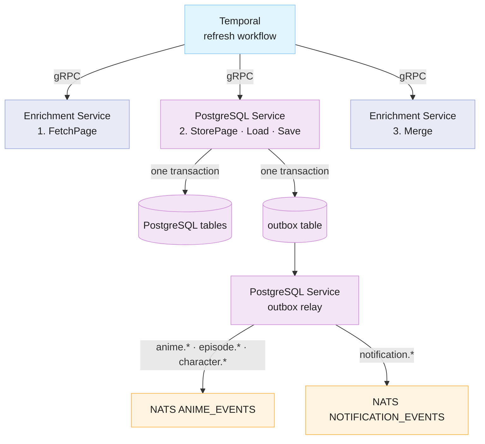
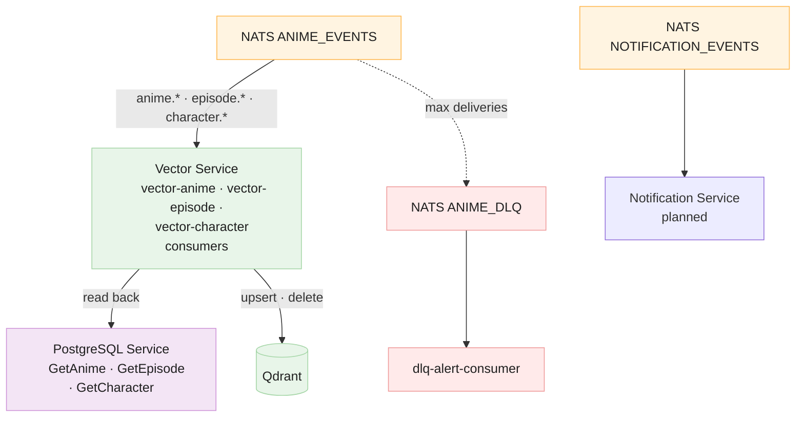

# Event-Driven Architecture

## Overview

Echora uses two ways for services to work together, each for its own job:

- **Temporal orchestrates every write.** A refresh, a first enrichment and a page moving between works are Temporal workflows, for works, episodes and characters alike. Each step is a gRPC call to the service that owns it, so Temporal keeps the order of the steps, retries them and records their history. See [[update_service|Update Service]].
- **NATS JetStream tells other services that something changed.** After the PostgreSQL Service commits a change, its outbox sends a notice on NATS. The vector service, and later the notification service, react to it.

Only the PostgreSQL Service publishes catalogue events, and only through its outbox. No workflow, pipeline or other service publishes to `ANIME_EVENTS`. An event is never a command. A service that needs another service to do something calls it over gRPC from a Temporal workflow.

> [!important] Why notices and not commands
> A notice states a fact that is already true in PostgreSQL ("work X changed"). Every consumer decides on its own what to do with it, and a new consumer can be added without changing the publisher. A command sent as an event ("please re-index work X") would hide a dependency the publisher relies on, without the retries and history Temporal gives a real call.

## Architecture Diagrams

### Writes

A Temporal workflow calls each service in order. The PostgreSQL Service commits the change and its outbox row together, and the relay publishes the row afterwards. Episodes and characters are saved the same way by their own refresh workflows.



### Reads after an event

Each consumer pulls a notice, reads the current state back from the PostgreSQL Service and writes that. A delete is applied only when the read-back confirms the entity is gone. A notice that fails five times becomes a dead-letter advisory.



## Event Bus: NATS JetStream

NATS JetStream carries the catalogue events. The reasons:

- **One small server.** NATS is a single binary with JetStream built in, so development and production run the same thing without a separate coordination cluster.
- **Durable, at-least-once delivery.** JetStream keeps messages on disk, tracks each durable consumer's position and redelivers unacknowledged messages.
- **What the design needs is built in.** Broker-side deduplication (`Nats-Msg-Id`), per-message expiry (`Nats-TTL`) and max-delivery advisories for the dead-letter stream need no extra code.
- **Official clients for both languages.** `async-nats` for the Rust PostgreSQL Service and `nats-py` for the Python services. (ECHO-90)

Catalogue events are small notices kept for days, so the long retention and replay of a log such as Kafka buy nothing here. Kafka is worth adding only if a long-kept, replayable stream of every user action is wanted later, for recommendations or analytics, and then beside NATS, not instead of it.

The server is pinned to the [2.15](https://docs.nats.io/release-notes/upgrade-to-2.15) line, the latest. NATS ships a minor release about every six months and patches only the latest line and the one before it ([supported versions](https://docs.nats.io/release-notes/)), so the pin moves when 2.16 ships. Before that move, any permissions on `$JS.ACK.>` or `$JS.FC.>` subjects must change to the new format that 2.16 turns on by default. (ECHO-90)

What newer releases offer, and what the design takes from them:

- **Publishing one notice at a time, asynchronously.** NATS's [publishing guide](https://docs.nats.io/learn/jetstream/advanced-publishing) recommends one-at-a-time or async publishing unless messages must land together or throughput demands more. The relay publishes a batch asynchronously and waits for every confirmation. Atomic batches (2.12) are for messages that only make sense together, and each notice stands alone. Fast batch publishing (2.14) is for throughput far above ours. NATS's guide also notes that Rust reaches atomic batches through the Synadia Orbit libraries, not `async-nats` itself. (ECHO-106)
- **Message schedules (2.12, recurring from 2.14)** are not used. Temporal already runs episode tracking and the sweep, with retries and history.
- **Consumer reset (2.14)** moves a consumer back to an earlier sequence without recreating it (`reset_consumer` in `nats-py` 2.16). It can replay up to the 7 days the stream keeps. A full re-index reads PostgreSQL instead. (ECHO-121)
- **Strict JetStream API (2.12)** rejects requests with unknown fields, so the clients stay on current releases: `async-nats` and `nats-py` 2.16 or later. (ECHO-90)
- **A default limit of 1,000 consumers per stream (2.15)** is far above the few consumers each stream has.

## Thin Events

Every catalogue event is a thin notice: one `CatalogueEvent` message holding the ID of what changed and its version, never the changed data. The subject says which entity and which change. See [[event_schema_specification#Catalogue Events|Event Schema Specification]].

A consumer reads the current state back from the PostgreSQL Service over gRPC and writes that. This keeps every consumer correct under the delivery JetStream gives:

- **Repeated deliveries are harmless.** Reading and writing the current state twice gives the same result.
- **Order does not matter.** A late notice for version 4 still reads version 6, the current one.
- **Stale writes are refused.** The vector service stores the version it indexed in each Qdrant point, and every write is conditional on the stored version being older, so a late or slow notice cannot overwrite a newer one. (ECHO-114)
- **Events stay small.** An entity's merged record never travels through NATS, and the event schema does not repeat the data model.

The `version` is a counter on each entity that its save increases in the transaction that changes it:

- on each work (ECHO-98),
- on each episode (ECHO-103),
- on each character (ECHO-104).

### Created, updated and deleted

Events describe works, episodes and characters, never provider pages. Storing a page sends nothing. (ECHO-97)

Only a save sends an event, after a merge. (ECHO-98)

- **`created`** means the entity's first merge was saved. A new anime listed by five providers never seen before is fetched page by page, merged once and saved once, so it sends one `anime.created`, then one `episode.created` and one `character.created` for each episode and character it lists.
  - A work the seed load created has a row before its first merge, with `merged_at` empty, and sends nothing until then. Its first save sends `anime.created`. (ECHO-98)
  - An episode's first save sends `episode.created`. (ECHO-103)
  - A character's first save sends `character.created`. (ECHO-104)
- **`updated`** means an existing entity was saved with changes, such as a refreshed page changing a field or a new provider page joining it.
  - A work's save sends `anime.updated`. (ECHO-98)
  - An episode's save sends `episode.updated`. (ECHO-103)
  - A character's save sends `character.updated`. (ECHO-104)
- **`deleted`** means the entity was removed. The row stays with `deleted_at` set, and the version increases once more.
  - A work merged into another is removed by `DeleteAnime`. (ECHO-107)
  - A character merged into another is removed by the character merge. (ECHO-104)
  - A character no work links to any more is removed by the cleanup job. (ECHO-116)
- A save that changes nothing sends no event. (ECHO-98)

A page moving between works sends one event per affected work:

- **A page split off into its own new work** sends `anime.created` for the new work and `anime.updated` for the work it left. (ECHO-107)
- **Two works merged into one** send `anime.updated` for the work that stays and `anime.deleted` for the one removed. (ECHO-107)
- **A page moving between two existing works** sends `anime.updated` for both. (ECHO-107)

Consumers that only index the current state, such as the vector service, handle `created` and `updated` the same way. Consumers that care about new entities, such as a "recently added" list, read `created` alone. Because every consumer reads the current state back, an `updated` that arrives before its `created` is still handled correctly, and the late `created` is skipped by its version. (ECHO-114)

## Event Flow

### 1. A workflow saves an entity

Each save stores the merged entity in its tables (see [[Database Schema]]) and writes its outbox rows, all in one transaction:

- `SaveAnime` for a work (ECHO-98),
- `SaveEpisode` for an episode (ECHO-103),
- `SaveCharacter` for a character (ECHO-104).

- **Version check.** The save writes only if the entity's version still equals `expected_version` from its load. Otherwise it returns `ABORTED`. Every save checks it, as listed under [[event_schema_specification#PostgresService (planned)|Event Schema Specification]].
  - The merge activity then loads, merges and saves again. (ECHO-111)
- **Change check.** The entity's `merged_record_hash` tells whether anything changed. When nothing did, the save writes nothing and sends nothing. (ECHO-98)
  - The refresh's last call, `RecordRefresh`, records that it finished either way. (ECHO-108)

```rust
// crates/postgres_db: save_anime (ECHO-98)

/// Subject of the notice for a work's first merge; the vector service consumes `anime.*`.
const ANIME_CREATED_SUBJECT: &str = "anime.created";
/// Subject of the notice for a later change to a work.
const ANIME_UPDATED_SUBJECT: &str = "anime.updated";
/// Format of `merged_record_hash`. Raising it makes every entity's next save count as a change.
const HASH_FORMAT: i16 = 1;

let mut transaction = pool.begin().await?;
// Canonical hash of everything the save writes: the work and its episode and character lists
let record_hash = hash_merged_record(&merged_anime, &episodes, &characters);

let stored_work = sqlx::query!(
    "SELECT version, merged_record_hash, merged_at FROM anime WHERE id = $1 FOR UPDATE",
    anime_id,
)
.fetch_one(&mut *transaction)
.await?;

if stored_work.version != expected_version {
    return Err(SaveError::version_conflict(anime_id, stored_work.version));
}

if stored_work.merged_record_hash.as_deref() != Some(record_hash.as_str()) {
    let version = expected_version + 1;
    let subject = if stored_work.merged_at.is_none() {
        ANIME_CREATED_SUBJECT
    } else {
        ANIME_UPDATED_SUBJECT
    };
    write_anime_tables(&mut transaction, anime_id, &merged_anime).await?;
    sqlx::query!(
        "UPDATE anime SET version = $2, merged_record_hash = $3, hash_format = $4,
                          merged_at = coalesce(merged_at, now()) WHERE id = $1",
        anime_id, version, record_hash, HASH_FORMAT,
    )
    .execute(&mut *transaction)
    .await?;
    let notice = CatalogueEvent { entity_id: anime_id.to_string(), version, ..Default::default() };
    sqlx::query!(
        "INSERT INTO outbox (subject, entity_id, version, payload, traceparent)
         VALUES ($1, $2, $3, $4, $5)",
        subject, anime_id, version, notice.encode_to_vec(), current_traceparent(),
    )
    .execute(&mut *transaction)
    .await?;
}

transaction.commit().await?;
```

`save_anime` returns a `SaveError`, an error struct whose kind stays private. `From<sqlx::Error>` lets `?` convert database errors, and a missing row becomes a not-found error. Callers ask `is_version_conflict()` or `is_not_found()`. (ECHO-93)

The gRPC handler in `postgres_service` maps it to a status in one function, since Rust's orphan rule forbids `impl From<SaveError> for Status` in a crate that owns neither type. (ECHO-97)

```rust
// crates/postgres_service: the one place library errors become gRPC statuses (ECHO-97)
fn map_save_error_to_status(error: &SaveError) -> Status {
    if error.is_version_conflict() {
        Status::aborted(error.to_string())
    } else if error.is_not_found() {
        Status::not_found(error.to_string())
    } else {
        Status::internal(error.to_string())
    }
}
```

`write_anime_tables` writes everything the save stores, in one transaction:

- the work's columns, `updated_at`, and on a work's first merge `merged_at`, which makes its outbox row `anime.created` (ECHO-98);
- its names, classification and images (ECHO-100);
- its songs, streaming, links, statistics, broadcast and hiatus (ECHO-101);
- its relations, source material, companies and `graph_edge` rows, resolving pending relations (ECHO-102);
- the episodes the merge gave new IDs (ECHO-103);
- the characters the merge gave new IDs (ECHO-104);
- a status notification row when the work's status changed (ECHO-98).

It sorts its keys and writes the shared tables (`genre`, `tag`, `company`, `character`, `graph_edge` and the others) in a fixed order, so two refreshes saving at once take their locks in the same order and cannot deadlock. (ECHO-98)

The episode-aired notification is not written by a save. `MarkEpisodeAired` writes it, once, when episode tracking confirms the episode aired. (ECHO-103)

### 2. The outbox relay publishes

A background task in the PostgreSQL Service publishes unpublished rows. It never holds a database transaction open while talking to NATS:

1. **Claim.** A short statement marks up to 100 unpublished rows as claimed for 30 seconds and returns them. `FOR UPDATE SKIP LOCKED` lets more than one relay run without claiming the same row. (ECHO-106)
2. **Publish.** Outside any transaction, the relay publishes every claimed row and waits for NATS to confirm each one. (ECHO-106)
3. **Mark.** One short statement sets `published_at` on every row NATS confirmed. A row that failed stays unpublished, and is claimed again once its claim runs out. (ECHO-106)

```rust
// crates/postgres_db: outbox relay, run as a background task by postgres_service (ECHO-106)

/// Rows claimed per batch, few enough to publish well within one claim.
const RELAY_BATCH_SIZE: i64 = 100;
/// How long a claim lasts, in seconds.
///
/// Longer than one batch takes to publish. A relay that stops mid-batch leaves its rows
/// to be claimed again once this runs out, and JetStream drops the copies by `Nats-Msg-Id`.
const RELAY_CLAIM_SECONDS: f64 = 30.0;
/// Wait when no row is due, so an idle relay does not query PostgreSQL in a tight loop.
const RELAY_IDLE_WAIT: Duration = Duration::from_secs(1);
/// Wait after a failed batch, so a PostgreSQL or NATS outage is not retried in a tight loop.
const RELAY_FAILURE_WAIT: Duration = Duration::from_secs(5);
/// Failed sends after which a row is parked: taken out of the queue and alerted on, so a row
/// that can never be sent, such as one whose subject no stream holds, cannot block the rest.
const RELAY_MAX_FAILURES: i32 = 10;

/// Publish outbox rows to NATS until the service stops.
///
/// A failed batch is logged and tried again after a pause, so one outage never stops
/// the relay.
pub async fn run_outbox_relay(pool: PgPool, jetstream: jetstream::Context) {
    loop {
        match relay_batch(&pool, &jetstream).await {
            Ok(0) => tokio::time::sleep(RELAY_IDLE_WAIT).await,
            Ok(_) => {}
            Err(error) => {
                event!(
                    name: "outbox.relay.failed",
                    Level::WARN,
                    error.message = %error,
                    "outbox batch failed: {{error.message}}",
                );
                tokio::time::sleep(RELAY_FAILURE_WAIT).await;
            }
        }
    }
}

/// Claim, publish and mark one batch of outbox rows, returning how many were claimed.
async fn relay_batch(pool: &PgPool, jetstream: &jetstream::Context) -> Result<usize, RelayError> {
    // 1. Claim, in one short statement
    let claimed_rows = sqlx::query_as!(
        OutboxRow,
        r#"
        UPDATE outbox SET claimed_until = now() + make_interval(secs => $2)
        WHERE id IN (
            SELECT id FROM outbox
            WHERE published_at IS NULL AND parked_at IS NULL
              AND (claimed_until IS NULL OR claimed_until < now())
            ORDER BY id
            LIMIT $1
            FOR UPDATE SKIP LOCKED
        )
        RETURNING id, subject, payload, traceparent
        "#,
        RELAY_BATCH_SIZE,
        RELAY_CLAIM_SECONDS,
    )
    .fetch_all(pool)
    .await?;
    let claimed_count = claimed_rows.len();

    // 2. Publish outside any transaction, then wait for every confirmation
    // A failed send affects only its own row, never the rest of the batch.
    let mut confirmations = Vec::with_capacity(claimed_count);
    let mut failed_ids = Vec::new();
    for row in claimed_rows {
        let mut headers = HeaderMap::new();
        headers.insert(header::NATS_MESSAGE_ID, row.id.to_string().as_str());
        headers.insert(header::NATS_EXPECTED_STREAM, stream_for(&row.subject));
        headers.insert("traceparent", row.traceparent.as_str());
        match jetstream.publish_with_headers(row.subject, headers, row.payload.into()).await {
            Ok(confirmation) => confirmations.push((row.id, confirmation)),
            Err(error) => {
                log_publish_failure(row.id, &error);
                failed_ids.push(row.id);
            }
        }
    }
    let mut published_ids = Vec::with_capacity(claimed_count);
    for (outbox_id, confirmation) in confirmations {
        match confirmation.await {
            Ok(_) => published_ids.push(outbox_id),
            Err(error) => {
                log_publish_failure(outbox_id, &error);
                failed_ids.push(outbox_id);
            }
        }
    }

    // 3. Mark, in one short statement each: published rows, and failed rows,
    //    which are parked after RELAY_MAX_FAILURES so they never block the rows behind them
    sqlx::query!("UPDATE outbox SET published_at = now() WHERE id = ANY($1)", &published_ids)
        .execute(pool)
        .await?;
    sqlx::query!(
        "UPDATE outbox SET publish_failures = publish_failures + 1,
                parked_at = CASE WHEN publish_failures + 1 >= $2 THEN now() END
         WHERE id = ANY($1)",
        &failed_ids,
        RELAY_MAX_FAILURES,
    )
    .execute(pool)
    .await?;
    Ok(claimed_count)
}

/// Log one outbox row that NATS did not take or did not confirm.
fn log_publish_failure(outbox_id: Uuid, error: &dyn std::error::Error) {
    event!(
        name: "outbox.publish.failed",
        Level::WARN,
        outbox.id = %outbox_id,
        error.message = %error,
        "outbox row {{outbox.id}} was not published: {{error.message}}",
    );
}
```

- **The outbox row ID is the `Nats-Msg-Id`.** If the relay stops after publishing but before marking a row, the row is published again once its claim runs out, and JetStream drops the copy within the dupe window. The ID is a UUIDv7, never a sequence number, so a database restored to an earlier moment cannot reuse an ID that JetStream would drop as a duplicate. (ECHO-106)
- **`Nats-Expected-Stream`** makes a publish fail when the subject is not bound to the expected stream, instead of losing the message. (ECHO-106)
- **Failures stay with their row.** A row whose send fails counts one more failure, and after `RELAY_MAX_FAILURES` it is parked and raises an alert, so a row that can never be sent never blocks the rows behind it. Rows already sent in the same batch are still marked. (ECHO-106)
- **The relay restarts.** The PostgreSQL Service supervises the relay task and starts it again if it ever exits, panic included, so publishing never stops silently. (ECHO-106)
- **Traces continue.** Each outbox row keeps the `traceparent` of the save that wrote it, and the relay sends it as a NATS header, so one trace runs from the save to the vector service's write. (ECHO-106)
- **Order.** Rows are published in `id` order within a batch, but a retried row can arrive after newer ones. Consumers do not rely on order, since every event carries a version. (ECHO-106)
- Published rows older than the stream's retention are deleted by a daily job. (ECHO-116)

### 3. The vector service reacts

The vector service runs one pull consumer per entity kind and reads the current state back for each notice. (ECHO-114)

```python
# Vector Service (Python) (ECHO-114)
async def consume_anime_events(jetstream: JetStreamContext, postgres: PostgresServiceStub) -> None:
    """Index works in Qdrant from anime.created, anime.updated and anime.deleted notices."""
    subscription = await jetstream.pull_subscribe_bind(
        durable="vector-anime-consumer", stream="ANIME_EVENTS"
    )
    while True:
        try:
            messages = await subscription.fetch(batch=EMBED_MAX_CONCURRENCY, timeout=5)
        except nats.errors.TimeoutError:
            continue
        await asyncio.gather(*(process_anime_notice(message, postgres) for message in messages))


async def process_anime_notice(message: Msg, postgres: PostgresServiceStub) -> None:
    """Index one notice, keeping its delivery alive while the embeddings run."""
    heartbeat = asyncio.create_task(report_progress(message, every_seconds=30))
    try:
        await handle_anime_notice(message, postgres)
        await message.ack()
    except DecodeError as error:
        logger.error(f"[{message.subject}] Unreadable notice, terminating: {error}")
        await message.term()
    except Exception as error:
        logger.error(f"[{message.subject}] Failed to index notice: {error}")
        await message.nak(delay=retry_delay_seconds(message.metadata.num_delivered))
    finally:
        heartbeat.cancel()
```

`handle_anime_notice` reads the subject first:

- `anime.created` and `anime.updated` read the work with `GetAnime`, which returns the work with its version, and write its point. (ECHO-114)
- `anime.deleted` reads the work back too, and turns the point into a tombstone only when `GetAnime` answers `NOT_FOUND`, which it does for a deleted or never-merged work. A forged or mistaken delete notice therefore changes nothing. Any notice whose read-back answers `NOT_FOUND` makes the tombstone the same way, with the notice's version. (ECHO-114)

The episode and character consumers work the same way with `GetEpisode` and `GetCharacter`. (ECHO-114)

- **Progress.** Embedding a work's text and images can take longer than a delivery's deadline. `report_progress` calls `message.in_progress()` every 30 seconds, which tells JetStream the work is still running and restarts the deadline. (ECHO-114)
- **Binding, not creating.** `pull_subscribe_bind` attaches to the consumer the service created at startup and fails if it is missing. `pull_subscribe` would quietly create one with default settings, without the backoff. (ECHO-114)
- **Failures.** A failed notice is nak'd with a growing delay. A bare `nak()` would redeliver it at once and use up `max_deliver` in seconds. (ECHO-114)
- **Notices that can never succeed** are terminated, not retried. A payload that is not a `CatalogueEvent` will fail on every delivery, so `term()` stops its delivery at once and JetStream sends a terminated advisory, which `ANIME_DLQ` keeps beside the max-delivery ones. NATS [recommends](https://docs.nats.io/learn/jetstream/acknowledgment) `term()` only when no later attempt can succeed, and a delayed nak otherwise. (ECHO-114)
- **Batch size.** A fetch takes as many notices as the service embeds at once (`EMBED_MAX_CONCURRENCY`), so no fetched notice waits in memory while its deadline runs. (ECHO-114)
- **Indexing apart from search.** The vector service runs as two roles of one image: search replicas, which run no consumers, and indexing replicas, which run the consumers and the comparison job. A seed load's flood of notices then never competes with searches for the models. (ECHO-114)
- **Version in Qdrant.** Each point's payload stores the version it was indexed from. The payload has no version today, so it is added with the consumers. (ECHO-114)
- **Conditional writes.** Every write uses Qdrant's [conditional update](https://qdrant.tech/documentation/manage-data/points/) (`update_filter`, from Qdrant 1.16; this repository runs 1.19.1): it applies only when the stored point's version is older than the one being written. Two replicas handling one entity in any order, or a slow embed finishing after a newer one, therefore end at the newest version. (ECHO-114)
- **Tombstones.** A delete does not remove the point. It removes the point's vectors, so search can no longer find it, and keeps a payload with `deleted` and the version. A slow update that read the entity before it was deleted then finds the tombstone's newer version and is refused, where it would otherwise insert the point again. Tombstones older than 8 days, longer than the stream keeps any notice, are purged by the comparison job. That Qdrant keeps a point with no vectors is confirmed when the consumers are built. (ECHO-114)
- **Reads skip tombstones.** Vector search cannot return a point without vectors, but `scroll` and `retrieve` in `libs/qdrant_db` read payloads and would. Every read therefore adds `must_not: deleted = true`, and `deleted` gets a payload index. (ECHO-114)
- **The three write paths are tested separately.** A conditional write on a missing point inserts it, which is what `created` needs. On an existing point with an older version, it updates. On a tombstone with a newer version, it is refused. (ECHO-114)
- **Embedding only what changed.** Most saves change only statistics, such as member counts, which the embedded text does not contain. Each point stores two hashes, each prefixed with the version of the model and of the text or image extraction that produced it: `text_embed_hash` over the embedded text, and `image_embed_hash` over the image URLs. The consumer runs BGE-M3 only when the text hash differs, downloads images and runs OpenCLIP only when the image hash differs, and otherwise updates the payload alone. A model or extraction upgrade changes the prefix, so every point is re-embedded on its next write without a separate migration. (ECHO-114)
- **The comparison job.** A scheduled job in the vector service pages through `ListEntityVersions` and Qdrant side by side. It indexes every entity whose point is missing or holds a different version, older or newer, and tombstones every point whose entity is gone. It is how a missed delete, a dead-lettered notice or a database restore is repaired, and the same job rebuilds Qdrant from scratch. (ECHO-121)

## Subjects

```
# ── ANIME_EVENTS (anime.> + episode.> + character.>) ─────────────────  (ECHO-90)
# Published by the PostgreSQL Service outbox relay only. All use CatalogueEvent.

anime.created        anime.updated        anime.deleted
episode.created      episode.updated      episode.deleted
character.created    character.updated    character.deleted

# ── NOTIFICATION_EVENTS (notification.>) ─────────────────────────────  (ECHO-90)
# Published by the PostgreSQL Service outbox relay only.

notification.episode.aired          # Episode tracking confirmed an episode aired
notification.anime.status.changed   # A work changed airing status
```

Each consumer filters on one entity's subjects, such as `anime.*`. Every subject under it carries the same `CatalogueEvent`, so a wildcard never mixes message types. (ECHO-114)

> [!note] Upcoming-episode reminders
> Reminders before an episode airs are not catalogue changes, so they do not go through the outbox. Who sends them is decided with the notification service. (P-ECHO-18)

## Consumer Configuration

### Pull consumers

Every consumer pulls. The service fetches a batch when it is ready, which gives it control over its own pace when a sweep saves thousands of entities at once. NATS remembers each durable consumer's position across restarts. (ECHO-114)

### Delivery deadline and backoff

> **Linear:** ECHO-114

A consumer's `BackOff` list **replaces** its `AckWait`. The first entry is the deadline of the first delivery, and each later entry is the deadline of the next one ([NATS consumer docs](https://github.com/nats-io/nats.docs/blob/master/nats-concepts/jetstream/consumers.md), [acknowledgements](https://docs.nats.io/learn/jetstream/acknowledgment)). A list starting at one second would redeliver a notice after one second, while it is still being embedded. So:

- **`BackOff[0]` is longer than the slowest normal processing**, and `in_progress()` keeps longer work alive.
- **A known failure is nak'd with a delay** that grows with the delivery count, since a nak ignores `BackOff`.

| Setting | Value |
|---|---|
| Consumer type | Pull, durable |
| Ack policy | Explicit |
| Batch size | `EMBED_MAX_CONCURRENCY` |
| Backoff | 2 min, 5 min, 15 min, 30 min (4 deadlines for 5 deliveries) |
| Progress | `in_progress()` every 30 s during indexing |
| Max deliver | 5 |
| Dead letters | Broker advisory into `ANIME_DLQ`, alert on every one |

### Streams and consumers

```
Stream: ANIME_EVENTS                    # (ECHO-90)
  Subjects:      anime.>, episode.>, character.>
  Storage:       File
  Retention:     7 days
  Dupe window:   10m   # longer than a claim, so a relay retry is dropped; see below

Consumer: vector-anime-consumer         # (ECHO-114)
  Filter:        anime.*
  Max deliver:   5
  Backoff:       [2m, 5m, 15m, 30m]

Consumer: vector-episode-consumer       # (ECHO-114)
  Filter:        episode.*
  Max deliver:   5
  Backoff:       [2m, 5m, 15m, 30m]

Consumer: vector-character-consumer     # (ECHO-114)
  Filter:        character.*
  Max deliver:   5
  Backoff:       [2m, 5m, 15m, 30m]

Stream: ANIME_DLQ                       # (ECHO-90)
  Subjects:      $JS.EVENT.ADVISORY.CONSUMER.MAX_DELIVERIES.ANIME_EVENTS.*
                 $JS.EVENT.ADVISORY.CONSUMER.MSG_TERMINATED.ANIME_EVENTS.*
  Storage:       File
  Retention:     30 days

Stream: NOTIFICATION_EVENTS             # (ECHO-90)
  Subjects:      notification.>
  Storage:       File
  Retention:     3 days
  Dupe window:   1h
  Allow msg TTL: true   # publishers set Nats-TTL so a late notification expires

Consumer: notification-consumer         # planned, Notification Service (P-ECHO-18)
  Filter:        notification.>
  Max deliver:   3
  Backoff:       [30s, 2m, 5m]
```

**Dupe window.** JetStream keeps every `Nats-Msg-Id` of the window in memory, at about 140 bytes each, and [does not reliably return that memory](https://www.synadia.com/insights/checks/nats-large-deduplication-window.md). A seed load can send close to a million notices in a day, so a 24-hour window would hold over 100 MB for nothing. The window only needs to outlast the relay's own retry: a row is published again no sooner than its 30-second claim runs out, so 10 minutes covers a relay restart with room to spare. A copy that arrives after a longer outage is harmless, since consumers skip a notice whose version they already indexed. (ECHO-90)

Neither service waits for NATS to start, and both retry stream and consumer setup in the background until NATS answers.

- The PostgreSQL Service creates the streams at startup, and updates their settings when they differ. (ECHO-90)
- The PostgreSQL Service serves reads and saves without NATS, since rows wait in the outbox. (ECHO-106)
- The vector service serves search without NATS, and creates its own durable consumers at startup with `nats-py`'s `add_consumer`. JetStream accepts a create whose settings match the existing consumer, so this is safe on every start. (ECHO-114)

## Error Handling

### Retries

```python
# Vector Service (Python), at startup (ECHO-114)
from nats.js.api import ConsumerConfig

await jetstream.add_consumer(
    "ANIME_EVENTS",
    ConsumerConfig(
        durable_name="vector-anime-consumer",
        filter_subject="anime.*",
        max_deliver=5,  # must be greater than the number of backoff entries
        # Replaces ack_wait: each entry, in seconds, is the deadline of one delivery
        backoff=[120, 300, 900, 1800],
    ),
)
```

Together the deliveries span about an hour, enough to ride out a restart of Qdrant or the PostgreSQL Service. (ECHO-114)

### Dead letters

> **Linear:** ECHO-121

After `max_deliver` attempts, the NATS server publishes an advisory to `$JS.EVENT.ADVISORY.CONSUMER.MAX_DELIVERIES.ANIME_EVENTS.<consumer>`. A notice a consumer terminates gets one on `$JS.EVENT.ADVISORY.CONSUMER.MSG_TERMINATED.ANIME_EVENTS.<consumer>`. JetStream has [no built-in dead-letter queue](https://docs.nats.io/learn/monitoring/advisories-and-events), and an advisory nobody is subscribed to is lost, so the `ANIME_DLQ` stream captures both. No application code copies the failed message anywhere.

- The original message stays in `ANIME_EVENTS` at its sequence number, which the advisory names in `stream_seq`.
- `ANIME_DLQ` keeps advisories 30 days, longer than the 7 days of `ANIME_EVENTS`, so the advisory outlives the message. Inspect a failure within 7 days, or rely on the next notice for the same entity.
- A missed notice is never lost data. The entity is current in PostgreSQL, and the next notice or a re-index from PostgreSQL brings Qdrant up to date.

```bash
# Read the failed message named by an advisory
docker exec echora-nats-box nats stream get ANIME_EVENTS 12345
```

The `dlq-alert-consumer` pulls from `ANIME_DLQ` and sends an alert with the consumer name, `stream_seq` and delivery count for every advisory. Start by alerting on every one, and batch the alerts only if they become noise.

## Monitoring

> **Linear:** ECHO-122

NATS serves its numbers as JSON on the monitoring port, which Prometheus cannot read. [`prometheus-nats-exporter`](https://docs.nats.io/learn/monitoring/prometheus-and-dashboards) runs beside each server, reads port 8222 and serves Prometheus metrics on port 7777, such as `nats_consumer_num_pending` for consumer lag and `nats_consumer_num_redelivered`. Prometheus scrapes it like the other services, and Grafana charts it.

```bash
prometheus-nats-exporter -varz -jsz=all -prefix nats -port 7777 http://localhost:8222

curl http://localhost:8222/jsz                                # JetStream, as JSON
docker exec echora-nats-box nats stream info ANIME_EVENTS     # stream
docker exec echora-nats-box nats consumer report ANIME_EVENTS # consumer lag
```

| Metric | Alert when |
|--------|-----------|
| Failed workflow runs (Temporal metrics) | Any refresh, tracker or sweep that fails |
| Wait in a provider queue | Tasks waiting longer than a day, a sign of a ban or a rate set too low |
| A provider marked blocked | Any |
| Parked outbox rows | Any |
| Age of the oldest pending notice | Over an hour. A count of pending messages rises on every sweep and says nothing; age shows a consumer falling behind |
| Unpublished outbox rows | Oldest row older than 5 minutes |
| Dead-letter advisories | Any |
| Ack time | Over 5 s |

## Local Development

```yaml
# docker/docker-compose.dev.yml addition (ECHO-90)
nats:
  image: nats:2.15
  container_name: echora-nats
  command: ["-js", "-m", "8222", "-sd", "/data"]
  ports:
    - "4222:4222"   # clients
    - "8222:8222"   # monitoring
  volumes:
    - nats-data:/data

nats-box:
  image: natsio/nats-box:0.20.2
  container_name: echora-nats-box
  command: ["tail", "-f", "/dev/null"]
  depends_on:
    - nats
```

```bash
docker compose -f docker/docker-compose.dev.yml up -d nats nats-box
curl "http://localhost:8222/healthz?js-enabled-only=true"   # also checks JetStream
docker exec -it echora-nats-box nats stream ls
docker exec -it echora-nats-box nats sub "anime.>"   # watch notices as they are sent
```

## Production

> **Linear:** P-ECHO-21

> [!warning] Checklist
> - [ ] TLS on NATS connections
> - [ ] One NATS account per service; only the PostgreSQL Service may publish `anime.>`, `episode.>`, `character.>` and `notification.>`
> - [ ] Mutual TLS between services, with each server's interceptor allowing each caller only its methods (see [[postgres_integration_architecture_decision#Security|PostgreSQL Service]])
> - [ ] A NATS cluster of 3 nodes, with streams replicated 3 times
> - [ ] `ANIME_EVENTS` dupe window set to 10 minutes
> - [ ] `prometheus-nats-exporter` runs beside every NATS server
> - [ ] `ANIME_DLQ` exists with 30-day retention, and `dlq-alert-consumer` is connected to alerting
> - [ ] Every publish sets `Nats-Msg-Id` and `Nats-Expected-Stream`
> - [ ] `NOTIFICATION_EVENTS` allows message TTL, and every notification sets `Nats-TTL`
> - [ ] The oldest unpublished outbox row is monitored
> - [ ] Structured logs carry the entity ID and outbox row ID

```yaml
# Three-node cluster
services:
  nats-1:
    image: nats:2.15
    command: ["-js", "-sd", "/data", "-cluster_name", "echora", "-cluster", "nats://0.0.0.0:6222",
              "-routes", "nats://nats-2:6222,nats://nats-3:6222"]
  nats-2:
    image: nats:2.15
    command: ["-js", "-sd", "/data", "-cluster_name", "echora", "-cluster", "nats://0.0.0.0:6222",
              "-routes", "nats://nats-1:6222,nats://nats-3:6222"]
  nats-3:
    image: nats:2.15
    command: ["-js", "-sd", "/data", "-cluster_name", "echora", "-cluster", "nats://0.0.0.0:6222",
              "-routes", "nats://nats-1:6222,nats://nats-2:6222"]
```

## Related Documentation

- [[update_service|Update Service]] — The Temporal workflows that save works, episodes and characters
- [[event_schema_specification|Event Schema Specification]] — Event and gRPC message definitions
- [[Database Schema|Database Schema]] — Tables, including the outbox
- [[postgres_integration_architecture_decision|PostgreSQL Architecture]] — The PostgreSQL Service
- [NATS JetStream](https://docs.nats.io/nats-concepts/jetstream)
- [Transactional outbox](https://microservices.io/patterns/data/transactional-outbox.html)
- [async-nats](https://docs.rs/async-nats/) and [nats-py](https://github.com/nats-io/nats.py)

---

**Status**: Planned | **Last Updated**: 2026-11-14
