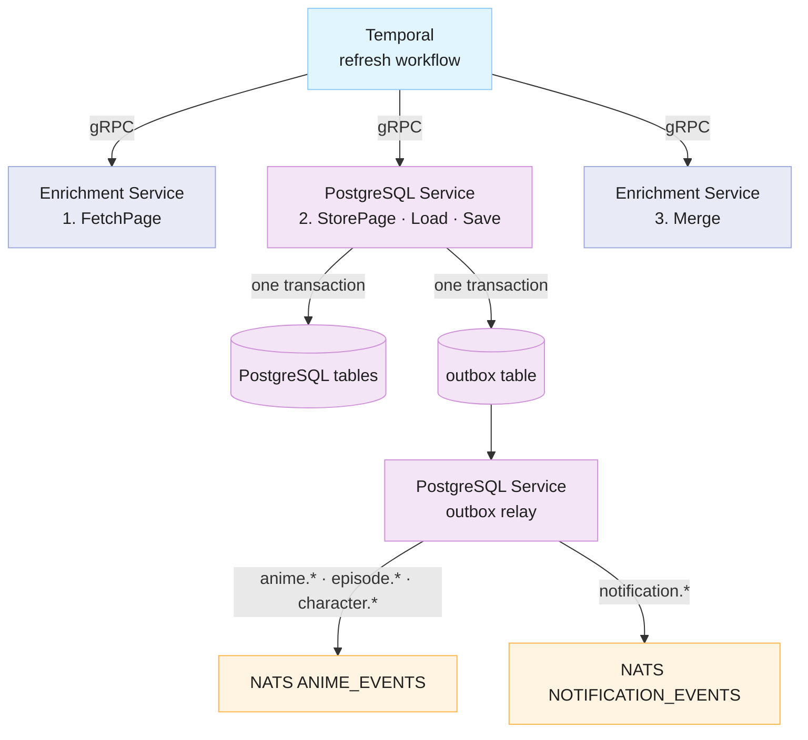
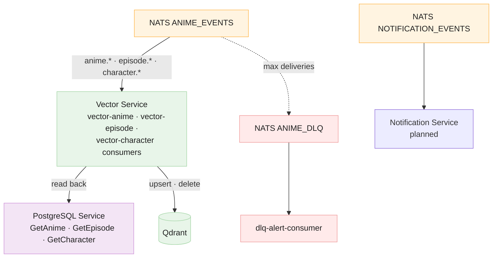

# Event-Driven Architecture

## Overview

Echora uses two ways for services to work together, each for its own job:

- **Temporal orchestrates every write.** A refresh, a first enrichment and a page moving between works are Temporal workflows, for works, episodes and characters alike. Each step is a gRPC call to the service that owns it, so Temporal keeps the order of the steps, retries them and records their history. See [[update_service|Update Service]].
- **NATS JetStream tells other services that something changed.** After the PostgreSQL Service commits a change, its outbox sends a notice on NATS. The vector service, and later the notification service, react to it.

Only the PostgreSQL Service publishes catalogue events, and only through its outbox. No workflow, pipeline or other service publishes to `ANIME_EVENTS`. An event is never a command. A service that needs another service to do something calls it over gRPC from a Temporal workflow.

> [!important] Why notices and not commands
> A notice states a fact that is already true in PostgreSQL ("work X changed"). Every consumer decides on its own what to do with it, and a new consumer can be added without changing the publisher. A command sent as an event ("please re-index work X") would hide a dependency the publisher relies on, without the retries and history Temporal gives a real call.

## Architecture Diagrams

### Writes

A Temporal workflow calls each service in order. The PostgreSQL Service commits the change and its outbox row together, and the relay publishes the row afterwards. Episodes and characters are saved the same way by their own refresh workflows.



### Reads after an event

Each consumer pulls a notice, reads the current state back from the PostgreSQL Service and writes that. A delete is applied without reading back. A notice that fails five times becomes a dead-letter advisory.



## Event Bus: NATS JetStream

NATS JetStream carries the catalogue events. The reasons:

- **One small server.** NATS is a single binary with JetStream built in, so development and production run the same thing without a separate coordination cluster.
- **Durable, at-least-once delivery.** JetStream keeps messages on disk, tracks each durable consumer's position and redelivers unacknowledged messages.
- **What the design needs is built in.** Broker-side deduplication (`Nats-Msg-Id`), per-message expiry (`Nats-TTL`) and max-delivery advisories for the dead-letter stream need no extra code.
- **Official clients for both languages.** `async-nats` for the Rust PostgreSQL Service and `nats-py` for the Python services.

Catalogue events are small notices kept for days, so the long retention and replay of a log such as Kafka buy nothing here. Kafka is worth adding only if a long-kept, replayable stream of every user action is wanted later, for recommendations or analytics, and then beside NATS, not instead of it.

The server is pinned to the [2.14](https://nats.io/blog/nats-server-2.14-release/) line. Nothing here needs 2.14's new features, such as recurring message schedules and fast batch publishing, but it is the current line.

## Thin Events

Every catalogue event is a thin notice: one `CatalogueEvent` message holding the ID of what changed and its version, never the changed data. The subject says which entity and which change. See [[event_schema_specification#Catalogue Events|Event Schema Specification]].

A consumer reads the current state back from the PostgreSQL Service over gRPC and writes that. This keeps every consumer correct under the delivery JetStream gives:

- **Repeated deliveries are harmless.** Reading and writing the current state twice gives the same result.
- **Order does not matter.** A late notice for version 4 still reads version 6, the current one.
- **Skipped work is cheap to detect.** The vector service stores the version it indexed in each Qdrant point, and skips a notice whose version is not newer than that.
- **Events stay small.** An entity's merged record never travels through NATS, and the event schema does not repeat the data model.

The `version` is a counter on each work, episode and character that its save increases in the transaction that changes it.

### Created, updated and deleted

Events describe works, episodes and characters, never provider pages. Storing a page sends nothing. Only a save sends an event, after a merge.

- **`created`** means the entity got its first row in PostgreSQL. A new anime listed by five providers never seen before is fetched page by page, merged once and saved once, so it sends one `anime.created`, then one `episode.created` and one `character.created` for each episode and character it lists.
- **`updated`** means an existing entity was saved with changes, such as a refreshed page changing a field or a new provider page joining it.
- **`deleted`** means the entity was removed, such as a work merged into another or a character no work links to any more. The row stays with `deleted_at` set, and the version increases once more.
- A save that changes nothing sends no event.

A page moving between works sends one event per affected work:

- **A page split off into its own new work** sends `anime.created` for the new work and `anime.updated` for the work it left.
- **Two works merged into one** send `anime.updated` for the work that stays and `anime.deleted` for the one removed.
- **A page moving between two existing works** sends `anime.updated` for both.

Consumers that only index the current state, such as the vector service, handle `created` and `updated` the same way. Consumers that care about new entities, such as a "recently added" list, read `created` alone. Because every consumer reads the current state back, an `updated` that arrives before its `created` is still handled correctly, and the late `created` is skipped by its version.

## Event Flow

### 1. A workflow saves an entity

> **Linear:** ECHO-98, ECHO-103, ECHO-104

`SaveWork`, `SaveEpisode` and `SaveCharacter` store the merged entity in its tables (see [[Database Schema]]) and write its outbox rows, all in one transaction.

- **Version check.** The save writes only if the entity's version still equals `expected_version` from its load. Otherwise it returns `ABORTED`, and Temporal retries the merge from the load.
- **Change check.** The entity's `merged_record_hash` tells whether anything changed. When nothing did, the save writes nothing and sends nothing, and only records that the refresh finished.

```rust
// PostgreSQL Service (Rust) — inside SaveWork, for an existing work
let mut transaction = pool.begin().await?;
let record_hash = hash_merged_record(&merged_anime);

let stored = sqlx::query!(
    "SELECT version, merged_record_hash FROM anime WHERE id = $1 FOR UPDATE",
    anime_id,
)
.fetch_one(&mut *transaction)
.await?;

if stored.version != expected_version {
    return Err(Status::aborted("the work changed since it was loaded"));
}

if stored.merged_record_hash.as_deref() == Some(record_hash.as_str()) {
    sqlx::query!("UPDATE anime SET refreshed_at = now() WHERE id = $1", anime_id)
        .execute(&mut *transaction)
        .await?;
} else {
    let version = expected_version + 1;
    write_work_tables(&mut transaction, anime_id, &merged_anime).await?;
    sqlx::query!(
        "UPDATE anime SET version = $2, merged_record_hash = $3, refreshed_at = now() WHERE id = $1",
        anime_id, version, record_hash,
    )
    .execute(&mut *transaction)
    .await?;
    let notice = CatalogueEvent { entity_id: anime_id.to_string(), version, ..Default::default() };
    sqlx::query!(
        "INSERT INTO outbox (subject, entity_id, version, payload) VALUES ($1, $2, $3, $4)",
        "anime.updated", anime_id, version, notice.encode_to_vec(),
    )
    .execute(&mut *transaction)
    .await?;
}

transaction.commit().await?;
```

`write_work_tables` upserts the work's columns and detail rows, creates the episodes and characters the merge gave new IDs, and resolves pending relations. A new work is inserted with version 1 the same way, and its outbox row is `anime.created`. An episode saved as aired for the first time, or a work whose status changed, adds a notification row in the same transaction.

### 2. The outbox relay publishes

> **Linear:** ECHO-106, ECHO-116

A background task in the PostgreSQL Service publishes unpublished rows. It never holds a database transaction open while talking to NATS:

1. **Claim.** A short statement marks up to 100 unpublished rows as claimed for 30 seconds and returns them. `FOR UPDATE SKIP LOCKED` lets more than one relay run without claiming the same row.
2. **Publish.** Outside any transaction, the relay publishes every claimed row and waits for NATS to confirm each one.
3. **Mark.** One short statement sets `published_at` on every row NATS confirmed. A row that failed stays unpublished, and is claimed again once its claim runs out.

```rust
// PostgreSQL Service (Rust) — outbox relay
loop {
    // 1. Claim, in one short statement
    let rows = sqlx::query_as!(
        OutboxRow,
        r#"
        UPDATE outbox SET claimed_until = now() + interval '30 seconds'
        WHERE id IN (
            SELECT id FROM outbox
            WHERE published_at IS NULL AND (claimed_until IS NULL OR claimed_until < now())
            ORDER BY id
            LIMIT 100
            FOR UPDATE SKIP LOCKED
        )
        RETURNING id, subject, payload
        "#,
    )
    .fetch_all(&pool)
    .await?;

    if rows.is_empty() {
        tokio::time::sleep(Duration::from_secs(1)).await;
        continue;
    }

    // 2. Publish outside any transaction, then wait for every confirmation
    let mut confirmations = Vec::with_capacity(rows.len());
    for row in &rows {
        let mut headers = async_nats::HeaderMap::new();
        headers.insert("Nats-Msg-Id", row.id.to_string().as_str());
        headers.insert("Nats-Expected-Stream", stream_for(&row.subject));
        let confirmation = jetstream
            .publish_with_headers(row.subject.clone(), headers, row.payload.clone().into())
            .await?;
        confirmations.push((row.id, confirmation));
    }
    let mut published_ids = Vec::with_capacity(rows.len());
    for (id, confirmation) in confirmations {
        if confirmation.await.is_ok() {
            published_ids.push(id);
        }
    }

    // 3. Mark, in one short statement
    sqlx::query!("UPDATE outbox SET published_at = now() WHERE id = ANY($1)", &published_ids)
        .execute(&pool)
        .await?;
}
```

- **The outbox row ID is the `Nats-Msg-Id`.** If the relay stops after publishing but before marking a row, the row is published again once its claim runs out, and JetStream drops the copy within the dupe window.
- **`Nats-Expected-Stream`** makes a publish fail when the subject is not bound to the expected stream, instead of losing the message.
- **Order.** Rows are published in `id` order within a batch, but a retried row can arrive after newer ones. Consumers do not rely on order, since every event carries a version.
- Published rows older than the stream's retention are deleted by a daily job.

### 3. The vector service reacts

> **Linear:** ECHO-114

The vector service runs one pull consumer per entity kind and reads the current state back for each notice.

```python
# Vector Service (Python)
async def consume_anime_events(js: JetStreamContext, postgres: PostgresServiceStub) -> None:
    """Index works in Qdrant from anime.created, anime.updated and anime.deleted notices."""
    subscription = await js.pull_subscribe(
        "anime.*", durable="vector-anime-consumer", stream="ANIME_EVENTS"
    )
    while True:
        try:
            messages = await subscription.fetch(batch=EMBED_MAX_CONCURRENCY, timeout=5)
        except nats.errors.TimeoutError:
            continue
        await asyncio.gather(*(index_anime_notice(message, postgres) for message in messages))


async def index_anime_notice(message: Msg, postgres: PostgresServiceStub) -> None:
    """Index one notice, keeping its delivery alive while the embeddings run."""
    heartbeat = asyncio.create_task(report_progress(message, every_seconds=30))
    try:
        await handle_anime_notice(message, postgres)
        await message.ack()
    except Exception as error:
        logger.error(f"[{message.subject}] Failed to index notice: {error}")
        await message.nak(delay=retry_delay_seconds(message.metadata.num_delivered))
    finally:
        heartbeat.cancel()
```

`handle_anime_notice` reads the subject first:

- `anime.created` and `anime.updated` read the work with `GetAnime`, then upsert its point when the stored version is older.
- `anime.deleted` deletes the work's point when its stored version is older than the notice, without reading the work back.

The episode and character consumers work the same way with `GetEpisode` and `GetCharacter`.

- **Progress.** Embedding a work's text and images can take longer than a delivery's deadline. `report_progress` calls `message.in_progress()` every 30 seconds, which tells JetStream the work is still running and restarts the deadline.
- **Failures.** A failed notice is nak'd with a growing delay. A bare `nak()` would redeliver it at once and use up `max_deliver` in seconds.
- **Batch size.** A fetch takes as many notices as the service embeds at once (`EMBED_MAX_CONCURRENCY`), so no fetched notice waits in memory while its deadline runs.
- **Version in Qdrant.** Each point's payload stores the version it was indexed from. The payload has no version today, so it is added with the consumers.

## Subjects

```
# ── ANIME_EVENTS (anime.> + episode.> + character.>) ─────────────────
# Published by the PostgreSQL Service outbox relay only. All use CatalogueEvent.

anime.created        anime.updated        anime.deleted
episode.created      episode.updated      episode.deleted
character.created    character.updated    character.deleted

# ── NOTIFICATION_EVENTS (notification.>) ─────────────────────────────
# Published by the PostgreSQL Service outbox relay only.

notification.episode.aired          # An episode was saved as aired for the first time
notification.anime.status.changed   # A work changed airing status
```

Each consumer filters on one entity's subjects, such as `anime.*`. Every subject under it carries the same `CatalogueEvent`, so a wildcard never mixes message types.

> [!note] Upcoming-episode reminders
> Reminders before an episode airs are not catalogue changes, so they do not go through the outbox. Who sends them is decided with the notification service.

## Consumer Configuration

### Pull consumers

Every consumer pulls. The service fetches a batch when it is ready, which gives it control over its own pace when a sweep saves thousands of entities at once. NATS remembers each durable consumer's position across restarts.

### Delivery deadline and backoff

> **Linear:** ECHO-114

A consumer's `BackOff` list **replaces** its `AckWait`. The first entry is the deadline of the first delivery, and each later entry is the deadline of the next one ([NATS consumer docs](https://github.com/nats-io/nats.docs/blob/master/nats-concepts/jetstream/consumers.md), [acknowledgements](https://docs.nats.io/learn/jetstream/acknowledgment)). A list starting at one second would redeliver a notice after one second, while it is still being embedded. So:

- **`BackOff[0]` is longer than the slowest normal processing**, and `in_progress()` keeps longer work alive.
- **A known failure is nak'd with a delay** that grows with the delivery count, since a nak ignores `BackOff`.

| Setting | Value |
|---|---|
| Consumer type | Pull, durable |
| Ack policy | Explicit |
| Batch size | `EMBED_MAX_CONCURRENCY` |
| Backoff | 2 min, 5 min, 15 min, 30 min (4 deadlines for 5 deliveries) |
| Progress | `in_progress()` every 30 s during indexing |
| Max deliver | 5 |
| Dead letters | Broker advisory into `ANIME_DLQ`, alert on every one |

### Streams and consumers

> **Linear:** ECHO-90

```
Stream: ANIME_EVENTS
  Subjects:      anime.>, episode.>, character.>
  Storage:       File
  Retention:     7 days
  Dupe window:   24h   # longer than any relay outage the outbox should recover from

Consumer: vector-anime-consumer
  Filter:        anime.*
  Max deliver:   5
  Backoff:       [2m, 5m, 15m, 30m]

Consumer: vector-episode-consumer
  Filter:        episode.*
  Max deliver:   5
  Backoff:       [2m, 5m, 15m, 30m]

Consumer: vector-character-consumer
  Filter:        character.*
  Max deliver:   5
  Backoff:       [2m, 5m, 15m, 30m]

Stream: ANIME_DLQ
  Subjects:      $JS.EVENT.ADVISORY.CONSUMER.MAX_DELIVERIES.ANIME_EVENTS.*
  Storage:       File
  Retention:     30 days

Stream: NOTIFICATION_EVENTS
  Subjects:      notification.>
  Storage:       File
  Retention:     3 days
  Dupe window:   1h
  Allow msg TTL: true   # publishers set Nats-TTL so a late notification expires

Consumer: notification-consumer   (planned, Notification Service)
  Filter:        notification.>
  Max deliver:   3
  Backoff:       [30s, 2m, 5m]
```

The PostgreSQL Service creates the streams at startup, and updates their settings when they differ. Each consumer service creates its own durable consumers with `get_or_create_consumer`, which is safe to call on every start.

## Error Handling

### Retries

```rust
use async_nats::jetstream::consumer::pull::Config;

Config {
    durable_name: Some("vector-anime-consumer".to_string()),
    filter_subject: "anime.*".to_string(),
    max_deliver: 5,
    // Replaces ack_wait: each entry is the deadline of one delivery
    backoff: vec![
        Duration::from_secs(120),
        Duration::from_secs(300),
        Duration::from_secs(900),
        Duration::from_secs(1800),
    ],
    ..Default::default()
}
```

Together the deliveries span about an hour, enough to ride out a restart of Qdrant or the PostgreSQL Service.

### Dead letters

> **Linear:** ECHO-121

After `max_deliver` attempts, the NATS server publishes an advisory to `$JS.EVENT.ADVISORY.CONSUMER.MAX_DELIVERIES.ANIME_EVENTS.<consumer>`, and the `ANIME_DLQ` stream keeps it. No application code copies the failed message anywhere.

- The original message stays in `ANIME_EVENTS` at its sequence number, which the advisory names in `stream_seq`.
- `ANIME_DLQ` keeps advisories 30 days, longer than the 7 days of `ANIME_EVENTS`, so the advisory outlives the message. Inspect a failure within 7 days, or rely on the next notice for the same entity.
- A missed notice is never lost data. The entity is current in PostgreSQL, and the next notice or a re-index from PostgreSQL brings Qdrant up to date.

```bash
# Read the failed message named by an advisory
docker exec echora-nats-box nats stream get ANIME_EVENTS 12345
```

The `dlq-alert-consumer` pulls from `ANIME_DLQ` and sends an alert with the consumer name, `stream_seq` and delivery count for every advisory. Start by alerting on every one, and batch the alerts only if they become noise.

## Monitoring

> **Linear:** ECHO-122

```bash
curl http://localhost:8222/varz                               # server
curl http://localhost:8222/jsz                                # JetStream
docker exec echora-nats-box nats stream info ANIME_EVENTS     # stream
docker exec echora-nats-box nats consumer report ANIME_EVENTS # consumer lag
```

| Metric | Alert when |
|--------|-----------|
| Consumer lag | Over 1,000 pending messages |
| Unpublished outbox rows | Oldest row older than 5 minutes |
| Dead-letter advisories | Any |
| Ack time | Over 5 s |

## Local Development

```yaml
# docker/docker-compose.dev.yml addition
nats:
  image: nats:2.14
  container_name: echora-nats
  command: ["-js", "-m", "8222", "-sd", "/data"]
  ports:
    - "4222:4222"   # clients
    - "8222:8222"   # monitoring
  volumes:
    - nats-data:/data

nats-box:
  image: natsio/nats-box:latest
  container_name: echora-nats-box
  command: ["tail", "-f", "/dev/null"]
  depends_on:
    - nats
```

```bash
docker compose -f docker/docker-compose.dev.yml up -d nats nats-box
curl http://localhost:8222/healthz
docker exec -it echora-nats-box nats stream ls
docker exec -it echora-nats-box nats sub "anime.>"   # watch notices as they are sent
```

## Production

> **Linear:** Deployment project

> [!warning] Checklist
> - [ ] TLS on NATS connections
> - [ ] A NATS cluster of 3 nodes, with streams replicated 3 times
> - [ ] `ANIME_EVENTS` dupe window set to 24h
> - [ ] `ANIME_DLQ` exists with 30-day retention, and `dlq-alert-consumer` is connected to alerting
> - [ ] Every publish sets `Nats-Msg-Id` and `Nats-Expected-Stream`
> - [ ] `NOTIFICATION_EVENTS` allows message TTL, and every notification sets `Nats-TTL`
> - [ ] The oldest unpublished outbox row is monitored
> - [ ] Structured logs carry the entity ID and outbox row ID

```yaml
# Three-node cluster
services:
  nats-1:
    image: nats:2.14
    command: ["-js", "-sd", "/data", "-cluster_name", "echora", "-cluster", "nats://0.0.0.0:6222",
              "-routes", "nats://nats-2:6222,nats://nats-3:6222"]
  nats-2:
    image: nats:2.14
    command: ["-js", "-sd", "/data", "-cluster_name", "echora", "-cluster", "nats://0.0.0.0:6222",
              "-routes", "nats://nats-1:6222,nats://nats-3:6222"]
  nats-3:
    image: nats:2.14
    command: ["-js", "-sd", "/data", "-cluster_name", "echora", "-cluster", "nats://0.0.0.0:6222",
              "-routes", "nats://nats-1:6222,nats://nats-2:6222"]
```

## Related Documentation

- [[update_service|Update Service]] — The Temporal workflows that save works, episodes and characters
- [[event_schema_specification|Event Schema Specification]] — Event and gRPC message definitions
- [[Database Schema|Database Schema]] — Tables, including the outbox
- [[postgres_integration_architecture_decision|PostgreSQL Architecture]] — The PostgreSQL Service
- [NATS JetStream](https://docs.nats.io/nats-concepts/jetstream)
- [Transactional outbox](https://microservices.io/patterns/data/transactional-outbox.html)
- [async-nats](https://docs.rs/async-nats/) and [nats-py](https://github.com/nats-io/nats.py)

---

**Status**: Planned | **Last Updated**: 2026-11-14
