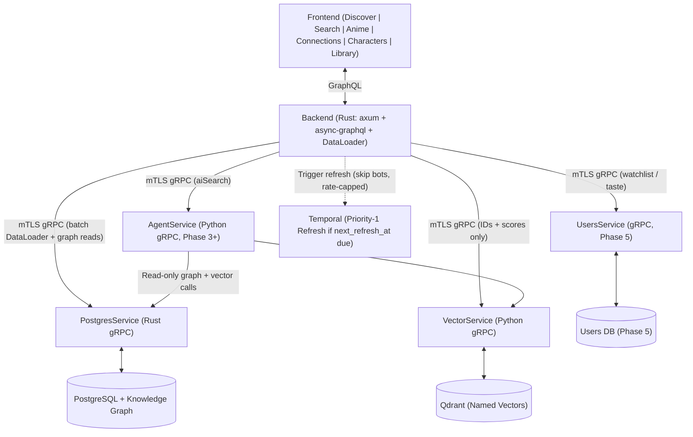
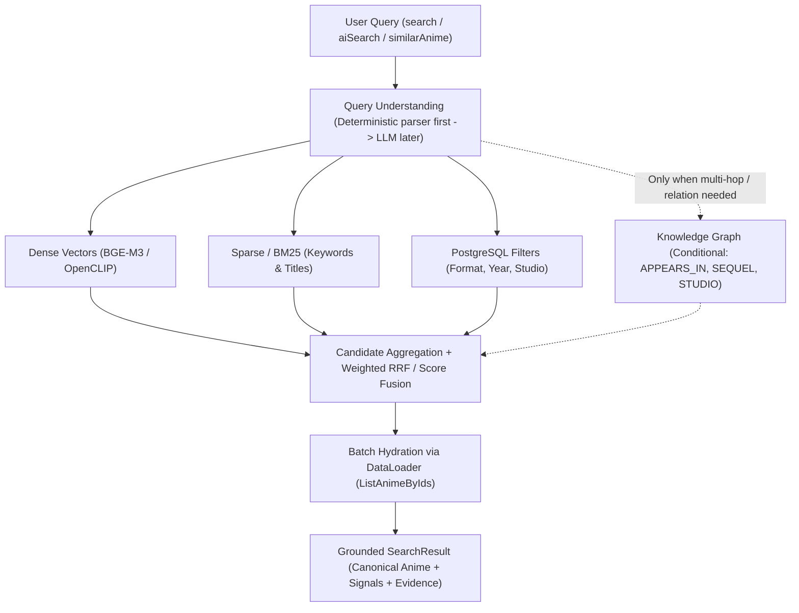

# Frontend & Backend Discovery Plan

## Overview

This document turns the product ideas in [echora_frontend_discovery_research.md](../echora_frontend_discovery_research.md) into a phased implementation plan for the **Frontend** and the **Rust + GraphQL Backend** (`crates/backend`, `axum` + `async-graphql` + `tonic`).

Every idea from the research doc is included below—none are dropped—ordered by what the backend services and data actually support at each stage:

1. **Phase 1 — Catalogue, Detail Pages & Regular Search** (`PostgresService` + `VectorService`, no AI)
2. **Phase 2 — Graph Connections, Comparisons & Discovery Dashboard** (`PostgresService` Knowledge Graph + `VectorService` similarity)
3. **Phase 3 — Natural-Language AI Search, Explanations & Attribute Discovery** (`AgentService`)
4. **Phase 4 — Multi-Dimensional Similarity & Character/Staff/Episode Discovery** (New Qdrant sub-vectors + `P-ECHO-20` People + `character_relation`)
5. **Phase 5 — Personalization & User Library** (`P-ECHO-17` `UsersService`)

### Architecture Principles

- **Backend is the single entry point.** The Frontend talks only to `crates/backend` over GraphQL. `Backend` orchestrates `PostgresService`, `VectorService`, `AgentService`, and `UsersService` over mTLS gRPC.
- **Two search modes.**
  - **Regular search (`search`, `browseAnime`):** Fast and deterministic, backed by `VectorService` (BGE-M3 dense+sparse or OpenCLIP image) and `PostgresService` filters. No LLM in the loop.
  - **Natural-language AI search (`aiSearch`):** Routed to `AgentService`, which parses intent, orchestrates `VectorService` + `PostgresService` graph reads, and writes grounded explanations.
- **Separate canonical data from retrieval metadata.** GraphQL wraps hits in `SearchResult { rank, signals, explanation, relationshipEvidence, anime }`, so search/relevance fields never pollute the canonical `Anime`, `Character`, or `Episode` types.
- **No GraphQL N+1.** Every list or nested edge (`SearchResult.anime`, `Anime.relations`, `Anime.characters`, `Character.anime`) resolves through `async-graphql::DataLoader` backed by batch `PostgresService` RPCs (`ListAnimeByIds`, `ListCharactersByIds`, `ListCompaniesByIds`). Depth (`limit_depth`) and complexity (`limit_complexity`) caps are enforced on the GraphQL server.
- **Page views write nothing.** `GetAnime`, `GetEpisode`, and `GetCharacter` return `next_refresh_at`; `Backend` checks it on top-level detail queries (skipping bots, capped globally per minute) and triggers a priority-1 refresh in Temporal (`USE_EXISTING`) when due.
- **Graceful incomplete coverage.** Missing images, empty character lists, missing graph edges, or unpopulated dimensions render cleanly without looking broken.

### End-to-End Architecture & Request Workflow

#### 1. Service & Data Flow (Frontend → Rust GraphQL Backend → Services)



#### 2. Hybrid & AI Retrieval Pipeline



---

## Idea-by-Idea Feasibility & Phase Map

Every idea from [echora_frontend_discovery_research.md](../echora_frontend_discovery_research.md) mapped to its phase and what is needed to make it work:

| Idea from Research Doc | Phase | Feasibility & Required Additions |
|---|---|---|
| Anime catalogue, browse & structured filters (genre, tag, studio, year, format, status) | **1** | **Doable.** Needs `BrowseAnime` RPC on `PostgresService`. |
| Exact title lookup, seasonal / airing schedules, "Recently added", "Hidden gems" | **1** | **Doable.** Needs `ListAiringSchedule` and sort/filter support in `BrowseAnime`. |
| Anime detail page (overview, synopsis, metadata, genres, themes, characters, studios, episodes) | **1** | **Doable.** Uses `GetAnime`, paginated `ListEpisodes`, new `ListAnimeCharacters`, and `GetAnimeRedirect` (`merged_into_anime_id`). |
| Reusable anime cards | **1** | **Doable.** Needs `AnimeCard` projection + `ListAnimeByIds` batch RPC. |
| Regular hybrid search (dense + sparse BGE-M3 + structured filters) | **1** | **Doable.** Existing `VectorSearchService.Search(with_payload=false)` + `ListAnimeByIds`. |
| Image-based discovery (screenshot / artwork visual search) | **1** | **Doable.** Existing `VectorSearchService.Search(image)` (OpenCLIP `image_vector`). GraphQL takes base64 or a companion upload endpoint on `axum`. |
| Overall "Similar anime" & "Similar characters" | **2** | **Needs addition.** Add `similar_to_id` to `VectorSearchService.Search` (Qdrant point-ID lookup) so Backend doesn't re-embed. |
| Knowledge graph explorer (sequels, prequels, spin-offs, shared studios, characters, source material) | **2** | **Doable.** Existing `FindNeighbors` / `FindReachable` + `ListAnimeByIds` / `ListCompaniesByIds` / `ListCharactersByIds`. |
| Explainable connection paths (`Anime A -> Studio X -> Anime B` with type, direction, provenance) | **2** | **Doable.** Existing `FindPath` + `anime_relation_claim` provider counts. |
| Structural anime comparison (2–3 anime: scalar diffs, shared studios, characters, genres, tags, paths) | **2** | **Doable.** Existing `CompareEntities` (extend to accept 2–3 IDs or compose pairs in Backend). |
| Discovery dashboard ("Connected anime", "Explore a studio", "Explore a character", "Recently added") | **2** | **Doable** for PostgreSQL/Graph/overall-vector sections; **Phase 3/4** for AI-curated theme collections. |
| Natural-language discovery (`aiSearch`) with intent awareness & "Understanding your search" | **3** | **Needs `AgentService`.** Intent classification (`EXACT_LOOKUP`, `SEMANTIC_DISCOVERY`, etc.), constraint extraction, and structured query interpretation output. |
| Grounded per-result explanations ("Why this matches") | **3** | **Needs `AgentService`.** Grounded strictly in vector/filter/graph evidence; never show uncalibrated raw cosine % as a match score. |
| Combining vector search + graph traversal (e.g., *"like Monster, manipulative protagonist"*) | **3** | **Needs `AgentService`.** Conditional multi-step orchestration across `VectorService` + `PostgresService` graph reads. |
| Attribute & theme exploration + curated discovery collections (*unreliable narrators*, *time manipulation*) + "Unexpected discoveries" | **3** | **Needs `AgentService` + Qdrant.** Query expansion + cross-genre negative-genre-filter vector queries. |
| Character semantic discovery & character detail pages | **3** | **Doable once indexed.** Needs `VectorService` `vector-character-consumer` (`ECHO-114`) + `GetCharacter` + `ListCharacterAnime`. |
| Multi-dimensional similarity (`STORY`, `CHARACTER`, `THEMES`, `ATMOSPHERE`, `SETTING`) & user-adjustable weight sliders | **4** | **Needs Qdrant schema expansion.** Today Qdrant only has `text_vector`, `text_sparse_vector`, `image_vector`. Requires separate named vectors per dimension + AI/structured extraction (`AgentService`). |
| Staff / director / VA connections & discovery | **4** | **Needs `P-ECHO-20` (People).** `person`, `anime_staff`, `character_voice` tables and graph edges are planned last. |
| Character-to-character relationships (*rivals*, *siblings*, *mentor/student*) | **4** | **Needs `character_relation`.** Currently undecided in `Database Schema.md` (requires AI extraction). |
| Episode-level semantic discovery | **4** | **Needs `ECHO-114`.** `vector-episode-consumer` + episode text indexing + episode GraphQL search. |
| Personalization, watchlists, ratings, negative preferences, taste profiles, "Similar to what you like" | **5** | **Needs `P-ECHO-17` (`UsersService`).** Separate user database, auth/accounts, and user feedback signals. |

---

## Phase 1: Catalogue, Detail Pages & Regular Search (MVP)

**Goal:** Ship a complete, fast anime catalogue and hybrid text/image search without waiting on `AgentService`, `People`, or `UsersService`.

**Backend dependencies:** `PostgresService`, `VectorService`, `Temporal` (priority-1 refresh on open).

### Ideas & What They Offer

- **Catalogue, Browse & Structured Filters:** Traditional structured discovery backed by PostgreSQL—browse by genre, tag, demographic, format (`TV`, `Movie`, `OVA`, `ONA`, `Special`), status, year range, season, rating, and studio, with sorting (`score`, `popularity`, `release date`, `recently added`) and cursor pagination. Serves queries where hard factual constraints are the whole intent (e.g., *"TV anime released in 2023"* or *"Anime by Madhouse"*).
- **Exact Title Lookup, Airing Schedules & "Hidden Gems":** Fast direct title lookup (including alternate/English/Romanized titles), weekly airing schedules (by weekday, premiering this week, ongoing), and curated PostgreSQL slices like *Recently Added* and *Hidden Gems* (high `score_weighted`, lower member count).
- **Anime, Episode & Character Detail Pages + Reusable Cards:** Complete canonical pages hydrated from PostgreSQL, with clean redirect handling when `merged_into_anime_id` is set. A reusable `AnimeCard` powers browse, search, graph, and comparison views—showing factual metadata everywhere, and relevance/match explanations *only* on search or recommendation results.
- **Regular Hybrid Search (Text & Image, No AI):** Fast, deterministic search combining Qdrant BGE-M3 dense vectors (semantic meaning) + sparse vectors (exact keyword/BM25 matching) + PostgreSQL structured filters, alongside OpenCLIP image upload search (find an anime from a screenshot or visually similar artwork).

### Frontend Screens

- **Catalogue / Browse (`/anime`):** Filter by genre, tag, demographic, type, status, year range, season, rating, studio; sort by score, popularity, release date, or recently added; cursor pagination.
- **Airing Schedule (`/schedule`):** Airing by weekday, premiering this week, ongoing works.
- **Regular Search (`/search`):** Hybrid text search (BGE-M3 dense + sparse) with structured filters, exact title fallback, and image upload search (OpenCLIP).
- **Anime Detail (`/anime/:id`):** Overview, synopsis (AI-written or correction), metadata, genres/themes, studios/producers, paginated episodes, paginated cast (`characters`), and external/streaming links. Redirects cleanly if `merged_into_anime_id` is set.
- **Episode Detail (`/anime/:id/episodes/:num`):** Episode metadata, synopsis, air date, streaming links.
- **Character Detail (`/character/:id`):** Bio, traits, attributes (with spoiler toggle), and works appeared in.

### Required `PostgresService` & `VectorService` Additions

- **New `AnimeCard` proto message:** `id`, `title`, `title_english`, `type`, `status`, `year`, `episode_count`, `score_weighted`, `cover_url`, `is_nsfw`, `version`.
- **New `PostgresService` RPCs:**
  - `ListAnimeByIds(repeated string anime_ids)` → `repeated AnimeCard` (for `DataLoader` & search hydration).
  - `ListCharactersByIds(repeated string character_ids)` / `ListCompaniesByIds(repeated string company_ids)`.
  - `BrowseAnime(filter, sort, cursor, page_size)` → `repeated AnimeCard` + `next_cursor`.
  - `ListAiringSchedule(weekday, ...)` → `repeated AnimeCard` + broadcast slot.
  - `ListAnimeCharacters(anime_id, page_size, after_billing_order)` (paginated).
  - `ListCharacterAnime(character_id, page_size, cursor)`.
  - `GetCompany(company_id)` + `ListCompanyAnime(company_id, role, page_size, cursor)`.
  - `GetAnimeRedirect(anime_id)` → `optional string merged_into_anime_id` (or included in `GetAnime` error metadata).
- **Update existing `PostgresService` RPC:** Paginate `ListEpisodes` (`page_size`, `after_episode_number`) for long series like *One Piece*.

### GraphQL Surface (Phase 1)

```graphql
type Query {
  anime(id: ID!): AnimeLookupResult!        # Anime | AnimeMoved | NotFound
  browseAnime(filter: AnimeFilter, sort: AnimeSort, after: String, first: Int): AnimeCardConnection!
  airingSchedule(weekday: Int): [ScheduleEntry!]!
  search(text: String, imageBase64: String, filters: AnimeFilter, limit: Int): SearchResultConnection!
  episode(id: ID!): Episode
  character(id: ID!): Character
  company(id: ID!): Company
}
```

---

## Phase 2: Graph Connections, Comparisons & Discovery Dashboard

**Goal:** Turn Echora from a standard catalogue into a connected discovery product using `graph_edge` and Qdrant point-ID similarity—still with **no AI required**.

**Backend dependencies:** `PostgresService` Knowledge Graph (`P-ECHO-22`), `VectorService` similarity-by-ID.

### Ideas & What They Offer

- **Overall "Similar Anime" (Point-ID Similarity):** On any anime page, discover semantically and visually similar works using Qdrant point-ID lookup (`similar_to_entity_id`, no re-embedding), paired with hard factual filters (`format`, `year`, `excludeSource`). Because Qdrant already stores `text_vector` and `image_vector` on every anime point, Phase 2 `similarAnime` can already use `query_points()` (`Prefetch` + `RrfQuery`) to offer **Overall**, **Content only (`text_vector`)**, **Visual style only (`image_vector`)**, or a simple **Content ↔ Visuals** balance.
- **Interactive Knowledge Graph Explorer:** Turns PostgreSQL `graph_edge` rows into an explorable universe. Starting from an anime, character, studio, or source material, users can expand nodes, collapse branches, filter edge types (`SEQUEL`, `PREQUEL`, `SIDE_STORY`, `STUDIO`, `FEATURES`, `ADAPTED_FROM`), and jump to entity pages—without needing a separate graph database.
- **Explainable Connection Paths:** Instead of overwhelming users with a giant hairball graph, answers *"How are these two connected?"* with a clear path such as `Anime A --[PRODUCED_BY]--> Studio X <--[PRODUCED_BY]-- Anime B`. Preserves edge type, direction, provenance, and provider agreement counts (`anime_relation_claim`), so a shared studio is never presented as equivalent to a sequel.
- **Structural Anime Comparison (2–3 Anime):** Side-by-side comparison showing both shared and distinct attributes: scalar metadata (format, duration, release year, score), shared studios, shared characters, overlapping genres/tags/themes, and direct graph paths. *(Expands in Phase 4 to include per-dimension similarity scores.)*
- **Discovery Dashboard (Core Sections):** Replaces a generic "popular anime" homepage with structured discovery entry points: *Recently Added*, *Hidden Gems*, *Explore a Studio*, *Connected Franchises* (watch orders), and *Discover Something New*.

### Frontend Screens & Features

- **Similar Anime Tab (on `/anime/:id`):** Overall semantic + visual similarity using Qdrant point-ID lookup, with structured filters (`format`, `year`, `excludeSource`).
- **Interactive Connections Explorer (`/anime/:id/connections`):** Expandable/collapsible graph starting from an anime, character, studio, or source material; filterable by edge type (`SEQUEL`, `PREQUEL`, `SIDE_STORY`, `STUDIO`, `FEATURES`, `ADAPTED_FROM`). Clearly labels relationship types (e.g., *Shared Studio* vs. *Sequel*) and provider agreement counts (`anime_relation_claim`).
- **Connection Path Explainer (`/connections/path?from=...&to=...`):** Shows shortest path(s) between two entities (e.g., `Anime A --[STUDIO]--> Studio X --[STUDIO]--> Anime B`) using `FindPath`.
- **Structural Compare (`/compare?ids=a,b,c`):** Side-by-side diff of 2–3 anime: scalar fields, shared studios, shared characters, shared genres/tags/themes, and direct graph paths.
- **Discovery Dashboard (`/`):**
  - *Recently Added* (`PostgresService`)
  - *Hidden Gems* (high `score_weighted`, lower `members`)
  - *Explore a Studio* (`Company` + `STUDIO` edges)
  - *Connected Franchises* (`FindReachable` watch order by air date)

### Required Service Additions

- **`VectorSearchService.Search` (`vector_search.proto`):** Add `optional string similar_to_entity_id` (uses Qdrant `query_points` by point ID, excluding the source ID).
- **`PostgresService`:** Ensure `FindNeighbors`, `FindReachable`, `FindPath`, `CompareEntities` filter through `*_visible` views and expose `anime_relation_claim` provider counts for edge confidence.

### GraphQL Additions (Phase 2)

```graphql
extend type Query {
  similarAnime(id: ID!, filters: AnimeFilter, limit: Int): SearchResultConnection!
  connections(startId: ID!, startType: GraphNodeType!, edgeTypes: [GraphEdgeType!], maxHops: Int, limit: Int): GraphConnectionResult!
  connectionPath(fromId: ID!, fromType: GraphNodeType!, toId: ID!, toType: GraphNodeType!, edgeTypes: [GraphEdgeType!]): [GraphPath!]!
  compareAnime(ids: [ID!]!): AnimeComparison!
}
```

---

## Phase 3: Natural-Language AI Search, Explanations & Character Discovery

**Goal:** Add `AgentService` for natural-language discovery, intent interpretation, grounded explanations, and multi-hop vector + graph queries, plus first-class Character search.

**Backend dependencies:** `AgentService` (`ECHO-91`), `VectorService` `vector-character-consumer` (`ECHO-114`).

### Ideas & What They Offer

- **Natural-Language AI Search (`aiSearch`) & "Understanding Your Search":** Lets users search with rich, conversational queries—for example: *"Anime where the protagonist is intelligent, manipulative, and always several steps ahead. Preferably psychological, with a dark atmosphere and little romance."* `AgentService` classifies intent (`EXACT_LOOKUP`, `SEMANTIC_DISCOVERY`, `SIMILARITY_SEARCH`, `ATTRIBUTE_FILTER`, `ENTITY_DISCOVERY`, `RELATIONSHIP_EXPLORATION`, `COMPARISON`, `RECOMMENDATION`), separates soft semantic cues from hard factual filters, and displays an **"Understanding your search"** panel so users can tweak interpreted constraints (e.g., *Minimal romance*, *TV series*) without rewriting their prompt.
  - *Implementation rollout:* Start with a **deterministic rule/dictionary parser** behind the `InterpretedQuery` contract (years, formats, genres/tags/studios, simple negations), benchmark accuracy (`Recall@K`, `Precision@K`, `NDCG@K`), and swap in an LLM inside `AgentService` later with zero frontend or GraphQL changes. Toggling interpreted chips re-runs `VectorService` + `PostgresService` directly without re-calling the LLM.
- **Grounded Per-Result Explanations ("Why This Matches"):** Shows *why* each anime matched and *which parts* of the query it satisfies (e.g., *Death Note* → intelligent protagonist, deception, strategic planning, psychological conflict; *Code Geass* → strategic protagonist, manipulation, political intrigue, military planning; *Tomodachi Game* → psychological games, deception, interpersonal strategy). Every explanation must be grounded in actual vector hits, matched tags/filters, or graph paths—never hallucinated, and never displaying raw cosine similarity as a percentage.
- **Combining Vector Search + Knowledge Graph Traversal:** Solves multi-hop discovery queries that neither vectors nor graphs handle alone. For example, *"Anime similar to Monster, but with a protagonist who is more intellectually manipulative"*: (1) find anime semantically similar to *Monster*, (2) search character vectors for intelligent/manipulative protagonists, (3) traverse `APPEARS_IN` graph edges to their anime, (4) fuse, rank, hydrate from PostgreSQL, and explain using both vector evidence and graph paths. Graph traversal is conditional—skipped for simple queries.
- **Attribute & Theme Exploration, Dynamic Collections & "Unexpected Discoveries":** Lets users explore narrative concepts that aren't standard genres or tags: *morally ambiguous protagonists*, *unreliable narrators*, *complex political systems*, *time manipulation*, *psychological mind games*, *intelligent antagonists*, and *non-linear storytelling*. Powers dynamically generated collections and **Unexpected Discoveries**—anime from a *different* genre that share narrative structure, character dynamics, or themes with something the user likes (implemented by excluding **all** `source.genres` via Qdrant `must_not` for `0` genre overlap, relaxing to `<= 1` overlapping genre if too few results match).
- **Character Semantic Discovery:** Promotes characters from passive cast-list entries to first-class searchable entities. Users can search characters by personality, motivations, abilities, or traits (e.g., *"Find characters like Lelouch who are strategic, manipulative, and morally ambiguous"*), find similar characters, and explore all anime a character appears in.

### Frontend Screens & Features

- **Natural-Language Discovery (`aiSearch`):**
  - Parses user intent (`EXACT_LOOKUP`, `SEMANTIC_DISCOVERY`, `SIMILARITY_SEARCH`, `ATTRIBUTE_FILTER`, `ENTITY_DISCOVERY`, `RELATIONSHIP_EXPLORATION`, `COMPARISON`, `RECOMMENDATION`).
  - Displays **"Understanding your search"** (extracted themes, character traits, constraints, and retrieval strategy) so users can tweak constraints without rewriting the prompt.
  - Returns **grounded per-result explanations** citing actual vector hits, matched tags/filters, and graph paths.
- **Combined Vector + Graph Queries:** e.g., *"Anime similar to Monster with a manipulative protagonist"* (character vectors → `APPEARS_IN` graph edges → anime similarity fusion).
- **Dynamic Discovery Collections & Unexpected Discoveries:** Curated concept collections (*unreliable narrators*, *time manipulation*, *political intrigue*) and cross-genre recommendations (high semantic similarity with `must_not` on the source anime's primary genres).
- **Character Semantic Search (`/characters/search`):** Search characters by personality, traits, and descriptions, and find similar characters.

### Required Service Additions

- **`AgentService` (`agent_service.proto`):** Add `DiscoverAnime` / `DiscoverCharacters` RPCs returning ranked entity IDs, `InterpretedQuery`, `RelevanceSignal`s, and grounded explanations.
- **`VectorService`:** Complete `vector-character-consumer` (`ECHO-114`) so characters are indexed in Qdrant.

### GraphQL Additions (Phase 3)

```graphql
extend type Query {
  aiSearch(query: String!, filters: AnimeFilter, limit: Int): AiDiscoveryResponse!
  searchCharacters(query: String!, limit: Int): CharacterSearchConnection!
  similarCharacters(id: ID!, limit: Int): CharacterSearchConnection!
}
```

---

## Phase 4: Multi-Dimensional Similarity, People (Staff/VAs) & Episodes

**Goal:** Unlock fine-grained similarity sliders, staff/VA graph discovery, character-to-character relationships, and episode-level search.

**Backend dependencies:** Qdrant multi-vector schema expansion, `P-ECHO-20` (People), `character_relation` design, `vector-episode-consumer` (`ECHO-114`).

### Ideas & What Each Offers

1. **Multi-Dimensional Similarity (`STORY`, `CHARACTER`, `THEMES`, `ATMOSPHERE`, `SETTING`) & Weight Sliders:**
   - **What it offers:** Moves beyond a single "Similar anime" list by letting users explore similarity along specific dimensions—**Story** (narrative concepts & storytelling), **Character** (protagonist personalities & dynamics), **Themes** (psychological, philosophical, or social ideas), **Atmosphere** (tone & viewing experience), **Setting** (environments & world structures), and **Visual**—via tabs on anime detail pages and interactive **weight sliders** (e.g., `Story 40% / Characters 35% / Themes 15% / Visual 10%`).
   - **What must be built first:** Extract per-dimension text representations (via `AgentService`), add dedicated named vectors to Qdrant (`qdrant_config.py`), and calibrate scores / benchmark weighted fusion vs. RRF before shipping sliders.
2. **Staff, Director & Voice Actor Discovery (`P-ECHO-20`):**
   - **What it offers:** Connects anime and characters through real-world creators (`person`, `anime_staff`, `character_voice`, `source_material_creator`), enabling queries and graph paths like *"Anime with the same director and composer"*, *"Characters voiced by the same VA"*, and *"Adaptations from the same original author"*.
3. **Character-to-Character Relationships (`character_relation`):**
   - **What it offers:** Exposes explicit interpersonal relationships between characters (*rivals*, *siblings*, *mentor/student*, *allies*) so users can explore character networks and paths within and across works.
   - **How it is scoped:** Settle the static vs. arc-scoped temporal model, then bound AI extraction (`AgentService` reading `Character.description` + `Anime.synopsis`) strictly to **characters who co-appear in the same anime** (`Character ← Anime → Character`), flagging spoiler-sourced relations separately.
4. **Episode-Level Semantic Discovery:**
   - **What it offers:** Lets users search for specific episode plots, moments, or themes and find similar episodes across series once `vector-episode-consumer` (`ECHO-114`) is indexed.

### Named Vectors, Sliders & Qdrant Query Design

#### 1. Finalized Named Vectors by Entity (`anime.py` → Qdrant)

All vectors for an entity live on the **same Qdrant point** (`id = entity_id`):

| Entity | Named Vector | Source Fields (`anime.py`) | Notes |
|---|---|---|---|
| **Anime** | `text_vector`, `text_sparse_vector` *(existing)* | `title`, `title_english`, `synonyms`, `synopsis`, `genres`, `tags` | General Phase 1–3 hybrid search |
| **Anime** | `image_vector` *(existing, OpenCLIP)* | `images` (posters / covers) | Visual / key-art style similarity |
| **Anime** | `story_vector` | `synopsis` + `background` | Plot, premise, narrative structure |
| **Anime** | `themes_vector` | `themes` (`ThemeEntry` names + descriptions) + `tags` + `genres` | Conceptual themes & motifs (combining `tags` avoids sparse `themes` coverage) |
| **Anime** | `character_vector` | Aggregated `MAIN`/`SUPPORTING` `Character.description`, `traits`, `attributes` (non-spoiler) | Cast dynamics & protagonist archetypes |
| **Anime** | `atmosphere_vector` | `AgentService`-extracted tone, mood, pacing | Stored in PostgreSQL; omitted cleanly if not yet extracted |
| **Anime** | `setting_vector` | `AgentService`-extracted world, era, environment | Stored in PostgreSQL; omitted cleanly if not yet extracted |
| **Character** *(Phase 3+)* | `text_vector`, `text_sparse_vector` | `name`, `name_variations`, `nicknames`, `description`, `traits`, `attributes` | **Exclude `Character.spoilers`** from default search vectors |
| **Character** *(optional)* | `personality_vector` | `AgentService`-extracted personality/motivation from `description` + `traits` | Prevents trivia (`attributes`) from diluting personality queries |
| **Episode** *(Phase 4)* | `text_vector`, `text_sparse_vector` | `title`, `title_romaji`, `synopsis`, `description` | Filter by `anime_id`, `episode_number`, `filler`, `recap` |

Exact metadata (`year`, `type`, `status`, `rating`, `nsfw`, `companies`) stays in PostgreSQL / Qdrant payload filters and Knowledge Graph edges—not vectors.

#### 2. Two Distinct Slider Modes

- **Similarity Weight Sliders (`0%` → `100%`, Base Required):**
  - Sliders: **Story**, **Themes & Concepts**, **Characters**, **Atmosphere**, **Setting**, **Visuals** (show 4–6 in UI).
  - Meaning: `0%` = ignore that dimension; `100%` = prioritize matching it heavily.
  - **Must be attached to a base:** a reference anime (Point-ID lookup), a natural-language prompt (`aiSearch`), or the user's taste profile (Phase 5). A bare *"40% Story"* slider has no query without a base.
- **Standalone Spectrum / Vibe Sliders (No Base Required):**
  - Polar sliders where both ends have concrete meaning, usable on `/discover` or `/search` with no anime selected:
    - `Lighthearted / Cozy` ⟷ `Dark / Bleak`
    - `Slow-burn` ⟷ `Fast-paced`
    - `Grounded / Realistic` ⟷ `Fantastical / Surreal`
    - `Episodic` ⟷ `Serialized`

#### 3. How Qdrant Executes Both Modes

- **Similarity Sliders (`query_points` + `Prefetch` + Weighted Fusion):**
  - Run parallel `Prefetch(query=<base_anime_id_or_vector>, using="<dim>_vector", limit=50)` branches for every slider with `weight > 0` (Point-ID `query` auto-excludes the source anime).
  - **Weighted RRF (`RrfQuery(rrf=Rrf(k=60, weights=[...]))`, Qdrant `v1.17+`):** Preferred default when mixing different embedding spaces (e.g., BGE-M3 text dimensions + OpenCLIP `image_vector`), because rank fusion avoids raw cosine scale mismatches.
  - **Weighted Score Sum (`FormulaQuery`):** `SumExpression` of `MultExpression([weight_i, "$score[i]"])` with `defaults={"$score[i]": 0.0}` (and optional metadata payload boosts like `score_weighted`), used only after score calibration across dimensions.
- **Standalone Spectrum Sliders (Two Options):**
  - **Qdrant `RecommendInput` / `Context`:** Pre-embed pole anchor prompts (e.g., *dark/bleak* vs. *cozy/lighthearted*) and pass `positive` / `negative` vectors against `atmosphere_vector` or `story_vector`.
  - **PostgreSQL / Qdrant Payload Scores:** Have `AgentService` score `0.0–1.0` attributes during enrichment for exact range filtering or `FormulaQuery` score boosting.
- **Prerequisites:** Upgrade/verify Qdrant `v1.17+` for Weighted RRF, add the new named vectors to `qdrant_config.py` (requires collection schema update + re-index), and expose dimension weights in `VectorSearchService.Search`.

---

## Phase 5: Personalization & User Library

**Goal:** Adapt discovery to each user once the core discovery experience is proven.

**Backend dependencies:** `P-ECHO-17` (`UsersService` + user database + auth).

### Ideas & What They Offer

- **User Library & Watchlist:** Personal watchlist, viewing status, and ratings, with automatic `merged_into_anime_id` redirect handling so merged entries never break user lists.
- **Preferences & Negative Signals:** Explicit recommendation feedback (*thumbs up / down*) and negative preferences (*"less like this"* / *"avoid romance"*) with clear user controls.
- **Personalized Feeds & Taste Profiles:** *"Similar to what you like"* and *"Discover something new"* feeds weighted by viewing history and taste profiles, automatically excluding already-watched or dropped anime.

---

## Information Architecture & UX Rules

### Navigation Structure

- **Discover:** Recommended discovery, unexpected discoveries, explore themes, explore by mood/concept.
- **Search:** Natural-language search (`aiSearch`), regular hybrid/keyword search, image search, advanced filters.
- **Anime:** Anime catalogue, anime detail, similar anime, compare anime.
- **Connections:** Relationship explorer, connection paths.
- **Characters:** Character discovery, character detail, character similarity.
- **User Library *(Phase 5)*:** Watchlist, ratings, preferences.

### Reusable Card & Detail Page Rules

- **Cards (`AnimeCard` + optional `SearchResult`):** Show poster, title (and alternate title if useful), year, format, genres, and score where available, plus quick actions (*Explore similarities*, *View connections*, *Compare*). Show match reasons and matched dimensions **only** on search/recommendation cards—never fake relevance explanations on plain catalogue/browse cards.
- **Anime Detail Page Sections:** Overview, synopsis & metadata, genres & themes, characters, staff & studios, similar anime (tabs: Overall, Story, Characters, Themes once Phase 4 lands), connected anime, relationship explorer, compare with another anime, discover more.
- **Image Search Modes:** Text-to-image, image-to-image (screenshot / artwork / visual style), and character visual appearance are distinct retrieval tasks; validate each against the indexed OpenCLIP model before exposing it in the UI.
- **Discovery Dashboard (9 Sections Across Phases):**
  - *Phase 1–2 (Postgres + Graph + Overall Vector):* `Recently added`, `Hidden gems`, `Explore a studio`, `Connected anime`, `Discover something new`.
  - *Phase 3 (AgentService + Characters):* `Explore by themes`, `Explore a character`, `Unexpected discoveries` (different genre, shared narrative/themes), `Unusual combinations`.
  - *Phase 5 (UsersService):* `Similar to what you like`.

### Retrieval, Grounding & Evaluation Rules

- **Factual constraints win:** A semantic match must never override a factual filter (year, format, studio, official relations).
- **Grounded explanations & scores:** Never display raw cosine similarity as a percentage unless calibrated against human relevance judgments. Explanations must cite actual vector hits, matched filters/tags, or graph paths.
- **Weight slider validation *(Phase 4)*:** Normalize weights to 100%, calibrate scores across models/dimensions, and benchmark weighted score fusion vs. RRF before shipping.
- **Graph caching:** Cache frequent relationship projections (e.g., franchise watch orders) rather than running heavy traversals on every page view, and always label relationship types clearly (never equate *Shared Studio* with *Sequel*).
- **Graceful incomplete coverage:** Missing images, empty character lists, missing graph edges, or unpopulated similarity dimensions must degrade cleanly without looking broken.
- **Search quality evaluation:** Maintain a representative query dataset with human judgments and track **Recall@K**, **Precision@K**, **NDCG@K**, **Latency**, and **Diversity** (avoiding franchise/title concentration).

---

## Reference Products Worth Studying

- **Sprout Anime Recommender** (`https://anime.ameo.dev/`) — recommendation models, stats, and interactive relationship atlas.
- **Indoga** (`https://indoga.app/`) — taste-based recommendations and interactive filters.
- **Anime-Planet** (`https://www.anime-planet.com/`) — tag-based discovery, catalogue organization, and navigation.
- **Binge Senpai** (`https://bingesenpai.com/how-it-works`) — conversational discovery and recommendation explanations.

---

## Open Product Decisions (Settle Before UI Implementation)

1. **Product scope at launch:** Public-facing discovery website only first, or discovery + personal watchlist/tracker from day one?
2. **Launch entity scope:** Anime only (Phase 1), Anime + Characters (Phase 3), or Anime + Characters + Studios + Staff?
3. **Knowledge graph coverage:** Which relation types are populated and reliable enough to expose in the Phase 2 UI?
4. **Search entry point:** Coexist natural-language search (`aiSearch`) alongside conventional catalogue + filters (`browseAnime` / `search`).
5. **Personalization timing:** Confirm watchlist, ratings, and negative preferences wait for Phase 5 (`UsersService`).

---

## Immediate Next Step

Start **Phase 1** by defining `AnimeCard` and the Phase 1 read RPCs (`ListAnimeByIds`, `BrowseAnime`, `ListAiringSchedule`, `ListAnimeCharacters`, `ListCharacterAnime`, `GetCompany`, `ListCompanyAnime`, paginated `ListEpisodes`, `GetAnimeRedirect`) in [event_schema_specification.md](file:///home/dani/code/echora/docs/architecture/event_schema_specification.md), alongside `crates/backend`.
