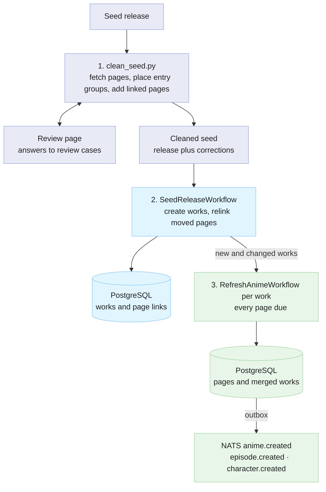

# Ingestion Pipeline

## Overview

Ingestion fills the catalogue from a seed release, the offline anime database. It has three steps:

1. **Clean the seed.** Seed cleaning decides which provider pages make up each work, and sends what the rules cannot settle to review.
2. **Load the works.** A Temporal workflow turns the cleaned seed into works and page links in PostgreSQL.
3. **Enrich each new work.** The same `RefreshAnimeWorkflow` that keeps works current fetches every page of a new work, merges it and saves it. Each episode and character the work lists then gets its own first refresh.

There is no separate ingestion service and no separate enrichment path. A first enrichment is a refresh in which every page is due, so ingestion and updates share one code path, one set of provider rate limits and one history in Temporal. See [[update_service|Update Service]].

Seed cleaning is temporary. Once discovery finds new works and pages directly from providers, the seed and `libs/seed_cleaning` are removed, and discovery feeds the same load step.

---

## 1. Clean the Seed

> **Linear:** ECHO-92

`scripts/clean_seed.py` runs `libs/seed_cleaning` on a downloaded seed release. It fetches every page of the release, and every page those pages link that no entry holds, then applies the `libs/work_matching` rules:

- **Doubled providers.** An entry listing two pages of one provider is split into the works those pages belong to.
- **Split works.** Entries that may be one work told apart by a provider are grouped, and each page is placed in a work or as a partial source.
- **Linked pages.** A page an entry links, but no entry holds, is added to the entry when the rules confirm it.

What the rules cannot settle becomes a review case, answered on the review page. Answers are kept across runs and seed releases. The result is a list of seed corrections, and the cleaned seed is the release with those corrections applied. The release itself is never edited.

The run ends by writing the cleaned seed to `cleaned_seed.jsonl` in its data folder, one line per work: its source page keys and its partial-source page keys. That file is what the load step reads.

The details of each step are in the `libs/seed_cleaning` and `libs/work_matching` READMEs.

---

## 2. Load the Works

> **Linear:** ECHO-107, ECHO-120

A `SeedReleaseWorkflow`, with the workflow ID `seed-release`, loads one cleaned seed file. Its conflict policy is `FAIL`, so a second load is refused while one runs. The workflow receives only the file's path, never its contents, since a seed of tens of thousands of works is far beyond Temporal's 2 MB payload limit. An activity reads the file a page of lines at a time, and the worker and `clean_seed.py` share the folder it sits in.

For each page of lines:

1. **Find what is already stored.** `PostgresService.FindEntitiesByPages` returns which of the lines' page keys already belong to a work, and in which role.
2. **Decide per line:**
   - **Every source page belongs to one stored work** → that work. If its partial-source pages differ, they are relinked.
   - **No source page is stored** → a new work. The activity gives it a UUIDv7, and `CreateWorks` creates it with its page links.
   - **Source pages belong to different stored works, or a stored page moved** → `RelinkPages` moves the pages, as seed cleaning and its review answers placed them. A work left with no source page is removed with `DeleteWork`.
3. **Refresh what changed.** The workflow starts a `RefreshAnimeWorkflow` for each new work through the `start_workflows` activity, and sends `merge_requested` to each relinked one. See [[update_service#Starting other workflows|Update Service]].

Unchanged works are left alone. The weekly sweep keeps them current.

- **Bounded.** Before each page of lines, the workflow waits until fewer than `SWEEP_MAX_PENDING_STARTS` (500) of its refreshes are still running, counted by the search attribute `RefreshTrigger = 'seed'`. It continues as new between pages of lines, so its own history stays small.
- **Shares the providers fairly.** Its refreshes run with priority 3 and the fairness key `seed`, so works users open still go first, and the weekly sweep keeps its share of every provider. See [[update_service#Provider rate limits|Update Service]].
- **Safe to run again.** `CreateWorks` skips a work an earlier attempt already created, and every other write is safe to repeat, so a retried or repeated load changes nothing the second time.

---

## 3. Enrich Each New Work

> **Linear:** ECHO-111, ECHO-112

The `RefreshAnimeWorkflow` of a new work finds every page due, since none has been fetched into PostgreSQL yet:

1. `refresh_page` runs once per page, on that provider's task queue: `EnrichmentService.FetchPage`, then `PostgresService.StorePage`.
2. `merge_work` runs once: `PostgresService.LoadWork`, `EnrichmentService.MergeWork`, then `PostgresService.SaveWork`. The merge gives each episode and character the pages list a UUIDv7, and `SaveWork` creates them.
3. `SaveWork` saves the work and writes `anime.created` to the outbox in the same transaction. The vector service indexes the work from that event.
4. The workflow starts a `RefreshEpisodeWorkflow` and a `RefreshCharacterWorkflow` for each new episode and character, which fetch their own pages and send `episode.created` and `character.created`.

A full seed load starts tens of thousands of these workflows. They share the provider task queues and their rate limits with the weekly sweep and with entities users open. A large load therefore takes as long as the slowest provider's pacing allows, without ever exceeding it.

---

## Where It Stands

> **Linear:** ECHO-92, ECHO-105, ECHO-123

What exists today, and what the plan above still needs:

- **The cleaned seed is built only in memory, and only after the first pass.** `build_corrected_seed` in `libs/seed_cleaning` applies the first pass's corrections so the second pass can group split works. A cleaned seed with every correction applied, written to `cleaned_seed.jsonl`, is still to be added.
- **Enrichment reads the raw seed.** `scripts/run_enrichment.py` reads `assets/seed_data/anime-offline-database.json` directly, one entry at a time, and writes per-agent folders under `temp/`. The merge (`merge_provider_records`) has no command-line entry point, derives the work's ID from its source URLs, reads `sources` from the offline database entry and merges provider synopses. All three change when `MergeWork` is built.
- **Pages are fetched twice.** Seed cleaning fetches pages for their details (titles, type, links, episode counts) and keeps them in `data/seed_cleaning/provider_pages.jsonl`. Enrichment fetches the same pages again for their full responses. The shared HTTP cache serves the second fetch while its entries last, and the planned `StorePage` makes PostgreSQL the one page store.
- **The planned methods do not exist yet.** `EnrichmentService` has only `Health` and `RunPipeline`. `FetchPage`, the merge methods, the PostgreSQL Service and the Temporal workflows are all planned.
- **Episodes and characters** are processed by the stage 2 and stage 5 scripts (`process_stage2_episodes.py`, `process_stage5_characters.py`). That processing moves into `MergeEpisode` and `MergeCharacter`.

---

## Configuration

Ingestion has no settings of its own. It uses the settings of the services it runs through:

- seed cleaning's command-line options and `--data-dir`, in the `libs/seed_cleaning` README,
- the Temporal, refresh and `SWEEP_MAX_PENDING_STARTS` settings in [[update_service#Configuration|Update Service]],
- the enrichment settings in `libs/common/src/common/config/`.

---

## Related Documentation

- [[update_service|Update Service]] — The refresh workflows that enrich every work, episode and character
- [[event_driven_architecture|Event-Driven Architecture]] — The outbox and `anime.created`
- [[event_schema_specification|Event Schema Specification]] — The gRPC methods each step calls
- [[Database Schema|Database Schema]] — Provider pages, works and their links
- `libs/seed_cleaning/README.md` and `libs/work_matching/README.md` — Seed cleaning and the matching rules

---

**Status**: Planned | **Last Updated**: 2026-11-15
