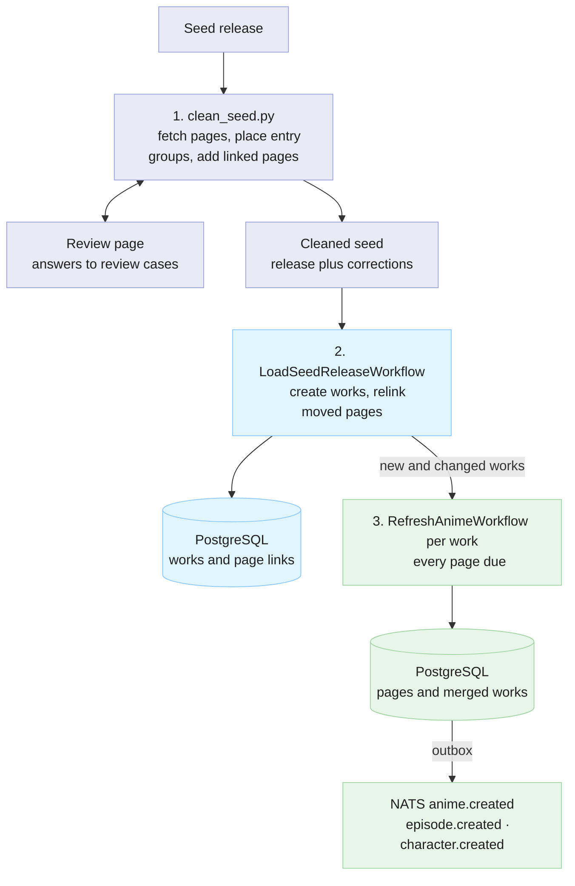

# Ingestion Pipeline

## Overview

Ingestion fills the catalogue from a seed release, the offline anime database. It has three steps:

1. **Clean the seed.** Seed cleaning decides which provider pages make up each work, and sends what the rules cannot settle to review. (ECHO-92)
2. **Load the works.** A Temporal workflow turns the cleaned seed into works and page links in PostgreSQL. (ECHO-120)
3. **Enrich each new work.**
   - The same `RefreshAnimeWorkflow` that keeps works current fetches every page of a new work, merges it and saves it. (ECHO-111)
   - Each episode and character the work lists then gets its own first refresh. (ECHO-112)

There is no separate ingestion service and no separate enrichment path. A first enrichment is a refresh in which every page is due, so ingestion and updates share one code path, one set of provider rate limits and one history in Temporal. See [[update_service|Update Service]]. (ECHO-111)

Seed cleaning is temporary. Once discovery finds new works and pages directly from providers, the seed and `libs/seed_cleaning` are removed, and discovery feeds the same load step. `libs/work_matching`, which decides which pages belong to one work, stays: discovery uses the same rules. (P-ECHO-8)

---

## 1. Clean the Seed

`scripts/clean_seed.py` runs `libs/seed_cleaning` on a downloaded seed release. It fetches every page of the release, and every page those pages link that no entry holds, then applies the `libs/work_matching` rules:

- **Doubled providers.** An entry listing two pages of one provider is split into the works those pages belong to.
- **Split works.** Entries that may be one work told apart by a provider are grouped, and each page is placed in a work or as a partial source.
- **Linked pages.** A page an entry links, but no entry holds, is added to the entry when the rules confirm it.

What the rules cannot settle becomes a review case, answered on the review page. Answers are kept across runs and seed releases. The result is a list of seed corrections, and the cleaned seed is the release with those corrections applied. The release itself is never edited.

The run ends by writing the cleaned seed to `cleaned_seed.jsonl` in its data folder, one line per work: its source page keys and its partial-source page keys. That file is what the load step reads. (ECHO-92)

The details of each step are in the `libs/seed_cleaning` and `libs/work_matching` READMEs.

---

## 2. Load the Works

A `LoadSeedReleaseWorkflow`, with the workflow ID `seed-release`, loads one cleaned seed file. Its conflict policy is `FAIL`, so a second load is refused while one runs. The workflow receives only the file's path and its hash, never its contents, since a seed of tens of thousands of works is far beyond Temporal's 2 MB payload limit. Every activity that reads the file checks the hash and refuses a file that changed during the load. The worker and `clean_seed.py` share the folder it sits in. (ECHO-120)

**A release only adds and moves.**

- The load keeps a work or a page missing from a new release as it is, since the seed is one source among several. A page is found to be gone only when a refresh hears so from its provider (see [[update_service#How a Refresh Runs|Update Service]]). (ECHO-120)
- The seed-load methods of the PostgreSQL Service never remove a page because a release no longer lists it. A page leaves a work only by a move, or by being confirmed dead. (ECHO-107)
- A release adds new works and pages, and moves a page when seed cleaning and its review answers place it in a different work. (ECHO-120)

The load runs in two passes, so the order of lines in the file cannot change the result:

1. **Plan.** One activity reads the whole file, decides per line and writes the plan to a file beside the cleaned seed. A plan for tens of thousands of works is far past Temporal's 2 MB payload limit, so only the plan's path and hash pass through Temporal, and the apply pass checks the hash. (ECHO-120)
   - The stored work of every page key comes from `PostgresService.FindEntitiesByPages`, which returns each stored page's work, its role and the work's version. (ECHO-107)

   Each line is decided this way:
   - **Every source page belongs to one stored work** → that work. Partial-source pages the line adds are linked to it. (ECHO-120)
   - **No source page is stored** → a new work, with a UUIDv7 and its page links. (ECHO-120)
   - **Source pages belong to different stored works, or a stored page moved** → a move to the work seed cleaning placed it in. A work left with no source page by the moves was merged into another, and is deleted with `merged_into_anime_id` and the version from the plan. (ECHO-120)
   - **A page the line no longer lists** stays with its work. (ECHO-120)
2. **Apply, in a fixed order.** The workflow applies the plan in the order below, so no page is ever linked as a source of two works at once. (ECHO-120)
   - `CreateAnime` creates the new works with `merged_at` empty, their pages linked before they are fetched, hidden from reads until their first merge. (ECHO-107)
   - `RelinkPages` then applies the moves in page-key order. (ECHO-107)
   - `DeleteAnime` removes the works the moves emptied. (ECHO-107)
3. **Refresh.** The workflow starts a `RefreshAnimeWorkflow` through `start_entity_workflows` for every work that is new, gained or lost a page, **or is still unmerged**. The last case catches works an earlier, interrupted attempt created without starting their refresh. See [[update_service#Starting other workflows|Update Service]]. (ECHO-120)

The load leaves unchanged works alone. (ECHO-120)

The weekly sweep keeps them current. (ECHO-117)

- **Bounded.** Before each batch of refresh starts, the workflow waits until fewer than `MAX_PENDING_BULK_REFRESHES` (500) of its refreshes are still running, counted by the search attribute `RefreshTrigger = 'seed'`. It continues as new between batches, so its own history stays small. (ECHO-120)
- **Shares the providers fairly.** Its refreshes run with priority 3 and the fairness key `seed`. (ECHO-120)
  - The provider queues order work by priority and fairness, so works users open still go first, and the weekly sweep keeps its share of every provider. See [[update_service#Provider rate limits|Update Service]]. (ECHO-113)
- **Safe to run again.** A retried or repeated load changes nothing the second time. (ECHO-120)
  - `CreateAnime` skips a work an earlier attempt already created, and the other seed-load writes are safe to repeat. (ECHO-107)

---

## 3. Enrich Each New Work

The `RefreshAnimeWorkflow` of a new work finds every page due, since none has been fetched into PostgreSQL yet:

1. `refresh_page` runs once per page, on that provider's task queue. (ECHO-111)
   - `EnrichmentService.FetchPage` fetches the page. (ECHO-99)
   - `PostgresService.StorePage` stores it. (ECHO-97)
2. `merge_anime` runs once. (ECHO-111)
   - `PostgresService.LoadAnime` loads the work's pages. (ECHO-98)
   - `EnrichmentService.MergeAnime` merges them, and gives each episode and character the pages list a UUIDv7. (ECHO-105)
   - `PostgresService.SaveAnime` saves the work. (ECHO-98)
   - The same save creates the new episodes. (ECHO-103)
   - The same save creates the new characters. (ECHO-104)
3. `SaveAnime` saves the work and writes `anime.created` to the outbox in the same transaction. (ECHO-98)
   - The vector service indexes the work from that event. (ECHO-114)
4. The workflow starts a `RefreshEpisodeWorkflow` and a `RefreshCharacterWorkflow` for each new episode and character, which fetch their own pages and send `episode.created` and `character.created`. (ECHO-112)

A full seed load starts tens of thousands of these workflows. They share the provider task queues and their rate limits with the weekly sweep and with entities users open. A large load therefore takes as long as the slowest provider's pacing allows, without ever exceeding it. (ECHO-113)

---

## Where It Stands

What exists today, and what the plan above still needs:

- **The cleaned seed is built only in memory, and only after the first pass.** `build_corrected_seed` in `libs/seed_cleaning` applies the first pass's corrections so the second pass can group split works. A cleaned seed with every correction applied, written to `cleaned_seed.jsonl`, is still to be added. (ECHO-92)
- **Enrichment reads the raw seed.** `scripts/run_enrichment.py` reads `assets/seed_data/anime-offline-database.json` directly, one entry at a time, and writes per-agent folders under `temp/`. The script is removed once the new methods replace it. (ECHO-123)
  - The merge (`merge_provider_records`) has no command-line entry point, derives the work's ID from its source URLs, reads `sources` from the offline database entry and merges provider synopses. All three change when `MergeAnime` is built. (ECHO-105)
- **Pages are fetched twice.** Seed cleaning fetches pages for their details (titles, type, links, episode counts) and keeps them in `data/seed_cleaning/provider_pages.jsonl`. Enrichment fetches the same pages again for their full responses. The shared HTTP cache serves the second fetch while its entries last, and the planned `StorePage` makes PostgreSQL the one page store. (ECHO-97)
- **The planned methods do not exist yet.** `EnrichmentService` has only `Health` and `RunPipeline`.
  - `FetchPage` and the merge methods are planned. (P-ECHO-11)
  - The PostgreSQL Service is planned. (P-ECHO-10)
  - The Temporal workflows are planned. (P-ECHO-12)
- **Episodes and characters** are processed by the stage 2 and stage 5 scripts (`process_stage2_episodes.py`, `process_stage5_characters.py`), which are removed afterwards. (ECHO-123)
  - Episode processing moves into `MergeEpisode`. (ECHO-109)
  - Character processing moves into `MergeCharacter`. (ECHO-110)

---

## Configuration

Ingestion has no settings of its own. It uses the settings of the services it runs through:

- seed cleaning's command-line options and `--data-dir`, in the `libs/seed_cleaning` README,
- the Temporal, refresh and `MAX_PENDING_BULK_REFRESHES` settings in [[update_service#Configuration|Update Service]],
- the enrichment settings in `libs/common/src/common/config/`.

---

## Related Documentation

- [[update_service|Update Service]] — The refresh workflows that enrich every work, episode and character
- [[event_driven_architecture|Event-Driven Architecture]] — The outbox and `anime.created`
- [[event_schema_specification|Event Schema Specification]] — The gRPC methods each step calls
- [[Database Schema|Database Schema]] — Provider pages, works and their links
- `libs/seed_cleaning/README.md` and `libs/work_matching/README.md` — Seed cleaning and the matching rules

---

**Status**: Planned | **Last Updated**: 2026-11-15
