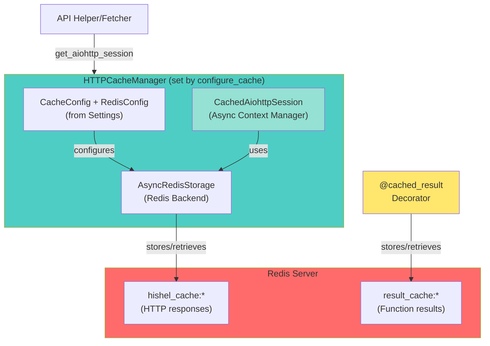

# HTTP & Result Caching Library

## Overview

A Redis-backed caching library providing HTTP-level and result-level caching for Python applications. Designed for async workflows with intelligent cache management and multi-process support.

**Two caching strategies:**

1. **HTTP-Level Caching**: RFC 9111 compliant HTTP response caching using Hishel
2. **Result-Level Caching**: Function result caching using custom decorator

**Primary use case:** Anime enrichment pipeline (see [enrichment/README.md](../enrichment/README.md))

## Benefits

- **Eliminates redundant network calls** - Same data never fetched twice within TTL
- **Reduces API rate limit issues** - Cached hits don't count toward rate limits
- **Multi-process support** - Share cache across concurrent processes via Redis
- **Bandwidth reduction** - 95%+ reduction for cached responses
- **Offline development** - Work with cached data without network access
- **Flexible TTL configuration** - Per-service cache expiration control

## Architecture



**Key Components**:

- **HTTPCacheManager**: Hands out cached aiohttp sessions and owns both Redis clients; the app creates one with `configure_cache` and code reads it with `get_cache()`
- **CachedAiohttpSession**: Async context manager wrapping aiohttp.ClientSession with caching
- **AsyncRedisStorage**: hishel's own Redis storage, built by the manager for each session with the source's TTL
- **@cached_result**: Decorator for caching function results (used by crawlers)

**Storage Strategy**:

- HTTP-level caching: `hishel_cache:*` keys, written by hishel's `AsyncRedisStorage`: `entry:<id>`, `idx:<cache key>`, `stream:<id>` and `stream_done:<id>`
- Result-level caching: `result_cache:*` keys (managed by @cached_result decorator)
- Both use the same Redis server with different key prefixes for isolation

## Configuration

The cache takes two configs from `common.config`, both part of `Settings`:

- `CacheConfig` (`settings.cache`): what is cached and for how long.
- `RedisConfig` (`settings.redis`): where Redis is and how to size its connection pools. The vector service's embedding cache uses the same config.

Like every `Settings` sub-config, each field is read from the environment variable of the same name in upper case, then from `.env`, then falls back to its default.

**`CacheConfig`:**

```bash
CACHE_ENABLED=true          # cache provider responses and crawl results
FORCE_CACHE=true            # cache even when the API sends no-cache headers
ALWAYS_REVALIDATE=false     # ask the server on every cache hit
MAX_CACHE_KEY_LENGTH=200    # longer result-cache keys are hashed

# How long each source's responses and crawl results are kept, in seconds
TTL_MAL=604800
TTL_ANILIST=604800
TTL_ANIDB=604800
TTL_KITSU=604800
TTL_ANIME_PLANET=604800
TTL_ANISEARCH=604800
TTL_ANIMESCHEDULE=86400

CLOUDFLARE_CLEARANCE_MAX_TTL=86400
```

**`RedisConfig`:**

```bash
REDIS_URL=redis://localhost:6379/0   # the default; database 0 is enrichment's, 1 the vector service's
REDIS_MAX_CONNECTIONS=100
REDIS_SOCKET_KEEPALIVE=true
REDIS_SOCKET_CONNECT_TIMEOUT=5
REDIS_SOCKET_TIMEOUT=10
REDIS_RETRY_ON_TIMEOUT=true
REDIS_HEALTH_CHECK_INTERVAL=30       # 0 = never
```

Caching is on by default. It turns off when `CACHE_ENABLED` is false or the app passes a `RedisConfig` without `redis_url`; with caching enabled and no `redis_url`, the cache logs one warning and everything runs uncached.

Redis databases 0-15 belong to the services (enrichment 0, vector 1). Tests use 16-31 on the dev Redis, which runs with `--databases 32`.

### Setting Up the Cache

An app configures the cache once at startup and closes it on shutdown:

```python
from common.config import get_settings
from http_cache import close_cache, configure_cache

settings = get_settings()
cache = configure_cache(settings.cache, settings.redis)
try:
    ...  # pass `cache` to objects that take it, such as EnrichmentPipeline
finally:
    await close_cache()
```

Objects that make HTTP requests take the manager in their constructor. Code that runs inside the app without one, such as `@cached_result` functions, looks it up with `get_cache()` when it runs. Without `configure_cache`, `get_cache()` returns a manager with caching off, so tests and plain library use run uncached.

## Context Manager Protocol

### CachedAiohttpSession (Context Manager)

The `CachedAiohttpSession` returned by `get_aiohttp_session()` is an async context manager:

```python
async with cache.get_aiohttp_session("mal") as session:
    async with session.get("https://api.example.com/data") as response:
        data = await response.json()
```

Closing the session closes the underlying `aiohttp.ClientSession`. The Redis clients belong to the manager and stay open for the next session.

For usage patterns in the enrichment pipeline (session ownership, event loop management), see [enrichment/README.md - Helper Implementation Patterns](../enrichment/README.md#helper-implementation-patterns).

### Cleanup

`close_cache()` closes the manager's two Redis clients: one for HTTP responses and one for crawl results. Call it once when the app shuts down. A later request opens new clients.

## API Reference

### Setup (`http_cache`)

- `configure_cache(cache: CacheConfig, redis: RedisConfig) -> HTTPCacheManager`: sets the manager every `get_cache()` call returns.
- `get_cache() -> HTTPCacheManager`: the configured manager, or one with caching off.
- `close_cache() -> None`: closes the configured manager's Redis clients.

### HTTPCacheManager

- `get_aiohttp_session(service: str, **kwargs)`: a `CachedAiohttpSession` that keeps responses for the source's TTL, or a plain `aiohttp.ClientSession` when caching is off. Accepts the usual `aiohttp.ClientSession` arguments.
- `get_result_client() -> Redis | None`: the Redis client for crawl results, or None when caching is off.
- `enabled`: whether caching is on.
- `close() -> None`: closes both Redis clients.

Each Redis client belongs to the event loop it was created on, so both are created again when called from a different loop.

### @cached_result Decorator

**Location:** `http_cache.result_cache`

```python
from http_cache.result_cache import cached_result

@cached_result(service="mal", key_prefix="mal_anime")
async def fetch_anime(url: str) -> dict[str, Any] | None:
    ...
```

- `service`: source whose TTL applies, such as `"mal"` for `TTL_MAL`. Without one, results are kept for 24 hours.
- `key_prefix`: cache key prefix (default: the decorated function's name).
- `dependencies`: further functions to cover in the schema hash. The hash already covers the decorated function and every plain (non-async) function of its package it reaches, directly or through other helpers, with the module-level data each reads. List an async helper here only when a change to it should invalidate cached results.
- `ttl`: a lifetime in seconds that overrides the source's.

Whether to cache and the TTL are read from `get_cache()` on every call, so the decorator can run at import, before the app configures the cache.

**Features:**
- Automatic cache key generation from function name + schema hash + arguments
- Schema versioning with automatic invalidation (function source code hashing)
- Graceful fallback on Redis failures (RedisError) and JSON serialization errors (TypeError)
- Multi-process safe via Redis atomic operations
- `None` return values are never cached (intentional design choice)
- Supports complex argument types via JSON serialization with repr() fallback

## How It Works

### Two Caching Strategies

**1. HTTP-Level Caching**

- **Technology:** Hishel (RFC 9111 compliant) with custom Redis storage backend
- **Use case:** RESTful APIs, GraphQL endpoints, any HTTP-based data sources
- **Caches:** Raw HTTP responses at the network layer
- **Implementation:** `CachedAiohttpSession` wrapping `aiohttp.ClientSession`
- **Transparency:** Automatic caching with no code changes to request logic

**2. Result-Level Caching**

- **Technology:** Custom `@cached_result` decorator
- **Use case:** Non-HTTP operations (web scraping, computations, file I/O)
- **Caches:** Serialized function return values (JSON)
- **Implementation:** Python decorator with Redis storage and automatic schema invalidation

### Cache Management Features

- **TTL enforcement:** Configurable per source, for HTTP responses and crawl results alike
- **Schema versioning:** Automatic cache invalidation when function implementation changes
- **Graceful degradation:** Falls back to uncached execution on Redis failures (connection errors, timeouts)
- **Multi-process safe:** Redis atomic operations prevent race conditions
- **Event loop aware:** Per-event-loop Redis client management (automatic cleanup on loop changes)

## Thread-Safety and Concurrency

### Concurrency Model

The cache manager is designed for **async concurrency** within Python's asyncio event loop, supporting multiple concurrent operations without race conditions.

**Supported Concurrent Operations:**

- **Multiple async tasks in same event loop** - Concurrent HTTP requests via `asyncio.gather()`
- **Multiple agents with shared Redis cache** - Multiple session instances safely share Redis storage
- **Multiple processes** - Redis atomic operations coordinate cache access across processes
- **Concurrent cache reads/writes** - Redis connection pooling (configurable via `REDIS_MAX_CONNECTIONS`, default 100) handles concurrent operations

**Not Thread-Safe:**

- **Sharing sessions across OS threads** - Each thread needs its own session instance
- **Sharing sessions across event loops** - Create separate sessions per event loop

### Thread-Safety Guarantees

**CachedAiohttpSession:**
- Safe for concurrent async requests within single event loop
- Multiple instances can share same Redis storage backend
- Not safe for sharing across threads or event loops

**AsyncRedisStorage (hishel):**
- Writes an entry and its index in one Redis transaction
- Serves a response only once its body is stored completely; a body cut off mid-stream is dropped
- Keeps each response for the source's TTL from when it was fetched; a cache hit does not extend it
- Does not cache response bodies over 10 MB; they are still returned to the caller
- A removed entry leaves the index at once and Redis frees its keys 180 s later

**@cached_result Decorator:**
- Safe for concurrent async function calls
- Redis atomic operations ensure process-safe caching
- Automatic per-event-loop client management

## Cache Management

### Clear Cache

```bash
# Clear all cached data (HTTP + result caches)
docker exec echora-dev-redis redis-cli FLUSHALL

# Alternative: Clear specific database (DB 0)
docker exec echora-dev-redis redis-cli FLUSHDB
```

### View Cache Statistics

```bash
# Connect to Redis CLI
docker exec -it echora-dev-redis redis-cli

# Check total cache size
> DBSIZE

# View HTTP cache keys (from Hishel)
> KEYS hishel_cache:*

# View result cache keys (from crawlers)
> KEYS result_cache:*

# Check TTL on any key
> TTL result_cache:anisearch_anime:18878

# Exit Redis CLI
> exit
```

## Testing

### Cache Manager Tests

Redis is mocked in these tests, so none of them needs a running Redis:

```bash
./pants test tests/libs/http_cache::
```

For enrichment pipeline-specific tests, see [enrichment/README.md - Testing](../enrichment/README.md#testing).

## Important Edge Cases & Behaviors

### Result Caching (`@cached_result`)

**None Values Are Never Cached:**
```python
@cached_result(ttl=3600)
async def fetch_data(id: str) -> Optional[dict]:
    if not_found:
        return None  # This will NOT be cached
    return {"data": "value"}  # This WILL be cached
```

**Schema Hash Changes Invalidate Cache:**
```python
# Version 1 (schema_hash: abc123...)
@cached_result()
async def process(x: int) -> int:
    return x * 2

# Version 2 (schema_hash: def456... - DIFFERENT!)
@cached_result()
async def process(x: int) -> int:
    return x * 3  # Changed logic = new schema hash = old cache ignored
```

### HTTP Caching (Hishel + Redis)

**Body-Based Caching for GraphQL/POST:**

`HTTPCacheManager` sets `use_body_key = True` on its `FilterPolicy` instance, which instructs Hishel to include the request body in the cache key. This means POST requests with different bodies (e.g., different GraphQL queries) are cached as separate entries — essential for AniList and other GraphQL APIs.

**Graceful Degradation on Errors:**

On Redis connection failures the library falls back to uncached requests transparently. On serialization errors (`TypeError`) the function is called without caching. Neither case causes application crashes — only a performance impact.

## Troubleshooting

### Cache Not Working

**Symptom:** No performance improvement on repeated requests

**Diagnosis:**

```bash
# Check if cache enabled
echo $CACHE_ENABLED  # Should be "true"

# Check Redis connection
redis-cli -h localhost -p 6379 PING  # Should return "PONG"

# Check cache keys exist
docker exec -it echora-dev-redis redis-cli
> KEYS *
> DBSIZE
```

**Solutions:**

1. Verify `CACHE_ENABLED` is not false and `REDIS_URL` points at the running Redis
2. Check Redis is running: `docker compose ps redis`
3. Check the app calls `configure_cache` at startup; without it the cache is off
4. Check application logs for cache-related warnings

### Redis Connection Failed

**Symptom:** Warning logs about Redis connection failures

**Cause:** Redis not running or incorrect connection string

**Solution:**

```bash
# Start Redis
docker compose up -d redis

# Verify Redis is accessible
redis-cli -h localhost -p 6379 PING  # Should return "PONG"

# Check connection string format
echo $REDIS_URL  # Should be: redis://host:port/db
```

### Session Lifecycle Issues

**Symptom:** `RuntimeError: Event loop is closed` or session-related errors

**Cause:** Improper session management across event loops

**Solution:** Use context managers and ensure proper cleanup:

```python
# CORRECT: Context manager pattern
async with cache.get_aiohttp_session("my_service") as session:
    async with session.get(url) as response:
        data = await response.json()

# CORRECT: Manual cleanup
session = cache.get_aiohttp_session("my_service")
try:
    async with session.get(url) as response:
        data = await response.json()
finally:
    await session.close()  # MUST close manually
```

For multi-event-loop scenarios, see [enrichment/README.md - Pattern C](../enrichment/README.md#pattern-c-per-event-loop-session-anilist_helper).

## Summary

The cache manager library provides production-ready caching infrastructure:

- **HTTP-level caching** via Hishel (RFC 9111 compliant)
- **Result-level caching** via `@cached_result` decorator
- **Redis backend** for multi-process support
- **Async-first design** with proper resource management
- **Configurable TTLs** per service
- **Event loop aware** session management
- **Schema versioning** with automatic invalidation
- **Graceful degradation** on Redis failures

**For usage in the anime enrichment pipeline**, see [enrichment/README.md](../enrichment/README.md).
