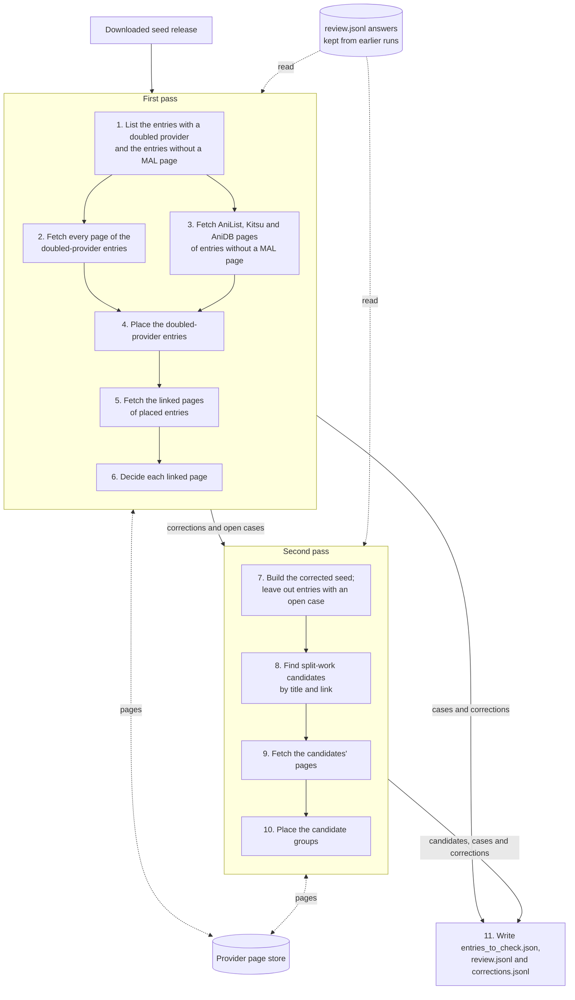
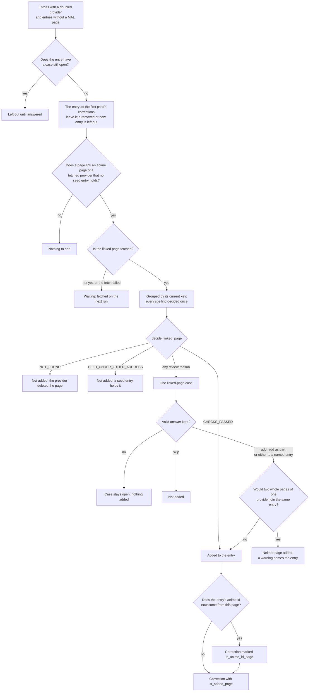

# seed_cleaning

Repairs the seed before enrichment reads it. It finds the seed entries that need
checking, fetches their provider pages so the `work_matching` rules can decide
from their links, and writes the result as seed corrections:

- where each page of an entry group ends up: an entry with a doubled provider,
  or entries that may be one split work;
- which pages, linked from an entry but held by no seed entry, are added to it.

Whatever the rules cannot settle goes to the review file for a person. The
downloaded seed release is read and never changed; the cleaned seed is built
later from the release plus the corrections. The library is deleted once
discovery replaces the seed; `libs/work_matching` stays.

## Contents

- [Terms](#terms)
- [The run](#the-run)
- [Entries to check](#entries-to-check)
  - [Split-work candidates](#split-work-candidates)
- [Fetching pages](#fetching-pages)
- [Placing entry groups](#placing-entry-groups)
  - [Second pass](#second-pass)
  - [Seed corrections](#seed-corrections)
  - [Correction rules](#correction-rules)
  - [Lines of the corrections file](#lines-of-the-corrections-file)
  - [Corrected entries](#corrected-entries)
- [Adding linked pages](#adding-linked-pages)
  - [Linked-page rules](#linked-page-rules)
  - [Every linked-page scenario](#every-linked-page-scenario)
- [Running it](#running-it)
  - [AniDB limits](#anidb-limits)
  - [Output files](#output-files)
- [Files](#files)

## Terms

The matching terms (work, provider page, page key, current key, reference page,
doubled provider, split work, linked page, part page) are defined in the
`work_matching` README, under [Terms](../work_matching/README.md#terms). This library adds:

| Term                         | Meaning                                                                                                                                                                               |
| ---------------------------- | ------------------------------------------------------------------------------------------------------------------------------------------------------------------------------------- |
| **Entry to check**           | A seed entry with a doubled provider, or one of a group of split-work candidates.                                                                                                     |
| **First pass, second pass**  | The two rounds of a run. The first places the entries with a doubled provider and adds linked pages; the second groups split-work candidates on the entries as the first leaves them. |
| **Corrected seed**           | Every work entry as the first pass's corrections leave it, with how corrections name each entry (its seed entry or new entry key) and each page (the seed entry listing it).          |
| **Entry without a MAL page** | A seed entry listing no MyAnimeList page. Its AniList, Kitsu and AniDB pages are fetched for their links, since a missing MAL page matters most there.                                |
| **Seed correction**          | One change to the seed, by page: where a page of an entry ends up, or a page added to an entry (`SeedCorrection`). Corrections are rebuilt on every run.                              |
| **Provider page store**      | `data/seed_cleaning/provider_pages.jsonl`: every fetched page's details, kept beyond the 7-day HTTP cache, so a rerun fetches only what is missing.                                   |
| **Review file**              | `data/seed_cleaning/review.jsonl`: one case per decision left to a person, with the answers kept across runs.                                                                         |

## The run

`scripts/clean_seed.py` runs these steps in order, in two passes. With
`--no-fetch` it skips the fetching steps and works from the pages already
stored.



Solid arrows give the order of the steps; dotted arrows are what the passes
fetch into and read from the store and the review file:

- Steps 2, 3, 5 and 9 add pages to the store; steps 4 to 8 and 10 read it.
- Steps 4, 6 and 10 read the answers kept in `review.jsonl`.
- Step 7 reads the downloaded seed again, to rebuild the entries the first
  pass's corrections change.
- Step 11 writes both passes' results: the first pass's cases and corrections,
  the candidate groups, and the second pass's cases and corrections, which
  stand in for the first pass's.

First pass:

1. **List the entries.** The entries with a doubled provider, and the entries without a MAL page. See [Entries to check](#entries-to-check).
2. **Fetch the doubled-provider entries:** every page of a provider with an enrichment helper, and AnimeSchedule through each entry's MAL pages (else AniList, else AniDB). See [Fetching pages](#fetching-pages).
3. **Fetch the entries without a MAL page:** their AniList, Kitsu and AniDB pages only.
4. **Place the doubled-provider entries:** each entry is one group, placed by the rules or by one review case. See [Placing entry groups](#placing-entry-groups).
5. **Fetch the linked pages** of the entries whose pages are placed, and the current key of any linked page fetched under another spelling.
6. **Decide the linked pages:** add, review, or leave out (not found, or already held under another address). See [Adding linked pages](#adding-linked-pages).

Second pass:

7. **Build the corrected seed** from the first pass's corrections, and leave out the entries of every case still open. See [Second pass](#second-pass).
8. **Find split-work candidates** among those entries, by title and by link. See [Split-work candidates](#split-work-candidates).
9. **Fetch the candidates' pages.** Links are read before this fetch, so pages fetched here tie entries from the next run on.
10. **Place the candidate groups:** every group is one review case.
11. **Write** `entries_to_check.json`, `review.jsonl` and `corrections.jsonl`, the second pass's corrections standing in for the first's, and print the counts. See [Output files](#output-files).

Each step is described below.

## Entries to check

| Entries to check          | Found by                                                                                                                                  | Why                                                                                                                                                                                                     |
| ------------------------- | ----------------------------------------------------------------------------------------------------------------------------------------- | ------------------------------------------------------------------------------------------------------------------------------------------------------------------------------------------------------- |
| **Doubled provider**      | An entry with pages of one provider carrying more than one id. Simkl and AnimeCountdown count as one provider.                            | The same rule `decide_doubled_providers` uses (`find_doubled_provider_page_keys`), so exactly the pages it decides are checked.                                                                         |
| **Split-work candidates** | Entries matching by title, type, year and season, or tied by a link, joined into groups. Found in the second pass, on the corrected seed. | A site often adds a page before the seed joins it to the work's main entry, so the page becomes an entry of its own. Seasons and parts often carry titles of their own, so links find what titles miss. |

### Split-work candidates

A split-work match needs:

- the title lookup of the known work entries to find one entry for the other:
  title equal once case, punctuation, accents and season wording are folded,
  same type, and equal years or a missing year. A missing year matches because the small entry
  of a split work usually has none yet;
- seasons equal, next to each other, or one missing. Seasons far apart are
  different works ("Gelpiyo", winter and fall); neighbouring ones go either way.

Two entries are also candidates when they are tied by a link
(`find_split_work_links`):

| Link                                                                                                                    | Ties the entries | Why                                                                                                                                                      |
| ----------------------------------------------------------------------------------------------------------------------- | ---------------- | -------------------------------------------------------------------------------------------------------------------------------------------------------- |
| A fetched page of one entry, or a page searched by one of its pages (AnimeSchedule), links a page the other entry holds | yes              | Seasons and parts link the work's main entry even when their titles differ.                                                                              |
| Both entries hold their own MAL page                                                                                    | no               | A work is what MAL lists, so two MAL pages are two works and a review would always answer "separate".                                                    |
| The linking page links two or more pages of one provider                                                                | no               | Such a page covers several works, such as an anthology.                                                                                                  |
| The linked page is linked from two or more entries holding their own MAL page                                           | no               | Such a page covers several works, such as AniDB's single page for a series and its specials; tying through it would chain separate works into one group. |
| The linking page is dead                                                                                                | no               | Its links cannot be read.                                                                                                                                |

An entry holding a page that covers several works, and no MAL page itself,
forms a group with the MAL entries linking that page, when no title or link
already groups it. Under MAL's division the page belongs to none of those
works, so the reviewer decides whether the entry stays its own work or merges
into one of them.

Entries joined through a shared match, link or several-works page form one
group, which keeps every title match and link as its evidence
(`candidate_evidence`), and is flagged when a page tying it is also linked from
entries outside it. A group found by title alone is then judged by the
providers with pages in two or more of its entries; a group with a link is
kept whatever they share, since the link is evidence enough to ask a person:

| Shared providers | Group                           | Why                                                                                                           |
| ---------------- | ------------------------------- | ------------------------------------------------------------------------------------------------------------- |
| none             | kept                            | Nothing says the entries are different works.                                                                 |
| one              | kept, marked with that provider | One provider listing the entries apart does not decide: such groups are sometimes one work and sometimes not. |
| two or more      | dropped and logged              | Two providers each listing the entries apart points to different works.                                       |
| MAL              | dropped and logged              | A work is what MAL lists, so entries holding different MAL pages are never one work.                          |

Title, type and year only find candidates, never decide that entries are one
work: every candidate group goes to review (see
[Placing entry groups](#placing-entry-groups)). Every path a candidate group
takes is mapped in the `work_matching` README, under
[Every split-work scenario](../work_matching/README.md#every-split-work-scenario).

## Fetching pages

`ProviderPageFetcher` fetches each page once through the public
`ApiFetcher.fetch_all_data`, one service at a time, with characters and
episodes off, and keeps it in the provider page store. The same fetch fills the
HTTP cache enrichment reads later.

- **Which pages:** those of the providers enrichment has a helper for
  (`FETCHED_PROVIDERS`): MAL, AniList, Kitsu, AniDB, Anime-Planet, AniSearch.
  ANN, LiveChart, Simkl and AnimeCountdown have no helper. AnimeSchedule is not
  in the seed: its page is a searched page, found by searching AnimeSchedule
  with each of the entry's MAL pages (else AniList, else AniDB), and records
  that page in `searched_by`. One AnimeSchedule page searched by pages of two
  entries keeps both.
- **Limited to some providers:** for the entries without a MAL page only
  AniList, Kitsu and AniDB pages are fetched (`LINK_CARRYING_PROVIDERS`), with
  no AnimeSchedule search. Anime-Planet and AniSearch pages carry no links to
  other providers, and AnimeSchedule pages rarely link MAL, so fetching them
  would find nothing to add.
- **Linked pages:** a linked page is known only by its key, so its address is
  built back from the key (`build_page_address`). When its fetch reports
  another current key, that key is fetched too, so the details are stored under
  the key an entry holds the page by.
- **Dead pages:** a page is stored as dead only when its provider said it does
  not exist, that is when its helper answered None. A failed fetch (a timeout,
  a block, a page that cannot be read, a service that did not run, a payload
  without an anime record) is not stored. AnimeSchedule finding nothing stores
  nothing: there is no page.
- **Retries:** a failed page is fetched once more after the rest of its
  provider's queue, so a provider that failed for a while, such as during a
  block, gets a second chance in the same run. A page failing again is retried
  on the next run.
- **Reruns:** a page already stored, or an AnimeSchedule search that found a
  page, is not fetched again. A search that found nothing is repeated on every
  run, so a page AnimeSchedule adds later is still found.
- **New fields:** each page keeps its episode count and air dates. Pages stored
  before a field was kept get it from one `--refetch-stored` run, which fetches
  every stored page again; the cache serves pages fetched in the last week.
- **Pace:** each provider has its own queue, one page at a time, so each
  site's rate limits hold while different sites run side by side. AnimeSchedule
  searches wait 3 seconds between them: requests without an app token get its
  stricter, undocumented limit.

The table lists every case a page fetch meets.

| Scenario                                                                                    | What happens                                                                                                                                                  |
| ------------------------------------------------------------------------------------------- | ------------------------------------------------------------------------------------------------------------------------------------------------------------- |
| The provider returns the page's record                                                      | The page is stored with its details and links.                                                                                                                |
| The provider says the page does not exist                                                   | Stored as dead and never fetched again.                                                                                                                       |
| The fetch fails: a timeout, a block, a page that cannot be read, a service that did not run | Nothing stored. The page is fetched once more after the rest of its provider's queue; if that fails too, the failure is printed and the next run tries again. |
| The provider answers without an anime record                                                | Counted as failed; nothing stored.                                                                                                                            |
| An unexpected error in one fetch                                                            | That page fails; the other providers' queues finish.                                                                                                          |
| The page is already stored                                                                  | Not fetched again, unless `--refetch-stored` asks, which replaces its details.                                                                                |
| The provider has no enrichment helper (ANN, LiveChart, Simkl, AnimeCountdown)               | Skipped.                                                                                                                                                      |
| The same page is listed by two entries                                                      | Fetched once, and counted once.                                                                                                                               |
| An entry without a MAL page                                                                 | Only its AniList, Kitsu and AniDB pages are fetched (`LINK_CARRYING_PROVIDERS`).                                                                              |
| AnimeSchedule finds a page through the entry's MAL page (else AniList, else AniDB)          | Stored as a searched page, recording the page it was found by; that search is not repeated.                                                                   |
| An entry with two MAL pages                                                                 | AnimeSchedule is searched once per MAL page.                                                                                                                  |
| AnimeSchedule finds nothing                                                                 | Nothing stored; the search is repeated on the next run.                                                                                                       |
| A linked page, known only by its key                                                        | Its address is built from the key (`build_page_address`), and the page stored.                                                                                |
| A linked page reports another current key                                                   | That key is fetched too, unless it is already stored.                                                                                                         |
| A linked page of a provider without a helper                                                | Skipped.                                                                                                                                                      |

## Placing entry groups

An `EntryGroup` holds the entries one review case places, with the evidence
that grouped them. The first pass makes one group per entry with a doubled
provider; the second makes one group per set of split-work candidates
(`EntryGroup.from_candidates`). Candidate groups never share an entry, and the
second pass leaves out entries with an open first-pass case, so no page is
placed by two groups at once.

`correct_entry_groups` checks each group's pages as one combined entry, from
the stored pages, including the pages searched by them. When the group is a
single entry and no decision needs review, its pages are placed at once.
Otherwise the group is one review case, and its places come from the kept
answer once a person gives a valid one (see
[Placing pages](../work_matching/README.md#placing-pages) and
[Entry groups and split works](../work_matching/README.md#entry-groups-and-split-works)
in the `work_matching` README). A group of two
or more entries always goes to review. Each placed page, and each added linked
page, becomes a seed correction.

### Second pass

The second pass places entries as the first pass left them, but corrections
name the downloaded seed, from which the cleaned seed is built.
`prepare_split_work_pass` builds the corrected seed (`build_corrected_seed`),
which keeps how corrections name every entry and page, and
`correct_entry_groups` writes the second pass's corrections with it:

| Second-pass page                                    | Correction                                                                                |
| --------------------------------------------------- | ----------------------------------------------------------------------------------------- |
| A page of a seed entry, staying                     | none, or the first pass's correction stands                                               |
| A page the first pass moved into the entry, staying | names the seed entry listing the page, and the entry it now stays in                      |
| A page joining another entry                        | names the seed entry listing the page, and the joined entry's seed entry or new entry key |
| A page the first pass added                         | stays marked added wherever it goes                                                       |

`merge_corrections` then lets each second-pass correction stand in for the
first pass's correction of the same page of the same seed entry: the second
pass placed the page where the first left it, so its correction already holds
the final place.

### Seed corrections

Each correction is a `SeedCorrection`:

| Field                         | Holds                                                                                                                                                                                               |
| ----------------------------- | --------------------------------------------------------------------------------------------------------------------------------------------------------------------------------------------------- |
| `entry_reference_page`        | The reference page of the seed entry that lists the page, or that an added page joins.                                                                                                              |
| `page_key`, `address`         | The page as the seed entry lists it; for an added page, its current key and the seed's spelling of it.                                                                                              |
| `placement_word`              | `work 1`, `work 2` and so on, or `other work`.                                                                                                                                                      |
| `is_main_page`                | Whether enrichment fetches this page for its provider in its work.                                                                                                                                  |
| `renamed_to`                  | The current page key, when the seed lists the page under an old address.                                                                                                                            |
| `target_entry_reference_page` | The reference page of the seed entry the page joins: the sure move target of an `other work` page, or the entry that survives as the page's work; `null` when the page stays or starts a new entry. |
| `new_entry_key`               | The new entry the page starts or joins: pages with the same key form one new entry. `null` when the page stays or joins a seed entry.                                                               |
| `is_added_page`               | Whether the page is not in the seed and is added to the entry (see [Adding linked pages](#adding-linked-pages)).                                                                                    |
| `is_part_page`                | Whether the page covers only part of its work, so enrichment combines it with the work's other part pages: an answer's `, part`, or an added page's `add as part`.                                  |
| `is_anime_id_page`            | Whether the entry's anime id now comes from this added page, so the search entry stored under the old id must be replaced (see the anime id rule under [Linked-page rules](#linked-page-rules)).    |
| `reason`                      | Why the page is placed here: the doubled-provider decision's outcome by name (`SAME_PAGE`, `PAGES_OF_OTHER_WORKS`), the linked-page decision's reason by name, or `review answer`.                  |

### Correction rules

The rules:

- **Final places, not steps.** A correction says where its page ends up, so
  the order corrections are applied in never matters, even when a page moves
  into an entry that is itself being corrected.
- **Rebuilt every run** from this run's decisions and the kept answers, so the
  file always matches them and needs no clean-up.
- **Pages without a place stay** as the seed lists them and get no correction.
- **Moves.** An `other work` page joins the seed entry its sure move names
  (`UnrelatedPage.move_target_entry`): its links name exactly one seed entry,
  that entry holds no page of the same provider, and their year and type agree.
  The rules and review answers use the same target, so neither makes a new
  doubled provider; a page an answer sends to another work without a sure
  target starts a new entry.
- **Works.** A page in `work N` joins the entry that survives as that work
  (`find_surviving_entries`); without one, the pages in that work form one new
  entry.
- **Removed entries.** A seed entry every page left is removed from the cleaned
  seed, since an entry without pages is no work.
- **Renamed pages.** The old address is dropped: the entry also lists the page
  under its current address, or the rules send the entry to review.
- **Main page first**, because enrichment fetches the first address of each
  provider.

### Lines of the corrections file

Lines of the corrections file, taken from real runs. Each correction is one
line in the file; here each is shown across lines.

A page the rules keep in its entry, under the address it has now:

```json
{
  "entry_reference_page": "mal:anime:127",
  "page_key": "animeplanet:anime:gate-keepers",
  "address": "https://anime-planet.com/anime/gate-keepers",
  "placement_word": "work 1",
  "is_main_page": false,
  "renamed_to": null,
  "target_entry_reference_page": null,
  "new_entry_key": null,
  "is_added_page": false,
  "is_part_page": false,
  "is_anime_id_page": false,
  "reason": "SAME_PAGE"
}
```

The same page's old address, dropped because the entry also lists the current
one (`renamed_to`):

```json
{
  "entry_reference_page": "mal:anime:127",
  "page_key": "animeplanet:anime:gatekeepers",
  "address": "https://anime-planet.com/anime/gatekeepers",
  "placement_word": "work 1",
  "is_main_page": false,
  "renamed_to": "animeplanet:anime:gate-keepers",
  "target_entry_reference_page": null,
  "new_entry_key": null,
  "is_added_page": false,
  "is_part_page": false,
  "is_anime_id_page": false,
  "reason": "SAME_PAGE"
}
```

A page the rules move to the seed entry its links name:

```json
{
  "entry_reference_page": "mal:anime:37196",
  "page_key": "anilist:anime:199801",
  "address": "https://anilist.co/anime/199801",
  "placement_word": "other work",
  "is_main_page": false,
  "renamed_to": null,
  "target_entry_reference_page": "mal:anime:62648",
  "new_entry_key": null,
  "is_added_page": false,
  "is_part_page": false,
  "is_anime_id_page": false,
  "reason": "PAGES_OF_OTHER_WORKS"
}
```

A page an answer moves into the entry that survives as its work (_CUE!_: the
ANN-only entry merged into the MAL entry, which is then removed):

```json
{
  "entry_reference_page": "ann:anime:24629",
  "page_key": "ann:anime:24629",
  "address": "https://animenewsnetwork.com/encyclopedia/anime.php?id=24629",
  "placement_word": "work 1",
  "is_main_page": false,
  "renamed_to": null,
  "target_entry_reference_page": "mal:anime:43735",
  "new_entry_key": null,
  "is_added_page": false,
  "is_part_page": false,
  "is_anime_id_page": false,
  "reason": "review answer"
}
```

A page an answer puts in a work no entry survives as, so it starts a new entry
shared by every page with the same `new_entry_key`:

```json
{
  "entry_reference_page": "mal:anime:43735",
  "page_key": "kitsu:anime:44979",
  "address": "https://kitsu.app/anime/44979",
  "placement_word": "work 2",
  "is_main_page": false,
  "renamed_to": null,
  "target_entry_reference_page": null,
  "new_entry_key": "mal:anime:43735 work 2",
  "is_added_page": false,
  "is_part_page": false,
  "is_anime_id_page": false,
  "reason": "review answer"
}
```

A linked page the seed lacks, added to the entry linking it; the entry's anime
id now comes from it, since it is a MAL page:

```json
{
  "entry_reference_page": "anilist:anime:163794",
  "page_key": "mal:anime:65144",
  "address": "https://myanimelist.net/anime/65144",
  "placement_word": "work 1",
  "is_main_page": false,
  "renamed_to": null,
  "target_entry_reference_page": null,
  "new_entry_key": null,
  "is_added_page": true,
  "is_part_page": false,
  "is_anime_id_page": true,
  "reason": "CHECKS_PASSED"
}
```

### Corrected entries

`build_corrected_entries` turns the corrections into `WorkEntry`s: each seed
entry they change, without the pages that left it and with those moved in or
added, and each new entry, with the key its pages share. An added page that a
later correction moves joins only the entry it moves to. A new entry takes its title, type, year and season
from its most trusted fetched page; a page with no fetched details only has the
entry it came from to go by, so it takes that entry's title and an unknown
type.

## Adding linked pages

Providers link pages the seed lacks, most often a MAL page linked from an
entry's AniList, Kitsu or AniDB page. `linked_page_additions` collects these
links, has them fetched, decides each with `decide_linked_page`, and writes an
addition as a seed correction or leaves a review case (see
[Linked pages](../work_matching/README.md#linked-pages) in the `work_matching` README for
the checks and the answers).

### Linked-page rules

- **Which entries:** the entries with a doubled provider and the entries without a MAL page
  (`find_entries_without_mal_page`), as the entry group corrections leave them
  (`list_entries_with_placed_pages`). An entry whose entry group waits for an
  answer is left out until answered: its pages are not placed yet, so a link on
  one of them may belong to another work. New entries and removed entries are
  left out, since a correction must name a seed entry that still has pages.
- **Which links:** links to anime pages of providers whose pages are fetched,
  so each linked page can be checked live. ANN, LiveChart, Simkl and
  AnimeCountdown pages come from seed releases instead.
- **Spellings:** the linked pages are grouped by the current key their fetch
  reports, so the spellings of one page (a Kitsu slug and its number) are
  decided once, with every entry linking any of them. A page a seed entry
  already holds at its current key is counted as held under another address
  and not added. An addition is recorded under the current key and the seed's
  spelling of its address.
- **Waiting:** a linked page not fetched yet, or whose fetch failed, gets no
  decision; the next run fetches it again. A page the provider says does not
  exist is stored as dead and never added.
- **One step:** corrections are rebuilt from the downloaded seed on every run,
  so an added page's own links are never followed.
- **No doubled provider from answers:** two answers adding two whole pages of
  one provider to one entry add neither; the run prints both pages and a
  warning names the entry.
- **Anime id:** enrichment derives an entry's anime id from its pages: the
  first of MAL, AniList, AniDB, Kitsu, Anime-Planet and AniSearch the entry
  holds (`find_anime_id_page_key` in `enrichment.pipeline.link_rules`). An added
  page that becomes that page, such as a MAL page added to an entry holding
  only an AniList page, changes the id, and its correction says so
  (`is_anime_id_page`). The cleaned seed must then replace the search entry
  stored under the old id.

### Every linked-page scenario

This map follows a link from an entry's page to the corrections file. The
decision in the middle is `decide_linked_page` (see
[Deciding a linked page](../work_matching/README.md#deciding-a-linked-page) in the
`work_matching` README for its checks).



The table lists every scenario, with a real example where one is known.

| Scenario                                                                                                                                                                                                        | Outcome                                                                                                                        |
| --------------------------------------------------------------------------------------------------------------------------------------------------------------------------------------------------------------- | ------------------------------------------------------------------------------------------------------------------------------ |
| An entry's group waits for a review answer                                                                                                                                                                      | Its links are not read: its pages are not placed yet, so a link on one of them may belong to another work.                     |
| A new entry built from an answer, or an entry every page left                                                                                                                                                   | Not read: a correction must name a seed entry that still has pages.                                                            |
| A link to a manga page, or to a page of a provider that is not fetched (ANN, LiveChart, Simkl, AnimeCountdown)                                                                                                  | Ignored: a manga link names source material, and the other pages cannot be checked live.                                       |
| The linked page is not fetched yet, or its fetch failed                                                                                                                                                         | Waiting, with no decision; the next run fetches it.                                                                            |
| The provider says the page does not exist (most MAL links from AniList and Kitsu)                                                                                                                               | `NOT_FOUND`: stored as dead, never added, no case.                                                                             |
| The link spells a page a seed entry holds another way (an AnimeSchedule Kitsu slug for a page the seed lists by number)                                                                                         | `HELD_UNDER_OTHER_ADDRESS`: not added, no case.                                                                                |
| One entry links it and every check passes (MAL 65144 _The Boxer_, linked from AniList 163794)                                                                                                                   | `CHECKS_PASSED`: added; here the entry's anime id now comes from the MAL page, so the correction is marked `is_anime_id_page`. |
| Two or more entries link it                                                                                                                                                                                     | `SEVERAL_ENTRIES`: review; the answer names the entry with `add to <reference page>`.                                          |
| The entry already holds a page of the provider                                                                                                                                                                  | `PROVIDER_IN_ENTRY`: review; `add as part` adds it as one part of the work.                                                    |
| The entry links two unheld pages of one provider                                                                                                                                                                | `SEVERAL_PAGES_OF_PROVIDER`: review.                                                                                           |
| Year or type differ from the entry's (AniList 102289, an ONA, linked from the _Nami_ movie entry)                                                                                                               | `DETAILS_DIFFER`: review.                                                                                                      |
| Both episode counts known and different                                                                                                                                                                         | `EPISODE_COUNTS_DIFFER`: review; suggested `add as part` when the page lists fewer episodes and year and type agree.           |
| Answers add two whole pages of one provider to one entry                                                                                                                                                        | Neither is added, so no doubled provider is made; the run prints both pages.                                                   |
| An added page's own links                                                                                                                                                                                       | Never followed: corrections are rebuilt from the downloaded seed on every run, so additions never chain.                       |
| An answer that is not valid: `add` while the entry holds a page of the provider, `add` with no entry named when several link the page, `add to` an entry that does not link it, or an answer naming other pages | The case stays open; nothing is added.                                                                                         |
| `add as part` while the entry holds a page of the provider                                                                                                                                                      | Accepted: a work can hold several part pages of one provider.                                                                  |

## Running it

```bash
uv run python scripts/clean_seed.py                  # list the entries to check, fetch their pages, correct them
uv run python scripts/clean_seed.py --no-fetch       # correct them from the pages already stored
uv run python scripts/clean_seed.py --refetch-stored # fetch stored pages again, so they gain new fields
uv run python scripts/clean_seed.py path/to/seed.json --data-dir data/seed_cleaning
uv run python scripts/clean_seed.py --store data/seed_pages/provider_pages.jsonl --no-fetch
```

Split works are found by links as well as titles, and a link is only seen when
the store holds the linking page. `--store` reads a store holding every seed
entry's pages, so links between any two entries are found.

### AniDB limits

AniDB caps requests per day as well as per second, and a ban blocks every
AniDB request from the address, enrichment included. Run with a wide gap, and
stop contacting AniDB after the first block; the next day's run picks up where
this one stopped:

```bash
ANIDB_MIN_REQUEST_INTERVAL=8 ANIDB_BAN_COOLDOWN=86400 uv run python scripts/clean_seed.py
```

### Output files

The run prints the entries found, a count per fetch outcome, every failed
fetch, the corrections by kind, the review cases open and answered, and the
linked pages waiting, not found, or held under another address.

It writes to the data folder, `data/seed_cleaning/` unless `--data-dir` names
another (git-ignored). The provider page store is `provider_pages.jsonl` in
that folder unless `--store` names another file.

| File                    | Written                                                                                                                                      | Holds                                                                                                                                                                                                                                | Used for                                                                                                                                         |
| ----------------------- | -------------------------------------------------------------------------------------------------------------------------------------------- | ------------------------------------------------------------------------------------------------------------------------------------------------------------------------------------------------------------------------------------ | ------------------------------------------------------------------------------------------------------------------------------------------------ |
| `provider_pages.jsonl`  | During the run, a line per page as each fetch returns (steps 2, 3, 5 and 9); never with `--no-fetch`. Added to across runs, never rewritten. | Every fetched page's details, one per line, dead pages included; see `ProviderPageStore`.                                                                                                                                            | Read by every step that decides: links, episode counts and air dates. Kept beyond the 7-day HTTP cache, so a rerun fetches only what is missing. |
| `entries_to_check.json` | At the end of the run (step 11). Rewritten each run.                                                                                         | The seed's `$schema` (its address names the release), the doubled-provider entries with their doubled pages, and the split-work candidate groups with their entries, their evidence and whether a tying page is linked from outside. | Read by people, to see what a release holds to check; no code reads it.                                                                          |
| `review.jsonl`          | At the end of the run (step 11), after both passes; read at the start of the next. Rewritten each run, answers kept.                         | One case per entry group the rules cannot place and per linked page they cannot add, with the evidence, reasons and suggested answer; see `ReviewFile`.                                                                              | A person writes each case's `answer`; the next run reads the answers back and turns the valid ones into corrections.                             |
| `corrections.jsonl`     | At the end of the run (step 11). Rewritten each run.                                                                                         | Every `SeedCorrection` of both passes, merged, sorted by entry reference page and page key.                                                                                                                                          | Building the cleaned seed: the downloaded release plus these corrections, so the release is never edited. Nothing builds it yet.                 |

## Files

| File                          | Holds                                                                                                                                                                                                           |
| ----------------------------- | --------------------------------------------------------------------------------------------------------------------------------------------------------------------------------------------------------------- |
| `doubled_provider_entries.py` | `find_doubled_provider_entries`: the entries holding a doubled provider.                                                                                                                                        |
| `split_work_links.py`         | `SplitWorkLink`, `SplitWorkLinks`, `find_split_work_links`: the links tying entries, the entries linking each page, and the pages covering several works.                                                       |
| `split_work_candidates.py`    | `SplitWorkCandidates` and `find_split_work_candidates`: the candidate groups by title, link and several-works page, with their evidence.                                                                        |
| `provider_page_fetcher.py`    | `ProviderPageFetcher`, `FetchSummary`, `FetchOutcome`, `FETCHED_PROVIDERS`: fetching every page of the entries to check, the link-carrying pages of entries without a MAL page, and linked pages by key.        |
| `entry_groups.py`             | `EntryGroup`: the entries one review case places, with why they are grouped.                                                                                                                                    |
| `corrected_seed.py`           | `build_corrected_seed`, `CorrectedSeed`, `EntryIdentity`, `PageOrigin`: every entry as the first pass leaves it, and how corrections name its entries and pages.                                                |
| `split_work_pass.py`          | `prepare_split_work_pass`, `SplitWorkPass`: the second pass's entries and candidate groups.                                                                                                                     |
| `cleaning_report.py`          | `build_entries_to_check_document`, `count_corrections`: what `entries_to_check.json` holds and the counts a run prints.                                                                                         |
| `group_placement.py`          | `correct_entry_groups`: each entry group's pages placed, from the rules or a review answer.                                                                                                                     |
| `seed_corrections.py`         | `SeedCorrection`, `PlacementCorrections`, `merge_corrections`, `write_corrections`: where each checked page ends up, the two passes merged, written to the corrections file.                                    |
| `corrected_entries.py`        | `build_corrected_entries`, `CorrectedEntry`: the work entries the corrections change or create.                                                                                                                 |
| `linked_page_additions.py`    | `find_entries_without_mal_page`, `LINK_CARRYING_PROVIDERS`, `list_entries_with_placed_pages`, `find_linking_seed_entries`, `correct_linked_pages`: the linked pages added as corrections.                       |
| `linked_page_groups.py`       | `LinkingSeedEntry`, `group_linked_pages_by_current_key`, `rename_linked_pages_to_current_keys`: the linked pages grouped by the current key their fetch reports, so the spellings of one page are decided once. |
