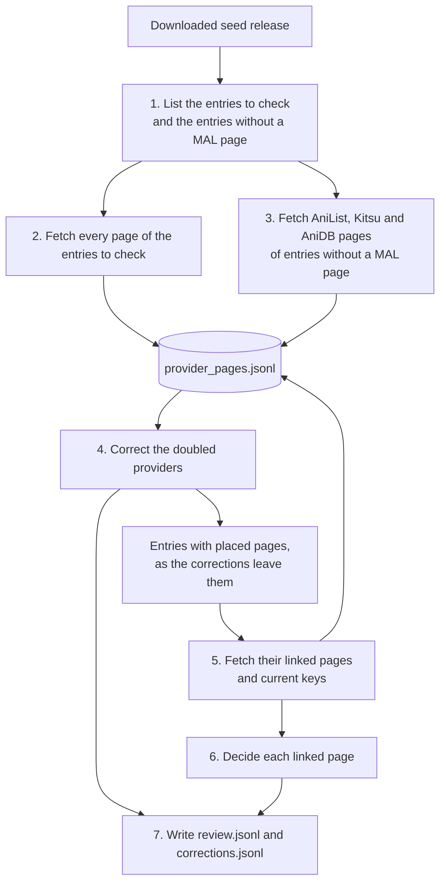

# seed_cleaning

Repairs the seed before enrichment reads it. It finds the seed entries that need
checking, fetches their provider pages so the `work_matching` rules can decide
from their links, and writes the result as seed corrections:

- where each page of an entry with a doubled provider ends up;
- which pages, linked from an entry but held by no seed entry, are added to it.

Whatever the rules cannot settle goes to the review file for a person. The
downloaded seed release is read and never changed; the cleaned seed is built
later from the release plus the corrections. The library is deleted once
discovery replaces the seed; `libs/work_matching` stays.

The matching terms (work, provider page, page key, current key, reference page,
doubled provider, split work, linked page, part page) are defined in the
`work_matching` README. This library adds:

| Term | Meaning |
| -- | -- |
| **Entry to check** | A seed entry with a doubled provider, or one of a group of split-work candidates. |
| **Entry without a MAL page** | A seed entry listing no MyAnimeList page. Its AniList, Kitsu and AniDB pages are fetched for their links, since a missing MAL page matters most there. |
| **Seed correction** | One change to the seed, by page: where a page of an entry ends up, or a page added to an entry (`SeedCorrection`). Corrections are rebuilt on every run. |
| **Provider page store** | `data/seed_cleaning/provider_pages.jsonl`: every fetched page's details, kept beyond the 7-day HTTP cache, so a rerun fetches only what is missing. |
| **Review file** | `data/seed_cleaning/review.jsonl`: one case per decision left to a person, with the answers kept across runs. |

## The run

`scripts/clean_seed.py` runs these steps in order. With `--no-fetch` it skips
the fetching steps and works from the pages already stored.



1. **List the entries.** The entries to check, written to `entries_to_check.json`, and the entries without a MAL page.
2. **Fetch the entries to check:** every page of a provider with an enrichment helper, and AnimeSchedule through each entry's MAL pages (else AniList, else AniDB).
3. **Fetch the entries without a MAL page:** their AniList, Kitsu and AniDB pages only.
4. **Correct the doubled providers:** place each entry's pages, or make one review case for the entry.
5. **Fetch the linked pages** of the entries whose pages are placed, and the current key of any linked page fetched under another spelling.
6. **Decide the linked pages:** add, review, or leave out (not found, or already held under another address).
7. **Write** `review.jsonl` and `corrections.jsonl`, and print the counts.

Each step is described below.

## Entries to check

| Entries to check | Found by | Why |
| -- | -- | -- |
| **Doubled provider** | An entry with pages of one provider carrying more than one id. Simkl and AnimeCountdown count as one provider. | The same rule `decide_doubled_providers` uses (`find_doubled_provider_page_keys`), so exactly the pages it decides are checked. |
| **Split-work candidates** | Entries matching by title, type, year and season, joined into groups. | A site often adds a page before the seed joins it to the work's main entry, so the page becomes an entry of its own. |

A split-work match needs:

- the title lookup of the known work entries to find one entry for the other:
  title equal once case, punctuation, accents and season wording are folded,
  same type, and equal years or a missing year. A missing year matches because the small entry
  of a split work usually has none yet;
- seasons equal, next to each other, or one missing. Seasons far apart are
  different works ("Gelpiyo", winter and fall); neighbouring ones go either way.

Entries joined through a shared match form one group. The group is then judged
by the providers with pages in two or more of its entries:

| Shared providers | Group | Why |
| -- | -- | -- |
| none | kept | Nothing says the entries are different works. |
| one | kept, marked with that provider | One provider listing the entries apart does not decide: such groups are sometimes one work and sometimes not. |
| two or more | dropped and logged | Two providers each listing the entries apart points to different works. |

Split-work candidates are listed and their pages fetched; merging them is not
built yet. Title, type and year only find candidates, never decide that entries
are one work.

## Fetching pages

`ProviderPageFetcher` fetches each page once through the public
`ApiFetcher.fetch_all_data`, one service at a time, with characters and
episodes off, and keeps it in the provider page store. The same fetch fills the
HTTP cache enrichment reads later.

- **Which pages:** those of the providers enrichment has a helper for
  (`FETCHED_PROVIDERS`): MAL, AniList, Kitsu, AniDB, Anime-Planet, AniSearch.
  ANN, LiveChart, Simkl and AnimeCountdown have no helper. AnimeSchedule is not
  in the seed: its page is a searched page, found by searching AnimeSchedule
  with each of the entry's MAL pages (else AniList, else AniDB), and records
  that page in `searched_by`. One AnimeSchedule page searched by pages of two
  entries keeps both.
- **Limited to some providers:** for the entries without a MAL page only
  AniList, Kitsu and AniDB pages are fetched (`LINK_CARRYING_PROVIDERS`), with
  no AnimeSchedule search. Anime-Planet and AniSearch pages carry no links to
  other providers, and AnimeSchedule pages rarely link MAL, so fetching them
  would find nothing to add.
- **Linked pages:** a linked page is known only by its key, so its address is
  built back from the key (`build_page_address`). When its fetch reports
  another current key, that key is fetched too, so the details are stored under
  the key an entry holds the page by.
- **Dead pages:** a page is stored as dead only when its provider said it does
  not exist, that is when its helper answered None. A failed fetch (a timeout,
  a block, a page that cannot be read, a service that did not run, a payload
  without an anime record) is not stored, so the next run tries it again.
  AnimeSchedule finding nothing stores nothing: there is no page.
- **Reruns:** a page already stored, or an AnimeSchedule search that found a
  page, is not fetched again. A search that found nothing is repeated on every
  run, so a page AnimeSchedule adds later is still found.
- **New fields:** each page keeps its episode count and air dates. Pages stored
  before a field was kept get it from one `--refetch-stored` run, which fetches
  every stored page again; the cache serves pages fetched in the last week.
- **Pace:** each provider has its own queue, one page at a time, so each
  site's rate limits hold while different sites run side by side. AnimeSchedule
  searches wait 3 seconds between them: requests without an app token get its
  stricter, undocumented limit.

## Correcting entries with doubled providers

`correct_doubled_provider_entries` decides each entry with a doubled provider
from the stored pages, including the pages searched by them. When no decision
of the entry needs review, its pages are placed at once; otherwise the entry is
one review case, and its places come from the kept answer once a person gives a
valid one (see "Placing an entry's pages" in the `work_matching` README). Each
placed page, and each added linked page, becomes a `SeedCorrection`:

| Field | Holds |
| -- | -- |
| `entry_reference_page` | The reference page of the seed entry that lists the page, or that an added page joins. |
| `page_key`, `address` | The page as the seed entry lists it; for an added page, its current key and the seed's spelling of it. |
| `placement_word` | `entry`, `other work` or `work 2`, `work 3` and so on. |
| `is_main_page` | Whether enrichment fetches this page for its provider in its work. |
| `renamed_to` | The current page key, when the seed lists the page under an old address. |
| `target_entry_reference_page` | The reference page of the seed entry an `other work` page joins; `null` when it starts a new entry. |
| `is_added_page` | Whether the page is not in the seed and is added to the entry (see "Adding linked pages"). |
| `is_part_page` | Whether the page covers only part of its work, so enrichment combines it with the work's other part pages: an answer's `, part`, or an added page's `add as part`. |
| `reason` | Why the page is placed here: the doubled-provider decision's outcome by name (`SAME_PAGE`, `PAGES_OF_OTHER_WORKS`), the linked-page decision's reason by name, or `review answer`. |

The rules:

- **Final places, not steps.** A correction says where its page ends up, so
  the order corrections are applied in never matters, even when a page moves
  into an entry that is itself being corrected.
- **Rebuilt every run** from this run's decisions and the kept answers, so the
  file always matches them and needs no clean-up.
- **Pages without a place stay** as the seed lists them and get no correction.
- **Moves.** An `other work` page joins the seed entry its sure move names
  (`UnrelatedPage.move_target_entry`): its links name exactly one seed entry,
  that entry holds no page of the same provider, and their year and type agree.
  The rules and review answers use the same target, so neither makes a new
  doubled provider; a page an answer sends to another work without a sure
  target starts a new entry. Pages an answer puts in the same `work N` form one
  new entry.
- **Renamed pages.** The old address is dropped: the entry also lists the page
  under its current address, or the rules send the entry to review.
- **Main page first**, because enrichment fetches the first address of each
  provider.

`build_corrected_entries` turns the corrections into `WorkEntry`s: each seed
entry they change, without the pages that left it and with those moved in or
added, and each new entry. A new entry takes its title, type, year and season
from its most trusted fetched page; a page with no fetched details only has the
entry it came from to go by, so it takes that entry's title and an unknown
type.

## Adding linked pages

Providers link pages the seed lacks, most often a MAL page linked from an
entry's AniList, Kitsu or AniDB page. `linked_page_additions` collects these
links, has them fetched, decides each with `decide_linked_page`, and writes an
addition as a seed correction or leaves a review case (see "Adding linked
pages" in the `work_matching` README for the checks and the answers). The
rules:

- **Which entries:** the entries to check and the entries without a MAL page
  (`find_entries_without_mal_page`), as the doubled-provider corrections leave
  them (`list_entries_with_placed_pages`). An entry whose doubled providers wait
  for an answer is left out until answered: its pages are not placed yet, so a
  link on one of them may belong to another work. New entries are left out,
  since a correction must name a seed entry.
- **Which links:** links to anime pages of providers whose pages are fetched,
  so each linked page can be checked live. ANN, LiveChart, Simkl and
  AnimeCountdown pages come from seed releases instead.
- **Spellings:** the linked pages are grouped by the current key their fetch
  reports, so the spellings of one page (a Kitsu slug and its number) are
  decided once, with every entry linking any of them. A page a seed entry
  already holds at its current key is counted as held under another address
  and not added. An addition is recorded under the current key and the seed's
  spelling of its address.
- **Waiting:** a linked page not fetched yet, or whose fetch failed, gets no
  decision; the next run fetches it again. A page the provider says does not
  exist is stored as dead and never added.
- **One step:** corrections are rebuilt from the downloaded seed on every run,
  so an added page's own links are never followed.
- **No doubled provider from answers:** two answers adding two whole pages of
  one provider to one entry add neither; the run prints both pages and a
  warning names the entry.
- **Anime id:** an added MAL page changes the entry's anime id, since ids come
  from the MAL page first, so the cleaned seed must replace the old search
  entry.

## Running it

```bash
uv run python scripts/clean_seed.py                  # list the entries to check, fetch their pages, correct them
uv run python scripts/clean_seed.py --no-fetch       # correct them from the pages already stored
uv run python scripts/clean_seed.py --refetch-stored # fetch stored pages again, so they gain new fields
uv run python scripts/clean_seed.py path/to/seed.json --data-dir data/seed_cleaning
```

AniDB caps requests per day as well as per second, and a ban blocks every
AniDB request from the address, enrichment included. Run with a wide gap, and
stop contacting AniDB after the first block; the next day's run picks up where
this one stopped:

```bash
ANIDB_MIN_REQUEST_INTERVAL=8 ANIDB_BAN_COOLDOWN=86400 uv run python scripts/clean_seed.py
```

The run prints the entries found, a count per fetch outcome, every failed
fetch, the corrections by kind, the review cases open and answered, and the
linked pages waiting, not found, or held under another address.

It writes to `data/seed_cleaning/` (git-ignored):

| File | Holds |
| -- | -- |
| `entries_to_check.json` | The seed's `$schema` (its address names the release), the doubled-provider entries with their doubled pages, and the candidate groups with their entries. Rewritten on each run. |
| `provider_pages.jsonl` | Every fetched page, one per line; see `ProviderPageStore`. |
| `review.jsonl` | One case per entry the rules cannot place and per linked page they cannot add, where a person writes the answer; see `ReviewFile`. Answers are kept across runs. |
| `corrections.jsonl` | Every `SeedCorrection`, sorted by entry reference page and page key. Rewritten on each run. |

## Files

| File | Holds |
| -- | -- |
| `doubled_provider_entries.py` | `find_doubled_provider_entries`: the entries holding a doubled provider. |
| `split_work_candidates.py` | `SplitWorkCandidates` and `find_split_work_candidates`: the candidate groups. |
| `provider_page_fetcher.py` | `ProviderPageFetcher`, `FetchSummary`, `FetchOutcome`, `FETCHED_PROVIDERS`: fetching every page of the entries to check, the link-carrying pages of entries without a MAL page, and linked pages by key. |
| `seed_corrections.py` | `correct_doubled_provider_entries`, `SeedCorrection`, `build_corrected_entries`, `write_corrections`: where each page of an entry with doubled providers ends up, and the corrected entries. |
| `linked_page_additions.py` | `find_entries_without_mal_page`, `LINK_CARRYING_PROVIDERS`, `list_entries_with_placed_pages`, `find_linking_seed_entries`, `correct_linked_pages`: the linked pages added as corrections. |
