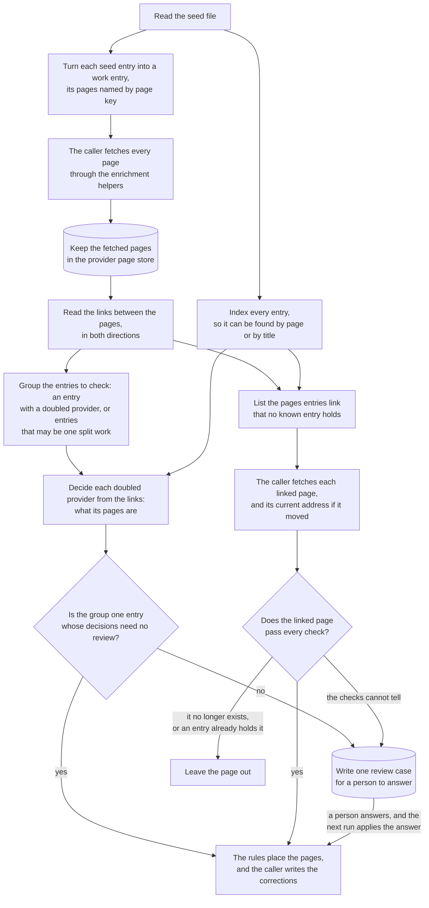
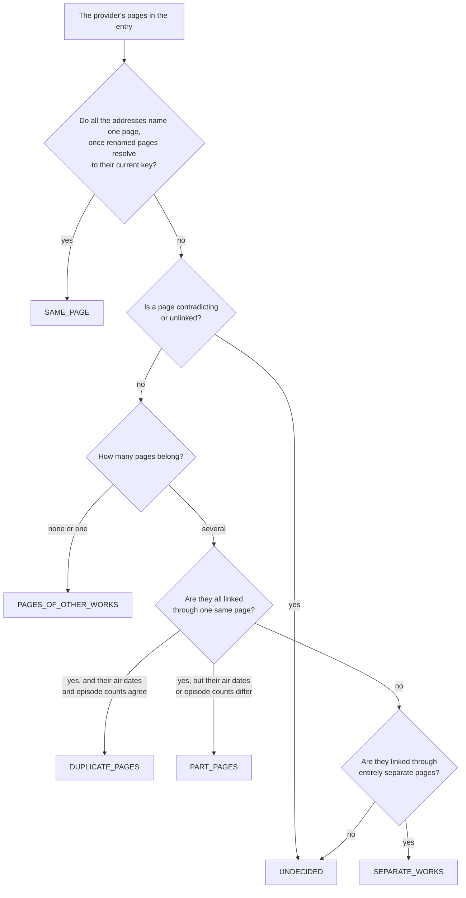
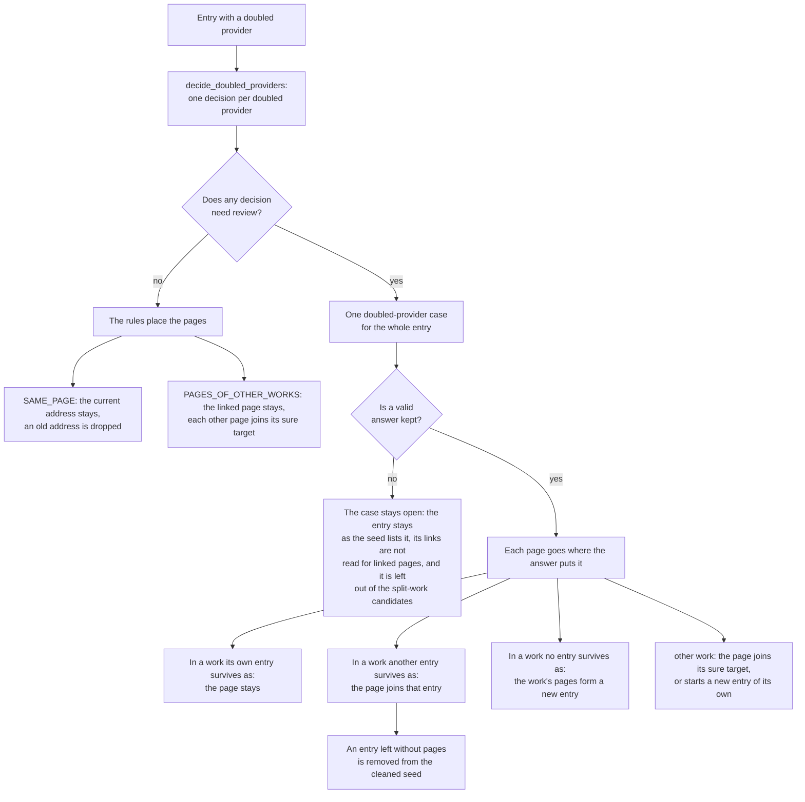
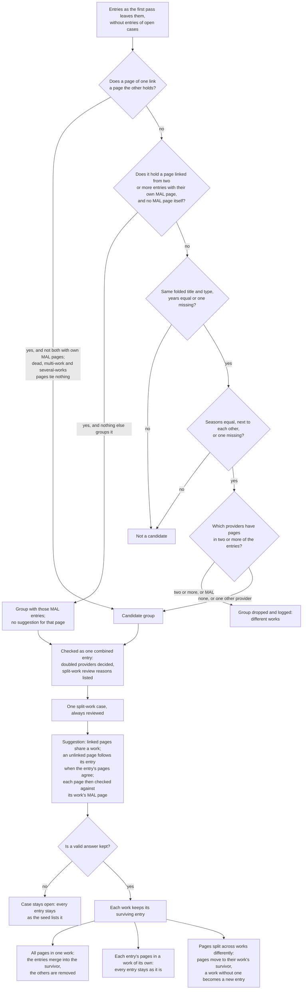
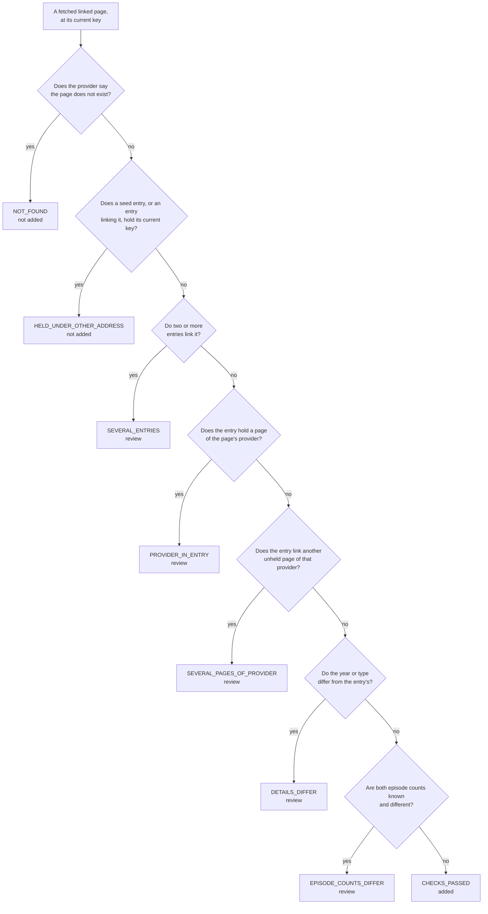

# work_matching

Decides which provider pages describe the same anime work. Seed cleaning uses it
now to repair the seed; seed link filling and discovery will use it later.

The library only decides. It does not fetch pages and does not change the seed:
the caller fetches the pages, and seed cleaning turns the decisions into
corrections. It imports nothing from `enrichment`, so it can outlive the seed.

It answers three questions, each from the links between provider pages:

1. **Doubled provider:** an entry lists two or more pages of one provider.
   Which of them belong to the entry's work?
2. **Split work:** several entries look like one work. Are they?
3. **Linked page:** an entry's pages link a page no known work holds. Should
   it join the entry?

Whatever the rules cannot settle becomes a review case, answered by a person
(later the review agent); the answer is kept and applied on every later run.

## Contents

- [Terms](#terms)
- [How it works](#how-it-works)
  - [Links decide; details only stop](#links-decide-details-only-stop)
  - [A stored page](#a-stored-page)
- [Doubled providers](#doubled-providers)
  - [How pages are labelled](#how-pages-are-labelled)
  - [Outcomes](#outcomes)
  - [Review reasons](#review-reasons)
  - [Sure moves](#sure-moves)
  - [Decision fields](#decision-fields)
  - [Worked examples](#worked-examples)
  - [Every doubled-provider scenario](#every-doubled-provider-scenario)
- [Placing pages](#placing-pages)
  - [Surviving entries](#surviving-entries)
  - [Placed by the rules](#placed-by-the-rules)
  - [Valid answers](#valid-answers)
  - [Suggested answers](#suggested-answers)
- [Entry groups and split works](#entry-groups-and-split-works)
  - [How a group is checked](#how-a-group-is-checked)
  - [Checking suggestions against MAL](#checking-suggestions-against-mal)
  - [Every split-work scenario](#every-split-work-scenario)
- [Linked pages](#linked-pages)
  - [Finding linked pages](#finding-linked-pages)
  - [Spellings](#spellings)
  - [Deciding a linked page](#deciding-a-linked-page)
  - [Answering a linked-page case](#answering-a-linked-page-case)
- [Review cases](#review-cases)
  - [Lines of the review file](#lines-of-the-review-file)
  - [Case fields](#case-fields)
  - [Accepted answers](#accepted-answers)
  - [Across runs](#across-runs)
- [Files](#files)
- [Use](#use)
  - [Decide an entry's doubled providers](#decide-an-entrys-doubled-providers)
  - [Send an entry to review](#send-an-entry-to-review)
  - [Decide an entry's linked pages](#decide-an-entrys-linked-pages)

## Terms

| Term                   | Meaning                                                                                                                                                                                                                                                                                                                            |
| ---------------------- | ---------------------------------------------------------------------------------------------------------------------------------------------------------------------------------------------------------------------------------------------------------------------------------------------------------------------------------- |
| **Work**               | One real anime title as a whole: a single TV season, movie, OVA or special. A sequel season is a separate work.                                                                                                                                                                                                                    |
| **Provider**           | A site that catalogues anime: MAL, AniList, Kitsu, AniDB, Anime-Planet, AniSearch, ANN, LiveChart, Simkl, AnimeCountdown. AnimeSchedule is fetched too, but the seed does not list it.                                                                                                                                             |
| **Provider page**      | One page on a provider about one work, such as `https://myanimelist.net/anime/21`.                                                                                                                                                                                                                                                 |
| **Page**               | Short for provider page. In code, `page` always holds a page's fetched details (`ProviderPage`) and `page_key` holds its key.                                                                                                                                                                                                      |
| **Address**            | The URL of a provider page. One page can have several addresses: an old address that redirects, or another spelling such as a Kitsu slug for a page the seed lists by number.                                                                                                                                                      |
| **Page key**           | The name of a provider page, whatever the spelling of its address: `mal:anime:21` for `https://www.myanimelist.net/anime/21/One_Piece`. It is `provider:kind:id`, where the kind is `anime` or `manga`. Pages are always compared by key.                                                                                          |
| **Current key**        | The key a page is found under now. A renamed page, or a page reached by another spelling (a Kitsu slug for a page the seed lists by number), has another current key, which only fetching the page shows (`ProviderPage.current_key`).                                                                                             |
| **Seed**               | The downloaded anime-offline-database file the enrichment pipeline starts from.                                                                                                                                                                                                                                                    |
| **Seed entry**         | One row of the seed: a title, type, year, season and a list of provider pages.                                                                                                                                                                                                                                                     |
| **Work entry**         | One work as this library sees it (`WorkEntry`): title, type, year, season and its page addresses by page key (`addresses_by_page_key`). Built from a seed entry, later also from discovery.                                                                                                                                        |
| **Reference page**     | The page that names an entry across seed releases: its most trusted page, MAL first, then AniList, AniDB, Kitsu, Anime-Planet, AniSearch, ANN, LiveChart, Simkl, AnimeCountdown (`REFERENCE_ORDER`). An entry's position in the seed file changes every release; its reference page does not.                                      |
| **Known work entries** | All work entries, looked up by page key or by title, type and year (`KnownWorkEntries`, backed by the seed in `KnownWorkEntriesFromSeed`). The seed lookup also reports page keys listed in several entries and the titles of entries without pages.                                                                               |
| **Held**               | An entry holds a page when the entry lists the page among its pages. A known work holds a page when the work's entry does.                                                                                                                                                                                                         |
| **Link**               | A page key one page lists for another provider's page (`ProviderPage.linked_page_keys`), read from the fetched record's `sources` and `external_sources`. A page's own provider is not a link (a second page of that provider is the page's new address, `renamed_to`), and neither are shared websites or unrecognised addresses. |
| **Linked**             | Two pages are linked when either one lists the other among its links. Direction does not matter. Links from a multi-work page, and a searched page's link back to the page it was searched by, are ignored.                                                                                                                        |
| **Doubled provider**   | An entry listing two or more pages of one provider. It may be one page under two addresses, one work the provider lists twice, or two works mixed into one entry. Checking tells which.                                                                                                                                            |
| **Mixed entry**        | An entry whose pages cover more than one work. Puu-Neko holds the pages of both "Puu-Neko" and "Puu-Neko Shougekijou".                                                                                                                                                                                                             |
| **Duplicate page**     | A provider having more than one page for the same work, such as Kitsu's "Yume Mitsuya" and "Yume Juuya" pages for one short.                                                                                                                                                                                                       |
| **Split work**         | One work spread over several seed entries, such as "CUE!" (only its ANN page) and "Cue!" (every other page).                                                                                                                                                                                                                       |
| **Linked page**        | A page an entry's pages link that no known work and not the entry holds, such as a MAL page linked from an AniList page the seed lists alone.                                                                                                                                                                                      |
| **Main page**          | The page enrichment fetches for a provider when a work keeps two or more pages of that provider. Enrichment takes the first address of each provider, so the main page is listed first.                                                                                                                                            |
| **Part page**          | A page covering only part of a work, such as one season of a run MAL lists as one work. A work can hold several part pages of one provider.                                                                                                                                                                                        |
| **Renamed page**       | A page whose address changed; the old address redirects to the new one. Anime-Planet renames pages. The old and new address are one page.                                                                                                                                                                                          |
| **Searched page**      | A page the seed does not list, found by searching its provider with one of the entry's page ids. AnimeSchedule is searched by MAL, AniList or AniDB id.                                                                                                                                                                            |
| **Searched by**        | The pages a searched page was found with (`ProviderPage.searched_by`). Every one is kept: a searched page can be reached through pages of several entries, such as both entries of a split work.                                                                                                                                   |
| **Dead page**          | A page the provider says does not exist (`ProviderPage.is_dead`).                                                                                                                                                                                                                                                                  |
| **Multi-work page**    | A page naming two or more pages of one provider, such as an anthology page linking several MAL pages. Its links prove nothing.                                                                                                                                                                                                     |
| **Several-works page** | A page linked with two or more MAL pages, in either direction, such as AniDB's single page for three _Ajin_ films MAL lists apart. A work is what MAL lists, so the page covers several works and its links prove nothing.                                                                                                         |
| **Review case**        | A decision the rules do not settle, written to the review file for a person (later the review agent) to answer.                                                                                                                                                                                                                    |

## How it works



1. **Read the seed.** Each seed entry becomes a `WorkEntry`, its pages keyed by page key. `KnownWorkEntriesFromSeed` indexes every entry by page and by title.
2. **Fetch the pages.** The caller fetches each page through the enrichment helpers, with characters and episodes off, and builds a `ProviderPage` with `ProviderPage.from_canonical_record`. AnimeSchedule is searched by the entry's MAL page (else AniList, else AniDB), and its page records that page as `searched_by`. Pages are kept in a `ProviderPageStore`, so they outlive the 7-day HTTP cache.
3. **Link the pages.** `ProviderPageLinks` joins the candidate pages by their links, in both directions:
   - a renamed page resolves to its current key;
   - a searched page counts as each page it was searched by, so AnimeSchedule's links count for every such page, and its link back to that page is ignored;
   - a link to a page of the same provider proves nothing and is ignored;
   - the links of a multi-work page are set aside, and so are the links of a several-works page, so it ties none of the works it covers together.
4. **Decide doubled providers and split works.** The caller groups the entries to check into entry groups. `decide_doubled_providers` decides each doubled provider of a group's combined entry (`combine_group_entries`), and `list_split_work_review_reasons` lists what speaks against a group of entries being one work. See [Doubled providers](#doubled-providers) and [Entry groups and split works](#entry-groups-and-split-works).
5. **Place or review.** `place_pages_without_review` places every doubled page of a single entry when no decision needs review, and the caller applies the places. Otherwise the group becomes one review case in the `ReviewFile`; a group of two or more entries always does, and its suggested answer is checked against the MAL page of each work (see [Checking suggestions against MAL](#checking-suggestions-against-mal)). See [Placing pages](#placing-pages).
6. **Add linked pages.** `find_unheld_linked_page_keys` lists the pages an entry's pages link that no known work holds. The caller fetches each, and its current key when the fetch reports another. `decide_linked_page` then adds the page, leaves it out, or makes a review case. See [Linked pages](#linked-pages).
7. **Apply answers.** Once a person answers a case, the next run hands the answer back to the caller, who applies it like a decision of the rules. See [Review cases](#review-cases).

### Links decide; details only stop

A page's title, year, type, season,
episode count and air dates never decide that pages belong together: a provider
listing one work twice gives the two pages different titles ("Ankeeto" and "The
Question" on Anime-Planet), and picking one by title drops the other. Details
only stop an automatic change, such as a move or an addition whose year or type
disagrees, and they are shown on review cases to help the reviewer.

### A stored page

A line of the file, taken from a real run. Each page is one line in the file;
here it is shown across lines:

```json
{
  "key": "kitsu:anime:10561",
  "address": "https://kitsu.app/anime/10561",
  "titles": ["Nami", "NAMI"],
  "type": "MOVIE",
  "year": 2000,
  "season": "WINTER",
  "episode_count": 1,
  "aired_from": "1999-12-31T15:00:00Z",
  "aired_to": "1999-12-31T15:00:00Z",
  "linked_page_keys": ["anilist:anime:102289", "mal:anime:29949"],
  "renamed_to": null,
  "searched_by": [],
  "is_dead": false
}
```

Lines stored before a field was kept lack it, and read with its default.

## Doubled providers

A doubled provider is a provider with two or more pages in one entry.
`decide_doubled_providers` makes one `DoubledProviderDecision` per doubled
provider. A decision holds two separate answers:

- **`outcome`**: what the provider's pages are, relative to the entry.
- **`review_reasons`**: why a person must check the decision. Every reason that
  applies is listed, not only the first.

### How pages are labelled

First, each page gets one of four labels from its links alone:

| Label             | When                                                                                                                                                                                        |
| ----------------- | ------------------------------------------------------------------------------------------------------------------------------------------------------------------------------------------- |
| **Belongs**       | The page is linked with a page of another provider in this entry, in either direction, and links no other work.                                                                             |
| **Unrelated**     | The page links a page outside this entry that names a different work: a page of a provider this entry already has (so the two disagree), or a page of another known work entry.             |
| **Contradicting** | The page is linked with this entry and also links a different work.                                                                                                                         |
| **Unlinked**      | Neither: no link ties the page to this entry or to another work. Pages of providers that are not fetched (ANN, LiveChart, Simkl, AnimeCountdown) end here unless a fetched page links them. |

The outcome follows from the labels:



### Outcomes

| Outcome                | What the pages are                                                                                                                                                       | Applied by the rules?                                                                     | Example                                                                                                                     |
| ---------------------- | ------------------------------------------------------------------------------------------------------------------------------------------------------------------------ | ----------------------------------------------------------------------------------------- | --------------------------------------------------------------------------------------------------------------------------- |
| `SAME_PAGE`            | One page under several addresses: an old address leads to the page's current address. The provider is not really doubled.                                                | Yes, when no review reason applies: the current address stays and the old one is dropped. | Cocoon on Anime-Planet: `cocoon-aru-natsu-no-shoujo-tachi-yori` now leads to `cocoon-one-summer-of-girlhood`.               |
| `PAGES_OF_OTHER_WORKS` | At most one page belongs to the entry's work. Every other page belongs to a work outside the entry, and moves out to that work's seed entry.                             | Yes, when no review reason applies: the linked page stays, and each other page moves.     | Buriki no Dance: Kitsu 48612 belongs; Kitsu 51023 links MAL 64943, which is the "Buriki no Dance (2026)" entry.             |
| `DUPLICATE_PAGES`      | Every page belongs to the entry's work and covers all of it: the provider lists the work more than once. Their first air dates and episode counts agree, or are unknown. | No: a person names the main page.                                                         | Fushigi na Taiko on Kitsu: pages 10544 and 7369, both one episode aired 19 August 1957.                                     |
| `PART_PAGES`           | Every page belongs to the entry's work, but their first air dates or episode counts differ, so each page covers part of the work, such as one of two OVAs.               | No: the details only suggest parts, so a person confirms them.                            | Ao Haru Ride OVA: AniList 20837 (aired August 2014) and 20900 (aired December 2014) both link MAL 24151, which covers both. |
| `SEPARATE_WORKS`       | Each page is linked with its own, separate set of the entry's pages, so the entry holds several works.                                                                   | No: every page of the entry has to be placed in one of the works.                         | Puu-Neko: MAL 10459 goes with AniList 10459 and Kitsu 6190; MAL 11589 with AniList 11589 and Kitsu 6543.                    |
| `UNDECIDED`            | The links do not tell which work every page belongs to: a page is contradicting or unlinked, or the belonging pages share only some linked pages.                        | No.                                                                                       | Ao Haru Ride OVA: Anime-Planet's "Unwritten" page has no links.                                                             |

### Review reasons

| Review reason               | When                                                                                                                                                                                                                            | Example                                                                                   |
| --------------------------- | ------------------------------------------------------------------------------------------------------------------------------------------------------------------------------------------------------------------------------- | ----------------------------------------------------------------------------------------- |
| `CURRENT_ADDRESS_MISSING`   | A `SAME_PAGE` decision whose entry lists only old addresses of the page, so dropping them would lose the page.                                                                                                                  |                                                                                           |
| `NO_PAGE_LINKED_WITH_ENTRY` | A `PAGES_OF_OTHER_WORKS` decision in which no page is linked with the entry, so the entry would lose every page of the provider.                                                                                                |                                                                                           |
| `MOVE_NOT_SURE`             | A page of another work has no sure place to go: its links name no seed entry or several, that entry already holds a page of the provider, or the page's year or type differs from that entry's (see [Sure moves](#sure-moves)). | Kitsu's "Qian Qiu" maps to a deleted MAL page, but is the entry's own "Thousand Autumns". |
| `DETAILS_DIFFER`            | Pages of one work (`DUPLICATE_PAGES` or `PART_PAGES`) whose years or types differ, so one of the links may be a provider's mistake. No answer is suggested for those pages.                                                     | Pocari Sweat: Kitsu's 2019 ad and its 2020 ad both link AniList 139182, the 2020 ad.      |
| `CONTRADICTING_LINKS`       | A page is linked with the entry and also links a different work, so its links disagree.                                                                                                                                         |                                                                                           |
| `UNLINKED_PAGES`            | A page has no link to the entry and no link to another work, so nothing says where it belongs. This is the most common review: ANN, LiveChart, Simkl, AnimeCountdown and Anime-Planet pages are rarely linked.                  | Ao Haru Ride OVA: Anime-Planet's "Unwritten" page.                                        |
| `OVERLAPPING_LINKS`         | The belonging pages share some linked pages, but no page is linked with all of them, so they are neither clearly one work nor clearly separate works.                                                                           |                                                                                           |
| `MULTI_WORK_LINK`           | A page that names two or more pages of one provider, such as an anthology, links one of these pages. Such a link does not say which work it means.                                                                              | An AniDB page for an anthology that links the MAL pages of two of its parts.              |
| `DEAD_PAGE`                 | One of the pages no longer exists on the provider's site, so its links cannot be read.                                                                                                                                          |                                                                                           |

A decision needs review (`needs_review`) when any review reason applies, or
when its outcome is `DUPLICATE_PAGES`, `PART_PAGES`, `SEPARATE_WORKS` or
`UNDECIDED`.

### Sure moves

A page of another work moves to a seed entry only when all of
these hold, and `UnrelatedPage.move_target_entry` then names that entry:

| Rule                                              | Reason for the rule                                                                                                                          |
| ------------------------------------------------- | -------------------------------------------------------------------------------------------------------------------------------------------- |
| The page's links name exactly one seed entry.     | The seed holds every live MAL page, so a link naming no seed entry most often comes from a stale mapping to a page the provider has deleted. |
| That entry holds no page of the same provider.    | The move would make a new doubled provider.                                                                                                  |
| The page's year and type agree with that entry's. | A disagreement shows the mapping itself may be wrong (Kitsu maps unaired Ganbare! Kickers episodes from 2005 to a 1987 recap OVA).           |

Simkl and AnimeCountdown number a work the same, so their pages are decided
together, under the provider name `simkl`. A Simkl page and an AnimeCountdown
page with different numbers count as a doubling.

### Decision fields

| Field                     | Holds                                                                                                                                                                                                             |
| ------------------------- | ----------------------------------------------------------------------------------------------------------------------------------------------------------------------------------------------------------------- |
| `provider`                | The provider decided; `simkl` for Simkl and AnimeCountdown together.                                                                                                                                              |
| `page_keys`               | The provider's page keys in the entry, renamed pages folded into their current key.                                                                                                                               |
| `outcome`                 | The `DoubledProviderOutcome` above.                                                                                                                                                                               |
| `review_reasons`          | Every `DoubledProviderReviewReason` that applies, in the order of the table above; empty when nothing stops the rules.                                                                                            |
| `belonging_page_keys`     | Each belonging page, with the entry's pages linked with it. On separate works these sets show which pages go together.                                                                                            |
| `unrelated_pages`         | Each unrelated page, as an `UnrelatedPage`: its `linked_page_keys` naming the other work, `other_work_entries`, the known work entries those links belong to, and `move_target_entry`, set when the move is sure. |
| `contradicting_page_keys` | The pages linked with the entry that also link a different work.                                                                                                                                                  |
| `unlinked_page_keys`      | The pages with no links either way.                                                                                                                                                                               |
| `title_matches`           | On review only: the pages whose main title matches the entry's title or the main title of one of its other pages.                                                                                                 |
| `year_type_matches`       | On review only: the pages whose year and type agree with the entry's.                                                                                                                                             |
| `season_matches`          | On review only: the pages in the entry's season.                                                                                                                                                                  |

The three match fields are hints for the reviewer, never the answer: a provider
listing one work twice gives the two pages different titles, so a title match
can point at one page and leave out the other.

### Worked examples

An arrow means "lists a link to"; links count both ways. A page missing from a
table lists no links.

**1. Separate works in one entry.** One entry holds two MAL pages, two AniList
pages and a Kitsu page.

| Page              | Links                              |
| ----------------- | ---------------------------------- |
| `anilist:anime:1` | → `mal:anime:1`                    |
| `anilist:anime:2` | → `mal:anime:2`                    |
| `kitsu:anime:1`   | → `mal:anime:1`, `anilist:anime:1` |

For MAL: `mal:anime:1` is linked with `anilist:anime:1` and `kitsu:anime:1`;
`mal:anime:2` with `anilist:anime:2`. Both belong, and their linked pages never
overlap, so the outcome is `SEPARATE_WORKS`. AniList comes out the same way.

```text
provider   outcome         review reasons  belonging
mal        SEPARATE_WORKS  (none)          mal:anime:1 -> {anilist:anime:1, kitsu:anime:1}
                                           mal:anime:2 -> {anilist:anime:2}
anilist    SEPARATE_WORKS  (none)          anilist:anime:1 -> {kitsu:anime:1, mal:anime:1}
                                           anilist:anime:2 -> {mal:anime:2}
```

The `belonging_page_keys` sets show the two works: `mal:anime:1`,
`anilist:anime:1` and `kitsu:anime:1` are one; `mal:anime:2` and
`anilist:anime:2` the other. A person places the entry's pages, because every
page has to go to one of the works.

**2. One provider applied, another sent to review.** The entry holds
`mal:anime:3`, two Kitsu pages and two Anime-Planet pages. Another known work
entry, "Other Example", has `mal:anime:9`, and its year and type agree with
`kitsu:anime:4`'s.

| Page                              | Links           | Title, type, year                |
| --------------------------------- | --------------- | -------------------------------- |
| `kitsu:anime:3`                   | → `mal:anime:3` |                                  |
| `kitsu:anime:4`                   | → `mal:anime:9` |                                  |
| `animeplanet:anime:example`       | none            | Example, TV, 2020 (as the entry) |
| `animeplanet:anime:example-movie` | none            | Example Movie, MOVIE, 2020       |

For Kitsu: `kitsu:anime:3` belongs. `kitsu:anime:4` links `mal:anime:9`, a MAL
page the entry does not have, so it is unrelated, and its move to "Other
Example" is sure. The outcome is `PAGES_OF_OTHER_WORKS` with no review reason,
so the rules apply it.

For Anime-Planet: neither page has links either way, so both are unlinked. The
outcome is `UNDECIDED`, with the review reason `UNLINKED_PAGES`. The match
fields point the reviewer at `animeplanet:anime:example`, but do not decide.

```text
provider     outcome               review reasons  result
kitsu        PAGES_OF_OTHER_WORKS  (none)          belonging: kitsu:anime:3 -> {mal:anime:3}
                                                   unrelated: kitsu:anime:4 -> links {mal:anime:9}, moves to "Other Example"
animeplanet  UNDECIDED             UNLINKED_PAGES  unlinked: animeplanet:anime:example, animeplanet:anime:example-movie
                                                   title_matches: animeplanet:anime:example
                                                   year_type_matches: animeplanet:anime:example
```

The entry still goes to review as one case, because the Anime-Planet decision
needs a person.

**3. Two pages linked with one same page.** The entry holds `mal:anime:5`,
`anilist:anime:5` and `anilist:anime:6`, and both AniList pages link
`mal:anime:5`.

- Both pages are TV from 2020 with 12 episodes, first aired the same day: the
  outcome is `DUPLICATE_PAGES`. AniList lists the work twice.
- If `anilist:anime:6` has 1 episode, or first aired on another day, the
  outcome is `PART_PAGES`: each page covers part of the work.
- If `anilist:anime:6` is from 2021, the review reason `DETAILS_DIFFER` is
  added: the year differs, so one link may be a provider's mistake.

### Every doubled-provider scenario

This map follows an entry with a doubled provider from the seed to the
corrections file. Every path the code takes is on it. Seed cleaning places
these entries in its first pass; an entry that may also be part of a split
work joins the [split-work map](#every-split-work-scenario) in the second pass,
once its own case is placed.



The map shows `decide_doubled_providers` as one step; how it reaches each
outcome is broken down in [How pages are labelled](#how-pages-are-labelled).

The table lists every scenario, with a real example where one is known.

| Scenario                                                                                                                                                                                                                                              | Rules decide                                                        | Placed by                                                    | Corrections                                                                                                                                     |
| ----------------------------------------------------------------------------------------------------------------------------------------------------------------------------------------------------------------------------------------------------- | ------------------------------------------------------------------- | ------------------------------------------------------------ | ----------------------------------------------------------------------------------------------------------------------------------------------- |
| One page listed under an old and a current address (Gate Keepers on Anime-Planet: `gatekeepers` now leads to `gate-keepers`)                                                                                                                          | `SAME_PAGE`                                                         | The rules                                                    | The current address stays; the old one is dropped (`renamed_to`).                                                                               |
| One page listed only under old addresses                                                                                                                                                                                                              | `SAME_PAGE`, `CURRENT_ADDRESS_MISSING`                              | A person                                                     | Whatever the answer places; dropping the old address would lose the page.                                                                       |
| One page belongs, every other page links one other seed entry, and the move is sure (Buriki no Dance on Kitsu)                                                                                                                                        | `PAGES_OF_OTHER_WORKS`                                              | The rules                                                    | The linked page stays; each other page joins its target (`target_entry_reference_page`).                                                        |
| As above, but a move is not sure: its links name no seed entry or several, the target already holds a page of the provider, or year or type differ (Qian Qiu on Kitsu)                                                                                | `PAGES_OF_OTHER_WORKS`, `MOVE_NOT_SURE`                             | A person                                                     | An `other work` page without a sure target starts a new entry of its own.                                                                       |
| No page of the provider is linked with the entry                                                                                                                                                                                                      | `PAGES_OF_OTHER_WORKS`, `NO_PAGE_LINKED_WITH_ENTRY`                 | A person                                                     | Whatever the answer places, so the entry does not lose the provider.                                                                            |
| The provider lists the work twice, details agree (Fushigi na Taiko on Kitsu)                                                                                                                                                                          | `DUPLICATE_PAGES`                                                   | A person                                                     | One page marked `, main` is listed first; the other pages stay in the work.                                                                     |
| Each page covers part of the work, details differ (Ao Haru Ride OVA on AniList)                                                                                                                                                                       | `PART_PAGES`                                                        | A person, from a suggestion with `, part`                    | Each page marked `, part`, so enrichment combines them.                                                                                         |
| Pages of one work whose years or types differ (Pocari Sweat on Kitsu)                                                                                                                                                                                 | `DUPLICATE_PAGES` or `PART_PAGES`, `DETAILS_DIFFER`                 | A person, with no suggestion for those pages                 | Whatever the answer places.                                                                                                                     |
| The entry holds several works, each page linked with its own set of the entry's pages (Puu-Neko)                                                                                                                                                      | `SEPARATE_WORKS`                                                    | A person, placing every page in `work 1`, `work 2` and so on | Pages of the work the entry survives as stay; each other work's pages form a new entry.                                                         |
| A page with no link either way, the most common case (Nintama Rantaro on ANN)                                                                                                                                                                         | `UNDECIDED`, `UNLINKED_PAGES`                                       | A person                                                     | Whatever the answer places.                                                                                                                     |
| A page linked with the entry and with another work                                                                                                                                                                                                    | `UNDECIDED`, `CONTRADICTING_LINKS`                                  | A person                                                     | Whatever the answer places.                                                                                                                     |
| Belonging pages sharing only some linked pages                                                                                                                                                                                                        | `UNDECIDED`, `OVERLAPPING_LINKS`                                    | A person                                                     | Whatever the answer places.                                                                                                                     |
| A page linked by an anthology page naming several pages of one provider                                                                                                                                                                               | any outcome, `MULTI_WORK_LINK`                                      | A person                                                     | Whatever the answer places.                                                                                                                     |
| A page the provider no longer has                                                                                                                                                                                                                     | any outcome, `DEAD_PAGE`                                            | A person                                                     | Whatever the answer places.                                                                                                                     |
| Two MAL pages in the entry                                                                                                                                                                                                                            | any outcome                                                         | The rules or a person                                        | No work holds both: the rules keep one and move the other, and an answer putting both in one work is not valid, since a work is what MAL lists. |
| The entry also shares a title with other entries (Atashin'chi Next)                                                                                                                                                                                   | Its own doubled providers first, alone                              | A person, in the entry's own case                            | Once that case is placed, the entry as the answer leaves it can be a split-work candidate in the second pass, with a case of its own.           |
| A provider with pages in two entries of a split-work group (Atashin'chi Next: ANN pages in both entries)                                                                                                                                              | A doubled provider of the group's combined entry                    | A person, in the split-work case                             | Each work keeps its surviving entry; the other entries' pages join it, and an emptied entry is removed.                                         |
| Two doubled providers, one settled by the rules and one not                                                                                                                                                                                           | The settled one has no review reason; the other has one             | A person                                                     | The whole entry is one case: nothing is applied, the settled provider included, until it is answered.                                           |
| Every doubled provider settled by the rules                                                                                                                                                                                                           | `SAME_PAGE` or `PAGES_OF_OTHER_WORKS`, no review reason             | The rules                                                    | All are applied in one run.                                                                                                                     |
| A Simkl page and an AnimeCountdown page with different numbers                                                                                                                                                                                        | One doubled provider, `simkl`: the two sites number a work the same | As for any doubled provider                                  | As for any doubled provider.                                                                                                                    |
| The answer puts the entry's own reference page in `work 2`                                                                                                                                                                                            |                                                                     | A person                                                     | The entry survives as `work 2` and keeps its pages there; the `work 1` pages leave as a new entry.                                              |
| The answer marks the entry's reference page `, part`                                                                                                                                                                                                  |                                                                     | A person                                                     | The entry still survives as that work, since no whole reference page is placed there.                                                           |
| The answer places the entry's reference page under its current key, after a rename                                                                                                                                                                    |                                                                     | A person                                                     | The entry survives as the work its reference page is placed in, found under the current key.                                                    |
| Pages the answer leaves out                                                                                                                                                                                                                           |                                                                     | A person                                                     | They stay in the entry. Only an answer using `work 2` or later must place every page.                                                           |
| A renamed page whose current address the entry does not list                                                                                                                                                                                          |                                                                     | A person                                                     | The page keeps its old address, since dropping it would lose the page.                                                                          |
| An answer that is not valid: a doubled page left out, `work 2` without every page, two `, main` pages, `, main` on a provider's only page, `, part` mixed with `, main`, `other work` with a mark, a misspelt word, or a page the entry does not hold |                                                                     |                                                              | The case stays open, the answer stays in the file to correct, and the run logs a warning.                                                       |

## Placing pages

A decision says what one provider's pages are; correcting the entry needs a
place for every page. `page_placement` gives each page a place in the words a
review answer uses, so places from the rules and from answers are applied the
same way:

| Place                        | Means                                                                                   | Applied as                                                                                                                                                                                                         |
| ---------------------------- | --------------------------------------------------------------------------------------- | ------------------------------------------------------------------------------------------------------------------------------------------------------------------------------------------------------------------ |
| `work 1`                     | The page belongs to the case's first work.                                              | It stays in the entry that survives as the first work (see [Surviving entries](#surviving-entries)); with no surviving entry, the work's pages form one new entry.                                                 |
| `other work`                 | The page belongs to a work outside this entry.                                          | It joins the seed entry its sure move names (`move_target_entry`); otherwise it starts a new entry of its own, so two `other work` pages become two entries. Give pages of one new work the same `work N` instead. |
| `work 2`, `work 3` and so on | The entry holds several works, and the page belongs to its second, third or later work. | Each work keeps its surviving entry, as `work 1` does; a work with none becomes one new entry. One case covers the whole entry, so a number names the same work on every page.                                     |
| `, main` after `work N`      | The page enrichment fetches when a work keeps two or more whole pages of one provider.  | It is listed first, since enrichment takes the first address of each provider.                                                                                                                                     |
| `, part` after `work N`      | The page covers only part of the work, such as one of two OVAs.                         | The correction marks it `is_part_page`, so enrichment combines it with the work's other part pages.                                                                                                                |

### Surviving entries

When pages are placed into works, each work keeps at most one seed entry, and
the other entries' pages in that work move into it. Keeping a seed entry keeps
its anime id, so search entries stored under that id stay valid.
`find_surviving_entries` applies these rules:

- Only an entry whose reference page is placed in the work can survive as that
  work.
- An entry whose reference page is a whole page wins over one whose reference
  page is a part page, because a part entry stands for only part of the work.
  A part entry still survives when no whole entry is placed in the work:
  building a new entry instead would lose its anime id and split a single
  entry's pages between two entries.
- Among the entries left, the one whose reference page has the most trusted
  provider survives (`rank_by_provider_trust`, MAL first). Two reference pages
  of the same provider are told apart by page key, so every run picks the same
  entry.
- A renamed reference page is looked up under its current key first, since a
  doubled page is placed under its current key (`find_page_placement`).
- A reference page with no place counts as `work 1`, since only the rules leave
  pages unplaced, and they keep the entry as its first work.
- A work in which no entry's reference page is placed has no surviving entry,
  and becomes one new entry.

### Placed by the rules

`place_pages_without_review` places an entry only
when none of its decisions needs review. Then each `SAME_PAGE` decision keeps
the current page, and each `PAGES_OF_OTHER_WORKS` decision keeps the linked page
in `work 1` and sends each other page to `other work`, joining its sure target.
Every other entry goes to review as one case.

### Valid answers

A valid answer follows these rules:

| Rule                                                                                              | Reason for the rule                                                                                         |
| ------------------------------------------------------------------------------------------------- | ----------------------------------------------------------------------------------------------------------- |
| It places every doubled page.                                                                     | Each doubled page needs a place.                                                                            |
| An answer using `work 2` or later places every page of the entry.                                 | Splitting the entry sends each page to one of the works; a page left out would stay in the entry otherwise. |
| In each work, a provider's two or more pages are either all `, part`, or exactly one is `, main`. | Enrichment needs either one page to fetch, or every part to combine.                                        |
| A provider's single page in a work is not `, main`.                                               | There is nothing to choose between.                                                                         |
| No work holds two MAL pages.                                                                      | A work is what MAL lists, so two MAL pages are two works.                                                   |
| A group of two or more entries places every page.                                                 | Merging entries moves pages between them, so each page needs a place.                                       |
| A work holding pages of two or more entries has the reference page of one of them placed in it.   | Otherwise the work would become a new entry, and every merged entry would lose its anime id.                |

Simkl and AnimeCountdown count as two providers here: enrichment fetches
neither.

### Suggested answers

A suggested answer comes with each case. Pages joined by the decisions'
links form works: the work holding the most trusted page
(`rank_by_provider_trust`) is `work 1`, the others `work 2`, `work 3` and so on
by trust. In a group of entries, pages of different entries linked with each
other also join one work, and a page no link reaches follows the other pages
of its own entry when all of them are suggested in one work, since the seed
listing them together is the only thing known about it. Such a page gets no
suggestion when its entry's pages are in different works, or when it is a
doubled page. A work joining two pages of one `SEPARATE_WORKS`
decision is left out, since its pages are linked with both works (Puu-Neko's
AniDB 8328), and so is a work joining two MAL pages. Pages of a
`PART_PAGES` decision are suggested with `, part`. Pages of a decision with
`DETAILS_DIFFER`, and pages linked with nothing, get no suggestion. In a group
of two or more entries, each suggestion is then checked against the MAL page of
its work (see [Checking suggestions against MAL](#checking-suggestions-against-mal)).

## Entry groups and split works

A split work is one work spread over several seed entries. An entry group is
what one review case places: one entry with doubled providers, or two or more
entries that may be one split work. Its pages are placed together, since which
works the group holds can only be told from all its pages at once. Seed
cleaning makes the split-work groups in a second pass, on the entries as the
doubled-provider pass leaves them, so the two kinds never share an entry.

### How a group is checked

- **Combined entry.** `combine_group_entries` makes one entry holding every
  page of the group, so a provider listed in two of its entries is a doubled
  provider like any other. It takes its title, type, year and season from the
  entry with the most trusted reference page. A single entry is used as it is.
- **Always reviewed.** A group of two or more entries always becomes a review
  case, because a shared title alone is never enough: remakes, music videos and
  short films reuse titles.
- **Review reasons.** `list_split_work_review_reasons` tells the reviewer what
  speaks against the group being one work. Every reason that applies is
  listed:

| Reason                           | What it means                                                                                                                                                                                                                                        |
| -------------------------------- | ---------------------------------------------------------------------------------------------------------------------------------------------------------------------------------------------------------------------------------------------------- |
| `NOT_TIED_BY_LINKS`              | Links do not connect every entry: starting from the first entry and following links between their pages, at least one entry is never reached. A page that two entries both list does not connect them, since it may be wrongly added to one of them. |
| `TYPE_DIFFERS`                   | The entries' seed types differ. `UNKNOWN` agrees with any type.                                                                                                                                                                                      |
| `YEAR_DIFFERS`                   | The entries' years differ. A missing year agrees with any year.                                                                                                                                                                                      |
| `NO_PAGE_CHECKED`                | No page of the entries could be fetched, so only what the seed holds is known.                                                                                                                                                                       |
| `LINK_SHARED_WITH_OTHER_ENTRIES` | A page tying the entries is also linked from entries outside the group, so it may cover several works and its link is weaker evidence.                                                                                                               |
| `LINKS_MAL_PAGE_OUTSIDE_GROUP`   | A page of the entries links a MAL page no entry of the group holds, so the entries' work may be missing from the case (_Fei Ren Zai_: the seasons' pages link per-season MAL pages that MAL has since merged into one entry).                        |

Each case also carries its `candidate_evidence`: the shared titles and links
that grouped its entries, so the reviewer can judge how strong the grouping is.

### Checking suggestions against MAL

A link or a shared seed entry alone has joined separate works, such as
AniSearch's single page for three _Dirty Pair Flash_ OVA series suggested as the
first of them. A work is what MAL lists, so in a group of two or more entries
each suggested page is compared with the MAL page of its suggested work
(`compare_page_with_mal_page`, `check_with_mal_pages`), in this order:

| Comparison        | When                                                                                                                                                             | Suggestion                                                                                                            |
| ----------------- | ---------------------------------------------------------------------------------------------------------------------------------------------------------------- | --------------------------------------------------------------------------------------------------------------------- |
| `DETAILS_DIFFER`  | The seed types differ (_holoAdvent_, six teasers, against MAL's single PV _Breach_).                                                                             | Left out                                                                                                              |
| `DETAILS_UNKNOWN` | An episode count is unknown.                                                                                                                                     | Kept for a page the seed lists in the MAL page's own entry, since keeping it there merges nothing; left out otherwise |
| `DETAILS_DIFFER`  | The runs are more than 31 days apart (AniList's _Oshiri Tantei 7 Part 2_ against MAL's _8th Season_).                                                            | Left out                                                                                                              |
| `SAME_WORK`       | The counts are equal, or within 2 episodes and 10% (a recap counted or not), and the start dates within 31 days or one unknown.                                  | Kept                                                                                                                  |
| `PART_OF_WORK`    | Fewer episodes, aired within the MAL page's run and more than 31 days shorter at one end (AniSearch's first 39 _Aware! Meisaku-kun_ episodes against MAL's 230). | Kept, marked `, part`                                                                                                 |
| `SEVERAL_WORKS`   | More episodes, aired more than 31 days beyond the MAL page's run at one end (_Dirty Pair Flash_ above).                                                          | Left out                                                                                                              |
| `DETAILS_DIFFER`  | Any other count difference the dates do not explain (_1 Cho_: 7 against 13 over the same dates).                                                                 | Left out                                                                                                              |
| `DETAILS_UNKNOWN` | A date the last checks need is unknown.                                                                                                                          | As above                                                                                                              |
| `NO_MAL_PAGE`     | The suggested work holds no MAL page, so nothing sets where it starts and ends.                                                                                  | Left out                                                                                                              |

A doubled provider's pages in one work are marked `, part` only when every one
is a part, since an answer may not mix a provider's part and whole pages in one
work. Each comparison that left a page out is added to the case's reasons by
name (`list_mal_page_review_reasons`).

`read_group_answer_placements` reads a group's answer with the
[placement rules](#valid-answers), and `suggest_group_page_placements` makes its suggestion.

### Every split-work scenario

This map follows seed entries sharing a title or a link from the seed to the
corrections file. Finding the candidates is seed cleaning's part
(`find_split_work_links`, `find_split_work_candidates`); everything after the
group is formed is this library's.



The table lists every scenario, with a real example where one is known.

| Scenario                                                                                                                                    | Found as                                                                                                                            | Case                                                                                                                     | What an answer does                                                                                                   |
| ------------------------------------------------------------------------------------------------------------------------------------------- | ----------------------------------------------------------------------------------------------------------------------------------- | ------------------------------------------------------------------------------------------------------------------------ | --------------------------------------------------------------------------------------------------------------------- |
| Entries linked to each other, same type and year (_CUE!_: an ANN-only entry and the MAL entry, whose AniDB and MAL pages link the ANN page) | Candidate group, sharing no provider                                                                                                | No review reason; every page suggested `work 1`                                                                          | `work 1` everywhere merges them: the MAL entry survives, the ANN entry's page joins it, and the ANN entry is removed. |
| Entries with no link between them (_Welsh & Shedar_: an ANN-only entry and a Simkl entry)                                                   | Candidate group                                                                                                                     | `NOT_TIED_BY_LINKS`; no suggestion, since neither entry has a linked page                                                | The reviewer places every page; one work merges them, two works keep both.                                            |
| One provider lists both entries (_Dirty Pair Flash_: ANN has a page in each)                                                                | Candidate group marked with that provider                                                                                           | The shared provider is a doubled provider of the combined entry, here `UNDECIDED` with `UNLINKED_PAGES`                  | As above; the provider's pages may also be duplicate or part pages of one work.                                       |
| Two or more providers list the entries apart (_Hanasaka Jiisan_: AniDB and Simkl)                                                           | Dropped and logged                                                                                                                  | No case                                                                                                                  | Nothing: two providers keeping them apart points to different works.                                                  |
| The entries hold different MAL pages                                                                                                        | Dropped and logged                                                                                                                  | No case                                                                                                                  | Nothing: a work is what MAL lists.                                                                                    |
| Seasons far apart (_Gelpiyo_: winter and fall)                                                                                              | Not grouped                                                                                                                         | No case                                                                                                                  | Nothing.                                                                                                              |
| An entry of the group also has a doubled provider (_Atashin'chi Next_)                                                                      | First pass: the entry's doubled-provider case                                                                                       | Its split-work case comes once the doubled-provider case is answered                                                     | Each answer places its own pages; the second pass sees the entry as the first answer left it.                         |
| Entries tied by a link, titles different (_Douluo Dalu_: AnimeSchedule's page of each arc links MAL's _2nd Season_)                         | Candidate group with the links as evidence                                                                                          | Pages within the MAL page's run and with fewer episodes suggested `, part`                                               | The reviewer confirms the parts of one work.                                                                          |
| A page linked from two or more entries holding their own MAL page (_Aware! Meisaku-kun_: AniDB 12006 holds the series and its specials)     | The page ties nothing                                                                                                               | The entries are grouped only by title or by another link                                                                 | Separate works stay apart.                                                                                            |
| An entry holding such a page and no MAL page, grouped by nothing else (_Ajin_: AniDB's page for three films)                                | One group with the MAL entries linking the page                                                                                     | The page gets no suggestion                                                                                              | The entry stays its own work, or its pages merge into one MAL entry's work.                                           |
| A page covering several MAL works (_Dirty Pair Flash_ on AniSearch)                                                                         |                                                                                                                                     | `SEVERAL_WORKS`; no suggestion for it                                                                                    | The reviewer places it.                                                                                               |
| A page linking a MAL page outside the group (_Fei Ren Zai_)                                                                                 |                                                                                                                                     | `LINKS_MAL_PAGE_OUTSIDE_GROUP`                                                                                           | The reviewer looks for the missing work.                                                                              |
| Three entries joined through one shared match                                                                                               | One group of three                                                                                                                  | Each pair need not be linked; `NOT_TIED_BY_LINKS` only when some entry is reached by no link                             | As for two entries.                                                                                                   |
| Years differ through a chain: a 2020 entry and a 2021 entry both match an entry with no year                                                | One group                                                                                                                           | `YEAR_DIFFERS`                                                                                                           | The reviewer decides; the years alone do not separate them.                                                           |
| Types differ                                                                                                                                | By title, never: the title lookup returns entries of one type only. By link, yes (_holoAdvent_, an ONA, links MAL's _Breach_, a PV) | `TYPE_DIFFERS`                                                                                                           | The reviewer decides.                                                                                                 |
| An answer leaves a page out, puts two MAL pages in one work, or puts pages of two entries in a work holding none of their reference pages   |                                                                                                                                     | The answer is not valid; the case stays open                                                                             | Nothing until the answer is corrected.                                                                                |
| Two seed entries listing the same page                                                                                                      | Candidate group marked with that page's provider                                                                                    | The shared page does not tie them: `NOT_TIED_BY_LINKS` unless a link does. The provider is doubled in the combined entry | As for any group.                                                                                                     |
| Two candidate groups sharing an entry                                                                                                       | Merged into one entry group                                                                                                         | One case for all their entries                                                                                           | As for any group.                                                                                                     |
| Every reference page in a work is marked `, part`                                                                                           |                                                                                                                                     |                                                                                                                          | The most trusted of those entries survives; a whole reference page would win.                                         |
| Two reference pages of the same provider in one work                                                                                        |                                                                                                                                     |                                                                                                                          | The entry whose reference page has the lower page key survives, so every run picks the same one.                      |
| A page no link reaches, in an entry whose suggested pages are in different works or include `other work`                                    |                                                                                                                                     | The page gets no suggestion                                                                                              | The reviewer places it.                                                                                               |
| A doubled page no link reaches                                                                                                              |                                                                                                                                     | No suggestion, even when its entry's other pages agree                                                                   | The reviewer judges it.                                                                                               |
| A suggested work would hold two MAL pages                                                                                                   |                                                                                                                                     | That work gets no suggestion                                                                                             | The reviewer splits them.                                                                                             |

## Linked pages

Providers link pages the seed does not list: an AniList page names a MAL page
no seed entry holds. Most such links are stale (the provider has deleted the
page) and some are wrong mappings, so a linked page is checked before it joins
an entry.

### Finding linked pages

`find_unheld_linked_page_keys` lists the pages an entry's pages
link that no known work holds and the entry does not hold. It keeps only anime
pages (a manga link names source material, not a page of the work) of
providers whose pages can be fetched, so each can be checked live.

### Spellings

A link can spell a page another way than the seed does:
AnimeSchedule links Kitsu by slug while the seed lists Kitsu by number, and
Anime-Planet renames its addresses. Only the fetched page tells its current
key, so the caller fetches the page, fetches its current key too when the page
reports another, and the page is decided at that key. The spellings of one page
count as one page.

### Deciding a linked page

`decide_linked_page` takes the fetched page, every entry linking
it (as `LinkingEntryDetails`: the entry, its episode count, and every unheld
page it links), and the known work entries. The checks run in this order, and the
first that applies gives the reason:



| Reason                      | Outcome            | Why                                                                                                              |
| --------------------------- | ------------------ | ---------------------------------------------------------------------------------------------------------------- |
| `NOT_FOUND`                 | not added, no case | A stale link; there is no page to add.                                                                           |
| `HELD_UNDER_OTHER_ADDRESS`  | not added, no case | The page is already held, spelled another way.                                                                   |
| `SEVERAL_ENTRIES`           | review             | The page has no single entry to join.                                                                            |
| `PROVIDER_IN_ENTRY`         | review             | Adding it would make a doubled provider; it may be a part page of the entry's work.                              |
| `SEVERAL_PAGES_OF_PROVIDER` | review             | Adding each of the entry's linked pages of one provider would make a doubled provider.                           |
| `DETAILS_DIFFER`            | review             | The link may be a wrong mapping; this is the same year and type check moves use (`is_page_details_matching`).    |
| `EPISODE_COUNTS_DIFFER`     | review             | Providers divide long runs differently; a page with fewer episodes is often one season of the entry's whole run. |
| `CHECKS_PASSED`             | added              |                                                                                                                  |

The entry's episode count is the count of its most trusted page that gives one
(`get_entry_episode_count`, MAL first), because fetched pages are newer than
the seed's own count. A canonical record holds 0 when a provider gives no count
(an anime still airing or only announced), so 0 is read as unknown, and an
unknown count never stops an addition.

`decide_linked_page` returns a `LinkedPageDecision`:

| Field                 | Holds                                                                                                                         |
| --------------------- | ----------------------------------------------------------------------------------------------------------------------------- |
| `page_key`            | The page's current key, under which it is added.                                                                              |
| `reason`, `outcome`   | The `LinkedPageReason` above, and what it does: `ADD`, `REVIEW` or `SKIP`.                                                    |
| `linking_entries`     | Every entry linking the page, sorted by reference page.                                                                       |
| `entry_episode_count` | The one linking entry's episode count, shown to the reviewer; `None` when several entries link the page or no count is known. |

### Answering a linked-page case

A linked page's answer maps its current key to one of:

| Answer                                                       | Means                                                                                                        |
| ------------------------------------------------------------ | ------------------------------------------------------------------------------------------------------------ |
| `add`                                                        | Add it to the one entry linking it, which must hold no page of its provider.                                 |
| `add as part`                                                | Add it as a part page of that entry's work; the entry may already hold pages of its provider.                |
| `add to <reference page>`, `add as part to <reference page>` | The same for one of the linking entries, named by reference page; needed when several entries link the page. |
| `skip`                                                       | Leave it out.                                                                                                |

The case suggests `add as part` when one entry links the page, their year and
type agree and the page lists fewer episodes.

The end-to-end path of a linked page, from the entries read to the
corrections file, is mapped in the seed cleaning README, under
[Every linked-page scenario](../seed_cleaning/README.md#every-linked-page-scenario).

## Review cases

Every entry group the rules cannot place, and every linked page they cannot
add on their own, becomes a `ReviewCase`, one JSON line in the review file
(`ReviewCase.from_entry_group`, `ReviewCase.from_linked_page`). All of a
group's pages are one case, since telling which works it holds needs all its
pages at once. A
person, or later the review agent, writes the answer into the line; the next
run hands it back.

### Lines of the review file

Lines of the review file, taken from a real run. Each case is one line in the
file; here each is shown across lines, and `...` marks parts left out.

An entry with a doubled provider (`doubled provider`), still open:

```json
{
  "case_name": "doubled provider: ann:anime:19639 ann:anime:19640 in ann:anime:19639",
  "answer": null,
  "suggested_answer": {},
  "reasons": ["UNDECIDED", "UNLINKED_PAGES"],
  "entries": {
    "ann:anime:19639": {
      "title": "Nintama Rantaro",
      "type": "TV",
      "year": 2013,
      "season": "SPRING",
      "addresses_by_page_key": {
        "ann:anime:19639": "https://animenewsnetwork.com/encyclopedia/anime.php?id=19639",
        "ann:anime:19640": "https://animenewsnetwork.com/encyclopedia/anime.php?id=19640"
      }
    }
  },
  "decisions": [
    {
      "provider": "ann",
      "page_keys": ["ann:anime:19639", "ann:anime:19640"],
      "outcome": "the links do not tell which work every page belongs to",
      "review_reasons": [
        "a page has no link to the entry and no link to another work"
      ],
      "belonging_page_keys": {},
      "unrelated_pages": {},
      "contradicting_page_keys": [],
      "unlinked_page_keys": ["ann:anime:19639", "ann:anime:19640"],
      "title_matches": [],
      "year_type_matches": [],
      "season_matches": []
    }
  ],
  "pages": []
}
```

A group of entries that may be one split work (`split work`), still open:

```json
{
  "case_name": "split work: animecountdown:anime:3252888 ann:anime:40549 simkl:anime:3252888",
  "answer": null,
  "suggested_answer": {},
  "reasons": ["NOT_TIED_BY_LINKS"],
  "entries": {
    "ann:anime:40549": {
      "title": "Welsh & Shedar",
      "type": "TV",
      "year": 2026,
      "season": "FALL",
      "addresses_by_page_key": {
        "ann:anime:40549": "https://animenewsnetwork.com/encyclopedia/anime.php?id=40549"
      }
    },
    "simkl:anime:3252888": {
      "title": "Welsh & Shedar",
      "type": "TV",
      "year": 2026,
      "season": "FALL",
      "addresses_by_page_key": {
        "animecountdown:anime:3252888": "https://animecountdown.com/3252888",
        "simkl:anime:3252888": "https://simkl.com/anime/3252888"
      }
    }
  },
  "decisions": [],
  "pages": []
}
```

The same kind of case once a person answered it (_CUE!_), merging the ANN-only
entry into the MAL entry:

```json
{"case_name": "split work: anidb:anime:15827 anilist:anime:125682 ... simkl:anime:1467793",
 "answer": {"ann:anime:24629": "work 1", "anidb:anime:15827": "work 1", ...,
     "mal:anime:43735": "work 1", "simkl:anime:1467793": "work 1"},
 "suggested_answer": {"ann:anime:24629": "work 1", ...},
 "reasons": [], "entries": {...}, "decisions": [], "pages": [...]}
```

A linked page the rules could not add on their own (`linked page`):

```json
{"case_name": "linked page: anilist:anime:102289 from kitsu:anime:10561",
 "answer": null,
 "suggested_answer": {},
 "reasons": ["DETAILS_DIFFER"],
 "entries": {"kitsu:anime:10561": {"title": "Nami", "type": "MOVIE", ...}},
 "decisions": [{"page_key": "anilist:anime:102289",
     "reason": "the page's year or type differs from the entry's",
     "linking_entries": [{"title": "Nami", "type": "MOVIE", ...}],
     "entry_episode_count": 1}],
 "pages": [{"key": "anilist:anime:102289", "address": "https://anilist.co/anime/102289",
     "titles": ["Nami", "ナミ"], "type": "ONA", "year": 2000, ...}, ...]}
```

### Case fields

| Field                | Holds                                                                                                                                                                                                                                                                                                                                                                                               |
| -------------------- | --------------------------------------------------------------------------------------------------------------------------------------------------------------------------------------------------------------------------------------------------------------------------------------------------------------------------------------------------------------------------------------------------- |
| `case_name`          | The case's name: its kind and its sorted page keys. `doubled provider: ` with every doubled page of the entry and `in` the entry's reference page, since the answer places pages relative to that entry; `split work: ` with every page of the group's entries, since the answer places every page; or `linked page: ` with the page's current key and `from` the linking entries' reference pages. |
| `answer`             | `null` until answered.                                                                                                                                                                                                                                                                                                                                                                              |
| `suggested_answer`   | For an entry group, the places the links point to (see [Suggested answers](#suggested-answers)); for a linked page, possibly `add as part`.                                                                                                                                                                                                                                                         |
| `reasons`            | Names, so answers can be counted per reason even after the wording changes: for an entry group, each decision's outcome followed by its review reasons, then the split-work review reasons, then why the MAL check left pages without a suggestion; for a linked page, the decision's reason.                                                                                                       |
| `candidate_evidence` | For a split-work case, each shared title (`same title: 'A' and 'B'`), link (`<page key> links <page key>`) and several-works page that grouped its entries; empty for other cases.                                                                                                                                                                                                                  |
| `entries`            | Each entry involved, by its reference page, as its `WorkEntry`: title, type, year, season and page addresses.                                                                                                                                                                                                                                                                                       |
| `decisions`          | Every `DoubledProviderDecision` of the group's combined entry (none when no provider is doubled), or the one `LinkedPageDecision`, as the rules made them. Sets of page keys are written sorted, so two runs give the same file.                                                                                                                                                                    |
| `pages`              | The details of the entries' fetched pages and of the pages searched by them (such as AnimeSchedule), as `ProviderPage` stores them: every link and detail the decision read.                                                                                                                                                                                                                        |

### Accepted answers

`accepted_answer` returns a valid answer read for the caller:

- an entry group's answer places pages with the words in
  [Placing pages](#placing-pages), read into `PagePlacement`s;
- a linked page's answer is read into a `LinkedPageAddition`, or `skip` (see
  [Answering a linked-page case](#answering-a-linked-page-case)).

An answer that is not valid, such as a missing page, a misspelt word or two
main pages, leaves the case open and the text in place to correct.

### Across runs

`ReviewFile` reads only each line's `case_name` and `answer`.
`write_cases` writes this run's cases with their kept answers, and replaces the
file in one step, so an interrupted run leaves the old file:

- a case named the same as before gets its kept answer back;
- a case whose pages changed, or whose doubled pages moved to another entry, has
  a new name, so it is asked again;
- an answer whose case did not come up is kept as written, never applied, and
  returned, so it can be reported;
- an unanswered case that did not come up is dropped.

Only `answer` is kept from a line; anything else written in it is rebuilt. An
answer that is not accepted, or a case answered on two lines, is logged as a
warning. A line that is not valid JSON stops the run, with the file and line
named, so a person's edit is never overwritten unread. Two cases with the same
name in one run raise `DuplicateCaseError`. The file is replaced through
`replace_file_lines`: written to disk next to the old one and renamed over it,
keeping its permissions; the folder is then synced, so the rename survives a
power cut. Do not edit the file while a run is writing it: an answer saved
during the run can be lost.

Applying answers is the caller's job: seed cleaning turns them into corrections.

The table lists every case the review file meets across runs.

| Scenario                                                            | What happens                                                                                                |
| ------------------------------------------------------------------- | ----------------------------------------------------------------------------------------------------------- |
| A case comes up with the same name as before                        | It gets its kept answer back.                                                                               |
| A provider gains a page, so the case's pages change                 | The case gets a new name and is asked again.                                                                |
| A case's doubled pages move to another entry                        | The case gets a new name and is asked again.                                                                |
| An answer whose case no longer comes up                             | Kept as written, never applied, and reported, so a seed release that brings the case back meets its answer. |
| An unanswered case that no longer comes up                          | Dropped.                                                                                                    |
| An answer that is not valid                                         | Kept in the file to correct, the case left open, and a warning logged.                                      |
| A case answered on two lines                                        | The last line is kept, and a warning logged.                                                                |
| An answer saved after the file was opened, before the run writes it | Kept: the answers are read again just before the write.                                                     |
| A blank line                                                        | Skipped, and not written back.                                                                              |
| A line that is not JSON, or not a case                              | The run stops, naming the file and line, so a person's edit is never overwritten unread.                    |
| Two cases with the same name in one run                             | `DuplicateCaseError`.                                                                                       |
| The write fails part way                                            | The old file stays as it was.                                                                               |
| The file already exists                                             | The new file keeps its permissions; a new file gets the default ones.                                       |

## Files

| File                                                       | Holds                                                                                                                                                                                                                                                                                                                                                                                                                          |
| ---------------------------------------------------------- | ------------------------------------------------------------------------------------------------------------------------------------------------------------------------------------------------------------------------------------------------------------------------------------------------------------------------------------------------------------------------------------------------------------------------------ |
| `provider_page_key.py`                                     | `get_page_key`: an address to its page key. `build_page_address`: a page key back to an address, spelled as the seed spells it. `get_page_provider`, `get_page_kind`, `get_page_id`: the parts of a key. `rank_by_provider_trust`: how far a page's provider is trusted to name a work, in `REFERENCE_ORDER`.                                                                                                                  |
| `work_entry.py`                                            | `WorkEntry`, with `reference_page` and `has_page_of_same_provider`, and the type and year comparisons `is_type_matching` and `is_year_matching`.                                                                                                                                                                                                                                                                               |
| `comparable_title.py`                                      | `fold_title_for_comparison`: a title folded for comparison (case, punctuation, Latin accents, "2nd Season").                                                                                                                                                                                                                                                                                                                   |
| `known_work_entries.py`, `known_work_entries_from_seed.py` | The `KnownWorkEntries` interface and its seed-backed lookup.                                                                                                                                                                                                                                                                                                                                                                   |
| `provider_page.py`                                         | `ProviderPage`: what a provider says about one page (titles, type, year, season, episode count, air dates, linked page keys, current key), read from the canonical record its enrichment helper returns. `index_pages_by_current_key`: pages by the current key each resolves to.                                                                                                                                              |
| `provider_page_store.py`                                   | `ProviderPageStore`: fetched pages kept in a JSON Lines file. `get_entry_pages` returns an entry's pages and the pages searched by them; `has_page_searched_by` and `get_pages_searched_by` answer for searches such as AnimeSchedule's.                                                                                                                                                                                       |
| `provider_page_links.py`                                   | `ProviderPageLinks`: which pages of a group are linked.                                                                                                                                                                                                                                                                                                                                                                        |
| `doubled_provider_check.py`                                | `decide_doubled_providers`: the decision for each doubled provider of an entry, with its outcome, every review reason, and the sure move of each unrelated page.                                                                                                                                                                                                                                                               |
| `doubled_provider_decision.py`                             | `DoubledProviderDecision`, `DoubledProviderOutcome`, `DoubledProviderReviewReason` and `UnrelatedPage`: what a doubled provider's pages are, and why a person must check it (`needs_review`).                                                                                                                                                                                                                                  |
| `doubled_provider_pages.py`                                | `find_doubled_provider_page_keys`: an entry's doubled providers and their pages, the rule seed cleaning lists entries by. `get_decided_provider`: the provider a page's decision falls under, AnimeCountdown under Simkl.                                                                                                                                                                                                      |
| `page_details_comparison.py`                               | `get_seed_type`: the seed type a provider page's type falls under. `is_page_details_matching`: whether a page's year and type agree with an entry's, the check moves and linked pages share. `compare_page_with_mal_page`, `MalPageComparison`: what a page is against the MAL page of its work.                                                                                                                               |
| `page_placement.py`                                        | `PagePlacement`: where one page of an entry with doubled providers goes, and whether it is a main or part page. `place_pages_without_review`: the places when no decision needs review. `read_answer_placements`: an answer read into places. `suggest_page_placements`: the places the links point to, offered to a reviewer. `find_page_placement`: a page's place under its current key, else under the key an entry lists. |
| `split_work_check.py`                                      | `list_split_work_review_reasons`: what speaks against separate entries being one split work.                                                                                                                                                                                                                                                                                                                                   |
| `entry_group.py`                                           | `combine_group_entries`: one entry holding every page of an entry group. `read_group_answer_placements`, `suggest_group_page_placements`, `list_mal_page_review_reasons`: a group's answer read, the places offered, and why the MAL check left pages out.                                                                                                                                                                     |
| `mal_page_check.py`                                        | `check_with_mal_pages`: a group's suggested places kept, marked as parts or left out against each work's MAL page.                                                                                                                                                                                                                                                                                                             |
| `linked_page_check.py`                                     | `find_unheld_linked_page_keys`: an entry's linked pages. `get_entry_episode_count`: an entry's episode count from its most trusted page giving one. `decide_linked_page`: whether a linked page is added, reviewed or not added. `read_linked_page_answer`, `suggest_linked_page_answer`: a review answer read, and the answer offered.                                                                                        |
| `surviving_entries.py`                                     | `find_surviving_entries`: the seed entry each work of a placement keeps.                                                                                                                                                                                                                                                                                                                                                       |
| `review_cases.py`                                          | `ReviewCase`: one entry group or linked page left to a person, with its answer. `ReviewFile`: the review file, its answers kept across runs.                                                                                                                                                                                                                                                                                   |
| `file_replacement.py`                                      | `replace_file_lines`: a file's lines replaced in one step, so an interrupted run leaves the old file.                                                                                                                                                                                                                                                                                                                          |

## Use

### Decide an entry's doubled providers

Decide an entry's doubled providers from the stored pages. Pass the searched pages
too (`get_entry_pages` includes them): their links count for the pages they were searched by.

```python
from work_matching import (
    KnownWorkEntriesFromSeed,
    ProviderPageStore,
    decide_doubled_providers,
)

known_work_entries = KnownWorkEntriesFromSeed.from_file("assets/seed_data/anime-offline-database.json")
store = ProviderPageStore("data/seed_cleaning/provider_pages.jsonl")

entry = known_work_entries.find_by_page_key("mal:anime:10459")
pages = store.get_entry_pages(entry)
for decision in decide_doubled_providers(entry, pages, known_work_entries):
    if decision.needs_review:
        print(decision.provider, decision.outcome, decision.review_reasons)
```

### Send an entry to review

An entry the rules cannot place goes to the review file as one case, and its
kept answer comes back:

```python
from work_matching import ReviewCase, ReviewFile, place_pages_without_review

review = ReviewFile("data/seed_cleaning/review.jsonl")
decisions = decide_doubled_providers(entry, pages, known_work_entries)
placements = place_pages_without_review(decisions)
if placements is None:
    case = review.attach_kept_answer(
        ReviewCase.from_entry_group([entry], decisions, (), pages)
    )
    placements = case.accepted_answer  # None while the case is open
    unused = review.write_cases([case])
```

### Decide an entry's linked pages

Decide the linked pages of one entry, once they are fetched into the store:

```python
from work_matching import (
    LinkedPageOutcome,
    LinkingEntryDetails,
    decide_linked_page,
    find_unheld_linked_page_keys,
    get_entry_episode_count,
)

fetched_providers = {"mal", "anilist", "kitsu", "anidb", "animeplanet", "anisearch"}
linked_page_keys = find_unheld_linked_page_keys(entry, pages, known_work_entries, fetched_providers)
entry_details = LinkingEntryDetails(
    entry, get_entry_episode_count(entry, pages), linked_page_keys
)
for linked_page_key in linked_page_keys:
    if (linked_page := store.get_page(linked_page_key)) is not None:
        decision = decide_linked_page(linked_page, [entry_details], known_work_entries)
        if decision.outcome is LinkedPageOutcome.ADD:
            print("add", decision.page_key, "to", entry.reference_page)
```
