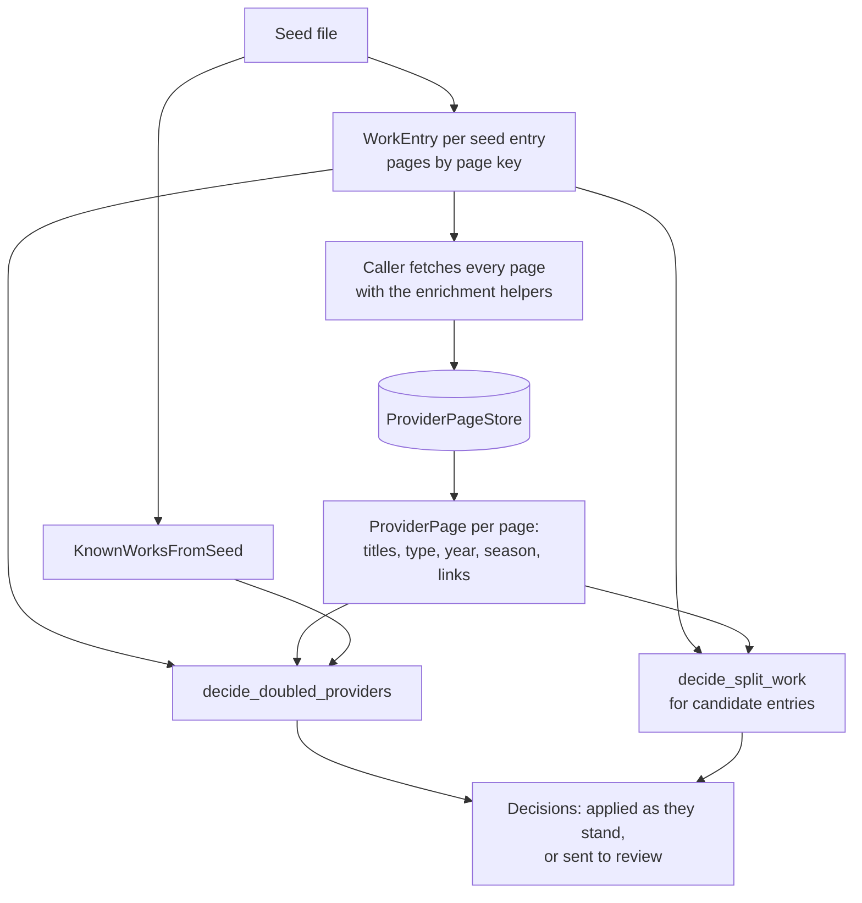
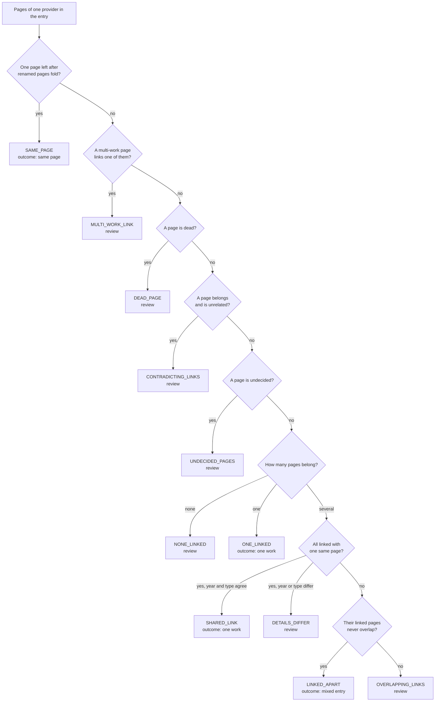

# work_matching

Decides which provider pages describe the same anime work. Seed cleaning uses it
now to repair the seed; seed link filling and discovery will use it later.

The library only decides. It does not fetch pages, and it does not change the
seed: the caller fetches the pages, and seed cleaning applies the decisions. It
imports nothing from `enrichment`.

## Terms

| Term | Meaning |
| -- | -- |
| **Work** | One real anime title as a whole: a single TV season, movie, OVA or special. A sequel season is a separate work. |
| **Provider** | A site that catalogues anime: MAL, AniList, Kitsu, AniDB, Anime-Planet, AniSearch, ANN, LiveChart, Simkl, AnimeCountdown. AnimeSchedule is fetched too, but the seed does not list it. |
| **Provider page** | One page on a provider about one work, such as `https://myanimelist.net/anime/21`. |
| **Page key** | The name of a provider page, whatever the spelling of its address: `mal:anime:21` for `https://www.myanimelist.net/anime/21/One_Piece`. Pages are always compared by key. |
| **Seed** | The downloaded anime-offline-database file the enrichment pipeline starts from. |
| **Seed entry** | One row of the seed: a title, type, year, season and a list of provider pages. |
| **Work entry** | One work as this library sees it (`WorkEntry`): title, type, year, season and its pages by key. Built from a seed entry, later also from discovery. |
| **Known works** | All work entries, looked up by page key or by title, type and year (`KnownWorks`, backed by the seed in `KnownWorksFromSeed`). The seed lookup also reports pages listed in several entries and entries without pages. |
| **Linked** | Two pages are linked when either one lists the other among its links to other providers. Direction does not matter. |
| **Doubled provider** | An entry listing two or more pages of one provider. It may be one page under two addresses, one work the provider lists twice, or two works mixed into one entry. Checking tells which. |
| **Mixed entry** | An entry whose pages cover more than one work. Puu-Neko holds the pages of both "Puu-Neko" and "Puu-Neko Shougekijou". |
| **Duplicate page** | A provider having more than one page for the same work, such as Kitsu's "Yume Mitsuya" and "Yume Juuya" pages for one short. |
| **Split work** | One work spread over several seed entries, such as "CUE!" (only its ANN page) and "Cue!" (every other page). |
| **Renamed page** | A page whose address moved; the old address lands on the new one. Anime-Planet renames pages. The old and new address are one page. |
| **Found page** | A page found through another provider's page rather than listed in the seed. AnimeSchedule is looked up by MAL, AniList or AniDB id. |
| **Lookup page** | The page a found page was found through, recorded as `ProviderPage.found_by`. |
| **Dead page** | A page the provider no longer serves (`ProviderPage.dead`). |
| **Multi-work page** | A page naming two or more pages of one provider, such as an anthology page linking several MAL pages. Its links prove nothing. |
| **Review** | A decision the rules do not settle. A person (later the review agent) answers it. |

## Files

| File | Holds |
| -- | -- |
| `provider_page_key.py` | `provider_page_key`: an address to its page key. `provider_of_key`: a key's provider. |
| `work_entry.py` | `WorkEntry`, and the type and year comparisons `is_type_matching` and `is_year_matching`. |
| `comparable_title.py` | `comparable_title`: a title folded for comparison (case, punctuation, Latin accents, "2nd Season"). |
| `known_works.py`, `known_works_from_seed.py` | The `KnownWorks` interface and its seed-backed lookup. |
| `provider_page.py` | `ProviderPage`: what a provider says about one page, read from the canonical record its enrichment helper returns. |
| `provider_page_store.py` | `ProviderPageStore`: fetched pages kept in a JSON Lines file, so they outlive the 7-day HTTP cache. |
| `provider_page_links.py` | `ProviderPageLinks`: which pages of a group are linked. |
| `doubled_provider_check.py` | `decide_doubled_providers`: the decision for each doubled provider of an entry. |
| `split_work_check.py` | `decide_split_work`: whether separate entries are one split work. |

## The flow



1. **Read the seed.** Each seed entry becomes a `WorkEntry`, its pages keyed by page key. `KnownWorksFromSeed` indexes every entry by page and by title.
2. **Fetch the pages.** The caller fetches each page through the enrichment helpers, with characters and episodes off, and builds a `ProviderPage` with `ProviderPage.from_canonical_record`. AnimeSchedule is looked up through the entry's MAL page (else AniList, else AniDB) and records that page as `found_by`. Pages are kept in a `ProviderPageStore`.
3. **Link the pages.** `ProviderPageLinks` joins the pages of one entry by their links, in both directions:
   * a renamed page answers to its new key;
   * a found page counts as its lookup page, so AnimeSchedule's links count for the MAL page it was found by, and its link back to that page is ignored;
   * the links of a multi-work page are set aside.
4. **Decide.** `decide_doubled_providers` decides each doubled provider of an entry, and `decide_split_work` decides whether candidate entries are one work.

Only links decide. A page's title, year, type, season and release date never
decide: a provider listing one work twice gives the two pages different titles
("Ankeeto" and "The Question" on Anime-Planet), and picking one by title drops
the other. These details are recorded on review cases to help the reviewer.

## Deciding a doubled provider

Each page of the provider first gets one of three answers:

| Page | Means |
| -- | -- |
| **Belongs** | It is linked with another provider's page of the entry. |
| **Unrelated** | It links a page outside the entry: a page of a provider the entry already has, or a page of another known work. |
| **Undecided** | Neither. This includes pages of providers that are not fetched (ANN, LiveChart, Simkl, AnimeCountdown) when no fetched page links them. |

A dead page or a link from a multi-work page sends the whole provider to review
before any links are read: a page that cannot be read, or a link that proves
nothing, could change which pages belong, so none of them is decided.

The checks then run in this order, and the first that applies gives the reason:



### Reasons

| Reason | Outcome | Means | Example |
| -- | -- | -- | -- |
| `SAME_PAGE` | same page | The addresses name one page: an old Anime-Planet address and the renamed page it lands on. Keep the current address. | Cocoon: `cocoon-aru-natsu-no-shoujo-tachi-yori` lands on `cocoon-one-summer-of-girlhood`. |
| `ONE_LINKED` | one work | One page belongs; every other page links another work. The others leave the entry and, when that work is a known seed entry, move to it. | Buriki no Dance: Kitsu 48612 belongs; Kitsu 51023 links MAL 64943, the "Buriki no Dance (2026)" entry. |
| `SHARED_LINK` | one work | Several pages belong, all linked with one same page, and their years and types agree. The provider lists the work twice, or splits what another provider files as one. All belong. | Ao Haru Ride OVA: AniList 20837 and 20900 both link MAL 24151. |
| `LINKED_APART` | mixed entry | Several pages belong, linked with separate pages that never overlap. Each page is a separate work, together with the pages linked with it. | Puu-Neko: MAL 10459 goes with AniList 10459 and Kitsu 6190; MAL 11589 with AniList 11589 and Kitsu 6543. |
| `MULTI_WORK_LINK` | review | A page that names several pages of one provider links these pages, so its links prove nothing. | An AnimeSchedule page found by MAL 37135 that links MAL 55706 (Islay). |
| `DEAD_PAGE` | review | A page is no longer served. | |
| `CONTRADICTING_LINKS` | review | A page is linked with the entry and also links another work. | |
| `UNDECIDED_PAGES` | review | A page has no links either way. Most review cases are this: ANN, LiveChart, Simkl, AnimeCountdown and Anime-Planet pages are rarely linked. | Ao Haru Ride OVA: Anime-Planet's "Unwritten" page. |
| `DETAILS_DIFFER` | review | Pages share a linked page but their year or type differ, so a link may be a provider's mistake. | Pocari Sweat: Kitsu's 2019 ad and 2020 ad both link AniList 139182. |
| `OVERLAPPING_LINKS` | review | Pages share some linked pages but none is linked with all of them. | |
| `NONE_LINKED` | review | Every page links another work; none is linked with the entry. | |

Simkl and AnimeCountdown number a work the same, so their pages are decided
together, under the provider name `simkl`. A Simkl page and an AnimeCountdown
page with different numbers count as a doubling.

### Decision fields

`decide_doubled_providers` returns one `DoubledProviderDecision` per doubled
provider:

| Field | Holds |
| -- | -- |
| `provider` | The provider decided; `simkl` for Simkl and AnimeCountdown together. |
| `pages` | The provider's page keys in the entry, renamed pages folded into their current key. |
| `reason` | The `Reason` above. |
| `outcome` | The `Outcome` the reason gives: `SAME_PAGE`, `ONE_WORK`, `MIXED_ENTRY` or `REVIEW`. Everything but `REVIEW` can be applied as it stands. |
| `belonging` | Each page that belongs, with the entry's pages linked with it. On a mixed entry these sets show which pages go together. |
| `unrelated` | Each unrelated page, as an `UnrelatedPage`: its `links` naming the other work, and `other_works`, the known works those links belong to. |
| `undecided` | The pages with no links either way. |
| `title_matches` | On review only: the pages whose main title matches the entry's title or the main title of one of its other pages. |
| `year_type_matches` | On review only: the pages whose year and type agree with the entry's. |
| `season_matches` | On review only: the pages in the entry's season. |

`belonging`, `unrelated` and `undecided` are filled for every reason except
`SAME_PAGE`. On a review they show what the links say, even when a check that
runs first, such as `DEAD_PAGE`, decided the reason.

The three match fields are hints for the reviewer, never the answer: a provider
listing one work twice gives the two pages different titles, so a title match
can point at one page and leave out the other.

### Worked examples

Keys are written short: `mal:1` for `mal:anime:1`. An arrow means "lists a link
to"; links count both ways. A page missing from a table lists no links.

**1. A mixed entry.** One entry holds two MAL pages, two AniList pages and a Kitsu page.

| Page | Links |
| -- | -- |
| `anilist:1` | → `mal:1` |
| `anilist:2` | → `mal:2` |
| `kitsu:1` | → `mal:1`, `anilist:1` |

For MAL: no page is renamed, no multi-work or dead page, so each page gets its
answer. `mal:1` is linked with `anilist:1` and `kitsu:1`; `mal:2` with
`anilist:2`. Both belong. They share no linked page, and their linked pages
never overlap, so the reason is `LINKED_APART`: a **mixed entry**. AniList comes
out the same way.

```text
provider   reason        outcome      belonging
mal        LINKED_APART  MIXED_ENTRY  mal:1 -> {anilist:1, kitsu:1}
                                      mal:2 -> {anilist:2}
anilist    LINKED_APART  MIXED_ENTRY  anilist:1 -> {kitsu:1, mal:1}
                                      anilist:2 -> {mal:2}
```

The `belonging` sets show the two works: `mal:1`, `anilist:1` and `kitsu:1`
are one; `mal:2` and `anilist:2` the other.

**2. One provider settled, another sent to review.** The entry holds `mal:3`,
two Kitsu pages and two Anime-Planet pages. Another known work has `mal:9`.

| Page | Links | Title, type, year |
| -- | -- | -- |
| `kitsu:3` | → `mal:3` | |
| `kitsu:4` | → `mal:9` | |
| `animeplanet:example` | none | Example, TV, 2020 (as the entry) |
| `animeplanet:example-movie` | none | Example Movie, MOVIE, 2020 |

For Kitsu: `kitsu:3` belongs. `kitsu:4` links `mal:9`, a MAL page the entry
does not have, so it is unrelated, and `mal:9` belongs to the known work "Other
Example". One page belongs and the other links elsewhere: `ONE_LINKED`, **one
work**. `kitsu:4` can move to "Other Example".

For Anime-Planet: neither page has links either way, so both are undecided and
the reason is `UNDECIDED_PAGES`: **review**. The match fields point the
reviewer at `animeplanet:example`, but do not decide.

```text
provider     reason           outcome   result
kitsu        ONE_LINKED       ONE_WORK  belonging: kitsu:3 -> {mal:3}
                                        unrelated: kitsu:4 -> links {mal:9}, other work "Other Example"
animeplanet  UNDECIDED_PAGES  REVIEW    undecided: animeplanet:example, animeplanet:example-movie
                                        title_matches: animeplanet:example
                                        year_type_matches: animeplanet:example
```

**3. Two pages linked with one same page.** The entry holds `mal:5`, `anilist:5`
and `anilist:6`, and both AniList pages link `mal:5`.

* Both pages are TV from 2020: they share a linked page and their year and type
  agree, so the reason is `SHARED_LINK`, **one work**. AniList lists the work
  twice, or splits what MAL files as one; both pages belong.
* `anilist:6` is from 2021 instead: they still share `mal:5`, but the year
  differs, so one link may be a provider's mistake. The reason is
  `DETAILS_DIFFER`: **review**.

## Deciding a split work

`decide_split_work` takes candidate entries, such as entries sharing a title,
and returns a `SplitWorkDecision`. The entries are one work only when links tie
every entry to the others and their types and years agree; `UNKNOWN` and a
missing year agree with anything. The checks run in this order:

| Reason | One work? | Means |
| -- | -- | -- |
| `TOO_FEW_ENTRIES` | no | Fewer than two entries, so there is nothing to join. |
| `NOT_LINKED` | no | Links do not tie every entry together. |
| `TYPE_DIFFERS` | no | The entries' types differ. |
| `YEAR_DIFFERS` | no | The entries' years differ. |
| `LINKED` | yes | Links tie every entry together and type and year agree. |

Every reason but `LINKED` goes to review. A shared title alone is never enough:
remakes, music videos and short films reuse titles.

## Use

```python
from work_matching import (
    KnownWorksFromSeed,
    Outcome,
    ProviderPageStore,
    decide_doubled_providers,
)

known_works = KnownWorksFromSeed.from_file("assets/seed_data/anime-offline-database.json")
store = ProviderPageStore("data/seed_cleaning/provider_pages.jsonl")

entry = known_works.find_by_page_key("mal:anime:10459")
pages = [page for key in entry.pages if (page := store.get_page(key))]
for decision in decide_doubled_providers(entry, pages, known_works):
    if decision.outcome is Outcome.REVIEW:
        print(decision.provider, decision.reason, decision.undecided)
```

Pass the found pages too (such as the entry's AnimeSchedule pages): their links
count for the page they were found through.
