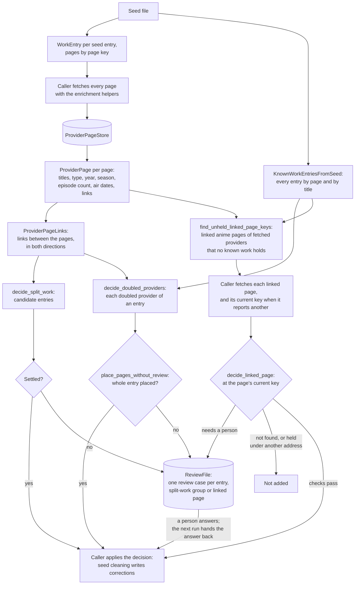
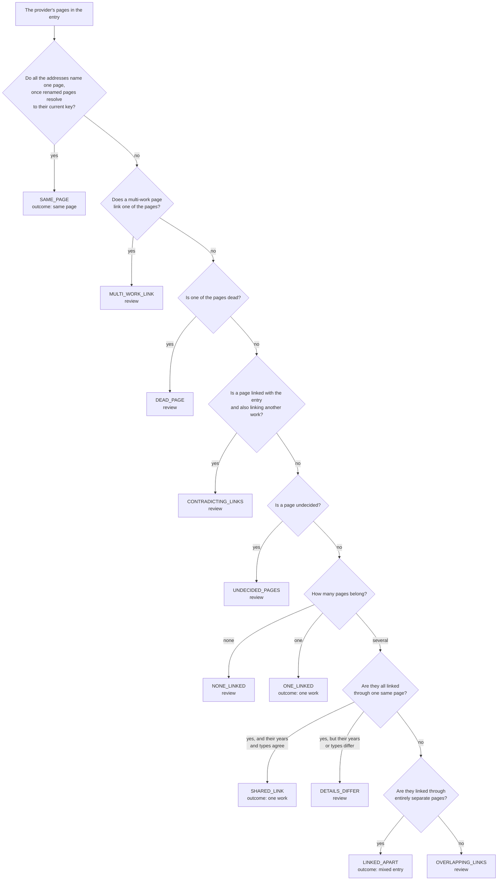
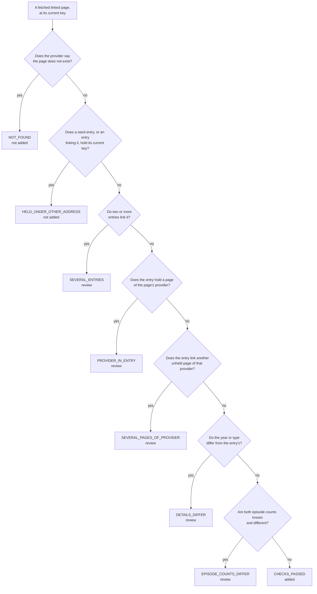

# work_matching

Decides which provider pages describe the same anime work. Seed cleaning uses it
now to repair the seed; seed link filling and discovery will use it later.

The library only decides. It does not fetch pages and does not change the seed:
the caller fetches the pages, and seed cleaning turns the decisions into
corrections. It imports nothing from `enrichment`, so it can outlive the seed.

It answers three questions, each from the links between provider pages:

1. **Doubled provider:** an entry lists two or more pages of one provider.
   Which of them belong to the entry's work?
2. **Split work:** several entries look like one work. Are they?
3. **Linked page:** an entry's pages link a page no known work holds. Should
   it join the entry?

Whatever the rules cannot settle becomes a review case, answered by a person
(later the review agent); the answer is kept and applied on every later run.

## Terms

| Term                 | Meaning                                                                                                                                                                                                                                                                                       |
| -------------------- | --------------------------------------------------------------------------------------------------------------------------------------------------------------------------------------------------------------------------------------------------------------------------------------------- |
| **Work**             | One real anime title as a whole: a single TV season, movie, OVA or special. A sequel season is a separate work.                                                                                                                                                                               |
| **Provider**         | A site that catalogues anime: MAL, AniList, Kitsu, AniDB, Anime-Planet, AniSearch, ANN, LiveChart, Simkl, AnimeCountdown. AnimeSchedule is fetched too, but the seed does not list it.                                                                                                        |
| **Provider page**    | One page on a provider about one work, such as `https://myanimelist.net/anime/21`.                                                                                                                                                                                                            |
| **Page** | Short for provider page. In code, `page` always holds a page's fetched details (`ProviderPage`) and `page_key` holds its key. |
| **Address** | The URL of a provider page. One page can have several addresses: an old address that redirects, or another spelling such as a Kitsu slug for a page the seed lists by number. |
| **Page key**         | The name of a provider page, whatever the spelling of its address: `mal:anime:21` for `https://www.myanimelist.net/anime/21/One_Piece`. It is `provider:kind:id`, where the kind is `anime` or `manga`. Pages are always compared by key.                                                     |
| **Current key**      | The key a page is found under now. A renamed page, or a page reached by another spelling (a Kitsu slug for a page the seed lists by number), has another current key, which only fetching the page shows (`ProviderPage.current_key`).                                                        |
| **Seed**             | The downloaded anime-offline-database file the enrichment pipeline starts from.                                                                                                                                                                                                               |
| **Seed entry**       | One row of the seed: a title, type, year, season and a list of provider pages.                                                                                                                                                                                                                |
| **Work entry**       | One work as this library sees it (`WorkEntry`): title, type, year, season and its page addresses by page key (`addresses_by_page_key`). Built from a seed entry, later also from discovery.                                                                                                                                           |
| **Reference page**   | The page that names an entry across seed releases: its most trusted page, MAL first, then AniList, AniDB, Kitsu, Anime-Planet, AniSearch, ANN, LiveChart, Simkl, AnimeCountdown (`REFERENCE_ORDER`). An entry's position in the seed file changes every release; its reference page does not. |
| **Known work entries** | All work entries, looked up by page key or by title, type and year (`KnownWorkEntries`, backed by the seed in `KnownWorkEntriesFromSeed`). The seed lookup also reports page keys listed in several entries and the titles of entries without pages.                                                                        |
| **Held** | An entry holds a page when the entry lists the page among its pages. A known work holds a page when the work's entry does. |
| **Link** | A page key one page lists for another provider's page (`ProviderPage.linked_page_keys`), read from the fetched record's `sources` and `external_sources`. A page's own provider is not a link (a second page of that provider is the page's new address, `renamed_to`), and neither are shared websites or unrecognised addresses. |
| **Linked** | Two pages are linked when either one lists the other among its links. Direction does not matter. Links from a multi-work page, and a searched page's link back to the page it was searched by, are ignored. |
| **Doubled provider** | An entry listing two or more pages of one provider. It may be one page under two addresses, one work the provider lists twice, or two works mixed into one entry. Checking tells which.                                                                                                       |
| **Mixed entry**      | An entry whose pages cover more than one work. Puu-Neko holds the pages of both "Puu-Neko" and "Puu-Neko Shougekijou".                                                                                                                                                                        |
| **Duplicate page**   | A provider having more than one page for the same work, such as Kitsu's "Yume Mitsuya" and "Yume Juuya" pages for one short.                                                                                                                                                                  |
| **Split work**       | One work spread over several seed entries, such as "CUE!" (only its ANN page) and "Cue!" (every other page).                                                                                                                                                                                  |
| **Linked page**      | A page an entry's pages link that no known work and not the entry holds, such as a MAL page linked from an AniList page the seed lists alone.                                                                                                                                                 |
| **Main page** | The page enrichment fetches for a provider when a work keeps two or more pages of that provider. Enrichment takes the first address of each provider, so the main page is listed first. |
| **Part page**        | A page covering only part of a work, such as one season of a run MAL lists as one work. A work can hold several part pages of one provider.                                                                                                                                                   |
| **Renamed page**     | A page whose address changed; the old address redirects to the new one. Anime-Planet renames pages. The old and new address are one page.                                                                                                                                                     |
| **Searched page**    | A page the seed does not list, found by searching its provider with one of the entry's page ids. AnimeSchedule is searched by MAL, AniList or AniDB id.                                                                                                                                       |
| **Searched by**      | The pages a searched page was found with (`ProviderPage.searched_by`). Every one is kept: a searched page can be reached through pages of several entries, such as both entries of a split work.                                                                                              |
| **Dead page**        | A page the provider says does not exist (`ProviderPage.is_dead`).                                                                                                                                                                                                                             |
| **Multi-work page**  | A page naming two or more pages of one provider, such as an anthology page linking several MAL pages. Its links prove nothing.                                                                                                                                                                |
| **Review case**      | A decision the rules do not settle, written to the review file for a person (later the review agent) to answer.                                                                                                                                                                               |

## How it works



1. **Read the seed.** Each seed entry becomes a `WorkEntry`, its pages keyed by page key. `KnownWorkEntriesFromSeed` indexes every entry by page and by title.
2. **Fetch the pages.** The caller fetches each page through the enrichment helpers, with characters and episodes off, and builds a `ProviderPage` with `ProviderPage.from_canonical_record`. AnimeSchedule is searched by the entry's MAL page (else AniList, else AniDB), and its page records that page as `searched_by`. Pages are kept in a `ProviderPageStore`, so they outlive the 7-day HTTP cache.
3. **Link the pages.** `ProviderPageLinks` joins the candidate pages by their links, in both directions:
   - a renamed page resolves to its current key;
   - a searched page counts as each page it was searched by, so AnimeSchedule's links count for every such page, and its link back to that page is ignored;
   - a link to a page of the same provider proves nothing and is ignored;
   - the links of a multi-work page are set aside.
4. **Decide doubled providers and split works.** `decide_doubled_providers` decides each doubled provider of an entry, and `decide_split_work` decides whether candidate entries are one work.
5. **Place or review.** `place_pages_without_review` places every doubled page of an entry when the rules settle the whole entry, and the caller applies the places. Otherwise the entry becomes one review case in the `ReviewFile`, as does a split-work group the links do not settle.
6. **Add linked pages.** `find_unheld_linked_page_keys` lists the pages an entry's pages link that no known work holds. The caller fetches each, and its current key when the fetch reports another. `decide_linked_page` then adds the page, leaves it out, or makes a review case.
7. **Apply answers.** Once a person answers a case, the next run hands the answer back to the caller, who applies it like a decision of the rules.

**Links decide; details only stop.** A page's title, year, type, season,
episode count and air dates never decide that pages belong together: a provider
listing one work twice gives the two pages different titles ("Ankeeto" and "The
Question" on Anime-Planet), and picking one by title drops the other. Details
only stop an automatic change, such as a move or an addition whose year or type
disagrees, and they are shown on review cases to help the reviewer.

## Deciding a doubled provider

A doubled provider is a provider with two or more pages in one entry.
`decide_doubled_providers` first gives each of those pages one of three labels,
from its links alone:

| Label         | When                                                                                                                                                                                        |
| ------------- | ------------------------------------------------------------------------------------------------------------------------------------------------------------------------------------------- |
| **Belongs**   | The page is linked with a page of another provider in this entry, in either direction.                                                                                                      |
| **Unrelated** | The page links a page outside this entry that names a different work: a page of a provider this entry already has (so the two disagree), or a page of another known work.                   |
| **Undecided** | Neither: no link ties the page to this entry or to another work. Pages of providers that are not fetched (ANN, LiveChart, Simkl, AnimeCountdown) end here unless a fetched page links them. |

Before the labels count, two checks can send the whole provider to review. A
dead page has no links to read, and a link from a multi-work page does not say
which work it means; either could change which pages belong, so none of the
provider's pages is decided.

The checks run in this order, and the first that applies gives the reason:



### Reasons

| Reason                | Outcome     | What the links show                                                                                                                                                  | What happens                                                                                                                      | Example                                                                                                         |
| --------------------- | ----------- | -------------------------------------------------------------------------------------------------------------------------------------------------------------------- | --------------------------------------------------------------------------------------------------------------------------------- | --------------------------------------------------------------------------------------------------------------- |
| `SAME_PAGE`           | same page   | The addresses are one page: an old address that now leads to the page's renamed address.                                                                             | Nothing is doubled; the current address is kept.                                                                                  | Cocoon on Anime-Planet: `cocoon-aru-natsu-no-shoujo-tachi-yori` now leads to `cocoon-one-summer-of-girlhood`.   |
| `ONE_LINKED`          | one work    | Exactly one page belongs. Every other page links a different work.                                                                                                   | The linked page stays. The others leave the entry, and move to the other work's entry when that work is in the seed.              | Buriki no Dance: Kitsu 48612 belongs; Kitsu 51023 links MAL 64943, which is the "Buriki no Dance (2026)" entry. |
| `SHARED_LINK`         | one work    | Two or more pages belong, all linked through the same page of another provider, and they have the same year and type.                                                | All of them stay: the provider lists this one work more than once, or splits into parts what another provider keeps as one.       | Ao Haru Ride OVA: AniList 20837 and 20900 both link MAL 24151, which covers both episodes.                      |
| `LINKED_APART`        | mixed entry | Two or more pages belong, but each through different pages of other providers, with no page in common.                                                               | Each page is a separate work, together with the pages it is linked with; the entry mixes them and is split along the links.       | Puu-Neko: MAL 10459 goes with AniList 10459 and Kitsu 6190; MAL 11589 with AniList 11589 and Kitsu 6543.        |
| `MULTI_WORK_LINK`     | review      | A page that names two or more pages of one provider, such as an anthology, links one of these pages. Such a link does not say which work it means.                   | A person decides.                                                                                                                 | An AniDB page for an anthology that links the MAL pages of two of its parts.                                    |
| `DEAD_PAGE`           | review      | One of the pages no longer exists on the provider's site, so its links cannot be read.                                                                               | A person decides.                                                                                                                 |                                                                                                                 |
| `CONTRADICTING_LINKS` | review      | One page is linked with the entry and also links a different work, so its links disagree.                                                                            | A person decides.                                                                                                                 |                                                                                                                 |
| `UNDECIDED_PAGES`     | review      | At least one page has no link to the entry and no link to another work, so nothing says where it belongs.                                                            | A person decides. This is the most common review: ANN, LiveChart, Simkl, AnimeCountdown and Anime-Planet pages are rarely linked. | Ao Haru Ride OVA: Anime-Planet's "Unwritten" page.                                                              |
| `DETAILS_DIFFER`      | review      | The pages are linked through the same page, as for `SHARED_LINK`, but their years or types differ, so one of the links may be a provider's mistake.                  | A person decides.                                                                                                                 | Pocari Sweat: Kitsu's 2019 ad and its 2020 ad both link AniList 139182, the 2020 ad.                            |
| `OVERLAPPING_LINKS`   | review      | The pages are linked through some of the same pages, but no single page is linked with all of them, so they are neither clearly one work nor clearly separate works. | A person decides.                                                                                                                 |                                                                                                                 |
| `NONE_LINKED`         | review      | Every page links a different work and none is linked with the entry, so the entry would keep none of this provider's pages.                                          | A person decides.                                                                                                                 |                                                                                                                 |

Simkl and AnimeCountdown number a work the same, so their pages are decided
together, under the provider name `simkl`. A Simkl page and an AnimeCountdown
page with different numbers count as a doubling.

### Decision fields

`decide_doubled_providers` returns one `DoubledProviderDecision` per doubled
provider:

| Field               | Holds                                                                                                                                    |
| ------------------- | ---------------------------------------------------------------------------------------------------------------------------------------- |
| `provider`          | The provider decided; `simkl` for Simkl and AnimeCountdown together.                                                                     |
| `page_keys`         | The provider's page keys in the entry, renamed pages folded into their current key.                                                      |
| `reason`            | The `Reason` above.                                                                                                                      |
| `outcome`           | The `Outcome` the reason gives: `SAME_PAGE`, `ONE_WORK`, `MIXED_ENTRY` or `REVIEW`. Everything but `REVIEW` can be applied as it stands. |
| `belonging_page_keys`   | Each page that belongs, with the entry's pages linked with it. On a mixed entry these sets show which pages go together.                 |
| `unrelated_pages`   | Each unrelated page, as an `UnrelatedPage`: its `linked_page_keys` naming the other work, and `other_work_entries`, the known work entries those links belong to. |
| `undecided_page_keys`   | The pages with no links either way.                                                                                                      |
| `title_matches`     | On review only: the pages whose main title matches the entry's title or the main title of one of its other pages.                        |
| `year_type_matches` | On review only: the pages whose year and type agree with the entry's.                                                                    |
| `season_matches`    | On review only: the pages in the entry's season.                                                                                         |

`belonging_page_keys`, `unrelated_pages` and `undecided_page_keys` are filled for every
reason except `SAME_PAGE`. On a review they show what the links say, even when
a check that runs first, such as `DEAD_PAGE`, decided the reason.

The three match fields are hints for the reviewer, never the answer: a provider
listing one work twice gives the two pages different titles, so a title match
can point at one page and leave out the other.

### Worked examples

An arrow means "lists a link to"; links count both ways. A page missing from a
table lists no links.

**1. A mixed entry.** One entry holds two MAL pages, two AniList pages and a
Kitsu page.

| Page              | Links                              |
| ----------------- | ---------------------------------- |
| `anilist:anime:1` | → `mal:anime:1`                    |
| `anilist:anime:2` | → `mal:anime:2`                    |
| `kitsu:anime:1`   | → `mal:anime:1`, `anilist:anime:1` |

For MAL: no page is renamed, and there is no multi-work or dead page, so each
page gets its label. `mal:anime:1` is linked with `anilist:anime:1` and
`kitsu:anime:1`; `mal:anime:2` with `anilist:anime:2`. Both belong. They share
no linked page, and their linked pages never overlap, so the reason is
`LINKED_APART`: a **mixed entry**. AniList comes out the same way.

```text
provider   reason        outcome      belonging
mal        LINKED_APART  MIXED_ENTRY  mal:anime:1 -> {anilist:anime:1, kitsu:anime:1}
                                      mal:anime:2 -> {anilist:anime:2}
anilist    LINKED_APART  MIXED_ENTRY  anilist:anime:1 -> {kitsu:anime:1, mal:anime:1}
                                      anilist:anime:2 -> {mal:anime:2}
```

The `belonging_page_keys` sets show the two works: `mal:anime:1`, `anilist:anime:1`
and `kitsu:anime:1` are one; `mal:anime:2` and `anilist:anime:2` the other.

**2. One provider settled, another sent to review.** The entry holds
`mal:anime:3`, two Kitsu pages and two Anime-Planet pages. Another known work
has `mal:anime:9`.

| Page                              | Links           | Title, type, year                |
| --------------------------------- | --------------- | -------------------------------- |
| `kitsu:anime:3`                   | → `mal:anime:3` |                                  |
| `kitsu:anime:4`                   | → `mal:anime:9` |                                  |
| `animeplanet:anime:example`       | none            | Example, TV, 2020 (as the entry) |
| `animeplanet:anime:example-movie` | none            | Example Movie, MOVIE, 2020       |

For Kitsu: `kitsu:anime:3` belongs. `kitsu:anime:4` links `mal:anime:9`, a MAL
page the entry does not have, so it is unrelated, and `mal:anime:9` belongs to
the known work "Other Example". One page belongs and the other links another
work: `ONE_LINKED`, **one work**. `kitsu:anime:4` can move to "Other Example".

For Anime-Planet: neither page has links either way, so both are undecided and
the reason is `UNDECIDED_PAGES`: **review**. The match fields point the
reviewer at `animeplanet:anime:example`, but do not decide.

```text
provider     reason           outcome   result
kitsu        ONE_LINKED       ONE_WORK  belonging: kitsu:anime:3 -> {mal:anime:3}
                                        unrelated: kitsu:anime:4 -> links {mal:anime:9}, other work "Other Example"
animeplanet  UNDECIDED_PAGES  REVIEW    undecided: animeplanet:anime:example, animeplanet:anime:example-movie
                                        title_matches: animeplanet:anime:example
                                        year_type_matches: animeplanet:anime:example
```

**3. Two pages linked with one same page.** The entry holds `mal:anime:5`,
`anilist:anime:5` and `anilist:anime:6`, and both AniList pages link
`mal:anime:5`.

- Both pages are TV from 2020: they share a linked page and their year and type
  agree, so the reason is `SHARED_LINK`, **one work**. AniList lists the work
  twice, or splits what MAL files as one; both pages belong.
- If `anilist:anime:6` is from 2021, they still share `mal:anime:5`, but the
  year differs, so one link may be a provider's mistake. The reason is
  `DETAILS_DIFFER`: **review**.

## Placing an entry's pages

A decision says which of one provider's pages belong to the entry; correcting
the entry needs a place for every page. `page_placement` gives each page a
place in the words a review answer uses, so places from the rules and from
answers are applied the same way:

| Place                              | Means                                                                            | Applied as                                                                                                                                                                                                         |
| ---------------------------------- | -------------------------------------------------------------------------------- | ------------------------------------------------------------------------------------------------------------------------------------------------------------------------------------------------------------------ |
| `entry`                            | The page belongs to this entry.                                                  | It stays.                                                                                                                                                                                                          |
| `other work`                       | The page belongs to a work outside this entry.                                   | It joins the seed entry its links name when they name exactly one; otherwise it starts a new entry of its own, so two `other work` pages become two entries. Give pages of one new work the same `work N` instead. |
| `work 2`, `work 3` and so on       | The entry is mixed, and the page belongs to its second, third or later work.     | Pages with the same number form one new entry. One case covers the whole entry, so a number names the same work on every page.                                                                                     |
| `, main` after `entry` or `work N` | The page enrichment fetches when a work keeps two or more pages of one provider. | It is listed first, since enrichment takes the first address of each provider.                                                                                                                                     |

**Settled without a person.** `place_pages_without_review` places the entry only
when every decision of it is one of these:

| Decision                                                                                                                                          | Places                                                                     | Why it is enough                                                                                                     |
| ------------------------------------------------------------------------------------------------------------------------------------------------- | -------------------------------------------------------------------------- | -------------------------------------------------------------------------------------------------------------------- |
| `SAME_PAGE`, the entry listing the current address                                                                                                | The current page `entry`; the old address is dropped.                      | Both addresses are one page.                                                                                         |
| `ONE_LINKED`, each other page naming exactly one seed entry that holds no page of the same provider and whose year and type agree with the page's | The linked page `entry`, the others `other work`, joining that seed entry. | Each page has exactly one place, the move adds no doubled provider, and the page's own details do not contradict it. |

Every other entry goes to review as one case:

- a work keeping two pages of one provider (`SHARED_LINK`) needs a person to
  name its main page;
- a mixed entry (`LINKED_APART`) needs every page placed, and some pages, often
  Anime-Planet, AniSearch, LiveChart or Simkl ones, are linked with neither
  work;
- a page naming two other works has no single place;
- a page whose links name no seed entry: the seed holds every live MAL page, so
  such a link most often comes from a stale mapping to a page the provider has
  deleted, kept by a duplicate page of the entry's own work (Kitsu's "Qian
  Qiu" maps to a deleted MAL page but is the entry's "Thousand Autumns");
- a page whose year or type disagrees with the seed entry its links name: the
  mapping itself may be wrong (Kitsu maps unaired Ganbare! Kickers episodes
  from 2005 to a 1987 recap OVA);
- a renamed page whose current address the entry does not list has no address
  to keep.

**A valid answer** places every doubled page. One that splits the entry (any
`work N`) places every page of the entry, since each must go to one of the
works; otherwise a page left out stays in the entry. In each work, a provider
with two or more pages has exactly one main page, and no other page is main.
Simkl and AnimeCountdown count as two providers here: enrichment fetches
neither.

**A suggested answer** comes with each case. Pages joined by the decisions'
links form works: the work holding the most trusted page
(`rank_by_provider_trust`) is `entry`, the others `work 2`, `work 3` and so on
by trust. A work joining two pages that a decision found linked apart is left
out, since its pages are linked with both works (Puu-Neko's AniDB 8328). Pages
linked with nothing get no suggestion.

## Deciding a split work

A split work is one work spread over several seed entries. `decide_split_work`
takes candidate entries, such as entries sharing a title, and returns a
`SplitWorkDecision`. The checks run in this order, and the first that fails
gives the reason:

| Reason            | One work? | What it means                                                                                                                                                                                                                                        |
| ----------------- | --------- | ---------------------------------------------------------------------------------------------------------------------------------------------------------------------------------------------------------------------------------------------------- |
| `TOO_FEW_ENTRIES` | no        | Fewer than two entries were given, so there is nothing to join.                                                                                                                                                                                      |
| `NOT_LINKED`      | no        | Links do not connect every entry: starting from the first entry and following links between their pages, at least one entry is never reached. A page that two entries both list does not connect them, since it may be wrongly added to one of them. |
| `TYPE_DIFFERS`    | no        | Links connect every entry, but their seed types differ. `UNKNOWN` agrees with any type.                                                                                                                                                              |
| `YEAR_DIFFERS`    | no        | Links connect every entry and the types agree, but their years differ. A missing year agrees with any year.                                                                                                                                          |
| `LINKED`          | yes       | Links connect every entry, and their types and years agree: the entries are one work.                                                                                                                                                                |

Every reason but `LINKED` goes to review. A shared title alone is never enough:
remakes, music videos and short films reuse titles.

## Adding linked pages

Providers link pages the seed does not list: an AniList page names a MAL page
no seed entry holds. Most such links are stale (the provider has deleted the
page) and some are wrong mappings, so a linked page is checked before it joins
an entry.

**Finding them.** `find_unheld_linked_page_keys` lists the pages an entry's pages
link that no known work holds and the entry does not hold. It keeps only anime
pages (a manga link names source material, not a page of the work) of
providers whose pages can be fetched, so each can be checked live.

**Spellings.** A link can spell a page another way than the seed does:
AnimeSchedule links Kitsu by slug while the seed lists Kitsu by number, and
Anime-Planet renames its addresses. Only the fetched page tells its current
key, so the caller fetches the page, fetches its current key too when the page
reports another, and the page is decided at that key. The spellings of one page
count as one page.

**Deciding.** `decide_linked_page` takes the fetched page, every entry linking
it (as `LinkingEntryDetails`: the entry, its episode count, and every unheld
page it links), and the known work entries. The checks run in this order, and the
first that applies gives the reason:



| Reason                      | Outcome            | Why                                                                                                              |
| --------------------------- | ------------------ | ---------------------------------------------------------------------------------------------------------------- |
| `NOT_FOUND`                 | not added, no case | A stale link; there is no page to add.                                                                           |
| `HELD_UNDER_OTHER_ADDRESS`  | not added, no case | The page is already held, spelled another way.                                                                   |
| `SEVERAL_ENTRIES`           | review             | The page has no single entry to join.                                                                            |
| `PROVIDER_IN_ENTRY`         | review             | Adding it would make a doubled provider; it may be a part page of the entry's work.                              |
| `SEVERAL_PAGES_OF_PROVIDER` | review             | Adding each of the entry's linked pages of one provider would make a doubled provider.                           |
| `DETAILS_DIFFER`            | review             | The link may be a wrong mapping; this is the same year and type check moves use (`is_page_details_matching`).    |
| `EPISODE_COUNTS_DIFFER`     | review             | Providers divide long runs differently; a page with fewer episodes is often one season of the entry's whole run. |
| `CHECKS_PASSED`             | added              |                                                                                                                  |

The entry's episode count is the count of its most trusted page that gives one
(`get_entry_episode_count`, MAL first), because fetched pages are newer than
the seed's own count. A canonical record holds 0 when a provider gives no count
(an anime still airing or only announced), so 0 is read as unknown, and an
unknown count never stops an addition.

`decide_linked_page` returns a `LinkedPageDecision`:

| Field                 | Holds                                                                                                                         |
| --------------------- | ----------------------------------------------------------------------------------------------------------------------------- |
| `page_key`            | The page's current key, under which it is added.                                                                              |
| `reason`, `outcome`   | The `LinkedPageReason` above, and what it does: `ADD`, `REVIEW` or `SKIP`.                                                    |
| `linking_entries`     | Every entry linking the page, sorted by reference page.                                                                       |
| `entry_episode_count` | The one linking entry's episode count, shown to the reviewer; `None` when several entries link the page or no count is known. |

**Answers.** A linked page's answer maps its current key to one of:

| Answer                                                       | Means                                                                                                        |
| ------------------------------------------------------------ | ------------------------------------------------------------------------------------------------------------ |
| `add`                                                        | Add it to the one entry linking it, which must hold no page of its provider.                                 |
| `add as part`                                                | Add it as a part page of that entry's work; the entry may already hold pages of its provider.                |
| `add to <reference page>`, `add as part to <reference page>` | The same for one of the linking entries, named by reference page; needed when several entries link the page. |
| `skip`                                                       | Leave it out.                                                                                                |

The case suggests `add as part` when one entry links the page, their year and
type agree and the page lists fewer episodes.

## Review cases

Every entry the rules cannot place, every split-work group they do not settle,
and every linked page they cannot add on their own becomes a `ReviewCase`, one
JSON line in the review file. All of an entry's doubled providers are one case,
since telling which works a mixed entry holds needs all its pages at once. A
person, or later the review agent, writes the answer into the line; the next
run hands it back.

```json
{"case_name": "doubled provider: animeplanet:anime:example animeplanet:anime:example-movie in mal:anime:3",
 "answer": {"animeplanet:anime:example": "entry", "animeplanet:anime:example-movie": "other work"},
 "suggested_answer": {"animeplanet:anime:example": "entry", "mal:anime:3": "entry"},
 "reasons": ["UNDECIDED_PAGES"], "entries": {"mal:anime:3": {...}}, "decisions": [...], "pages": [...]}
```

(One line in the file; wrapped here.)

| Field              | Holds                                                                                                                                                                                                                                                                                                                                                      |
| ------------------ | ---------------------------------------------------------------------------------------------------------------------------------------------------------------------------------------------------------------------------------------------------------------------------------------------------------------------------------------------------------- |
| `case_name`        | The case's name: its kind and its sorted page keys. `doubled provider: ` with every doubled page of the entry and `in` the entry's reference page, since the answer places pages relative to that entry; `split work: ` with the entries' reference pages; or `linked page: ` with the page's current key and `from` the linking entries' reference pages. |
| `answer`           | `null` until answered.                                                                                                                                                                                                                                                                                                                                     |
| `suggested_answer` | For a doubled-provider case, the places the links point to (see "Placing an entry's pages"); for a linked page, possibly `add as part`; empty for a split work.                                                                                                                                                                                            |
| `reasons`          | Each decision's reason by name, so answers can be counted per reason even after its wording changes.                                                                                                                                                                                                                                                       |
| `entries`          | Each entry involved, by its reference page, as its `WorkEntry`: title, type, year, season and page addresses.                                                                                                                                                                                                                                                       |
| `decisions`        | Every `DoubledProviderDecision` of the entry, the one `SplitWorkDecision`, or the one `LinkedPageDecision`, as the rules made them. Sets of page keys are written sorted, so two runs give the same file.                                                                                                                                                  |
| `pages`            | The details of the entries' fetched pages and of the pages searched by them (such as AnimeSchedule), as `ProviderPage` stores them: every link and detail the decision read.                                                                                                                                                                             |

**Answers.** `accepted_answer` returns a valid answer read for the caller:

- a doubled-provider answer places pages with the words in "Placing an entry's
  pages", read into `PagePlacement`s;
- a split work's answer is `one work` or `separate works`;
- a linked page's answer is read into a `LinkedPageAddition`, or `skip` (see
  "Adding linked pages").

An answer that is not valid, such as a missing page, a misspelt word or two
main pages, leaves the case open and the text in place to correct.

**Across runs.** `ReviewFile` reads only each line's `case_name` and `answer`.
`write_cases` writes this run's cases with their kept answers, and replaces the
file in one step, so an interrupted run leaves the old file:

- a case named the same as before gets its kept answer back;
- a case whose pages changed, or whose doubled pages moved to another entry, has
  a new name, so it is asked again;
- an answer whose case did not come up is kept as written, never applied, and
  returned, so it can be reported;
- an unanswered case that did not come up is dropped.

Only `answer` is kept from a line; anything else written in it is rebuilt. An
answer that is not accepted, or a case answered on two lines, is logged as a
warning. A line that is not valid JSON stops the run, with the file and line
named, so a person's edit is never overwritten unread. Two cases with the same
name in one run raise `DuplicateCaseError`. The file is replaced through
`replace_file_lines`: written to disk next to the old one and renamed over it,
keeping its permissions; the folder is then synced, so the rename survives a
power cut. Do not edit the file while a run is writing it: an answer saved
during the run can be lost.

Applying answers is the caller's job: seed cleaning turns them into corrections.

## Files

| File                                         | Holds                                                                                                                                                                                                                                                                                                                                                                                                                                                                                              |
| -------------------------------------------- | -------------------------------------------------------------------------------------------------------------------------------------------------------------------------------------------------------------------------------------------------------------------------------------------------------------------------------------------------------------------------------------------------------------------------------------------------------------------------------------------------- |
| `provider_page_key.py`                       | `get_page_key`: an address to its page key. `build_page_address`: a page key back to an address, spelled as the seed spells it. `get_page_provider`, `get_page_kind`, `get_page_id`: the parts of a key. `rank_by_provider_trust`: how far a page's provider is trusted to name a work, in `REFERENCE_ORDER`.                                                                                                                                                                                      |
| `work_entry.py`                              | `WorkEntry`, with `reference_page` and `has_page_of_same_provider`, and the type and year comparisons `is_type_matching` and `is_year_matching`.                                                                                                                                                                                                                                                                                                                                                   |
| `comparable_title.py`                        | `fold_title_for_comparison`: a title folded for comparison (case, punctuation, Latin accents, "2nd Season").                                                                                                                                                                                                                                                                                                                                                                                       |
| `known_work_entries.py`, `known_work_entries_from_seed.py` | The `KnownWorkEntries` interface and its seed-backed lookup.                                                                                                                                                                                                                                                                                                                                                                                                                                             |
| `provider_page.py`                           | `ProviderPage`: what a provider says about one page (titles, type, year, season, episode count, air dates, linked page keys, current key), read from the canonical record its enrichment helper returns. `index_pages_by_current_key`: pages by the current key each resolves to.                                                                                                                                                                                                                             |
| `provider_page_store.py`                     | `ProviderPageStore`: fetched pages kept in a JSON Lines file. `get_entry_pages` returns an entry's pages and the pages searched by them; `has_page_searched_by` and `get_pages_searched_by` answer for searches such as AnimeSchedule's.                                                                                                                                                                                                                                                                |
| `provider_page_links.py`                     | `ProviderPageLinks`: which pages of a group are linked.                                                                                                                                                                                                                                                                                                                                                                                                                                            |
| `doubled_provider_check.py`                  | `decide_doubled_providers`: the decision for each doubled provider of an entry. `find_doubled_provider_page_keys`: an entry's doubled providers and their pages, the rule seed cleaning lists entries by. `get_decided_provider`: the provider a page's decision falls under, AnimeCountdown under Simkl. `get_seed_type`: the seed type a provider page's type falls under. `is_page_details_matching`: whether a page's year and type agree with an entry's, the check moves and linked pages share. |
| `page_placement.py`                          | `PagePlacement`: where one page of an entry with doubled providers goes. `place_pages_without_review`: the places when the rules settle the whole entry. `read_answer_placements`: an answer read into places. `suggest_page_placements`: the places the links point to, offered to a reviewer. `find_move_target`: the seed entry a page moves to, when the move is sure.                                                                                                                         |
| `split_work_check.py`                        | `decide_split_work`: whether separate entries are one split work.                                                                                                                                                                                                                                                                                                                                                                                                                                  |
| `linked_page_check.py`                       | `find_unheld_linked_page_keys`: an entry's linked pages. `get_entry_episode_count`: an entry's episode count from its most trusted page giving one. `decide_linked_page`: whether a linked page is added, reviewed or not added. `read_linked_page_answer`, `suggest_linked_page_answer`: a review answer read, and the answer offered.                                                                                                                                                                |
| `review_cases.py`                            | `ReviewCase`: one entry, split-work group or linked page left to a person, with its answer. `ReviewFile`: the review file, its answers kept across runs.                                                                                                                                                                                                                                                                                                                                           |
| `file_replacement.py`                        | `replace_file_lines`: a file's lines replaced in one step, so an interrupted run leaves the old file.                                                                                                                                                                                                                                                                                                                                                                                              |

## Use

Decide an entry's doubled providers from the stored pages. Pass the searched pages
too (`get_entry_pages` includes them): their links count for the pages they were searched by.

```python
from work_matching import (
    KnownWorkEntriesFromSeed,
    Outcome,
    ProviderPageStore,
    decide_doubled_providers,
)

known_work_entries = KnownWorkEntriesFromSeed.from_file("assets/seed_data/anime-offline-database.json")
store = ProviderPageStore("data/seed_cleaning/provider_pages.jsonl")

entry = known_work_entries.find_by_page_key("mal:anime:10459")
pages = store.get_entry_pages(entry)
for decision in decide_doubled_providers(entry, pages, known_work_entries):
    if decision.outcome is Outcome.REVIEW:
        print(decision.provider, decision.reason, decision.undecided_page_keys)
```

An entry the rules cannot place goes to the review file as one case, and its
kept answer comes back:

```python
from work_matching import ReviewCase, ReviewFile, place_pages_without_review

review = ReviewFile("data/seed_cleaning/review.jsonl")
decisions = decide_doubled_providers(entry, pages, known_work_entries)
placements = place_pages_without_review(entry, decisions, pages)
if placements is None:
    case = review.attach_kept_answer(
        ReviewCase.from_doubled_provider_entry(entry, decisions, pages)
    )
    placements = case.accepted_answer  # None while the case is open
    unused = review.write_cases([case])
```

Decide the linked pages of one entry, once they are fetched into the store:

```python
from work_matching import (
    LinkedPageOutcome,
    LinkingEntryDetails,
    decide_linked_page,
    find_unheld_linked_page_keys,
    get_entry_episode_count,
)

fetched_providers = {"mal", "anilist", "kitsu", "anidb", "animeplanet", "anisearch"}
linked_page_keys = find_unheld_linked_page_keys(entry, pages, known_work_entries, fetched_providers)
entry_details = LinkingEntryDetails(
    entry, get_entry_episode_count(entry, pages), linked_page_keys
)
for linked_page_key in linked_page_keys:
    if (linked_page := store.get_page(linked_page_key)) is not None:
        decision = decide_linked_page(linked_page, [entry_details], known_work_entries)
        if decision.outcome is LinkedPageOutcome.ADD:
            print("add", decision.page_key, "to", entry.reference_page)
```
